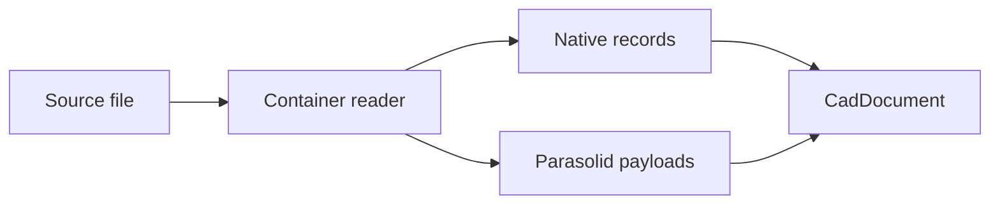

# SOLIDWORKS adapter

## Purpose and scope

Kit registers a SOLIDWORKS reader with part, assembly and drawing identifiers.
Its primary `format_id` is `solidworks.sldprt`, with reader aliases
`solidworks.sldasm` and `solidworks.slddrw`.
The generative writer uses `solidworks.sldprt` for the qualified part profiles.
Production format operations run without the vendor application.

| Identifier          | Suffix    |
| ------------------- | --------- |
| `solidworks.sldprt` | `.SLDPRT` |
| `solidworks.sldasm` | `.SLDASM` |
| `solidworks.slddrw` | `.SLDDRW` |

`available_adapters()` returns one entry for this adapter.
Read its `aliases` field to find the assembly and drawing identifiers.
The format listing reports writable extensions and aliases separately.
See [format selection](../../Tasks/SelectFormat.md) for a discovery example.

Registration is not evidence of complete feature-family support.
Inspect the exact source, target, and capability results for each conversion.

## Container and records

The container layer handles physical streams and compression.
The logical record layer interprets serialized objects and their references.
Keep these layers separate when diagnosing a failed file.

| Stream                               | Information                          |
| ------------------------------------ | ------------------------------------ |
| `Contents/Config-0-ResolvedFeatures` | Serialized feature records           |
| `Contents/Config-0-Partition`        | Cached Parasolid geometry            |
| `swXmlContents/KeyWords`             | Metadata useful for feature identity |
| `Contents/Definition`                | Native document definition records   |
| `Contents/CMgr`                      | Configuration-related records        |
| `Contents/Config-0-ModelHeader`      | Model header records                 |

The implemented container uses encoded stream names and compressed data.
A valid stream directory does not prove valid native feature records.
A valid feature record does not establish a successful vendor rebuild.

Internal archive primitives encode and decode collection counts, structural
tags, CString frames and fixed-width scalars in memory. Stream owners select
the count dialect and supply the context for object references.
[Wire primitives and verification](../../Changes/Solidworks/SolidworksArchiveWirePrimitives.md)

For ordinary version-19000 blind-cut files, the codec retains the native cut class and its affected-body and surface-reference records. The public reader binds a measured one-boss cut to its actual sketch, consumed body producer and live depth owners. The cut sketch preserves a free, radius-driven or diameter-driven circle. For the cache-free rectangular Front Plane profile, the default reader reconstructs the exact planar and cylindrical boundaries. [Typed history](../../Changes/Solidworks/Reading/Parts/SolidworksTypedBlindPocketHistory.md) [Cache-free solid](../../Changes/Solidworks/Reading/Parts/SolidworksCacheFreePocketGeometry.md)

For the measured single-stock version-19000 through-all cuts, the public reader preserves the native single or dual end selection, independent reversal, free circle, saved body scope and actual mid-plane stock driver. The neutral cut has no active length parameter. [Through-all cut history](../../Changes/Solidworks/Reading/Parts/SolidworksThroughAllCutHistory.md)

For the cache-free versions of that stock and cut on a principal datum, the default reader reconstructs one open cap or a complete tunnel. It checks the actual body producer, contour and direction before building the closed solid. [Cache-free through-all geometry](../../Changes/Solidworks/Reading/Parts/SolidworksCacheFreeThroughAllGeometry.md)

For the measured single selected stock, the normal reader also exposes the stock producer as an explicit portable body selection. It checks actual managed atom, wrapper and lineage before admitting cache-free geometry. Saved semantic reads retain the separate consumed and result atom identities. [Selected stock](../../Changes/Solidworks/Reading/Parts/SolidworksSelectedThroughAllStockRead.md)

The saved selected-stock through-all profile also exposes the exact resolved, cabinet, environment and configuration-helper owners while retaining all 28 source timeline rows. [Through-all presentation ownership](../../Changes/Solidworks/Reading/Parts/SolidworksThroughAllPresentationOwners.md)

With B-rep enabled, the ordinary saved two-stock selected through-all profile retains both independent blind bosses, the exact prior stock selection, two live D1 drivers and two distinct final solids. The active saved partition provides the geometry and its actual body owners. [Saved two-stock through-all reading](../../Changes/Solidworks/Reading/Parts/SolidworksSavedTwoStockRead.md)

The strict reader also reconstructs both solids for the admitted cache-free two-stock profile. It uses two rectangular blind stocks on the canonical Front and Right datums and the actual selected circular through cut. [Cache-free two-stock reading](../../Changes/Solidworks/Reading/Parts/SolidworksColdTwoStockRead.md)

With geometry disabled, the body summary accounts for both halves of a typed mid-plane stock extrusion. [Mid-plane stock bounds](../../Changes/Solidworks/Reading/Parts/SolidworksMidPlaneStockBounds.md)

The shared archive codec preserves an ordinary version-19000 revolve's actual axis, end specification, angular display and live parameter. A full turn and both measured partial directions re-emit the six linked streams exactly. [Typed ordinary revolve archive](../../Changes/Solidworks/Archive/SolidworksOrdinaryRevolveArchive.md)

The normal reader reconstructs a closed solid for the measured cache-free ordinary rectangular revolve. It uses the real selected sketch axis, positive angular parameter and signed sweep direction. The computed body uses its verified creator's printable ASCII name. [Cache-free revolve geometry](../../Changes/Solidworks/Reading/Parts/SolidworksCacheFreeRevolveGeometry.md) · [Derived body names](../../Changes/Solidworks/Reading/Parts/SolidworksColdRevolveNames.md)

The strict reader restores the editable D1 angle, the active thin wall parameters and the verified solid owner for the measured saved thin boss revolve. It checks the native partition and its face and edge geometry against the typed operation. [Saved thin revolve reading](../../Changes/Solidworks/Reading/Parts/SolidworksThinSavedRead.md)

The strict saved Standard sweep reader retains the Right Section, Front Path, both driving D1 parameters and the actual periodic Section seam. It checks the saved solid and signed trims in either read mode. Set `include_brep=False` to keep the validated topology and editable history without building a neutral B-rep. [Saved Standard sweep reading](../../Changes/Solidworks/Inspection/Parts/SolidworksAggregateSavedSweepRead.md)

The canonical generated cold Standard sweep exposes both editable sketch drivers and a body-owned density. Full reads compute the analytic trimmed solid from those profiles. Full and design-only neutral JSON can republish the exact measured archive with the original native locator, epoch and offline receipt. [Cold Standard sweep readback](../../Changes/Solidworks/Reading/Parts/SolidworksColdSweepReadback.md)

The default saved geometry reader also retains two independent annular bosses and their partial revolve cut when one actual stock is explicitly selected. The three D1 angles, selected construction axes and both final body names come from verified native owners. The measured cases cover canonical Front, Top and Right planes, including the direct stock wrapper and reversed cuts on Top and Right after a native rebuild and save. [Saved selected revolve cut](../../Changes/Solidworks/Reading/Parts/SolidworksSelectedRevolveCutRead.md) · [Signed principal readback](../../Changes/Solidworks/Reading/Parts/SolidworksSignedRevolveSelectionRead.md) · [Reversed readback](../../Changes/Solidworks/Reading/Parts/SolidworksReverseSelectedRevolveRead.md)

The neutral selected-stock writer accepts two independent coaxial annular stocks and a partial cut restricted to one actual stock on the canonical Top or Right plane. A cold strict SDK read restores both solids and the three editable angles without the native partition. [Selected revolve writing and cold read](../../Changes/Solidworks/Construction/Revolve/SolidworksSelectedRevolvePublic.md)

The default strict geometry read restores the exact count, spacing, seed feature and principal datum of the measured joined linear boss pattern. It joins the final body to the actual pattern and retains the saved boundary. [Saved linear pattern](../../Changes/Solidworks/Reading/Patterns/SolidworksLinearPatternRead.md)

The internal linked part archive codec also retains the finite hinge, constrained angular plane and its driving display for the measured oblique linear pattern. It reproduces the generated and native-saved streams with their owner maps. [Angular pattern archive](../../Changes/Solidworks/Archive/Patterns/SolidworksAngularPatternArchive.md)

The strict public reader also recovers the finite hinge supports and the actual angular driving parameter for the measured saved oblique pattern. The contained joined-boss cases retain the count, pitch, direction, dependencies and saved solid. [Saved angular pattern](../../Changes/Solidworks/Reading/Patterns/SolidworksAngularPatternRead.md)

The strict reader reconstructs the same contained oblique pattern when its native body cache is physically absent. The computed closed shell retains the actual pitch, count and datum ownership. The ordered canonical Top and Back annotation catalog is validated against its actual view transforms and identities. [Cache-free pattern reading](../../Changes/Solidworks/Reading/Patterns/SolidworksColdAngularPatternRead.md) · [Canonical annotation catalog](../../Changes/Solidworks/Reading/Patterns/SolidworksCanonicalPatternRead.md)

The measured oblique pattern also exposes its finite hinge and supported angular plane as portable model definitions. Both principal supports, both finite endpoints, the actual live D1 and the derived coincidence offset survive neutral JSON round trips. [Portable pattern datums](../../Changes/Solidworks/Reading/Patterns/SolidworksPortableAngularPatternDatums.md)

The part constructor generates the measured constrained angular plane and its model-owned annotation catalog from the registered hinge, angle and authored view definitions. The shared composer reproduces both measured pattern files and their four independent pitch or count variants from typed neutral inputs. The development writer route uses the same composer for strictly separated rectangular footprints contained within one plate. [Shared angular construction](../../Changes/Solidworks/Construction/Patterns/SolidworksAngularPlaneComposer.md) · [Complete scoped archive](../../Changes/Solidworks/Construction/Patterns/SolidworksSharedPatternArchive.md) · [Pattern writer scope and verification](../../Changes/Solidworks/Construction/Patterns/WriteSolidworksObliquePatterns.md)

The internal pocket composer builds a Front-plane rectangular blind boss followed by a reversed circular blind cut from neutral history. It preserves a free circle or the actual fixed-centre radius or diameter. Three disclosed designs pass 30 exact generated stream comparisons and 275 native open, edit, save and reopen checks. Held-out comparison and public admission remain open. [SDK blind pocket](../../Changes/Solidworks/Construction/SolidworksSdkBlindPocket.md)

For ordinary version-19000 parts and assemblies, the SDK decodes `Contents/CMgr` as a typed graph with its own map starting at 1. Read `metadata["solidworks.typed_configuration_manager"]` for the stored configuration names, comments, IDs, actual selected pointer identities and grammar coverage. Unsupported manager profiles report a diagnostic alongside the existing portable projection. Config, resolved-feature and mate streams retain their separate admission requirements. [Typed configuration managers](../../Changes/Solidworks/Archive/Configuration/SolidworksTypedConfigurationManager.md)

The internal ordinary part CMgr writer computes its own map from the typed configuration and actual selector aliases. The single-configuration host verification covers both states of the optional manager name and exact stream reproduction for disclosed controls. [Shared CMgr dispatch](../../Changes/Solidworks/Archive/Configuration/SolidworksSharedCmgrDispatch.md)

For the compatible ordinary part text profile, the normal reader preserves authored summary fields in `metadata["document_summary"]`, file custom text in `metadata["custom_properties"]`, and configuration custom text in that actual configuration's attributes. Require `metadata["solidworks.part_text_properties"]["status"] == "complete"` when qualifying property support. Unsupported optional properties add an information diagnostic and withhold the text projection while preserving ordinary geometry/history reads. Configuration IDs and names must match the typed manager; its binary value cache can retain earlier text after native save. The measured empty advanced owner also admits this profile, including the ordinary local import variant with an absent cut-list owner. Populated advanced properties, links and other value types remain guarded. [Local import text and names](../../Changes/Solidworks/Generation/SolidworksImportedPartSemanticInputs.md) [Empty advanced property owners](../../Changes/Solidworks/Inspection/Properties/SolidworksEmptyAdvancedPropertyRead.md) [Part text property reader](../../Changes/Solidworks/Inspection/Properties/SolidworksPartTextPropertyRead.md)

The internal local import constructor accepts explicit ambient and
directional light semantics with their actual names, coefficients and creation
times. Three disclosed parts retain this scene and their planar solids through
clean native open, rebuild, save and fresh reopen. The shared part text
serializer also preserves explicit empty summary, document and configuration
scopes through native save when selected by the neutral model. Two pre-writer
locked imports preserve these scopes and their authored lights through the
same measured geometry lifecycle with the generated native file property owner.
[Local import scene](../../Changes/Solidworks/Construction/SolidworksLocalImportScene.md)
[Empty part text scopes](../../Changes/Solidworks/Construction/Properties/SolidworksEmptyPartTextScopes.md)
[Empty file property owner](../../Changes/Solidworks/Construction/Properties/SolidworksEmptyFilePropertyOwner.md)

For the measured 2026 custom part preference, read `metadata["solidworks.typed_resolved_semantics"]["document_units"]` for millimetres, degrees, grams or kilograms, cubic millimetres and the native decimal counts for length, angle and mass. The reader requires a matching independent density length format in the document's user table. Presets and unqualified custom settings omit the optional entry. [Custom document units](../../Changes/Solidworks/Archive/SolidworksCustomDocumentUnitRead.md)

The internal origin-box planner qualifies the strict FreeCAD AdditiveBox model with its original Body shape lineage and constructs an independent native sketch and boss. FreeCAD 1.0.2 and 1.1.4 profiles retain the named body, three driving lengths, source text and custom kilograms after native edits and fresh reopens. Public export still refuses the intact documents with their retained native payloads, provenance and round-trip metadata. [Origin-box planner](../../Changes/Solidworks/Generation/Freecad/SolidworksFreecadOriginBoxPlan.md) · [Origin-box native result](../../Changes/Solidworks/Generation/Freecad/SolidworksFreecadBoxReleasePersistence.md)

The internal attached-box planner verifies the complete retained FreeCAD 0.21.2 source in memory and keeps it beside a signed Top-plane rectangle and reversed blind boss. The measured F14c candidate has all three live dimensions. The plan retains three independently selectable origin axes that the measured target omits. The earlier axis-free route omits those source axes. [Attached-box planner](../../Changes/Solidworks/Generation/Freecad/SolidworksFreecadAttachedBoxPlan.md) · [Origin datum evidence](../../Changes/Solidworks/Generation/Freecad/SolidworksAttachedBoxOriginAxes.md)

The separate F14c candidate adds all three named origin axes with their actual ordered principal plane references. The frozen part passes the controlled native edit, save and reopen lifecycle. Strict SDK reading reconstructs the cold solid, three drivers and six independently owned axis selections. [Axis candidate](../../Changes/Solidworks/Generation/Freecad/SolidworksAttachedBoxAxisCandidate.md) · [Strict readback](../../Changes/Solidworks/Reading/Parts/SolidworksColdBoxOriginAxes.md) · [Typed preparation](../../Changes/Solidworks/Generation/Freecad/SolidworksAttachedBoxAxisPreparation.md)

The measured F14c source publication route verifies the intact original and both immutable Trial02 receipts before generating output. The six host SDK stream entry points reproduce the same archive and expose source evidence alongside the native transfer report. The CLI receipt is accepted only at the physical measured Windows locator. [Exact publication contract](../../Changes/Solidworks/Generation/Freecad/SolidworksMeasuredAttachedBoxPublication.md)

For the measured ordinary single-configuration profile, `metadata["solidworks.typed_configuration_graph"]` reports the typed Config-0 stream, its inherited header aliases and map boundaries. The SDK decodes and serializes the same object graph. Twelve disclosed streams round-trip exactly with an independent CMgr context. The typed metadata preserves the strict linked-body boundary. [Typed configuration graph](../../Changes/Solidworks/Archive/Configuration/SolidworksTypedConfigurationGraph.md)

The internal version-19000 part configuration codec supports a scoped populated equation graph through the explicit `PartRelations` option. The option preserves real feature and sketch dimension handles and the side-to-relation links. The public neutral equation writer still requires its separate acceptance evidence. [Part equation configuration codec](../../Changes/Solidworks/Archive/Relations/SolidworksPartEquationConfigCodec.md)

The normal reader binds a measured local equation for one anchored Front Plane rectangular blind boss. The depth is derived from half the actual sketch width and exposes the width parameter ID and relation provenance. Strict default reading reconstructs the same prism from its proven relation graph when the native cache is absent. [Local equation read](../../Changes/Solidworks/Inspection/Relations/SolidworksLocalWidthDepthRead.md) [Strict reconstructed geometry](../../Changes/Solidworks/Inspection/Relations/SolidworksColdWidthDepthGeometry.md)

The cache-free reader also binds distinct local width, height and depth names when the actual sketch and boss own those dimensions. An independent dormant D2 is reported with its typed owner without enabling a second extrusion direction. This scope has guarded SDK readback evidence for the modeled C130 rectangle. [Named equation read](../../Changes/Solidworks/Inspection/Relations/SolidworksNamedWidthDepthRead.md) The internal composer can also attach an authored body label to that same linked equation and dormant end. [Source-owner comparison](../../Changes/Solidworks/Generation/Extrusion/SolidworksCornerEqBody.md)

For the disclosed native-saved width-depth part, the strict reader proves the selected Parasolid body belongs to the live equation's boss and matches its outward boundary. Full and design-only reads preserve the same editable history, body owner and measures. [Saved equation body](../../Changes/Solidworks/Inspection/Relations/SolidworksSavedWidthDepthBody.md)

The normal part writer accepts the anchored Front Plane rectangle and scoped derived depth with an explicit fixed origin construction point and active corner coincidence. The expression's actual dependency must select the width parameter and use the exact local `"D1@Sketch1" / 2` form with the admitted sketch's name. The internal composer binds both live handles before generating the linked archive. The disclosed native trial passes edit, save and reopen, and the normal SDK reproduces the same tested bytes. [Shared local equation constructor](../../Changes/Solidworks/Construction/SolidworksSharedWidthDepthConstruction.md) [Normal writer scope](../../Changes/Solidworks/Construction/SolidworksPublicWidthDepthWriter.md)

The internal SDK `ResolvedFeatures` codec extends the actual Config map and reads the separate CMgr context. Twelve disclosed parts and assemblies pass exact stream and object identity checks. Its research bridge passes the guarded construction regression and 42 linked comparisons, including six mate lists. [Typed resolved graph](../../Changes/Solidworks/Archive/SolidworksTypedResolvedGraph.md)

The public SDK uses matching version-19000 feature nodes for native name, class and identity. An ordinary boss gets its profile dependency and driving depths through its typed archive owners. Disclosed circle cases verify reversed blind, mid-plane and two-direction fields in the generated files and native-edited saves. [Typed public read](../../Changes/Solidworks/Archive/SolidworksTypedResolvedRead.md) [Circle end conditions](../../Changes/Solidworks/Construction/SolidworksSdkCircleEndConditions.md)

The strict part reader can reconstruct a neutral B-rep for a guarded version-19000 rectangular blind prism whose source omits the geometry-cache stream. The reader validates the complete typed feature history, plan, drivers and configuration before building the solid. Its `sldprt.brep_reconstructed` diagnostic identifies the computed geometry, and `brep_payloads` is empty. Parts with a native cache use its native payload decoder. [Typed prism reconstruction](../../Changes/Solidworks/Inspection/Parts/Geometry/SolidworksTypedPrismReconstruction.md)

The default strict reader reconstructs the four qualified circle profiles without a saved geometry cache. It validates the actual circle, fixed centre, active depths, linked support and complete ordinary graph. The Right Plane mid-plane profile retains one total depth and the reversed Top Plane two-direction profile retains both depth owners and their signed stations. The reconstruction diagnostic reports `native_kernel_identity=false`. [Blind circle geometry](../../Changes/Solidworks/Reading/Parts/SolidworksColdCircleGeometry.md) · [Mid-plane and two-direction geometry](../../Changes/Solidworks/Inspection/Extrusions/SolidworksColdCircleEndReadback.md)

For an ordinary cache-free prism with one actual output atom, the reader retains the atom's printable ASCII body name after validating its relationships and the computed B-rep. The name evidence reports `native_kernel_identity=false`. [Cache-free body names](../../Changes/Solidworks/Reading/Names/SolidworksCachelessBodyNames.md)

When the linked history proves the sole body creator of the rectangular prism, the strict reader exposes that boss as `create`. The logical body label follows its typed producer if there is no authored output atom. [Initial body creation](../../Changes/Solidworks/Reading/Parts/SolidworksColdPrismCreator.md)

For the rectangular Front-plane first boss, the strict reader preserves selected scope with zero prior bodies as `ScopedExtrusionFeature` in `first_creator` mode. This preserves its editable blind depth, profile and body creator in neutral JSON. The saved profile checks the actual partition body, output atom, rollback history and linked configuration before applying the same scope. [Cache-free first boss](../../Changes/Solidworks/Reading/Parts/SolidworksFirstCreatorScopeRead.md) · [Saved first boss](../../Changes/Solidworks/Reading/Parts/SolidworksSavedFirstCreatorScopeRead.md)

On the verified cache-backed single-solid profile, the normal part reader projects the actual native body label and sets `BrepBody.design_body_id` to the existing design body. The binding requires agreement between the active partition, the actual extrusion output atom and complete decoded topology. Check `metadata["solidworks.native_body_names"]` for the ownership result. History-only and unsupported body profiles keep their existing behavior. [Native single-solid body names](../../Changes/Solidworks/Reading/Names/SolidworksNativeBodyNames.md)

For the measured single planar local BaseBody profile, the reader binds the body to its existing design ID and preserves the native label. The actual LocalBodies group and import feature select the managed atom. Derived labels use the storage key and any agreeing kernel name, and explicitly named bodies retain their Unicode label. [Local imported-body names](../../Changes/Solidworks/Reading/Names/SolidworksLocalBodyNames.md)

The same proven local binding supplies solid, shell, face, edge and vertex counts when the ordinary payload decoder selects a complete body. [Local topology counts](../../Changes/Solidworks/Reading/Names/SolidworksLocalImportTopology.md)

An ordinary saved cylinder retains its implicit body label when the kernel attribute, actual extrusion output atom and complete cylindrical boundary agree. In the two already supported cache-free circle profiles, the label follows the actual sole producer of the computed neutral solid. The native name proof is available only on the cache-backed route. [Implicit cylinder body labels](../../Changes/Solidworks/Reading/Names/SolidworksImplicitCylinderBodyNames.md)

For the qualified Unicode case, the body label comes from the actual archive name and the agreeing implicit UTF-16 attribute owned by that body. The legacy character attribute can contain code-page substitutions. Nine disclosed source states pass the supported semantic and B-rep comparisons. [Unicode body names](../../Changes/Solidworks/Reading/Names/SolidworksUnicodeBodyNames.md)

An ordinary corner-anchored rectangle retains its four contour lines, fixed origin datum and seven sketch relations through the normal reader. The reader resolves the native point owner and indexes live lines independently of retired native rows. It preserves both sketch drivers in seven generated and disclosed native files. [Typed origin coincidence](../../Changes/Solidworks/Inspection/Profiles/SolidworksTypedOriginCoincidence.md)

The strict part reader preserves the four active edges and actual horizontal and vertical relations of the measured blind-cut stock sketches with no driving lengths. It retains the inactive rows and original slot identities in sketch metadata. The shared projection also matches six disclosed through-all source and edited saves. [Typed stock point slots](../../Changes/Solidworks/Inspection/Profiles/SolidworksTypedStockPointSlots.md)

For the admitted ordinary part, the typed public read now preserves the same 19 modeling rows through a native save and exposes the 25 measured English default-session presentation rows with their owner identities. Custom or unresolved presentation state retains the existing reader behavior. [System tree projection](../../Changes/Solidworks/Inspection/Presentation/SolidworksSystemTreeProjection.md)

For an ordinary aligned coincident, parallel or positive-distance mate between two direct part occurrences, the public assembly reader uses the complete typed MatesList graph and independently loaded child configuration. Each entity retains the actual occurrence path and child datum ID, including generated files without saved selection strings. A distance comes from its live length parameter in millimetres. Read `metadata["solidworks.typed_mates_semantics"]` for admission and grammar coverage. The supported profile has one configuration and can resolve ordered groups of these mates between two or more direct part occurrences. Wrapper identities are checked across the selected list. The ordinary native-saved child profile includes an empty sheet-metal master, typed mass caches and an empty property list. Disabling component resolution through `ReadOptions.values` also retains the legacy path. [Typed planar mate reads](../../Changes/Solidworks/Archive/SolidworksTypedPlanarMateRead.md) [Ordered planar mate groups](../../Changes/Solidworks/Archive/SolidworksPublicCombinedMates.md) [Saved child metadata](../../Changes/Solidworks/Archive/SolidworksSavedPartMetadataRead.md)

The ordinary mate reader also resolves one solved perpendicular mate between two direct occurrences of the same part. It retains the observed endpoint order, actual principal planes, one fixed occurrence and the accepted child configuration. Neutral alignment is `unknown` for the measured archive mode. [Perpendicular reader](../../Changes/Solidworks/Archive/Assembly/SolidworksPerpendicularReaderOwnership.md)

The internal MatesList codec also retains one ordinary concentric mate, including ordered cylinder selections, independent support snapshots, alignment, rotation lock and the side and cap face references. The measured native archive and planar control streams reproduce byte for byte. The internal parent constructor now builds those references from a generated child's actual kernel face, arc, caps and body atom. It reproduces both complete measured persistence and binary display pairs. [Concentric archive codec](../../Changes/Solidworks/Archive/Assembly/Groups/SolidworksConcentricSdkCodec.md) · [Concentric parent construction](../../Changes/Solidworks/Construction/Assembly/Mates/SolidworksConcentricParentModel.md)

For an admitted ordinary planar mate list with one actual flat resolved group, `CadDocument.assembly.mate_groups` retains the group name, root owner, archive provenance and ordered references to the same portable mates. Inline children, additional group owners and inconsistent membership stay outside typed admission. [Native mate group ownership](../../Changes/Solidworks/Reading/Assembly/SolidworksPlanarMateGroupOwnership.md)

The normal reader now projects the measured ordinary solved concentric profile between two rigid direct occurrences of one saved cylinder child. It binds the actual child face and body, ordered references, radius, aligned/anti-aligned intent, rotation lock and fixed occurrence. Default and metadata-only reads match the six disclosed saves. Unsupported ownership retains the guarded legacy path. Held-out reader qualification remains open. [Concentric reading scope](SolidworksConcentricReading.md) [Host validation](../../Changes/Solidworks/Reading/Mates/SolidworksPublicConcentricReading.md)

The internal concentric preparation builds its circular-boss child from the neutral sketch, actual support, radial and depth drivers, and ordered scene. The linked body atom, active partition and rollback marks reproduce both disclosed native-tested pairs within the ordinary forward Front scope. Whole-source and public publication eligibility are still open. [Child construction](../../Changes/Solidworks/Construction/Assembly/Mates/SolidworksConcentricChildModel.md)

Internal circular preparation also accepts the actual sketch and radial driver owner for an explicit three-dimensional label in the sketch frame. The normal offset changes the text position while the leader retains its tangential calculation. [Spatial radial labels](../../Changes/Solidworks/Construction/Assembly/Mates/SolidworksSpatialRadialLabels.md)

The internal concentric radial child can also generate its named appearance from the actual part, selected configuration and detached display holder. The aligned unlocked parent retains its single all-visible state. Full source and native acceptance for these composed files remain open. [Concentric child appearance](../../Changes/Solidworks/Construction/Assembly/Mates/SolidworksConcentricChildAppearance.md)

The internal concentric planner binds explicit neutral lateral faces to a verified generated feature-only cylinder child. It retains the original occurrence order, the selected endpoint order, explicit alignment, rotation lock and the fixed occurrence. Supplied B-reps remain outside this preparation profile. [Concentric mate planning](../../Changes/Solidworks/Construction/Assembly/Mates/SolidworksConcentricMatePlanning.md)

The assembly reader exposes display-state names in `CadDocument.assembly.attributes["display_states"]`. It reads `swDisplayStateName` and accepts `swName` when the display-state attribute is absent. [Display-state names](../../Changes/Solidworks/Reading/Assembly/SolidworksAssemblyDisplayStateNames.md)

For the measured SOLIDWORKS 2026 profile, `assembly.attributes["typed_display_states"]` also exposes the selected configuration, XML list and state IDs, and a single all-visible state's ordered visibility for one to three direct occurrences. Each entry binds its XML occurrence ID to its persistent feature ID. The typed view is optional for source reads. [Typed display-state reading](../../Changes/Solidworks/Research/Mates/SolidworksConcentricDisplayRead.md) · [Three-member and identity comparison](../../Changes/Solidworks/Research/Mates/SolidworksPlanarAssemblyIdentity.md)

Two opposite native-authored occurrence states are present in the saved
instance tree and VisualStates graphs. The cold open returned warning 32
with healthy controls. Both parent snapshots reference a later update stamp
than the paired child carries on disk.
[Assembly display-state authoring evidence](../../../re/solidworks/records/ConcentricDisplayAuthoring2026.md)

Saving the owned child with the matching update stamp clears warning 32
while the parent bytes and paired paths stay fixed. The cold reader verifies
both mixed visibility states through the named and active native APIs.
[Child synchronization comparison](../../../re/solidworks/records/ConcentricDisplaySync2026.md)

For the measured internal radial concentric profile, the assembly compositor can generate two mixed visibility states in the binary VisualStates owner. Its authored states bind to the actual occurrence names. The complete output matches the previously native-tested store-only parent and child. Public display-state writing remains open. [Binary display-state construction](../../Changes/Solidworks/Archive/Assembly/SolidworksAssemblyBinaryDisplayStates.md)

The same internal compositor accepts one all-visible default for the
ordinary two-occurrence concentric parent. Its binary state uses the
actual generated header, active configuration and persistent references.
[Concentric default state](../../Changes/Solidworks/Construction/Assembly/Mates/SolidworksConcentricDefaultDisplay.md)

The public writer accepts one initially satisfied principal-plane perpendicular between two direct occurrences of one owned dimensioned rectangular part. Both pre-writer locked assembly and child pairs pass the standard registry recipe, a live child depth edit, valid reorientation, synchronized save and fresh reopen. Both retain the ordered mate references, geometry and three driver values. [Perpendicular writer qualification](../../Changes/Solidworks/Archive/Assembly/Groups/SolidworksPerpendicularRegistryQualification.md)

The SDK construction layer builds complete aligned coincident and parallel plane-mate graphs from the actual registered assembly and child datum owners. Six independently generated parent and child pairs match the research composer byte for byte across all three principal axes. The SDK also constructs the complete positive driving distance graph with its dimension allocated before the mate, two actual reference pairs and its live length parameter. Six independent parent and child bundles match the reference composer across all principal axes. [Driving distance construction](../../Changes/Solidworks/Archive/SolidworksDrivingDistanceConstruction.md) [Fresh planar mate construction](../../Changes/Solidworks/Archive/SolidworksFreshPlanarMateConstruction.md)

Fresh mate construction accepts both standalone SDK Header nodes and decoded log rows. It uses the selected datum's first creation event and validates the log before allocating the mate. An independent replay preserved twelve existing parent and child bundles and passed 24 malformed-input cases. [Header epoch integration](../../Changes/Solidworks/Archive/SolidworksSdkHeaderEpochIntegration.md)

The complete SDK assembly constructor attaches two rigid occurrences to an actual generated part and an aligned coincident, parallel or positive driving distance mate. Eighteen complete inputs across the three axes pass 396 typed stream comparisons using the same child objects. [Complete assembly candidate](../../Changes/Solidworks/Archive/Assembly/SolidworksCompleteAssemblyCandidate.md)

One complete positive-distance pair preserves both native trees and the editable child depth through a 43.53 to 60.28 mm native mate edit, synchronized save and fresh reopen. The strict public reader resolves the same two typed datum links in both versions. [Native assembly lifecycle](../../Changes/Solidworks/Archive/Assembly/SolidworksSdkSingleAssemblyNativeTrial.md)

The SDK also attaches ordered coincident, distance and parallel groups to the same generated occurrences. The continuation validates each earlier mate and dimension owner against the actual allocator and header logs. Twelve mixed bundles pass across all six orderings and two rigid placement variants, with eighteen unchanged single-mate bundles. [Ordered assembly construction](../../Changes/Solidworks/Archive/Assembly/SolidworksOrderedAssemblyConstruction.md)

The internal explicit group constructor selects actual occurrence and plane endpoints from one shared generated child. Six dimensioned-child layouts with two, three and five components pass 1,740 typed stream round trips across 142 workers. Eight invalid graphs reject before output. [Explicit planar groups](../../Changes/Solidworks/Archive/Assembly/Groups/SolidworksExplicitPlanarGroups.md)

An internal planar construction option accepts an explicit stock colour resource, classic and basic shader values, and an independent part appearance allocation start for the dimensioned child. The model, selected configuration and detached self holder retain distinct ownership. The guarded host comparison keeps constructor-only output byte for byte and the public writer scope stays at the previously qualified profiles. [Named planar child renderer](../../Changes/Solidworks/Construction/Assembly/SolidworksPlanarRendererComposition.md)

A disclosed three-component group with six ordered mates passes a native driving edit, synchronized save and fresh reopen. The normal SDK reads all twelve datum endpoints and all three child drivers from the generated and saved states. The 26 scoped parent and child streams round-trip exactly. [Native explicit group verification](../../Changes/Solidworks/Archive/Assembly/Groups/SolidworksExplicitPlanarGroupNative.md)

The cold version-19000 parallel, distance and coincident assembly reader follows
both occurrences to their actual shared part. It reads all six datum selections,
the fixed occurrence and the live driving D1. Full reads derive the child solid.
Use `include_brep=False` for the same mate graph without child B-rep, or set
`resolve_components=False` to defer the linked mates. This scope is read-only.
[Cold rotated mate reading](../../Changes/Solidworks/Reading/Assembly/SolidworksColdRotatedMateRead.md)

Both pre-writer locked assemblies also pass the internal SDK comparison for
one aligned coincident or parallel mate paired with a positive driving
distance. The two or three direct occurrences of one dimensioned child
retain the complete measured native trees and actual datum ownership.
The two distance edits pass synchronized save and fresh reopen.
[Original planar groups](../../Changes/Solidworks/Archive/Assembly/Groups/SolidworksOriginalPlanarMateNative.md)

An explicitly supplied writer registry also builds the parent and shared
child from a portable document. A disclosed ordered distance, coincident and
parallel group passes four native processes, a 42 to 57.73 mm driving edit,
child-first save, and fresh reopen. Kit preserves all six mate endpoints and
26 scoped archive streams.
[Portable registry native trial](../../Changes/Solidworks/Archive/Assembly/Groups/SolidworksPortableAssemblyRegistryNative.md)

The normal writer accepts this bounded assembly profile through an
`.SLDASM` filesystem destination and generates its shared child beside it.
It supports aligned coincident, parallel and positive driving distance groups
with two or three direct occurrences. It also supports one initially satisfied
perpendicular with two direct occurrences. All mate endpoints are principal
planes. [Assembly writing profile](SolidworksAssemblyWriting.md)

The internal recursive composer attaches actual generated part and subassembly targets to fully resolved rigid occurrences. It derives expanded activity and world bounds from the dependency graph. A three-definition hierarchy and four-definition repeated hierarchy pass 156 typed stream comparisons. Thirty earlier single- and ordered-mate bundles retain exact bytes. [Generated assembly targets](../../Changes/Solidworks/Archive/Assembly/SolidworksGeneratedAssemblyTargets.md)

The strict reader resolves mirrored captions and owner-local placement order on the measured ordinary 2026 nested index. It requires the complete linked physical file keys, selected configurations and local feature references. Deferred and incomplete component resolution retains the indexed values. [Nested ownership readback](../../Changes/Solidworks/Reading/Assembly/SolidworksNestedIndexOwnerReadback.md)

The SDK reads and writes the complete ordinary 2026 part and assembly Definition stream. The constructors accept explicit presentation settings, part density and assembly save-as-part preferences. All 84 disclosed native Definitions retain their exact bytes and archive map. The research document composers use the same writer. [Model Definition codec](../../Changes/Solidworks/Construction/SolidworksModelDefinitionCodec.md)

The internal SDK construction layer can build the ordinary blind boss's typed length and angle parameter nodes and the complete end specification. It takes the allocated display and dimension owners and retains the caller's from-end identity. Two fresh generated topologies passed exact stream composition and memory readback. The profile, history and file-level construction remain separate requirements for writing. [Blind end construction](../../Changes/Solidworks/Construction/SolidworksBlindEndConstruction.md)

The SDK constructs the local sketch graph for an ordinary closed polygon from ordered vertices and an allocated profile. It derives point, line, and incident-handle identities and preserves the actual model and support references in linked stream readback. This profile covers unconstrained rings. [Polygon geometry construction](../../Changes/Solidworks/Construction/SolidworksPolygonGeometryConstruction.md) The SDK can also initialize the ordinary part's own model, self-component and relation manager with its allocated IDs. The system factory attaches actual configuration owners, system folders, principal planes and the fixed origin. Two neutral designs preserve five complete archive streams and their map aliases in fresh processes. Body geometry and the normal writer require additional construction. [Part root construction](../../Changes/Solidworks/Construction/SolidworksPartRootConstruction.md) [Part system construction](../../Changes/Solidworks/Construction/SolidworksPartSystemConstruction.md)

The internal SDK part composer builds the full ten-stream container for one neutral rectangular sketch and a forward blind boss. It supplies the actual configuration, model and manager header nodes to linked-document builders. Two independent inputs preserve every stream through the typed prepare path and a separate mathematical comparison. One disclosed candidate passes native open, rebuild, depth edit, save and fresh reopen with all 25 native rows. [Complete blind-boss construction](../../Changes/Solidworks/Construction/SolidworksBlindPartConstruction.md) [Native lifecycle](../../Changes/Solidworks/Construction/SolidworksSdkBlindPartNativeTrial.md)

Two standalone parts also pass the same native lifecycle from a UNC location outside the encoded self drive. The Unicode-named case has an absent archived self path. [Standalone relocation](../../Changes/Solidworks/Construction/SolidworksStandalonePartRelocation.md)

The internal preparation boundary uses normal write options and the final destination with an explicit construction recipe. A qualified standalone POSIX path retains the neutral basename in the measured Windows self locator. Staging and a caller-owned stream preserve the same bytes. [Write preparation](../../Changes/Solidworks/Construction/SolidworksPlainPartPreparation.md) [Standalone host preparation](../../Changes/Solidworks/Construction/SolidworksStandaloneHostPreparation.md)

A separate SDK constructor admits a simple closed line loop for the ordinary forward blind boss. A triangle and a concave polygon generate ten streams each, and both original rectangle containers remain byte-identical. The three original native polygon sources match the generated trees and geometry and pass edits and fresh reopen. [Complete polygon part](../../Changes/Solidworks/Construction/SolidworksSdkPolygonBlindPart.md) [Original polygon qualification](../../Changes/Solidworks/Construction/SolidworksSdkOriginalPolygonQualification.md)

The circle constructor generates a complete fixed-centre circle boss with an editable radius or diameter and independent blind depth. Both disclosed files pass first-load body checks, edit, save and fresh reopen in SOLIDWORKS 2026 SP05.2. [Circle boss construction](../../Changes/Solidworks/Construction/SolidworksSdkCircleBoss.md)

The original Front-plane forward diameter and Top-plane reversed radius
parts now pass the internal SDK held-out comparison. Both source and
generated files preserve 25 ordered native tree rows, actual radial and
depth drivers, topology and geometry across native edits, saves and
fresh reopen. The 16 strict normal SDK reads retain all scoped owners.
[Original circle qualification](../../Changes/Solidworks/Inspection/Profiles/SolidworksOriginalCircleNative.md)

The internal circle composer also applies the actual Front, Right or Top support and either reversed blind, total mid-plane or two independent blind ends. Four disclosed files pass 40 complete stream comparisons and 530 native geometry and edit checks. Their original generated, first-save and edited states retain the radial and depth drivers through the public reader. [Circle end measurements](../../Changes/Solidworks/Construction/SolidworksSdkCircleEndConditions.md)

The internal through-all composer generates one free circular cut within a finite mid-plane rectangular stock. All three principal-plane candidates pass exact linked reads. All three candidates pass native rebuild, stock depth edits, saves and fresh reopens. The internal preparation entry also derives those inputs from actual neutral feature and sketch records. The measured all-body route preserves the real stock driver and cut direction. [Neutral preparation](../../Changes/Solidworks/Generation/Extrusion/ThroughAll/SolidworksNeutralThroughAllPreparation.md) [Through-all construction](../../Changes/Solidworks/Generation/Extrusion/ThroughAll/SolidworksThroughAllColdConstruction.md) [Native Front lifecycle](../../Changes/Solidworks/Generation/Extrusion/ThroughAll/SolidworksThroughAllCutNativeValidation.md)

The internal selected-stock constructor builds the actual atom, manager membership, unit component and wrapper for one explicit stock body. Three selected candidates pass isolated typed readback, and the Front artifact matches the native-tested input byte for byte. [Selected-stock SDK constructor](../../Changes/Solidworks/Generation/Extrusion/ThroughAll/SolidworksSelectedStockSdk.md)

The internal neutral entry also takes one explicit portable stock selection on the actual cut. It derives scope from the feature/body path and rejects selections with unrepresented targets or query semantics. Four selected models pass guarded builds and strict default reads. [Neutral selected-stock construction](../../Changes/Solidworks/Generation/Extrusion/ThroughAll/SolidworksNeutralSelectedThroughAll.md)

The ordinary `.SLDPRT` writer also admits two independent fixed Front and Right rectangular blind stocks with editable D1s and a free circular through cut explicitly scoped to the Front stock. Two pre-writer locked native sources match the generated tree and geometry across edits, save and fresh reopen. The qualified path and binary stream routes use the same frozen preparer. [Two-stock writer](../../Changes/Solidworks/Generation/Extrusion/ThroughAll/SolidworksSelectedTwoStockWriter.md)

For this internal selected-stock profile, the composer emits a null inactive secondary display on the forward mid-plane stock. The strict cold reader binds the live D1, the selected stock atom and the cut before reconstructing the solid. The disclosed normal SDK output matches the native-tested archive byte for byte. [Selected-stock depth ownership](../../Changes/Solidworks/Construction/Parts/SolidworksMidPlaneStockSecondary.md)

The internal ordinary revolve entry builds from one Front rectangle, the actual selected construction axis and a live radian driver. The final pathname is bound before generation. All four generated containers match the native-tested files byte for byte. [Ordinary revolve preparation](../../Changes/Solidworks/Construction/Revolve/SolidworksRevolvePreparation.md)

The internal SDK rectangle composer also owns two driving sketch dimensions and four horizontal or vertical relations. Two independent neutral requests preserve all ten streams, real point and segment handles, displays and parameter ownership through typed preparation. [Rectangle driving dimensions](../../Changes/Solidworks/Construction/SolidworksRectangleDrivingDimensions.md)

The internal part composer can generate summary, document and active-configuration text properties through separate native XML owners. A triangle and a circle preserve independently edited values in both custom scopes through native save and fresh reopen. [Part text properties](../../Changes/Solidworks/Construction/Properties/SolidworksPartTextProperties.md)

The internal corner-anchored rectangle keeps the actual native origin coincidence through independent edits of both sketch lengths and the boss depth. All three native saves reopen with a fully constrained sketch and one solid, across eight processes and 255 numerical comparisons. [Native origin-anchored rectangle](../../Changes/Solidworks/Inspection/Profiles/SolidworksSdkCornerNativeEdits.md)

The typed archive graph allocates class descriptors and objects in one
map. Its stream readers validate reference kinds and retain shared object
identity when the next stream inherits a snapshot. Body callbacks provide
the fields for each stream and class.
[Object maps and verification](../../Changes/Solidworks/SolidworksArchiveObjectMaps.md)

The internal ordinary part Definition codec uses an independent object map.
It reads saved presentation fields and constructs the stream from explicit part settings.
[Part Definition scope and evidence](../../Changes/Solidworks/Archive/SolidworksOrdinaryPartDefinition.md)

The saved part view reader projects the version-19000 document orientation
and pan/zoom transforms from the complete Definition. It retains native
coefficients and scalar values. Per-user window selection is a separate
presentation owner.
[Saved part view inspection](../../Changes/Solidworks/Inspection/Presentation/SolidworksSavedPartView.md)

The standalone header codec uses independent maps for `Header2` and
`Contents/Config-0-ModelHeader` in the ordinary version-19000 profile.
Its typed records retain file references, revision logs and bounds for
reconstruction.
[Standalone header scope](../../Changes/Solidworks/SolidworksStandaloneHeaders.md)

The internal ordinary assembly Definition codec uses the same independent
archive framing and a distinct assembly root. It preserves the measured
saved preferences and constructs fresh save-as-part settings from ten
explicit native preference values.
[Assembly Definition scope](../../Changes/Solidworks/Archive/Assembly/SolidworksAssemblyDefinitionCodec.md)

Internal body callbacks handle scalars, canonical CString frames and
object links in the same graph and counted row scopes. Individual
stream layouts define the order and meaning of those fields.
Inherited body links require the concrete objects from the prior map.
[Body value scope](../../Changes/Solidworks/Archive/SolidworksArchiveBodyValues.md)

The current configuration directory codec reads and constructs
`Contents/CMgrHdr2` from a typed manager and its configuration rows.
Its archive map starts at one, independently of the full `CMgr` stream.
[Configuration directory scope](../../Changes/Solidworks/Archive/Configuration/SolidworksConfigurationDirectory.md)

The internal part header constructor takes the allocated part,
its actual selected configuration and explicit save provenance.
It builds both standalone header roles and the configuration
directory. Each stream uses its own archive map.
[Fresh part header scope](../../Changes/Solidworks/Archive/SolidworksFreshPartHeaders.md)

The internal unit-table codec reads one complete ordinary version-19000
`moUnitsTable_c` object using its caller's archive map snapshot. It keeps
inherited unit fields, the optional length override and the class slots
needed by subsequent records. Its scope is the bounded unit-table record.
Reading the full `Config-0` body requires additional native owners.
[Configuration unit-table scope](../../Changes/Solidworks/Archive/Configuration/SolidworksConfigUnitTables.md)

The bounded configuration member reader handles the ordinary relation
record and empty or absent feature color ownership. Stored length words
remain available alongside the decoded rows. The record owner supplies
the expected descriptor and the live archive map snapshot.
[Configuration member scope](../../Changes/Solidworks/Archive/Configuration/SolidworksConfigMemberFields.md)

The bounded member reader also handles absent or empty sketch block and
part exploded view managers. Their feature base selects branches and
concrete virtual targets. The sketch map backlink retains the newly
allocated manager's identity.
[Configuration field action scope](../../Changes/Solidworks/Archive/Configuration/SolidworksConfigFieldActions.md)

The bounded configuration member reader also handles the ordinary view
record with compact transforms and empty presentation lists. Context
changes govern both optional list windows in the same archive.
[Configuration view scope](../../Changes/Solidworks/Archive/Configuration/SolidworksConfigViewRecords.md)

The same member reader accepts a concrete partition mark and an absent
or empty thread reference manager. The archive slot and kernel mark ID
remain separate. A present thread manager retains the signed wire word
and its runtime Boolean.
[Thread and mark record scope](../../Changes/Solidworks/Archive/Configuration/SolidworksConfigThreadMarks.md)

The bounded lightweight material reader handles the part hatch, optional
density parameter, model data with an absent scene and empty body visual
counts. Each concrete owner retains its actual archive slot.
[Lightweight material scope](../../Changes/Solidworks/Archive/Configuration/SolidworksConfigMaterialOwners.md)

The ordinary assigned-material reader links the selected design body to a
`MaterialRecord` with the verified name and density in kg/m³. Both strict
read modes join the active partition atom and producing feature to Config-0,
CMgr and the material XML. The body attribute
`solidworks.assigned_part_material` retains the native owners.
Unresolved assignments, appearance and complete catalog properties prevent native
publication. The material color stays unset until effective display evidence
qualifies it.
[Assigned material archive inspection](../../Changes/Solidworks/Inspection/Materials/SolidworksAssignedMaterialRead.md)

The internal part-start reader loads the named
`Contents/Config-0-ModelHeader` and the current part root. At the start
of the lightweight section, it inserts the original header objects
into the part's map while preserving their standalone identities.
The self file comes first, followed by the directory entries in
stored order. This reader requires physical format 4 and logical
archive version 19000.
Complete configuration admission requires the remaining model body.
[Configuration header link scope](../../Changes/Solidworks/Archive/Configuration/SolidworksConfigHeaderLink.md)

The matching ordinary part emitter derives section lengths, allocates direct
model-header map slots and packs a signed empty ghost count. It accepts
the evidenced current archive profile and refuses populated ghost rows.
[Configuration section emission](../../Changes/Solidworks/Archive/Configuration/SolidworksConfigSectionEmission.md)

The direct header action accepts the version-19000 assembly root.
It uses the same self and directory order as the linked reader.
[Assembly header aliases](../../Changes/Solidworks/Archive/Configuration/SolidworksAssemblyHeaderAliases.md)

The bounded version-19000 part cache reader keeps zero through two mass
slots, each slot's atom rows and attached mass properties, and the
signed trailer when two slots are stored. The measured bounds field
carries an empty count in this profile. Populated bounds records require
additional owner evidence. Cache reads preserve the caller's map state.
[Part cache scope](../../Changes/Solidworks/Archive/Configuration/SolidworksConfigCaches.md)

The matching internal field writer emits zero through two modeled mass
slots and the observed empty bounds count with the same part ownership.
[Bounded cache emission](../../Changes/Solidworks/Archive/Configuration/SolidworksConfigCacheWriting.md)

The embedded part atom manager keeps concrete kind-zero archive atoms
with their signed IDs and existing map context. Later feature links
can reuse those exact objects. The stored unsigned atom state remains
available alongside its runtime projection.
[Atom manager scope](../../Changes/Solidworks/Archive/Configuration/SolidworksConfigAtomManager.md)

The shared version-19000 body reader has layouts for line fonts, embedded
widths, character formats, and print width tables in part detail definitions.
These fields retain their wire values and leave the archive map unchanged.
Complete detail definitions require the remaining annotation and table owners.
[Configuration font scope](../../Changes/Solidworks/Archive/Configuration/SolidworksConfigFontFields.md)

The ordinary part label layouts preserve all five embedded label types, with
their own numeric suffixes and shared characters and widths. An active
layer reference requires separate ownership evidence and is refused.
[Configuration label scope](../../Changes/Solidworks/Archive/SolidworksConfigLabelFields.md)

The bounded surface-finish helper preserves both embedded fonts and
its separate annotation leader fields against the ordinary linked
part archive. The same field layout serves the two weld-side copies.
[Configuration finish helper](../../Changes/Solidworks/Archive/Configuration/SolidworksConfigFinishHelpers.md)

The internal ordinary part configuration codec reads both bounded
version-19000 sections and retains the original ModelHeader aliases.
It emits from the same typed graph and derives lengths and references.
The bounded standalone record readers retain their own entry points.
[Complete ordinary part configuration](../../Changes/Solidworks/Archive/Configuration/SolidworksOrdinaryConfigGraph.md)

The configuration scene reader keeps the environment folder, its actual
name and the observed ambient and directional light children. The
runtime light reset retains its separate signed wire word. Populated
light property owners need further layout evidence.
[Scene record scope](../../Changes/Solidworks/Archive/SolidworksConfigSceneRecords.md)

The KeyWords framer serializes a typed XML tree with the native
stream marker, UTF-8 declaration and explicit empty tag style.
[KeyWords framing scope](../../Changes/Solidworks/Archive/SolidworksKeywordFraming.md)

The internal KeyWords emitter constructs this stream from typed configuration,
feature and dimension rows. The caller supplies their model identities,
references and presentation values.
[Typed KeyWords scope](../../Changes/Solidworks/Archive/SolidworksTypedKeywordModels.md)

## Read flow

The reader combines available feature, geometry, and assembly information.
Source metadata and diagnostics qualify the decoded result.
The cached body geometry and feature history provide different evidence.

The shared body reader uses stored comparison fields and archive conditions
for ordinary branches. Fixed repeats take their row count from the field
declaration. Signed normalization retains the original word with its runtime
projection. [Configuration field modes](../../Changes/Solidworks/Archive/Configuration/SolidworksConfigFieldModes.md)

For the compatible version-19000 part profile, strict reads project
literal native summary, document custom text and active configuration
text. Configuration text uses the saved directory and the matching
ModelHeader configuration name. All literal property scopes require the complete
ordinary Config-0 body linked to its ModelHeader. Unsupported property
variants leave the ordinary geometry and feature result available with
a diagnostic.
The registry refuses fresh native projections and direct writes when a
part or owned assembly component has an explicit property refusal.
An unfiltered interchange JSON copy preserves the inspection status
and original provenance when both registered adapters are interchange
JSON and the document meets the other portable-data requirements.
A verified empty legacy scope adds no property-specific restriction.
[Literal part properties](../../Changes/Solidworks/Inspection/Properties/SolidworksLiteralPartTextReader.md)

The Parasolid reader uses forward fin links and terminal vertices for schema
`SCH_3701250_37102_13006`. The disclosed SOLIDWORKS 2026 rectangles and an
independently locked capsule retain outward face loops and positive signed
volume in `open_document()`.
[Current fin orientation](../../Changes/Solidworks/Inspection/Model/SolidworksCurrentFinOrientation.md)

A part read can recover a closed planar solid from the local body store
when the sole selected configuration is zero, the active partition is
empty, and its rollback history validates. A sole resolved native
`Imported` feature must match the local group key. The SDK retains the
feature and payload records and returns the solid with matching design
body counts. The ordinary partition decoder keeps priority.
If the required current-profile local solid fails validation, a strict
B-rep read raises a format error. Explicit non-strict reads retain the
payloads with a local geometry rejection warning.
`extract_brep` reads the native payloads with strict framing
validation and without requiring local snapshot reconstruction.
This is source-backed inspection of the native import. Conversion
acceptance follows the [CAD success criteria](../Operations/CadSuccessCriteria.md).
[Local body readback](../../Changes/Solidworks/Inspection/Parts/SolidworksLocalBodyReadback.md)

A strict geometry read can bind the saved constant-radius single-edge fillet
on rectangular stock to its actual previous edge and live D1. Its warm
partition and rollback prove the named body and both circular trims.
[Saved edge fillet readback](../../Changes/Solidworks/Reading/Parts/SolidworksSavedEdgeFilletRead.md)

The partition model counts hidden pointer allocations under their actual
owners in each rollback state.
[Rollback node counts](../../Changes/Solidworks/Construction/Part/SolidworksRollbackNodeCounts.md)

The shared version-3701250 rollback reader exposes the selected mark ID
and its immediate predecessor ID after validation. The validation-only
entry point returns `None`.
[Partition mark identities](../../Changes/Solidworks/Archive/SolidworksPartitionMarks.md)

The strict local geometry route also admits the measured bare periodic
cylinder with a managed import feature and linked rollback predecessor.
Its neutral B-rep includes two synthesized seam vertices for the
original vertex-free circular edges.
[Periodic local body readback](../../Changes/Solidworks/Inspection/Parts/Geometry/SolidworksBareCylinderGeometry.md)

### Drawing layout inspection

Use the ordinary strict reader for the canonical SDK-generated blank ANSI A
landscape sheet. `open_document(source, strict=True)` preserves the typed sheet
and native settings and checks that the whole container can be generated from
those values. `kit decode SOURCE` uses this path for the supported profile.
The supported metadata and native source boundaries are documented in the
strict reader profile. [Strict reader profile](../Research/Solidworks/Reading/GeneratedBlankStrictReader.md)

For an ordinary SOLIDWORKS 2026 drawing, pass `strict=False` to `open_document()` or run `kit decode SOURCE --partial`. The returned `CadDocument.drawing` includes the active sheet, paper dimensions and scale. A sheet can have one external part view in Front, Top, Right or Isometric orientation with its position, outline, saved model path and selected configuration. View position, orientation, scale ratio and model-to-sheet transform come from the native Definition view. The independently stored Header2 bounds corroborate the outline. Distances are in metres. The standard interchange JSON path preserves these records. [Edited view positions](../../Changes/Solidworks/Inspection/Drawings/Linked/SolidworksEditedDrawingViewPosition.md)

A single unlinked sheet can also contain one ordinary unattached plain note. The partial reader stores its text and metre position in DrawingSheet.Notes. The JSON representation uses a notes array and a drawing-owned ID. The slddrw.plain_note_inspection warning reports the remaining style and display limits. The blank writer refuses note content before staging a native destination. [Plain note inspection](../../Changes/Solidworks/Inspection/Drawings/Notes/SolidworksPlainNotePartialRead.md)

The opt-in route supports a single unformatted sheet and verifies that Definition and the sheet and reference indexes agree. The `slddrw.layout_inspection` diagnostic identifies annotations, styles and graphics as outside this profile. Use the standalone blank drawing writer below for authored layouts. Strict reads of existing native drawings remain open. [Drawing view properties](../../Changes/Solidworks/Inspection/Drawings/SolidworksDrawingViewProperties.md) [Scaled named views](../../Changes/Solidworks/Inspection/Drawings/Linked/SolidworksScaledNamedDrawingViews.md)

The research property constructor generates text sections, IDs and name dictionaries from neutral sheet metadata. With the retained property XML's literal `vt` prefix declared, the generated blank sheet passes native open, rebuild, scale edit, SaveAs and fresh reopen. Four reference lanes pass in the ten-process comparison. A separate disclosed generated drawing and part pass view position edit, save and fresh reopen across eight processes. Its saved drawing preserves the sixteen-row tree, resolved part configuration and child geometry. The scope includes a single independent unit-scale front view on an unformatted sheet. [Blank drawing result](../../Changes/Solidworks/Inspection/Drawings/SolidworksDrawingPropertyPrefix.md) [Linked drawing result](../../Changes/Solidworks/Inspection/Drawings/Linked/SolidworksFrontDrawingPropertyPrefix.md)

The research composer also builds the four measured named views with positive explicit scales. It derives each view's sheet and model support planes from projected geometry and the generated model's canonical orientation. Two guarded builds of each of four new requests retained stream and layout identity. All four pairs passed native position edit, save and fresh reopen with healthy controls in twelve processes. The partial SDK reader recovered every saved view layout. [Scaled construction](../../Changes/Solidworks/Inspection/Drawings/Linked/SolidworksScaledDrawingConstruction.md) [Native comparison](../../Changes/Solidworks/Inspection/Drawings/Linked/SolidworksScaledDrawingOracle.md)

Both pre-writer locked Front drawing and ordinary rectangle pairs passed source-to-generated comparisons through view edits, native save and fresh reopen. Their ordered feature trees, sheet and view state, linked child geometry and empty annotation inventories match under the registered rules. Both controls and all twelve phases passed. [Original held-out results](../../Changes/Solidworks/Inspection/Drawings/Linked/SolidworksOriginalDrawingHeldoutProtocol.md)

The internal SDK writer can serialize ordinary 2026 sheet fields with the caller's actual drawing archive context and object map. Two blank and two linked generated designs matched the research serializer's complete streams in independent processes. The SDK also reads and writes the complete Definition of an ordinary blank sheet, preserving its inline header identities and archive map. The linked Definition codec also round-trips a complete ordinary unit-scale Front view, including the active sheet, external child and support aliases. The named-view profile preserves complete Definition bytes, ownership, and authored scale for Front, Top, Right and Isometric views. It follows the native near-unity rule for geometric point application. [Typed named Definition](../../Changes/Solidworks/Inspection/Drawings/Linked/SolidworksNamedViewDefinitionCodec.md) [Typed sheet fields](../../Changes/Solidworks/Inspection/Drawings/Linked/SolidworksDrawingSheetFieldWriter.md) [Typed blank Definition](../../Changes/Solidworks/Inspection/Drawings/Linked/SolidworksBlankDefinitionWriter.md) [Typed linked Front Definition](../../Changes/Solidworks/Inspection/Drawings/Linked/SolidworksLinkedFrontDefinitionCodec.md) The SDK also constructs a fresh blank sheet and its support graph from authored paper, scale and target values and the supplied drawing model. The complete seven-stream proof covers the actual support plane and component aliases. [Fresh sheet construction](../../Changes/Solidworks/Inspection/Drawings/Linked/SolidworksBlankSheetConstruction.md) The SDK also builds the drawing model itself, including its actual self-component, managers, styles, sheet and support identities. Six ordinary blank or linked Front designs preserve all logical streams. The internal SDK blank-file entry point now builds all seven logical streams and the container from the portable drawing and explicit settings. Four independent neutral drawings match the research constructor byte for byte in guarded workers. [SDK blank file](../../Changes/Solidworks/Inspection/Drawings/Portable/SolidworksSdkBlankDrawingFile.md) [Fresh drawing model](../../Changes/Solidworks/Inspection/Drawings/Linked/SolidworksBlankDrawingModel.md)

The complete linked SDK constructor builds the drawing from one external generated part and a single authored named view. Six designs pass exact stream and independent corner comparisons. One Front view and its generated part pass a native move, save and fresh reopen with exact native feature rows, resolved part geometry and live child depth. [Complete linked SDK drawing](../../Changes/Solidworks/Inspection/Drawings/Portable/SolidworksSdkLinkedDrawingFile.md) [Native lifecycle](../../Changes/Solidworks/Inspection/Drawings/Portable/SolidworksSdkLinkedDrawingNativeTrial.md)

Two original Right and Top drawing pairs pass a geometry comparison through native view movement, save and fresh reopen. Each drawing retains differences in 13 feature names. The generated child also differs in its notes area and feature rows. The strict source-semantic and held-out acceptance gates remain open. [Original drawing comparison](../../Changes/Solidworks/Inspection/Drawings/Qualification/SolidworksOriginalDrawingGeometryComparison.md)

The strict linked Definition reader recognizes the version-19000 system-scale object as an empty serialized body with an actual archive identity. Both original samples advance to the next unsupported profile component. All 43 prior-profile workers pass. [System scale archive](../../Changes/Solidworks/Inspection/Drawings/Archive/SolidworksSystemScaleArchive.md)

The linked Definition reader also preserves the native drawing profile base and
its three shared reference-chain classes. That subtree decodes fully in both
disclosed original source drawings. The root map reads the ordinary edge
reference through its shared base, sketch-entity and end-face surface
identities, line style and line-font configuration. Both reads also decode
the drawing user model environment, its embedded splitter and the
bill-of-materials manager. The complete Definition streams round-trip
byte for byte through the raw typed research path. Both originals pass the
empty appearance-manager check with the saved allocator counter intact.
The typed detailing index also retains the actual ordered model groups,
component keys, downstream identifiers and reference aliases. A populated
index records `drawing.detailing_edges` as unprojected. The typed view
state preserves an absent or present empty sketch cache and actual native
occurrence colour rows. The component-colour association remains unprojected.
The internal Definition codec also preserves the view-owned profile display and its actual folder, view and component-profile aliases. Both disclosed Right and Top Definitions now pass the complete named read and store byte for byte. Portable detailing, occurrence colours and profile display associations remain open.
[Drawing component profile](../../Changes/Solidworks/Inspection/Drawings/Archive/SolidworksComponentProfileArchive.md)
[Drawing reference chains](../../Changes/Solidworks/Inspection/Drawings/Archive/SolidworksDrawingReferenceChains.md)
[Drawing edge references](../../Changes/Solidworks/Inspection/Drawings/Archive/SolidworksDrawingEdgeReferences.md)
[Drawing sketch-entity IDs](../../Changes/Solidworks/Inspection/Drawings/Archive/SolidworksDrawingSketchEntityIds.md)
[Drawing end-face IDs](../../Changes/Solidworks/Inspection/Drawings/Archive/SolidworksDrawingEndFaceIds.md)
[Drawing line styles](../../Changes/Solidworks/Inspection/Drawings/Archive/SolidworksDrawingLineStyles.md)
[Drawing line fonts](../../Changes/Solidworks/Inspection/Drawings/Archive/SolidworksDrawingLineFonts.md)
[Drawing user environment](../../Changes/Solidworks/Inspection/Drawings/Archive/SolidworksDrawingUserEnvironments.md)
[Drawing splitter bodies](../../Changes/Solidworks/Inspection/Drawings/Archive/SolidworksDrawingSplitterBodies.md)
[Drawing BOM managers](../../Changes/Solidworks/Inspection/Drawings/Archive/SolidworksDrawingBomManagers.md)
[Complete raw drawing Definition checks](../../Changes/Solidworks/Inspection/Drawings/Archive/SolidworksDrawingRawGrammarChecks.md)
[Empty drawing appearance state](../../Changes/Solidworks/Inspection/Drawings/Archive/SolidworksDrawingEmptyAppearanceState.md)
[Drawing detailing index](../../Changes/Solidworks/Inspection/Drawings/Archive/SolidworksDrawingDetailingIndex.md)
[Drawing view rendering state](../../Changes/Solidworks/Inspection/Drawings/Archive/SolidworksDrawingViewRendering.md)
[Drawing profile displays](../../Changes/Solidworks/Inspection/Drawings/Archive/SolidworksDrawingProfileDisplays.md)

## Feature history

The internal dimensioned rectangle constructor now binds authored driver labels to the actual sketch and boss parameter IDs. It emits the same names in the typed ResolvedFeatures owners and KeyWords. The registered public assembly profile requires its measured default child names. [Named rectangle drivers](../../Changes/Solidworks/Construction/SolidworksNamedRectangleDrivers.md)

The resolved-feature grammar includes class definitions and object references.
The archive map changes as records are read.
Structural edits require consistent identifiers and map indices.
See [feature resolution](SolidworksFeatures.md) for the observed grammar.

For an ordinary SOLIDWORKS 2026 sketch, the reader matches the complete principal-plane handle inside its resolved-feature span. The model's actual persistent ID, axis kind and basis establish the sketch's support. Use `open_document(path, include_brep=False)` to inspect those history relationships without requesting cached body geometry. [Principal-plane reference change](../../Changes/Solidworks/SolidworksPrincipalPlaneReferences.md)

Strict reading rejects a stored principal-plane frame that disagrees with its reference. Set `strict=False` to keep an inspectable sketch with an unresolved attachment and the rejected plane ID. [Conflicting plane inspection](../../Changes/Solidworks/Reading/Parts/SolidworksPlaneFrameInspection.md)

For an ordinary dimensioned rectangle, the reader verifies the owned straight line ring and empty arc array. The sketch retains separate driving width and height, and the topology summary follows the actual profile bounds. [Rectangle sketch ownership](../../Changes/Solidworks/Inspection/Sketches/SolidworksRectangleSketchOwnership.md)

For the generated SOLIDWORKS 2026 blind-pocket discovery part, the reader recognizes the principal plane and origin class roles. Each sketch resolves through its native plane handle. The SDK recovers the closed rectangle from its confirmed point and line arrays. The blind depth and the cut's references to the boss and circular sketch remain available with B-rep excluded. [Blind-pocket sketch readback](../../Changes/Solidworks/Inspection/Sketches/SolidworksPocketSketchReadback.md)

For a native-saved local circle used by a forward blind boss, the typed reader preserves the closed nonconstruction profile, actual driving radius or diameter and fixed centre. Both constraints retain their sketch entity links. Twelve resolved streams reproduce exactly and nine public projections pass. [Saved radial read](../../Changes/Solidworks/Archive/SolidworksSavedRadialRead.md)

Strict SOLIDWORKS 2026 inspection reads one inward open shell on a
rectangular Front-plane boss with a forward blind depth. It retains the
selected terminal cap and the two live `D1` owners. Full reads expose a
closed 11-face solid. Design-only reads retain the same feature history
and measurements. Saved parts also require linked active and rollback
geometry. [Open-shell readback](../../Changes/Solidworks/Inspection/Parts/SolidworksColdOpenShell.md)

The ordinary 2026 radius-driven pocket retains its fixed centre as a relation targeting the circle's `center` subelement. The radius remains an independent driving parameter. The reader requires the native local point handle to resolve to the circle's centre slot. [Fixed-centre readback](../../Changes/Solidworks/Inspection/Sketches/SolidworksPocketCenterFixation.md)

The `moCompFeature_c` record supplies feature-tree ordering information in the documented research families.
Do not infer rebuild order from physical stream order alone.
Boss and cut behavior can depend on several related records.
A single flag change is not a general operation converter.

## Writing

`SldprtAdapter().write(document, destination, options)` uses the same
admission, native transfer checks and output staging as `write_document`.
Supply the existing native path options for a named part stream or linked
assembly bundle. [Direct writer parity](../../Changes/Solidworks/Construction/Adapters/SolidworksDirectAdapterWrite.md)

The shared atom manager encoder derives its row count and map allocation
from typed rows. Its bounded emission preserves native state normalization
under the actual archive conditions.
[Atom manager emission](../../Changes/Solidworks/Archive/Configuration/SolidworksConfigAtomEmission.md)

The internal version-19000 History and Biography codec uses an independent
archive map for each stream. It preserves existing biography telemetry
and supports fresh history with explicit creation and build provenance.
Its writer reads the emitted bytes to report their object offsets.
[Standalone history scope](../../Changes/Solidworks/Archive/Metadata/SolidworksHistoryStreamCodec.md)

Kit writes native SOLIDWORKS 2026 SP05.2 parts from a neutral millimetre
document with one active configuration, one closed Front-plane line loop,
one forward blind boss, one driving depth parameter `D1` and one solid.
Supply three through 64 ordinary unconstrained sketch lines, ordered around
a simple contour with matching endpoints and noncollinear adjacent sides.

Call `write_document` with a `.SLDPRT` path whose stem matches
`document.metadata["name"]`. For a binary stream, pass
`destination_format="solidworks.sldprt"` and supply an absolute part path in
`values["final_destination"]`. Use an empty, writable, seekable binary
stream at position zero. Kit checks the caller's complete output extent
without reading stream contents. The archive derives its stream lengths,
object maps, topology and editable records from the document.

The part route rejects unsupported neutral content. Separate assembly
and drawing routes use their own documented profiles. [Native part writer evidence](../../Changes/Solidworks/Construction/SolidworksNativePartWriter.md)

Public part output requires trusted offline native measurement for the exact
regenerated bytes. Pass a plain dictionary in
`values["solidworks_native_measurement"]`. Its `written_at` integer is the
original measured construction epoch. Its `receipt` object contains the parsed
report for the requested profile. The ordinary part route uses the version-1
SOLIDWORKS 2026 SP05.2 standalone part evidence report. The [report example](../../../re/solidworks/measurements/2026/SdkDefaultPartNative01.json)
records both disclosed candidates, their hash-linked native lifecycles and
the two passing controls.

Use `kit convert document.json Name.SLDPRT --native-measurement Measurement.json`
with the same dictionary stored as a JSON file. The CLI expands a leading
`~/` and reads this evidence before calling the writer. The SDK receives evidence in memory and regenerates
the native file from the neutral document. It checks the complete archive
digest and measured case before opening an output. Matching results set both
`vendor_loadable` and `application_usable` to true.

Authenticate and verify custody of the oracle report before supplying it.
Kit checks its structure, exact oracle identity, measurements and archive
digest binding. The report is unsigned. Its contents alone cannot establish
who made the native observations. Keep the exact basename and encoded self
locator used in the measured archive. Standalone non-Windows host paths keep
the existing neutral Windows self-locator rule. A Windows output must
reproduce the measured encoded locator.
[Exact measurement gate](../../Changes/Solidworks/Construction/SolidworksMeasuredPartPublication.md)

The measured width-to-depth equation uses the same envelope with its own
authenticated report. It covers the single Front Plane, origin-anchored
rectangle and forward blind boss whose depth is the local width divided by
two. Use the exact locator and epoch from that measurement.
[Width-to-depth publication](../../Changes/Solidworks/Construction/Equations/SolidworksWidthDepthMeasurementGate.md)

Measured physical material publication uses one `Default` configuration and
a dimensioned Front Plane rectangle with a forward blind boss. The single
result body references its `MaterialRecord` with the material name, density
in kg/m³ and the default gray `(192/255, 192/255, 192/255, 1.0)`. Set
`document.metadata["solidworks_material_catalog"]` to the catalog filename
stem and `document.metadata["solidworks_origin_anchor"]` to `"corner"`
or `"center"`. The corner uses an actual Origin coincidence. The center
uses a local point and two construction diagonals tied to Origin.

Supply the exact UTF-8 authority report in `receipt.native_report` and
the measured `written_at` and final locator. The archive must match one of
the two native-verified digests before public output. Full saved-source
material transfer still requires native catalog ID, catalog appearance and
material XML. [Physical material publication](../../Changes/Solidworks/Construction/Materials/SolidworksPhysicalMaterialPublication.md)

The measured Top-plane rectangular revolves use the same option with
the original generation, native result and inspection job as UTF-8 text.
The exact output digest qualifies Single Direction, Mid Plane, and
Two Directions in either rotation sense. Mid Plane retains one total
D1. Two Directions retains separate D1 and D2 values.
[Measured revolve end publication](../../Changes/Solidworks/Construction/Revolve/SolidworksMeasuredRevolveEndPort.md)

A strict cold readback of a measured ordinary part can use the same SDK writer
with its matching final locator and receipt. Kit verifies the regenerated
model and complete output digest before exposing bytes. Native saves with
extra state remain outside this path.

The combined SDK adapter listing describes the reader for shared formats.
Use `AdapterRegistry.writers()` after discovery for writer metadata.
Use `kit formats --json` for the exact reader and writer aliases and extensions.

The cold archive carries the editable feature graph. SOLIDWORKS rebuilds
the solid from that graph. With `include_brep=False`, Kit returns the
linked sketch, support and driving depth through its ordinary reader.
For three through 64 noncollinear prism sides, the default reader also
derives the exact planar solid from the typed loop, datum and depth.
Raw Parasolid extraction requires a saved Parasolid payload.

Model-only preparation also covers each scoped profile below. Public
standalone output requires an applicable exact native receipt. Today the
ordinary line loop uses the version-1 standalone receipt. Ellipse, Standard
sweep, distance chamfer, selected two-stock through cuts, the contained
oblique linear pattern, principal and thin revolves, fixed-centre circles,
principal offset-plane bosses, physically assigned origin rectangles and
the width-depth equation have dedicated proof schemas. The other entries describe model
preparation and native research coverage.

- An ordinary closed line loop on the canonical Front Plane with a forward blind boss
- One unrestrained full ellipse on the canonical Front Plane with a forward blind boss, one driving depth D1 and a Default configuration. Public output requires an exact offline measurement receipt and the measured native locator. [Measured ellipse publication](../../Changes/Solidworks/Construction/SolidworksMeasuredEllipsePublication.md)
- One Standard solid sweep with an origin-centred Right circle and an origin-start Front quarter arc, two editable sketch drivers and body-owned density. Publication needs the exact offline receipt, creation event and measured native locator. Two protected cases use the authored platform view arithmetic and a digest-pinned native report. [Measured sweep publication](../../Changes/Solidworks/Construction/Sweeps/SolidworksMeasuredSweepPublication.md) [Held-out sweep publication](../../Changes/Solidworks/Construction/Sweeps/SolidworksHeldoutSweepPublication.md)
- One contained oblique linear pattern with a rectangular plate and joined seed, finite hinge, angled datum and explicit count and spacing. The SDK accepts the exact disclosed packet and result through the `solidworks_native_measurement` envelope. The `solidworks_pattern_presentation` option takes the typed authored `PatPresentInput` for noncanonical annotations and driver display values. Publication verifies the complete regenerated digest and measured native locator. [Measured pattern publication](../../Changes/Solidworks/Construction/Patterns/SolidworksMeasuredPatternPublication.md)
- A signed rectangle on the canonical Top Plane with its fixed model-origin corner, two editable sketch lengths and a reversed blind depth. [Top rectangle writing](../../Changes/Solidworks/Construction/Part/SolidworksExplicitTopRectangleOrigin.md)
- A fixed-centre analytic circle on the canonical Front Plane with a driving diameter and a forward blind boss
- A fixed-centre analytic circle on the canonical Top Plane with a driving radius and a reversed blind boss
- A fixed-centre analytic circle on the canonical Right Plane with a driving diameter and a symmetric mid-plane boss
- A fixed-centre analytic circle on the canonical Top Plane with a driving diameter and a reversed two-direction boss
- A one-sided rectangular boss revolve on the canonical Top or Right plane with a selected construction line and one live D1. The exact inspected receipt covers authored neutral input and strict full or design-only readback. [Measured principal revolve publication](../../Changes/Solidworks/Construction/Revolve/SolidworksMeasuredPrincipalRevolve.md)
- A rectangular two-direction partial boss revolve on the canonical Top or Right plane with a selected construction line and independent D1 and D2 angular drivers. [Two-direction writing](../../Changes/Solidworks/Construction/Revolve/SolidworksTwoDirectionRevolveWriting.md)
- A partial square Mid Plane or Two Directions boss revolve on either of those planes, with four unary contour relations and one ordered equal-length relation. The Mid Plane case uses one total D1. [Square profile writing](../../Changes/Solidworks/Construction/Revolve/SolidworksSquareRevolvePublicParity.md)
- A forward partial thin boss revolve on a canonical principal plane, with one ordered open axial line and a separate selected centreline. The writer retains the angle and each active wall driver for the measured fresh neutral models. Their receipt supplies the original native result and inspection job texts and exact authoring epoch. The stream uses the measured self locator. A filesystem write requires the actual measured Windows path. The strict cold reader derives the analytic solid from its typed owners. [Measured thin publication](../../Changes/Solidworks/Construction/Revolve/SolidworksMeasuredThinPublication.md)

The strict cache-free circle reader also recovers the measured Front radius
blind, reversed Right diameter blind, Top radius mid-plane, Front diameter
two-direction and reversed Top radius two-direction cases. Each read preserves
the radial driver, signed support and all active depth drivers. The normal
SDK publishes the six measured disclosed circle artifacts from matching
authored neutral inputs and their authenticated receipts. [Measured circle ends](../../Changes/Solidworks/Construction/Circles/SolidworksMeasuredCircleEnds.md)

The six measured cold circle files also republish from strict full or
design-only SDK readback and its neutral JSON round trip. Exact typed
centre and depth owners regenerate the archive, which must match the
complete original projection and measured digest. [Cold circle republication](../../Changes/Solidworks/Construction/Circles/SolidworksColdCircleRepublication.md)

The measured offset-plane profile retains a separate signed principal datum,
its driving distance, the attached radius-driven sketch and a forward blind
boss. The normal SDK requires the exact receipt, authored presentation and
measured self locator. The strict reader reconstructs the signed analytic
cylinder. Full and design-only cold readbacks and their neutral JSON
round trips can republish the exact measured archive.
[Offset readback publication](../../Changes/Solidworks/Construction/Datums/SolidworksOffsetColdReadback.md)

The same cache-free full-ellipse profile reads back with its closed sketch and
live D1. The default reader constructs a solid with exact rational elliptical
geometry and both planar caps. Use `include_brep=False` to read the editable
history without constructing the solid.
[Full-ellipse readback and scope](../../Changes/Solidworks/Reading/Parts/SolidworksFullEllipseReadback.md)

Strict full and design-only reads of the two measured cold ellipse parts
can republish the exact original archives. Use the authenticated
normalized receipt, creation event and measured logical locator.
[Cold ellipse republication](../../Changes/Solidworks/Construction/Ellipses/SolidworksColdEllipseRepublication.md)

The earlier writer did not generate its streams from format rules.
Each supported family re-emitted a recorded payload, which is a typed recording of one saved stream.
Every generated file also took its `Config-0` stream from one recorded configuration program.
The [recorded payload removal](../../Changes/Solidworks/SolidworksRecordedPayloadRemoval.md) deleted that writer.
CI now rejects any recorded field program in `src`.

The generative writers derive each emitted structure from known format rules.
The container, archive, configuration manager, definition and resolved-feature codecs provide the shared construction model.
Do not present a carrier or a mode label as a completed translation.

### Publishing measured selected two-stock cuts

For the scoped Front stock selected by the through cut, the writer accepts
the corrected native receipt for the two generated files that passed the
held-out comparison. Set
`values["solidworks_native_measurement"]` to a dictionary with `written_at`
equal to `1765500071` and `receipt` equal to the parsed report.
[Corrected native receipt](../../../re/solidworks/measurements/2026/TwoStockWriterHoldoutNative02.json)

For binary output, set `values["final_destination"]` to the applicable
`C:\KitSdkCandidates\TwoStockWriterEvaluation02\TwoStockHoldoutA.SLDPRT`
or `C:\KitSdkCandidates\TwoStockWriterEvaluation02\TwoStockHoldoutB.SLDPRT`.
Filesystem output must use that actual native path on Windows. Kit verifies
the full regenerated size and digest before writing. The disclosed report
and alternate models remain useful for preparation and reader checks.
[Measured publication](../../Changes/Solidworks/Generation/Extrusion/ThroughAll/SolidworksHeldoutSelectedStockPublication.md)

### Preparing a geometry-only imported solid

Model-only preparation accepts an ordinary `.SLDPRT` destination and a
geometry-only millimetre document with one active configuration.
The solid may be a closed axis-aligned rectangular prism with exact
plane and edge ownership, an orthogonal concave L prism or a closed
periodic cylinder. The cylinder's
two outward caps and full circular rims share the signed mantle axis
and retain the canonical linked seam ownership. The destination
supplies the part name and the configuration retains its authored name.
The writer generates one native `Imported geometry` BaseBody and
reports native B-rep and configuration transfers. Other geometry and
requests carrying source identity or additional model content refuse
before publication.
[Periodic cylinder writer](../../Changes/Solidworks/Construction/SolidworksPeriodicCylinderWriter.md)
· [Rectangular solid writer](../../Changes/Solidworks/Construction/Parts/SolidworksBareRectangleImport.md)

Exact measured publication supports the disclosed bare rectangle and
one orthogonal concave L prism. Pass the completed import report through
the native measurement envelope and supply its exact locator and epoch.
A binary stream requires the measured `final_destination`. A filesystem
destination must use the corresponding actual Windows path. The result
reports unavailable editable history for the imported body.
[Measured planar publication](../../Changes/Solidworks/Construction/Parts/SolidworksMeasuredPlanarImports.md)

### Writing one angle-distance edge chamfer

Use a millimetre part with one active `Default` configuration and an ordinary
forward blind rectangular boss on the canonical Front Plane. Add an active
`ChamferFeature` with mode `distance_angle`, one earlier boss input, driving
`D1` in millimetres and driving `D2` in degrees or radians. The sole design
body retains the boss name and points to the chamfer as its final feature.

Set the chamfer's `selection_ids` to the edge and distance face, in that order.
Each selection has one `SelectPathElem` with kind `feature` and the preceding
boss ID. Use the subelement `edge` or `distance face` and a selection name
formed from the boss name, a space and the subelement. Give each a model-space
interior point in millimetres. The edge point identifies the actual finite
convex edge. The distance-face point identifies an adjacent face whose outward
normal defines the D1 setback direction into the stock. This supports either
incident face. The geometry and the ordered feature bindings determine the
support references.

Publication requires the original `written_at` and exact offline
`trial` and `native_result` through the `solidworks_native_measurement`
option. Use the actual measured Windows path, or pass that path as
`final_destination` for a binary stream. Kit generates the default
chamfer display view and its model-relative witnesses from the model.
Equal-distance and separate distance-pair modes, multiple edges, additional
feature history and custom presentation are outside this profile. The same
cache-free profile reads as a typed chamfer with both editable drivers and
ordered physical selections. A default strict read reconstructs the seven-face
solid from the live values and signed selected edge. Pass `include_brep=False`
to return the same history and selections without a solid boundary. The
strict reader also retains the verified stock and active result partition
for the measured saved angle profile, including native saves that list
the display dimensions in reverse order.
[Measured angle-distance publication](../../Changes/Solidworks/Construction/Chamfers/SolidworksMeasuredAngleChamferPublication.md) ·
[Chamfer readback](../../Changes/Solidworks/Reading/Parts/SolidworksSignedChamferReadback.md)

### Writing an equal-distance or two-distance edge chamfer

Use the same blind rectangular stock and ordered physical selections. Set
the chamfer mode to `equal_distance` for one shared D1 setback or
`two_distances` for independent D1 and D3 setbacks in millimetres.
Both profiles require the exact offline native measurement and its encoded
locator. The cache-free strict reader recovers the live drivers and their
solid in the measured stock scope.
[Distance chamfer publication](../../Changes/Solidworks/Construction/Chamfers/SolidworksMeasuredDistanceChamferPublication.md)

A strict read of the measured saved distance modes keeps the active
Parasolid body and links it to the typed chamfer and its preceding stock.
The rollback establishes the actual selected edge and its ordered adjacent
faces. The stock keeps its rectangular sketch, editable blind depth and
selected-empty first-creator scope. `include_brep=False` returns the same
verified history and parameters without the saved geometry.
[Saved distance chamfer reading](../../Changes/Solidworks/Reading/Parts/SolidworksSavedDistanceChamferRead.md)

### Writing standalone blank drawings

Call `write_document(document, path)` with an authored metre document and a
`.SLDDRW` destination. The explicit format ID is `solidworks.slddrw`. The
drawing must contain one active ANSI A landscape sheet with a name and positive
integral scale terms. An explicit document name must match the destination
basename.

For an authored Kit JSON layout, run `kit convert layout.json layout.SLDDRW`.
Use `--to solidworks.slddrw` to select the drawing format explicitly.

The SDK generates the seven native streams and the stock English presentation.
Model views, linked references, additional sheets and annotations require
broader support. The SDK rejects unsupported layouts
before publication. Two source-locked layouts passed native open, rebuild,
scale edit, save and fresh reopen against pristine controls. [Public blank writer](../../Changes/Solidworks/Construction/SolidworksPublicBlankDrawingWriter.md)

### Rewriting canonical generated blank drawings

Run `kit convert source.SLDDRW destination.SLDDRW` on a strictly readable
Kit-generated blank drawing. The SDK supports the same operation through
`write_document(open_document(source), destination)`. A Kit JSON document
from the strict reader also works.

The writer reconstructs the original typed source and verifies its SHA-256,
complete sheet layout and native sheet identity before publishing. It
preserves the title, native presentation and history, and computes the
destination locator and save event. An edited layout and an ordinary
vendor-authored or vendor-saved drawing remain outside this profile.
[Canonical rewrite evidence](../../Changes/Solidworks/Inspection/Drawings/Portable/SolidworksCanonicalBlankRewriteIntegration.md)

### Writing assemblies

The [assembly definition experiment](../../Changes/Solidworks/Inspection/Cohorts/SolidworksAssemblyDefinitionConstruction.md)
constructs assembly document settings from authored inputs and the 2026 format rules.
It verifies archive structure in a research process. It does not establish native assembly writing.
The [empty assembly candidates](../../Changes/Solidworks/Inspection/Cohorts/SolidworksEmptyAssemblyCandidates.md)
combine that record with the shared header and version metadata.
Two generated empty candidates matched the native control through save and fresh reopen.
This result applies to the research profile with no components or mates.
The [recursive assembly research profile](../../Changes/Solidworks/Inspection/Cohorts/Assembly/References/SolidworksGeneratedNestedAssembly.md)
emits a neutral definition DAG as distinct native files with shared
repeated targets. It derives recursive stamps, direct directories,
expanded counts and local bounds from the graph. The first
three-file candidate passes 28 object-stream round trips and the
SDK history route. Its controlled native trial also passes open,
rebuild, a live leaf-depth edit, synchronized three-file saves and
fresh reopen. The separate saved-state audit passes 36 scoped
stream comparisons. A repeated four-definition hierarchy also
passes native edit, synchronized saves and fresh reopen with seven
paths and five solids. Its typed audit passes 48 stream comparisons.
Both pre-writer locked rigid nested layouts pass the same native edit,
save and reopen checks across eight fresh processes. The scope is
the research writer's ordinary centered-prism hierarchy.
[Native nested measurements](../../../re/solidworks/records/GeneratedNestedAssemblyNative2026.md)
[Repeated native measurements](../../../re/solidworks/records/GeneratedRepeatedNestedAssembly2026.md)
[Blind evaluation](../../../re/solidworks/records/SealedNestedAssemblyEvaluation2026.md)
The [assembly XML research profile](../../Changes/Solidworks/Inspection/Cohorts/Assembly/SolidworksAssemblyXmlIndexes.md) adds generated component and KeyWords indexes for one ordinary child and its rigid placements. The public SDK validates this generated pair with `include_brep=False`. The default geometry route requires a readable Parasolid payload in the child.

The [shared count primitives](../../Changes/Solidworks/Model/SolidworksArchiveCountPrimitives.md)
begin the generative archive layer in `src/convert/adapters/solidworks/Archive/Counts/`.
They encode integer cardinalities and decode bounded byte buffers for the distinct vendor and framework count grammars.
The research archive calls these functions directly, so its process checks cover the production implementation.
This promotion adds no public writing capability.

The [shared tag primitives](../../Changes/Solidworks/Model/SolidworksArchiveTagPrimitives.md)
classify structural markers and references before descriptor parsing or map resolution.
The research archive reads and writes its tags through this production layer.
The [2026 grammar record](../../../re/solidworks/records/ArchiveTagGrammar2026.md) binds the encodings to complete native functions.
Noncanonical input widths are not retained.

The [typed string primitives](../../Changes/Solidworks/Model/SolidworksArchiveStrings.md)
derive Unicode payloads and length headers from supplied text.
They preserve source encoding explicitly during reconstruction and reject repeated Unicode markers.
The [2026 string record](../../../re/solidworks/records/CStringArchive2026.md) distinguishes ordinary framing from excluded DB and ANSI semantic behavior.
The research archive uses this production layer directly.
The [shared scalar layer](../../Changes/Solidworks/Model/SolidworksSharedArchiveScalars.md)
owns signed and unsigned integer widths and the two IEEE floating
widths. The research field executor and SDK header fields call
those same little-endian codecs. The linked-graph census records
the remaining body grammar owners and qualification boundaries.
The [complete modeled-archive process check](../../Changes/Solidworks/Model/SolidworksStringArchiveProcesses.md)
adds two-process string boundary and malformed-frame checks without a donor container or saved-stream passthrough.
Its first remote execution passes ten positive cases and three malformed-frame controls; reduced containers establish archive compatibility only.

The [shared object and map model](../../Changes/Solidworks/Model/SolidworksArchiveObjectModel.md)
tracks typed descriptors, node identities, recursive ownership, and inherited map snapshots.
The research archive delegates actual class/object operations to these production components.
Its compatibility bridge preserves lazy field providers and explicit unknown-schema prefix bindings.
No feature fields or native construction defaults come from this infrastructure.

The [shared 2026 header codec](../../Changes/Solidworks/Model/SolidworksSharedHeaderGraph.md)
reads and writes the ordinary standalone `Header2` and ModelHeader graph.
The planar assembly research process supplies the authored file identities,
revision logs and bounds, and the SDK computes the string lengths, list counts
and archive references. The [measured profile](../../../re/solidworks/records/SharedSdkHeaderGraph2026.md)
covers parts, assemblies and blank drawing variants at version 19000.

The [configuration header handoff](../../Changes/Solidworks/Model/SolidworksConfigHeaderHandoff.md)
selects the same header file objects for the next archive and registers
their references without writing bytes. The research linked loader
uses the SDK selector and map allocator directly. Twelve measured
files retain their original aliases through configuration, resolved
features and available mate streams.

The [typed planar mate projection](../../Changes/Solidworks/Inspection/Cohorts/Assembly/References/SolidworksTypedPlanarMateProjection.md)
uses the decoded assembly occurrence and the selected part datum to
identify the two ordered planes of coincident, parallel and positive
driving distance mates. The research projection command exercises the
SDK implementation with linked native archive maps. The typed SDK
MatesList codec now accepts the actual resolved map and holds inherited
occurrence aliases while reading and writing ordinary empty and planar lists.
Automatic public mate admission remains open. [Typed mate list](../../Changes/Solidworks/Archive/SolidworksTypedMateListCodec.md)

The [2026 archive map handoff](../../Changes/Solidworks/Archive/SolidworksArchiveMapHandoff.md)
and [locked source controls](../../Changes/Solidworks/SolidworksOracleControls.md)
extend the research instruments without establishing writer support.
The [oracle diagnostic correction](../../Changes/Solidworks/Inspection/SolidworksOracleDiagnostics.md)
records why the original source batch did not establish per-feature error status.
The [oracle identity record](../../Changes/Solidworks/Inspection/SolidworksOracleBuildIdentity.md)
defines the executable build check used by clean inspection and retained tracing.
The [process exit-status record](../../Changes/Solidworks/Inspection/SolidworksOracleExitStatus.md)
distinguishes observed termination codes from lost COM connections.
The [native stage reports](../../Changes/Solidworks/Inspection/SolidworksOracleStageReports.md)
preserve open results when later measurement or cleanup fails.
The [critical repair observer](../../Changes/Solidworks/Inspection/SolidworksCriticalRepairTracing.md)
tracks the current native rejection without establishing a serializer correction.
The [minimal repair profile](../../Changes/Solidworks/Inspection/SolidworksMinimalRepairProfile.md)
limits instruction hooks to the confirmed application flag boundaries.
The [matching open-mode action](../../Changes/Solidworks/Inspection/SolidworksObserverModeComparison.md)
separates writable inspection from the default read-only action.
The [initial-frame observer](../../Changes/Solidworks/Inspection/SolidworksInitialFrameObservation.md)
records the template update target and native exception details.
Its measurements require healthy controls and do not establish native acceptance.
The [model appearance constructor](../../Changes/Solidworks/SolidworksModelVisualProperties.md)
replaces a null model appearance with an independently generated owned record.
The measured prior fault and each constructor-derived field are documented.
The generated replacement opens and rebuilds without errors or warnings, but
its sketch and extrusion are suppressed and it has no body. Native acceptance
remains unfinished.
The [suppression diagnostic](../../Changes/Solidworks/Inspection/SolidworksSuppressionDiagnostic.md)
observes a vendor intervention on copied research parts without counting the
changed state as generated-output acceptance.
The [configuration progress operation](../../Changes/Solidworks/Construction/Parts/SolidworksConfigurationProgress.md)
derives the completed-history marker from the generated persistent-ID allocator.
The first generated prism now opens and regenerates one solid without vendor
intervention. Editing, saved-copy reopening and broader coverage remain under
measurement.
The [native depth-edit inspection](../../Changes/Solidworks/Inspection/SolidworksNativeDepthEditInspection.md)
checks generated geometry, a live parameter change and a saved-copy reopen in
fresh application processes against explicit neutral-model expectations.
The [three-case measured polygon batch](../../Changes/Solidworks/SolidworksPolygonNativeMeasurements.md)
passes those checks with healthy controls and unchanged inputs. It remains
research evidence; the public adapter still refuses writing.
The [visible viewport inspector](../../Changes/Solidworks/Inspection/SolidworksNativeViewportInspection.md)
captures the application's actual model view for separate visual inspection.
The [standard-view constructor](../../Changes/Solidworks/SolidworksStandardViewConstruction.md)
generates the missing canonical rotations from native constructor rules.
The [canonical-view measurements](../../Changes/Solidworks/Inspection/SolidworksCanonicalViewMeasurements.md)
confirm nine named rotations and visible selected-view depth for three polygon cases at their recorded source revision.
The [current polygon measurements](../../Changes/Solidworks/Inspection/SolidworksCurrentPolygonMeasurements.md)
also cover the later configuration/profile changes: three generated parts pass controlled views,
depth edits, saving and fresh reopening at the recorded byte hashes.
Their system material-folder labels change on saved-copy reopening, so full name preservation is not established.
Initial-camera parity also remains unestablished.
The [material-folder flag correction](../../Changes/Solidworks/SolidworksMaterialFolderFlagEncoding.md)
now derives the current-format archive word from two fresh runtime Boolean states.
Earlier measurements remain bound to their recorded hashes; changed bytes need their own controlled measurements.
The [canonical-flag polygon measurements](../../Changes/Solidworks/Model/SolidworksCanonicalFlagPolygonMeasurements.md)
now measure those changed bytes directly: all three files pass geometry, visible selected
views and depth-edit/save/fresh-reopen checks between healthy controls.
All 72 neutral scalar comparisons pass, with maximum center-of-mass error
`2.6020852139652106e-18 m`; all 90 named-view arrays match the controls.
The material-folder label still changes after reopening, so full feature-name
preservation fails. Initial-camera parity remains unestablished.
The [later polygon interruption](../../Changes/Solidworks/Inspection/SolidworksControlledPolygonInterruption.md)
records the earlier disconnected heptagon query and unavailable trailing control.
That incomplete batch is not counted as a format crash; the subsequent controlled repeats passed.
The [quaternion half-angle gotcha](../../Gotchas/Conversion/Solidworks/Model/QuaternionRotationUsesNegativeHalfAngle.md)
records the native negative half-angle and the refuted positive-factor assumption.
The [controlled curve source authoring tool](../../Changes/Solidworks/Inspection/SolidworksCurveSourceAuthoring.md)
prepares independent discovery and held-out inputs before curved-sketch writer
implementation. A two-case source preflight passed creation, reopen and driving edits with healthy controls.
The later full-family source lock is recorded below; Kit-written curve acceptance remains pending.
The [first full source attempt](../../../re/solidworks/measurements/2026/CurveSourceAttempt01.json)
passed eighteen discovery cases and stopped on an annulus relation-count assertion with healthy controls.
The [binding-aware source harness](../../Changes/Solidworks/Inspection/SolidworksCurveRelationBindings.md)
now verifies exact native relation entities; controlled annulus and capsule remeasurement remains pending.
The [explicit oracle interface bindings](../../Changes/Solidworks/Inspection/SolidworksExplicitOracleInterfaces.md)
avoid automatic type discovery on child objects that reject `GetTypeInfo`.
The [type-library inventory](../../Changes/Solidworks/Inspection/SolidworksTypeLibraryInventory.md)
selects installed API declarations and enum constants without activating CAD.
The [thin-revolve archive schemas](../../Changes/Solidworks/Inspection/SolidworksThinRevolveArchive.md)
add three structural research classes with a version-19000 guard.
The [disclosed thin boss and edited-save audit](../../Changes/Solidworks/Inspection/Revolve/SolidworksThinRevolveWireReading.md)
verifies exact Config-0 and ResolvedFeatures re-emission and captures the distinct wall, saved face and radial display owners.
Later [held-out measurements](../../../re/solidworks/measurements/2026/SdkThinRevolveHeldoutNative01.json) qualified the bounded cache-free writer for forward partial thin bosses on signed principal planes. The [saved thin reader](../../Changes/Solidworks/Reading/Parts/SolidworksThinSavedRead.md) independently verifies radial displays, cache lineage and physical topology in the disclosed native saves.
The [revolved-radius dimension schema](../../Changes/Solidworks/Inspection/SolidworksRevolvedRadiusDimensionArchive.md)
adds the separate feature-dimension class structurally at version `19000`; its actual case reachability and constructor rules remain unproved.
The [approved-session handoff tool](../../Changes/Solidworks/Inspection/SolidworksApprovedSessionHandoff.md)
closes an explicitly selected clean session after user authorization, while measurement guards continue to refuse existing processes.
The [existing-session inventory](../../Changes/Solidworks/Inspection/Sessions/SolidworksExistingSessionInventory.md)
attaches only to an active object and reads its identity and document metadata.
It never activates, closes or terminates an application, process or license server.
The [published inventory and selected handoff](../../../re/solidworks/measurements/2026/OracleExistingSessionInventory.json)
record stable zero-document snapshots and a separate confirmed graceful exit, with observed licensing daemons retained.
The [host deadline supervisor](../../Changes/Solidworks/Inspection/SolidworksOracleHostDeadline.md)
bounds one owned oracle transport with a host monotonic deadline and records guest state as unknown after a timeout.
It does not cancel guest jobs, recover the VM or establish native acceptance.
The [interrupted source preflight](../../Changes/Solidworks/Inspection/SolidworksCurveSourceInterruption.md)
completed rectangle-control authoring, then stalled while reopening that control.
No candidate or healthy trailing control was measured, so no family lock or format-crash attribution follows.
The [next source preflight](../../../re/solidworks/measurements/2026/CurveSourcePreflight08ActivationFailure.json)
failed both control activations before any candidate or runtime executable identity was obtained.
The host transport ended normally with exit `2`; no deadline fired and no native acceptance follows.
The [later annulus/capsule source preflight](../../Changes/Solidworks/Inspection/Relations/SolidworksCurveBindingPreflight.md)
passes ten phases and 121 numeric checks between healthy controls, confirming the repaired native bindings.
Its two-case selection establishes no full-family lock or Kit-written curve acceptance.
The [complete curve-source family lock](../../Changes/Solidworks/Inspection/Relations/SolidworksCurveSourceFamilyLock.md)
now records 30 passing source cases, 66 fresh phases, 797 passing numeric checks and healthy controls before and after.
All 32 source hashes were locked before fresh curve-writer implementation; six held-out native payloads remain sealed during derivation.
The [portable lock](../../../re/solidworks/v2026/heldout/CurveSourceLock.json) permits discovery analysis and establishes no Kit-written curve acceptance.
The [research schema-usage report](../../Changes/Solidworks/Model/SolidworksArchiveSchemaUsage.md)
separates actual load/store and linked-seed schema admission from byte identity.
Its strict option rejects used provisional or missing schemas and incomplete operations;
registry status alone does not establish field semantics or native writer acceptance.
The [curve discovery preparer](../../Changes/Solidworks/Model/SolidworksCurveDiscoveryCorpus.md)
selects only the 24 locked discovery cases and two controls, records framed privacy
transformations and leaves full archive-schema checks to remote CI.
The [first complete source archive report](../../../re/solidworks/measurements/2026/CurveArchiveAdmission01.json)
records all 234 requested byte identities and zero unread tails, while strict
declaration admission fails on 77 primary and 75 linked provisional owners.
The [geometry](../../Changes/Solidworks/Model/SolidworksGeometryArchiveOwners.md),
[common-part](../../Changes/Solidworks/Model/SolidworksCommonPartArchiveOwners.md),
[material/display](../../Changes/Solidworks/Model/SolidworksMaterialDisplayArchiveOwners.md)
and [annotation](../../Changes/Solidworks/Model/SolidworksAnnotationArchiveOwners.md)
definitions provide native evidence for 76 owners. Their [changed-revision report](../../../re/solidworks/measurements/2026/CurveDiscoveryAdmission42525.json)
preserves all 234 byte identities and leaves only the framework string-map count
dependency provisional, with no missing schemas. Strict admission passes 156
primary streams and zero linked streams; both strict process cases still fail.
The [complete decoded field inventory](../../Changes/Solidworks/Model/SolidworksCurveFieldInventory.md)
adds separate remote correlation reports with exact integer text, decoded float bits,
complete retained graph identities and byte-field hashes. Its process checks retain
strict schema admission; field correlations do not establish construction rules or
Kit-written curve acceptance.
The [MFC runtime-view probe](../../Changes/Solidworks/Model/SolidworksMfcRuntimeViewInspection.md)
can inspect effective exports in its own x64 analysis process without invoking
archive methods. Raw file discovery and mapped export identity remain separate
from proving a count implementation or accepting a CAD output.
Its [process-architecture admission](../../Changes/Solidworks/Model/SolidworksMfcProcessArchitectureAdmission.md)
requires the actual process-machine query and matching raw/mapped executable
identities after the original WOW64-based guard rejected the first probe before
MFC loading. That failure supplies no count or native CAD acceptance.
The optional [complete count-body capture](../../Changes/Solidworks/Model/SolidworksMfcCountBodyCapture.md)
can compare the two exact reached implementations with independently bounded
original-file bytes. It adds no archive-method invocation or production dependency.
The [separate framework count owner](../../Changes/Solidworks/Model/SolidworksMfcCountArchiveOwner.md)
uses that pinned native evidence for the ordinary-version-19000 string-to-int map,
preserving the vendor archive's independent count grammar. Remote admission of
the new definition and native writer acceptance remain separate checks.
The [usage-summary verifier](../../Changes/Solidworks/Model/SolidworksArchiveUsageSummaryVerification.md)
checks aggregate schema unions against complete stream/dependency phases without
treating a summary as a phase snapshot. Existing strict source gates remain active.
The [local curve and radial construction rules](../../Changes/Solidworks/SolidworksCurveReferenceConstruction.md)
bound both native reference scans and distinguish circle-marker updates from
ordinary polygon points. These static rules do not establish curve acceptance.
The [radial presentation rules](../../Changes/Solidworks/Inspection/SolidworksRadialPresentationRules.md)
derive radius and diameter prefixes and separate runtime selectors from archive fields.
They classify individual flag operations, rather than a universal saved flag word.
The [radial parameter lifecycle](../../Changes/Solidworks/Inspection/SolidworksRadialParameterLifecycle.md)
separates concrete reference-count methods, parameter connections and persistent IDs.
The [radial construction boundaries](../../Changes/Solidworks/Inspection/SolidworksRadialConstructionBoundaries.md)
separate geometry references, optional lookup indices, nullable tolerance and empty-list finalization.
These bounded rules do not establish final saved curve state or native acceptance.
The [bounded curve lifecycle observer](../../Changes/Solidworks/Inspection/SolidworksCurveLifecycleObservation.md)
retains the point/arc state and independent counters needed for controlled training observations.
The [radial training attempt](../../../re/solidworks/measurements/2026/RadialTrainingAuthor02.json)
activated all 36 hooks and measured healthy controls, then stopped before circle authoring on an RPC argument error.
The [explicit reset repair](../../Changes/Solidworks/Inspection/Sketches/SolidworksTrainingResetArguments.md)
passes the capture Boolean directly and preserves strict validation.
The [corrected training repeat](../../Changes/Solidworks/Inspection/Sketches/SolidworksRadialTrainingRepeat.md)
records two native authoring cases and fresh-process radius/diameter edits with forty-six matching numeric checks.
These observations retain separate source, process, observer and control evidence; they provide no generated-output acceptance.
The [public circle dispatch probe](../../Changes/Solidworks/Inspection/Sketches/SolidworksCircleApiDispatchProbe.md)
adds an independently pinned observation site for the forwarded COM target; its controlled run installed all hooks but emitted no required public-dispatch event and remains unqualified.
The [single-circle sketch synthesis](../../Changes/Solidworks/Model/Curves/SolidworksCircleSketchSynthesis.md)
adds a constructor-derived research graph with computed topology, IDs and counts. Two remote process candidates passed strict archive comparisons and file-read guards; both also passed controlled native sketch load/rebuild/save/fresh-reopen measurements. This free-sketch result is separate from the radial and body rungs below.
The [controlled circle sketch inspector](../../Changes/Solidworks/Inspection/Sketches/SolidworksCircleSketchInspection.md)
checks local geometry, authored plane, zero-body topology, rebuild state, save and fresh-process reopen between controls. Its first native run passed four phases and 48 numeric/frame comparisons matching to six significant figures; held-out family acceptance remains unestablished.
The [circle lifecycle rules](../../Changes/Solidworks/Model/Curves/SolidworksCircleLifecycleRules.md)
bind actual solver/data ownership, conditional status/color rules and separate coordinate/stamp operations. They supply no feature-specific solved defaults.
The [radial sketch synthesis](../../Changes/Solidworks/Model/Curves/SolidworksRadialSketchSynthesis.md)
adds a front-plane radius/diameter value, parameter, handle and display graph with explicit presentation inputs. Its free-center candidates passed remote generation and six controlled native load/edit/save/fresh-reopen phases with 104 matching numeric/frame checks. No family or extrusion acceptance is established.
The [radial sketch inspector](../../Changes/Solidworks/Inspection/Sketches/SolidworksRadialSketchInspection.md)
adds explicit driving-value edits and fresh reopening of edited sketches while retaining geometry, plane, ownership and control gates. The [fixed-center relation](../../Changes/Solidworks/Model/Curves/SolidworksCircleCenterFixation.md) also passed six controlled native phases and 104 numeric/frame checks with fully constrained status and exact center bindings.
The [circle blind boss synthesis](../../Changes/Solidworks/Model/Curves/SolidworksCircleExtrusionSynthesis.md)
composes that constrained sketch with the shared blind feature/end-spec model. Both generated candidates passed six native load/rebuild/edit/save/fresh-reopen phases, with one body, fully constrained sketches and all 200 numeric comparisons matching to six significant figures between healthy controls. The saved derivatives now pass 54 critical archive comparisons and 108 neutral numeric/frame checks; complete presentation and held-out family acceptance remain unestablished, and the public adapter still writes none.
The [saved-circle input preparer](../../Changes/Solidworks/Model/Curves/SolidworksSavedCircleReaderInputs.md)
binds six vendor-saved derivatives to the native receipt and neutral edit targets, with bounded metadata redaction and no archive-schema execution during preparation. These are reader fixtures, not additional generated outputs.
The [saved-circle process checks](../../Changes/Solidworks/Model/Curves/SolidworksSavedCircleReaderVerification.md)
require 54 complete primary/linked stream comparisons and 108 neutral semantic/frame comparisons across those six derivatives. Their remote outcome is recorded independently from the native body measurements.
The [archive failure diagnostics](../../Changes/Solidworks/Model/SolidworksArchiveFailureOwnership.md)
retain the exact typed owner and cursor at a rejected archive boundary; diagnostics do not turn a failed comparison into acceptance.
The [principal-plane circle rung](../../Changes/Solidworks/Model/Curves/SolidworksCirclePrincipalFrames.md)
computes explicit world/local radial placement for the existing Front, Right and Top model frames. The two new Right/Top candidates passed six controlled native phases and all 200 numeric checks, including body/mass targets and radial/depth edits through saving and fresh reopening. Full family, presentation and held-out acceptance remain unestablished.
The [conditional part master grammar](../../Changes/Solidworks/Model/SolidworksSheetMetalMasterArchive.md)
owns the directly serialized sheet-metal master that native saves may add before the common ID map, even when the visible feature tree contains only a circle boss. The repaired saved-reader process passed all 54 critical archive comparisons and 108 neutral numeric/frame checks across six derivatives; full CAD family and sheet-metal feature acceptance remain unestablished.
The [initial circle-load inspector](../../Changes/Solidworks/Inspection/Sketches/SolidworksCircleInitialLoadInspection.md)
records body count, rebuild problems and active named features before any explicit rebuild. All twelve phases for the unchanged four circle bosses pass with one initial body and active named sketch/boss features; all 400 rebuilt numeric checks, radial/depth edits, saves and edited fresh reopens also pass between healthy controls. Viewport/camera and full presentation remain unmeasured by this procedure.
The [independent circle-set sketch rung](../../Changes/Solidworks/Model/Curves/SolidworksCircleSetSketchSynthesis.md)
uses the common constructor and actual permanence events for disjoint free circles. The two/four-circle requests passed sixteen archive comparisons, topology-isolated resolved-stream growth and four controlled native load/rebuild/save/reopen phases with 72 matching numeric/frame checks. Dimensioned sets and body generation remain closed.
The [open-arc sketch rung](../../Changes/Solidworks/Model/Curves/SolidworksOpenArcSketchSynthesis.md)
computes signed partial-arc geometry with three distinct point nodes through that same arc/permanence model. Both signed-sweep candidates passed sixteen remote archive comparisons and four controlled native phases with all 64 numeric/frame checks matching to six significant figures, including both endpoints and native rotation direction. Arc dimensions and bodies remain closed.
The [mixed line/arc sketch rung](../../Changes/Solidworks/Model/Curves/SolidworksMixedCurveSketchSynthesis.md)
composes a rotated capsule through shared point, line, arc, adjacency and counter models. Both outputs passed sixteen complete comparisons and four controlled native phases with 124 matching numeric/frame checks and actual shared native endpoint identities. This adds no body or driving-dimension acceptance.
The [capsule blind-boss composition](../../Changes/Solidworks/Model/Curves/SolidworksCapsuleExtrusionSynthesis.md)
adds the shared blind feature and editable depth to that boundary. Both generated bosses passed sixteen archive comparisons and six controlled native phases, including an initial body, analytic mass, depth edit, save and edited fresh reopen. All 304 original numeric checks pass within six-digit precision; the receipt separately records two one-unit decimal rounding ties. Radius/length dimensions, tangent constraints and complete family acceptance remain outside the rung.
The [separate extrusion end-condition source family](../../Changes/Solidworks/Inspection/Extrusions/SolidworksEndConditionSourceAuthoring.md)
locks twelve discovery and four held-out inputs for forward/reversed blind, mid-plane and two-direction blind bosses. All sixteen cases passed 38 fresh phases and 437 numeric checks between healthy controls. Fourteen discovery/control fixtures passed the [independent archive comparison](../../Changes/Solidworks/Inspection/Extrusions/SolidworksEndConditionSourceAdmission.md): 126 complete comparisons and 87 predicted field/dimension checks, with zero tails or unresolved references. Four new held-out native payloads remain sealed. This supplies no generated-writer coverage.
The [second-depth native observer](../../Changes/Solidworks/Inspection/Extrusions/SolidworksEndConditionInspection.md)
adds independent direction/depth checks and separate second-depth edits to the shared inspector. The new observer passed twelve controlled phases for three new generated end-condition bosses plus an unchanged baseline, with 432 original numeric checks, initial bodies and edited fresh reopens; earlier receipts retain their original observer versions.
The [shared end-condition constructor](../../Changes/Solidworks/Model/Curves/SolidworksExtrusionEndSynthesis.md)
now uses those reconciled rules for explicit reversed, mid-plane and two-direction research requests. All three new requests passed 24 complete archive comparisons and controlled native body/edit/save/reopen measurements; 23 prior tagged neutral outputs remain byte-identical. The receipt retains two decimal rounding-boundary disagreements without changing targets or checks. Full presentation, held-out acceptance and production writing remain unfinished.
The [frozen held-out protocol](../../Changes/Solidworks/Inspection/Extrusions/SolidworksEndConditionHeldoutPrediction.md)
binds 341 unchanged writer/dependency files before four independent complete generation processes. All four predictions pass 32 complete archive comparisons, twelve controlled native load/edit/save/reopen phases and 432 numeric checks matching to six significant figures. Ninety-two comparisons against original source API baselines are exactly equal; 32 exact body/direction/termination comparisons also pass. The source metadata was inspected only after the writer freeze, and all original native payloads remain sealed. This qualifies the bounded held-out body/dimension/direction rung. Full tree/presentation parity remains false: the source has 19 top-level nodes and the generated tree has 20, while their observers use different traversal depths. Failed predictions cannot be reused as unseen evidence after repairing the writer. Full family and production writing remain unfinished.
The [earlier-circle prediction protocol](../../Changes/Solidworks/Inspection/Extrusions/SolidworksCurveCircleHeldoutPrediction.md)
now binds the two original independent circle held-outs to the same frozen writer and explicit radius/diameter request adapter. Both predictions pass sixteen complete archive comparisons, six controlled native body/edit/save/reopen phases and all 200 numeric checks, with identical six-digit text. All 44 source API comparisons are exactly equal and sixteen exact body/direction/termination checks pass. The generating job passes 196 native-format cases and 171 policy cases; the repaired harness preserves all 32 tagged neutral outputs byte-for-byte. The other four original curved-profile held-outs remain unqualified and outside this complete writer contract; they are not counted as successes.
The [recursive tree/save observer](../../Changes/Solidworks/Inspection/Presentation/SolidworksRecursiveTreeSaveObservation.md)
records the source-side recursive walk at opening, explicit rebuild, immediately after saving and fresh reopening, with existing body/dimension checks and controls. Four unchanged end-condition outputs pass eight phases, 24 recursive observations and 164 numeric checks with healthy controls. Generated trees have all six expected child type/parent pairs and one additional top-level notes-area folder. Material names remain authored immediately after saving and normalize by fresh reopening; the independent saved-field decoder now confirms the persisted transition. This adds no generated-output coverage or writer acceptance.
The [saved material-name workflow](../../Changes/Solidworks/Inspection/Presentation/SolidworksSavedTreeNameInspection.md)
prepares the eight native-saved derivatives with the bounded container/privacy helpers, then requires complete remote archive/graph decoding before reporting the typed persisted name. All 320 streams are retained with 152 framed metadata replacements and eight individually reviewed saved previews. Remote decoding passes 72 complete comparisons and eight typed material-name observations, with zero unresolved references. The first save preserves the authored persisted name; the unchanged file normalizes its live title on fresh reopening, and the next save persists that default. The exact native rename caller remains untraced. These reader fixtures add no generated outputs or native acceptance.
The [saved view-state observer](../../Changes/Solidworks/Inspection/Presentation/SolidworksSavedViewStateInspection.md)
reports both document transforms and the two transforms in each user splitter cell, with hashed personal labels. Remote decoding passes 72 complete archive comparisons, sixteen document transforms and 48 per-user cell transforms, all identity. The native default setter forwards to transform assignment. The higher-level active-camera mapping remains unproven and is not inferred from these hidden-session observations, field names or historical 2025 data.
The [visible native intervention probe](../../Changes/Solidworks/Inspection/Presentation/SolidworksVisibleViewInterventions.md)
separates orientation, translation and scale changes on unchanged generated input. All five cases and ten native save/fresh-reopen phases pass with exact pose persistence and healthy controls; these training measurements add no writer or held-out acceptance.
Its [fixture preparer](../../Changes/Solidworks/Inspection/Presentation/SolidworksViewProbeReaderFixtures.md)
prepares all ten saved derivatives with original API poses and intact source chains: 400 retained streams, 190 bounded metadata replacements and ten reviewed previews. Four distinct native API requests share one PNG, so a saved preview is not treated as active viewport proof. Complete archive/graph decoding remains a separate remote step.
The [orthographic field correlation](../../Changes/Solidworks/Inspection/Presentation/SolidworksOrthographicViewFieldCorrelation.md)
passes ninety complete archive comparisons and 130 exact native API component correspondences. Orientation is stored in the first document transform; translation and scale are stored in the second, with the primary user cell mirroring that pair. Native model/pan-zoom bridge inspection corroborates the split. Unseen generated camera output, perspective and actual visible viewport acceptance remain unqualified.
The [unseen camera source author](../../Changes/Solidworks/Inspection/Presentation/SolidworksUnseenViewSourceLock.md)
creates two independent native parts with distinct trimetric/dimetric poses and locks their hashes before camera writer implementation. Their payloads and detailed API observations remain sealed until that writer is frozen; source authoring does not count as generated acceptance.
The [shared orthographic view constructor](../../Changes/Solidworks/Model/SolidworksOrthographicViewConstruction.md)
validates rigid view input in `src` and supplies separate model and pan/zoom records to the existing research definition serializer. Native acceptance remains pending; it does not enable a production writer.
Its discovery subprocess checks now pass sixteen complete archive comparisons, runtime file/process guards and the 72-byte matrix growth rule. The [354-file writer freeze and unseen predictions](../../Changes/Solidworks/Inspection/Presentation/SolidworksCameraHeldoutPrediction.md)
preserve independent camera source inputs and forbid reference access until generated predictions pass the complete process checks. Both predictions now pass sixteen complete archive comparisons, zero unresolved references and the runtime read guards, with all 354 frozen dependencies unchanged.
The [frozen camera inspector](../../Changes/Solidworks/Inspection/Presentation/SolidworksFrozenCameraInspection.md)
captures the initial active pose before view setters or explicit rebuild, then compares it with independent source API observations through rebuild, radial/depth edits, saving and fresh reopening. The [controlled camera measurements](../../Changes/Solidworks/Inspection/Presentation/SolidworksCameraHeldoutMeasurements.md) pass both candidates, six phases and 600 numeric checks between healthy controls; all 400 pose comparisons and all 66 separate source-field/body comparisons are exactly equal. Inputs and licensing process identities remain unchanged, and the original native CAD payloads remain sealed. Two repeated mass-centre observations retain their one-ULP decimal formatting boundary difference. This qualifies the bounded camera rung; full presentation, perspective, feature-tree parity and production writing remain unfinished.
The [temporary Hopper MCP transport](../../Changes/Solidworks/Inspection/Presentation/SolidworksHopperMcpSession.md)
allows large native targets to finish initial analysis with a child-process startup deadline, retaining evidence outside checkouts without changing client configuration. This analysis transport supplies no conversion acceptance.
The [initial-view caller trace](../../Changes/Solidworks/Inspection/Presentation/SolidworksInitialViewLoaderTrace.md)
finds the document-transform fallback in `OnInitialUpdate` and separates it from user-environment enumeration and hidden-preview creation. REA supplies direct caller evidence; original PE instructions and reverse unwind ownership corroborate the static path. No runtime call-site or pixel-level viewport equality is claimed.
The [historical cohort regression](../../Changes/Solidworks/Inspection/Cohorts/SolidworksFrozenCohortRegression.md)
pins 3,404 source files separately from current development and requires each of eight old outputs to match its measured hash and the current writer's output. Import-audit review found 2,280 package/discovery modules outside the original 354-file table; all additional source files are unchanged since camera source authoring and in the actual prediction merge. The original explicit table was therefore incomplete. The new remote comparison passes all eight historical and eight current outputs, each set with 64 complete archive comparisons and runtime guards. The original freezes and measurements remain intact, and these reruns supply regression evidence only. New behavior still requires fresh independent source locks.
The [tree-presentation source protocol](../../Changes/Solidworks/Inspection/Cohorts/SolidworksTreePresentationSourceLock.md)
defines fresh independent inputs before the next system-folder change. The first mixed-end source attempt remains failed because native view translation changed after a fresh rebuild; its whole pair is ineligible, despite healthy controls. Two different blind-body inputs now pass four native source phases and 192 checks with healthy controls, idle postflight and unchanged licensing process IDs. Their private geometry, trees and poses remain sealed until writer freeze and successful remote prediction. The generated extra notes-area node and native markup node are different runtime classes. These source inputs add no generated-output coverage.
The [shared markup-folder constructor](../../Changes/Solidworks/Model/SolidworksMarkupFolderConstruction.md)
now admits an explicit ordinary markup class/name map separately from the historical extra-notes map. The existing common folder serializer computes its fields and graph bookkeeping. Discovery and rejection process checks pass with eight complete archive comparisons, no unresolved references or runtime reads and all eight historical/current regressions unchanged. The [new prospective freeze](../../Changes/Solidworks/Inspection/Cohorts/SolidworksTreeHeldoutPrediction.md) binds 3,435 files and complete schema membership before unseen predictions. Both locked predictions pass sixteen complete comparisons with no unresolved references or runtime reads, while every frozen dependency remains unchanged. The [paired native measurements](../../Changes/Solidworks/Inspection/Cohorts/SolidworksTreeParityMeasurements.md) pass all twelve source/candidate phases, 840 numeric checks, 440 exact pose comparisons and 22 ordered-tree comparisons across identical 25-node trees. All scenes have one visible body; controls, input hashes, idle postflight and licensing identities remain healthy. This qualifies the bounded ordinary-English tree/pose rung; full presentation and production writing remain unfinished.
The [COM instance probe](../../Changes/Solidworks/Inspection/SolidworksOracleInstanceProbe.md)
can check process separation before changing any application or document state.
The [oracle ownership guard](../../Changes/Solidworks/Inspection/SolidworksOracleSessionOwnership.md)
preserves existing sessions and limits dialog responses to registered live processes.
The fresh [model component constructors](../../Changes/Solidworks/Model/SolidworksModelConstruction.md)
and [metadata constructors](../../Changes/Solidworks/SolidworksMetadataConstruction.md)
build research object graphs from authored semantics and native constructor rules.
Their process checks do not establish a complete, loadable native document.
The [fresh profile-reference repair](../../Changes/Solidworks/SolidworksProfileReferenceOwnership.md)
gives the origin and ordinary sketch separate owned reference objects.

The [2026 archive research](../../Changes/Solidworks/Archive/SolidworksArchiveResearch.md)
adds version-specific class schemas and a byte-identity checker under `re/`.
Remote process checks use eight redacted, vendor-authored controls.
These checks measure schema coverage. They do not establish generated output,
held-out acceptance, or a production writer.

The [blind-pocket discovery constructor](../../Changes/Solidworks/Model/Curves/SolidworksBlindPocketDiscovery.md)
composes a rectangular boss and a circular blind cut from one authored model.
Its explicit scope choices support controlled comparison of cold rebuild behaviour.
Generated native measurements remain pending.

## Geometry cache boundary

The partition stream can contain geometry derived from feature history.
Some measured research cases permit regeneration by the vendor application.
That observation does not authorize deleting caches in arbitrary documents.
Verify the field, source family, and vendor version before relying on regeneration.

## Inspect a result

1. Record the part or assembly format identifier.
2. Record the selected configuration.
3. Inspect native and carrier transfers separately.
4. Check body and feature-history evidence.
5. Check assembly references when applicable.
6. Obtain the required target-application measurements.

Expected result: the report identifies both implemented behavior and unresolved acceptance conditions.
See [result evaluation](../../Tasks/InspectResult.md).

## Sources

- [Adapter implementation](../../../src/convert/adapters/solidworks/Core/Adapter.py)
- [Format metadata](../../../src/convert/adapters/solidworks/Container/Format.py)
- [Container](../../../src/convert/adapters/solidworks/Container/Container.py)
- [Archive](../../../src/convert/adapters/solidworks/Container/Archive.py)
- [Research grammar](../../../re/solidworks/archive/Grammar.md)
- [SOLIDWORKS research index](../../../re/solidworks/README.md)
