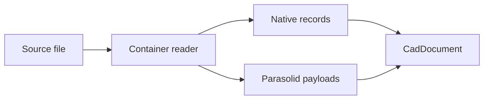

# SOLIDWORKS adapter

## Purpose and scope

Kit registers one SOLIDWORKS adapter with part and assembly identifiers.
Its primary `format_id` is `solidworks.sldprt`.
Its `aliases` field contains `solidworks.sldasm`.
The reader accepts part and assembly source records.
The native writer accepts qualified part documents and runs without a SOLIDWORKS installation.

| Identifier          | Suffix    |
| ------------------- | --------- |
| `solidworks.sldprt` | `.SLDPRT` |
| `solidworks.sldasm` | `.SLDASM` |

`available_adapters()` returns one entry for this adapter.
Read its `aliases` field to find the assembly identifier.
The format listing reports writable extensions and aliases separately.
See [format selection](../../Tasks/SelectFormat.md) for a discovery example.

Registration is not evidence of complete feature-family support.
Inspect the exact source, target, and capability results for each conversion.

## Container and records

The container layer handles physical streams and compression.
The logical record layer interprets serialized objects and their references.
Keep these layers separate when diagnosing a failed file.

| Stream                               | Information                          |
| ------------------------------------ | ------------------------------------ |
| `Contents/Config-0-ResolvedFeatures` | Serialized feature records           |
| `Contents/Config-0-Partition`        | Cached Parasolid geometry            |
| `swXmlContents/KeyWords`             | Metadata useful for feature identity |
| `Contents/Definition`                | Native document definition records   |
| `Contents/CMgr`                      | Configuration-related records        |
| `Contents/Config-0-ModelHeader`      | Model header records                 |

The implemented container uses encoded stream names and compressed data.
A valid stream directory does not prove valid native feature records.
A valid feature record does not establish a successful vendor rebuild.

Internal archive primitives encode and decode collection counts, structural
tags, CString frames and fixed-width scalars in memory. Stream owners select
the count dialect and supply the context for object references.
[Wire primitives and verification](../../Changes/Solidworks/SolidworksArchiveWirePrimitives.md)

The typed archive graph allocates class descriptors and objects in one
map. Its stream readers validate reference kinds and retain shared object
identity when the next stream inherits a snapshot. Body callbacks provide
the fields for each stream and class.
[Object maps and verification](../../Changes/Solidworks/SolidworksArchiveObjectMaps.md)

The internal ordinary part Definition codec uses an independent object map.
It reads saved presentation fields and constructs the stream from explicit part settings.
[Part Definition scope and evidence](../../Changes/Solidworks/Archive/SolidworksOrdinaryPartDefinition.md)

The saved part view reader projects the version-19000 document orientation
and pan/zoom transforms from the complete Definition. It retains native
coefficients and scalar values. Per-user window selection is a separate
presentation owner.
[Saved part view inspection](../../Changes/Solidworks/Inspection/Presentation/SolidworksSavedPartView.md)

The standalone header codec uses independent maps for `Header2` and
`Contents/Config-0-ModelHeader` in the ordinary version-19000 profile.
Its typed records retain file references, revision logs and bounds for
reconstruction.
[Standalone header scope](../../Changes/Solidworks/SolidworksStandaloneHeaders.md)

The internal ordinary assembly Definition codec uses the same independent
archive framing and a distinct assembly root. It preserves the measured
saved preferences and constructs fresh save-as-part settings from ten
explicit native preference values.
[Assembly Definition scope](../../Changes/Solidworks/Archive/Assembly/SolidworksAssemblyDefinitionCodec.md)

Internal body callbacks handle scalars, canonical CString frames and
object links in the same graph and counted row scopes. Individual
stream layouts define the order and meaning of those fields.
Inherited body links require the concrete objects from the prior map.
[Body value scope](../../Changes/Solidworks/Archive/SolidworksArchiveBodyValues.md)

The current configuration directory codec reads and constructs
`Contents/CMgrHdr2` from a typed manager and its configuration rows.
Its archive map starts at one, independently of the full `CMgr` stream.
[Configuration directory scope](../../Changes/Solidworks/Archive/SolidworksConfigurationDirectory.md)

The internal part header constructor takes the allocated part,
its actual selected configuration and explicit save provenance.
It builds both standalone header roles and the configuration
directory. Each stream uses its own archive map.
[Fresh part header scope](../../Changes/Solidworks/Archive/SolidworksFreshPartHeaders.md)

The internal unit-table codec reads one complete ordinary version-19000
`moUnitsTable_c` object using its caller's archive map snapshot. It keeps
inherited unit fields, the optional length override and the class slots
needed by subsequent records. Its scope is the bounded unit-table record.
Reading the full `Config-0` body requires additional native owners.
[Configuration unit-table scope](../../Changes/Solidworks/Archive/SolidworksConfigUnitTables.md)

The bounded configuration member reader handles the ordinary relation
record and empty or absent feature color ownership. Stored length words
remain available alongside the decoded rows. The record owner supplies
the expected descriptor and the live archive map snapshot.
[Configuration member scope](../../Changes/Solidworks/Archive/SolidworksConfigMemberFields.md)

The bounded member reader also handles absent or empty sketch block and
part exploded view managers. Their feature base selects branches and
concrete virtual targets. The sketch map backlink retains the newly
allocated manager's identity.
[Configuration field action scope](../../Changes/Solidworks/Archive/SolidworksConfigFieldActions.md)

The bounded configuration member reader also handles the ordinary view
record with compact transforms and empty presentation lists. Context
changes govern both optional list windows in the same archive.
[Configuration view scope](../../Changes/Solidworks/Archive/SolidworksConfigViewRecords.md)

The same member reader accepts a concrete partition mark and an absent
or empty thread reference manager. The archive slot and kernel mark ID
remain separate. A present thread manager retains the signed wire word
and its runtime Boolean.
[Thread and mark record scope](../../Changes/Solidworks/Archive/SolidworksConfigThreadMarks.md)

The bounded lightweight material reader handles the part hatch, optional
density parameter, model data with an absent scene and empty body visual
counts. Each concrete owner retains its actual archive slot.
[Lightweight material scope](../../Changes/Solidworks/Archive/SolidworksConfigMaterialOwners.md)

The internal part-start reader loads the named
`Contents/Config-0-ModelHeader` and the current part root. At the start
of the lightweight section, it inserts the original header objects
into the part's map while preserving their standalone identities.
The self file comes first, followed by the directory entries in
stored order. This reader requires physical format 4 and logical
archive version 19000.
Complete configuration admission requires the remaining model body.
[Configuration header link scope](../../Changes/Solidworks/Archive/SolidworksConfigHeaderLink.md)

The internal configuration section action bounds native body readers to the
declared lightweight or resolved length and keeps their shared map. Its scoped
ordinary records include direct model-header aliases and an empty ghost manager.
[Configuration section scope](../../Changes/Solidworks/Archive/SolidworksConfigSections.md)

The matching ordinary part emitter derives section lengths, allocates direct
model-header map slots and packs a signed empty ghost count. It accepts
the evidenced current archive profile and refuses populated ghost rows.
[Configuration section emission](../../Changes/Solidworks/Archive/Configuration/SolidworksConfigSectionEmission.md)

The direct header action accepts the version-19000 assembly root.
It uses the same self and directory order as the linked reader.
[Assembly header aliases](../../Changes/Solidworks/Archive/Configuration/SolidworksAssemblyHeaderAliases.md)

The bounded version-19000 part cache reader keeps zero through two mass
slots, each slot's atom rows and attached mass properties, and the
signed trailer when two slots are stored. The measured bounds field
carries an empty count in this profile. Populated bounds records require
additional owner evidence. Cache reads preserve the caller's map state.
[Part cache scope](../../Changes/Solidworks/Archive/SolidworksConfigCaches.md)

The matching internal field writer emits zero through two modeled mass
slots and the observed empty bounds count with the same part ownership.
[Bounded cache emission](../../Changes/Solidworks/Archive/Configuration/SolidworksConfigCacheWriting.md)

The embedded part atom manager keeps concrete kind-zero archive atoms
with their signed IDs and existing map context. Later feature links
can reuse those exact objects. The stored unsigned atom state remains
available alongside its runtime projection.
[Atom manager scope](../../Changes/Solidworks/Archive/SolidworksConfigAtomManager.md)

The shared version-19000 body reader has layouts for line fonts, embedded
widths, character formats, and print width tables in part detail definitions.
These fields retain their wire values and leave the archive map unchanged.
Complete detail definitions require the remaining annotation and table owners.
[Configuration font scope](../../Changes/Solidworks/Archive/SolidworksConfigFontFields.md)

The ordinary part label layouts preserve all five embedded label types, with
their own numeric suffixes and shared characters and widths. An active
layer reference requires separate ownership evidence and is refused.
[Configuration label scope](../../Changes/Solidworks/Archive/SolidworksConfigLabelFields.md)

The bounded surface-finish helper preserves both embedded fonts and
its separate annotation leader fields against the ordinary linked
part archive. The same field layout serves the two weld-side copies.
[Configuration finish helper](../../Changes/Solidworks/Archive/Configuration/SolidworksConfigFinishHelpers.md)

The internal ordinary part configuration codec reads both bounded
version-19000 sections and retains the original ModelHeader aliases.
It emits from the same typed graph and derives lengths and references.
The bounded standalone record readers retain their own entry points.
[Complete ordinary part configuration](../../Changes/Solidworks/Archive/Configuration/SolidworksOrdinaryConfigGraph.md)

The configuration scene reader keeps the environment folder, its actual
name and the observed ambient and directional light children. The
runtime light reset retains its separate signed wire word. Populated
light property owners need further layout evidence.
[Scene record scope](../../Changes/Solidworks/Archive/SolidworksConfigSceneRecords.md)

The KeyWords framer serializes a typed XML tree with the native
stream marker, UTF-8 declaration and explicit empty tag style.
[KeyWords framing scope](../../Changes/Solidworks/Archive/SolidworksKeywordFraming.md)

The internal KeyWords emitter constructs this stream from typed configuration,
feature and dimension rows. The caller supplies their model identities,
references and presentation values.
[Typed KeyWords scope](../../Changes/Solidworks/Archive/SolidworksTypedKeywordModels.md)

## Read flow

The reader combines available feature, geometry, and assembly information.
Source metadata and diagnostics qualify the decoded result.
The cached body geometry and feature history provide different evidence.

The shared body reader uses the stored comparison field and archive
conditions for ordinary branches. A fixed repeat uses its field
declaration for the row count. Signed normalization retains the
original word with its runtime projection.
[Configuration field modes](../../Changes/Solidworks/Archive/SolidworksConfigFieldModes.md)

For the compatible version-19000 part profile, strict reads project
literal native summary, document custom text and active configuration
text. Configuration text uses the saved directory and the matching
ModelHeader configuration name. All literal property scopes require the complete
ordinary Config-0 body linked to its ModelHeader. Unsupported property
variants leave the ordinary geometry and feature result available with
a diagnostic.
The registry refuses fresh native projections and direct writes when a
part or owned assembly component has an explicit property refusal.
An unfiltered interchange JSON copy preserves the inspection status
and original provenance when both registered adapters are interchange
JSON and the document meets the other portable-data requirements.
A verified empty legacy scope adds no property-specific restriction.
[Literal part properties](../../Changes/Solidworks/Inspection/Properties/SolidworksLiteralPartTextReader.md)

For current partitions with schema `SCH_3701250_37102_13006`, the Parasolid
reader uses forward fin links and terminal vertices. This preserves outward
face loops and positive signed volume in the disclosed rectangular case.
[Current fin orientation](../../Changes/Solidworks/Inspection/Model/SolidworksCurrentFinOrientation.md)

A part read can recover a closed planar solid from the local body store
when the sole selected configuration is zero, the active partition is
empty, and its rollback history validates. A sole resolved native
`Imported` feature must match the local group key. The SDK retains the
feature and payload records and returns the solid with matching design
body counts. The ordinary partition decoder keeps priority.
If the required current-profile local solid fails validation, a strict
B-rep read raises a format error. Explicit non-strict reads retain the
payloads with a local geometry rejection warning.
`extract_brep` reads the native payloads with strict framing
validation and without requiring local snapshot reconstruction.
This is source-backed inspection of the native import. Conversion
acceptance follows the [CAD success criteria](../Operations/CadSuccessCriteria.md).
[Local body readback](../../Changes/Solidworks/Inspection/Parts/SolidworksLocalBodyReadback.md)

The shared version-3701250 rollback reader exposes the selected mark ID
and its immediate predecessor ID after validation. The validation-only
entry point returns `None`.
[Partition mark identities](../../Changes/Solidworks/Archive/SolidworksPartitionMarks.md)

## Feature history

The resolved-feature grammar includes class definitions and object references.
The archive map changes as records are read.
Structural edits require consistent identifiers and map indices.
See [feature resolution](SolidworksFeatures.md) for the observed grammar.

The `moCompFeature_c` record supplies feature-tree ordering information in the documented research families.
Do not infer rebuild order from physical stream order alone.
Boss and cut behavior can depend on several related records.
A single flag change is not a general operation converter.

## Writing

The shared atom manager encoder derives its row count and map allocation
from typed rows. Its bounded emission preserves native state normalization
under the actual archive conditions.
[Atom manager emission](../../Changes/Solidworks/Archive/SolidworksConfigAtomEmission.md)

The internal version-19000 History and Biography codec uses an independent
archive map for each stream. It preserves existing biography telemetry
and supports fresh history with explicit creation and build provenance.
Its writer reads the emitted bytes to report their object offsets.
[Standalone history scope](../../Changes/Solidworks/Archive/Metadata/SolidworksHistoryStreamCodec.md)

Kit writes native SOLIDWORKS 2026 SP05.2 parts from a neutral millimetre
document with one active configuration, one closed Front-plane line loop,
one forward blind boss, one driving depth parameter `D1` and one solid.
Supply three through 64 ordinary unconstrained sketch lines, ordered around
a simple contour with matching endpoints and noncollinear adjacent sides.

Call `write_document` with a `.SLDPRT` path whose stem matches
`document.metadata["name"]`. For a binary stream, pass
`destination_format="solidworks.sldprt"` and supply an absolute part path in
`values["final_destination"]`. Use an empty, writable, seekable binary
stream at position zero. Kit checks the caller's complete output extent
without reading stream contents. The archive derives its stream lengths,
object maps, topology and editable records from the document.

The registry rejects unsupported neutral content and assembly or drawing
destinations before publishing a file. [Native part writer evidence](../../Changes/Solidworks/Construction/SolidworksNativePartWriter.md)

Public part output requires trusted offline native measurement for the exact
regenerated bytes. Pass a plain dictionary in
`values["solidworks_native_measurement"]`. Its `written_at` integer is the
original measured construction epoch. Its `receipt` object is the parsed
version-1 SOLIDWORKS 2026 standalone part evidence report from a qualified
SP05.2 or SP04.1 executable. The
[report example](../../../re/solidworks/measurements/2026/SdkDefaultPartNative01.json)
records both disclosed candidates, their hash-linked native lifecycles and
the two passing controls.

Use `kit convert document.json Name.SLDPRT --native-measurement Measurement.json`
with the same dictionary stored as a JSON file. The CLI expands a leading
`~/` and reads this evidence before calling the writer. The SDK receives evidence in memory and regenerates
the native file from the neutral document. It checks the complete archive
digest and measured case before opening an output. Matching results set both
`vendor_loadable` and `application_usable` to true.

Authenticate and verify custody of the oracle report before supplying it.
Kit checks its structure, exact oracle identity, measurements and archive
digest binding. The report is unsigned. Its contents alone cannot establish
who made the native observations. Keep the exact basename and encoded self
locator used in the measured archive. Standalone non-Windows host paths keep
the existing neutral Windows self-locator rule. A Windows output must
reproduce the measured encoded locator.
[Exact measurement gate](../../Changes/Solidworks/Construction/SolidworksMeasuredPartPublication.md)
[SP04.1 qualification](../../Changes/Solidworks/Construction/SolidworksEncoderOracleBuild.md)

A strict cold readback of a measured ordinary part can use the same SDK writer
with its matching final locator and receipt. Kit verifies the regenerated
model and complete output digest before exposing bytes. Native saves with
extra state remain outside this path.

The combined SDK adapter listing describes the reader for shared formats.
Use `AdapterRegistry.writers()` after discovery for writer metadata.
Use `kit formats --json` for the exact reader and writer aliases and extensions.

The cold archive carries the editable feature graph. SOLIDWORKS rebuilds
the solid from that graph. With `include_brep=False`, Kit returns the
linked sketch, support and driving depth through its ordinary reader.
For three through 64 noncollinear prism sides, the default reader also
derives the exact planar solid from the typed loop, datum and depth.
Raw Parasolid extraction requires a saved Parasolid payload.

The earlier writer did not generate its streams from format rules.
Each supported family re-emitted a recorded payload, which is a typed recording of one saved stream.
Every generated file also took its `Config-0` stream from one recorded configuration program.
The [recorded payload removal](../../Changes/Solidworks/SolidworksRecordedPayloadRemoval.md) deleted that writer.
CI now rejects any recorded field program in `src`.

The current part writer derives its streams from format rules using the
typed container, configuration, definition and resolved-feature codecs.

## Geometry cache boundary

The partition stream can contain geometry derived from feature history.
Some measured research cases permit regeneration by the vendor application.
That observation does not authorize deleting caches in arbitrary documents.
Verify the field, source family, and vendor version before relying on regeneration.

## Inspect a result

1. Record the part or assembly format identifier.
2. Record the selected configuration.
3. Inspect native and carrier transfers separately.
4. Check body and feature-history evidence.
5. Check assembly references when applicable.
6. Obtain the required target-application measurements.

Expected result: the report identifies both implemented behavior and unresolved acceptance conditions.
See [result evaluation](../../Tasks/InspectResult.md).

## Sources

- [Adapter implementation](../../../src/convert/adapters/solidworks/Core/Adapter.py)
- [Format metadata](../../../src/convert/adapters/solidworks/Container/Format.py)
- [Container](../../../src/convert/adapters/solidworks/Container/Container.py)
- [Archive](../../../src/convert/adapters/solidworks/Container/Archive.py)
- [Research grammar](../../../re/solidworks/archive/Grammar.md)
- [SOLIDWORKS research index](../../../re/solidworks/README.md)
