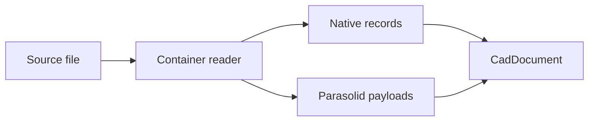

# SOLIDWORKS adapter

## Purpose and scope

Kit registers one SOLIDWORKS adapter with part, assembly and drawing identifiers.
Its primary `format_id` is `solidworks.sldprt`.
Its `aliases` field contains `solidworks.sldasm` and `solidworks.slddrw`.
The registered SOLIDWORKS formats are read-only.
It does not invoke SOLIDWORKS during production conversion.

| Identifier          | Suffix    |
| ------------------- | --------- |
| `solidworks.sldprt` | `.SLDPRT` |
| `solidworks.sldasm` | `.SLDASM` |
| `solidworks.slddrw` | `.SLDDRW` |

`available_adapters()` returns one entry for this adapter.
Read its `aliases` field to find the assembly and drawing identifiers.
See [format selection](../../Tasks/SelectFormat.md) for a discovery example.

Registration is not evidence of complete feature-family support.
Inspect the exact source, target, and capability results for each conversion.

## Container and records

The container layer handles physical streams and compression.
The logical record layer interprets serialized objects and their references.
Keep these layers separate when diagnosing a failed file.

| Stream                               | Information                          |
| ------------------------------------ | ------------------------------------ |
| `Contents/Config-0-ResolvedFeatures` | Serialized feature records           |
| `Contents/Config-0-Partition`        | Cached Parasolid geometry            |
| `swXmlContents/KeyWords`             | Metadata useful for feature identity |
| `Contents/Definition`                | Native document definition records   |
| `Contents/CMgr`                      | Configuration-related records        |
| `Contents/Config-0-ModelHeader`      | Model header records                 |

The implemented container uses encoded stream names and compressed data.
A valid stream directory does not prove valid native feature records.
A valid feature record does not establish a successful vendor rebuild.

For ordinary version-19000 parts and assemblies, the SDK decodes `Contents/CMgr` as a typed graph with its own map starting at 1. Read `metadata["solidworks.typed_configuration_manager"]` for the stored configuration names, comments, IDs, actual selected pointer identities and grammar coverage. Unsupported manager profiles report a diagnostic alongside the existing portable projection. Config, resolved-feature and mate streams retain their separate admission requirements. [Typed configuration managers](../../Changes/Solidworks/Archive/SolidworksTypedConfigurationManager.md)

For the measured ordinary single-configuration profile, `metadata["solidworks.typed_configuration_graph"]` reports the typed Config-0 stream, its inherited header aliases and map boundaries. The SDK decodes and serializes the same object graph. Twelve disclosed streams round-trip exactly with an independent CMgr context. This metadata supports inspection while the existing feature projection, strict linked-body boundary and read-only registration apply. [Typed configuration graph](../../Changes/Solidworks/Archive/SolidworksTypedConfigurationGraph.md)

The internal SDK `ResolvedFeatures` codec extends the actual Config map and reads the separate CMgr context. Twelve disclosed parts and assemblies pass exact stream and object identity checks. Its research bridge passes the guarded construction regression and 42 linked comparisons, including six mate lists. [Typed resolved graph](../../Changes/Solidworks/Archive/SolidworksTypedResolvedGraph.md)

The public SDK uses matching version-19000 feature nodes for native name, class and identity. An ordinary single forward blind boss gets its profile dependency and driving depth through its typed archive owners. The read reports unsupported typed modes and retains the existing reader for other families. Geometry keeps its existing path. [Typed public read](../../Changes/Solidworks/Archive/SolidworksTypedResolvedRead.md)

For the admitted ordinary part, the typed public read now preserves the same 19 modeling rows through a native save and exposes the 25 measured English default-session presentation rows with their owner identities. Custom or unresolved presentation state retains the existing reader behavior. [System tree projection](../../Changes/Solidworks/Inspection/Presentation/SolidworksSystemTreeProjection.md)

For an ordinary aligned coincident, parallel or positive-distance mate between two direct part occurrences, the public assembly reader uses the complete typed MatesList graph and independently loaded child configuration. Each entity retains the actual occurrence path and child datum ID, including generated files without saved selection strings. A distance comes from its live length parameter in millimetres. Read `metadata["solidworks.typed_mates_semantics"]` for admission and grammar coverage. The supported profile has one configuration and can resolve ordered groups of these mates between two or more direct part occurrences. Wrapper identities are checked across the selected list. The ordinary native-saved child profile includes an empty sheet-metal master, typed mass caches and an empty property list. Disabling component resolution through `ReadOptions.values` also retains the legacy path. [Typed planar mate reads](../../Changes/Solidworks/Archive/SolidworksTypedPlanarMateRead.md) [Ordered planar mate groups](../../Changes/Solidworks/Archive/SolidworksPublicCombinedMates.md) [Saved child metadata](../../Changes/Solidworks/Archive/SolidworksSavedPartMetadataRead.md)

The SDK construction layer builds complete aligned coincident and parallel plane-mate graphs from the actual registered assembly and child datum owners. Six independently generated parent and child pairs match the research composer byte for byte across all three principal axes. The SDK also constructs the complete positive driving distance graph with its dimension allocated before the mate, two actual reference pairs and its live length parameter. Six independent parent and child bundles match the reference composer across all principal axes. [Driving distance construction](../../Changes/Solidworks/Archive/SolidworksDrivingDistanceConstruction.md) [Fresh planar mate construction](../../Changes/Solidworks/Archive/SolidworksFreshPlanarMateConstruction.md)

Fresh mate construction accepts both standalone SDK Header nodes and decoded log rows. It uses the selected datum's first creation event and validates the log before allocating the mate. An independent replay preserved twelve existing parent and child bundles and passed 24 malformed-input cases. [Header epoch integration](../../Changes/Solidworks/Archive/SolidworksSdkHeaderEpochIntegration.md)

The complete SDK assembly constructor attaches two rigid occurrences to an actual generated part and an aligned coincident, parallel or positive driving distance mate. Eighteen complete inputs across the three axes pass 396 typed stream comparisons using the same child objects. [Complete assembly candidate](../../Changes/Solidworks/Archive/Assembly/SolidworksCompleteAssemblyCandidate.md)

One complete positive-distance pair preserves both native trees and the editable child depth through a 43.53 to 60.28 mm native mate edit, synchronized save and fresh reopen. The strict public reader resolves the same two typed datum links in both versions. [Native assembly lifecycle](../../Changes/Solidworks/Archive/Assembly/SolidworksSdkSingleAssemblyNativeTrial.md)

The SDK also attaches ordered coincident, distance and parallel groups to the same generated occurrences. The continuation validates each earlier mate and dimension owner against the actual allocator and header logs. Twelve mixed bundles pass across all six orderings and two rigid placement variants, with eighteen unchanged single-mate bundles. [Ordered assembly construction](../../Changes/Solidworks/Archive/Assembly/SolidworksOrderedAssemblyConstruction.md)

The SDK reads and writes the complete ordinary 2026 part and assembly Definition stream. The constructors accept explicit presentation settings, part density and assembly save-as-part preferences. All 84 disclosed native Definitions retain their exact bytes and archive map. The research document composers use the same writer. [Model Definition codec](../../Changes/Solidworks/Construction/SolidworksModelDefinitionCodec.md)

The internal SDK construction layer can build the ordinary blind boss's typed length and angle parameter nodes and the complete end specification. It takes the allocated display and dimension owners and retains the caller's from-end identity. Two fresh generated topologies passed exact stream composition and memory readback. The profile, history and file-level construction remain separate requirements for writing. [Blind end construction](../../Changes/Solidworks/Construction/SolidworksBlindEndConstruction.md)

The SDK constructs the local sketch graph for an ordinary closed polygon from ordered vertices and an allocated profile. It derives point, line, and incident-handle identities and preserves the actual model and support references in linked stream readback. This profile covers unconstrained rings. [Polygon geometry construction](../../Changes/Solidworks/Construction/SolidworksPolygonGeometryConstruction.md) The SDK can also initialize the ordinary part's own model, self-component and relation manager with its allocated IDs. The system factory attaches actual configuration owners, system folders, principal planes and the fixed origin. Two neutral designs preserve five complete archive streams and their map aliases in fresh processes. Body geometry and the normal writer require additional construction. [Part root construction](../../Changes/Solidworks/Construction/SolidworksPartRootConstruction.md) [Part system construction](../../Changes/Solidworks/Construction/SolidworksPartSystemConstruction.md)

The internal SDK part composer builds the full ten-stream container for one neutral rectangular sketch and a forward blind boss. It supplies the actual configuration, model and manager header nodes to linked-document builders. Two independent inputs preserve every stream through the typed prepare path and a separate mathematical comparison. One disclosed candidate passes native open, rebuild, depth edit, save and fresh reopen with all 25 native rows. [Complete blind-boss construction](../../Changes/Solidworks/Construction/SolidworksBlindPartConstruction.md) [Native lifecycle](../../Changes/Solidworks/Construction/SolidworksSdkBlindPartNativeTrial.md)

Two standalone parts also pass the same native lifecycle from a UNC location outside the encoded self drive. The Unicode-named case has an absent archived self path. [Standalone relocation](../../Changes/Solidworks/Construction/SolidworksStandalonePartRelocation.md)

The internal preparation boundary uses normal write options and the final destination with an explicit construction recipe. A qualified standalone POSIX path retains the neutral basename in the measured Windows self locator. Staging and a caller-owned stream preserve the same bytes. [Write preparation](../../Changes/Solidworks/Construction/SolidworksPlainPartPreparation.md) [Standalone host preparation](../../Changes/Solidworks/Construction/SolidworksStandaloneHostPreparation.md)

A separate SDK constructor admits a simple closed line loop for the ordinary forward blind boss. A triangle and a concave polygon generate ten streams each, and both original rectangle containers remain byte-identical. The three original native polygon sources match the generated trees and geometry and pass edits and fresh reopen. [Complete polygon part](../../Changes/Solidworks/Construction/SolidworksSdkPolygonBlindPart.md) [Original polygon qualification](../../Changes/Solidworks/Construction/SolidworksSdkOriginalPolygonQualification.md)

The internal SDK rectangle composer also owns two driving sketch dimensions and four horizontal or vertical relations. Two independent neutral requests preserve all ten streams, real point and segment handles, displays and parameter ownership through typed preparation. [Rectangle driving dimensions](../../Changes/Solidworks/Construction/SolidworksRectangleDrivingDimensions.md)

## Read flow

The reader combines available feature, geometry, and assembly information.
Source metadata and diagnostics qualify the decoded result.
The cached body geometry and feature history provide different evidence.

The Parasolid reader uses forward fin links and terminal vertices for schema
`SCH_3701250_37102_13006`. The disclosed SOLIDWORKS 2026 rectangular
solids retain outward face loops and positive signed volume in
`open_document()`. [Current fin orientation](../../Changes/Solidworks/Inspection/Model/SolidworksCurrentFinOrientation.md)

### Drawing layout inspection

For an ordinary SOLIDWORKS 2026 drawing, pass `strict=False` to `open_document()` or run `kit decode SOURCE --partial`. The returned `CadDocument.drawing` includes the active sheet, paper dimensions and scale. A sheet can have one external part view in Front, Top, Right or Isometric orientation with its position, outline, saved model path and selected configuration. View orientation, scale ratio and model-to-sheet transform come from the native Definition view. Distances are in metres. The standard interchange JSON path preserves these records.

The opt-in route supports a single unformatted sheet and verifies that Definition and the sheet and reference indexes agree. The `slddrw.layout_inspection` diagnostic identifies annotations, styles and graphics as outside this profile. Strict reads and native drawing writes remain unavailable. [Drawing view properties](../../Changes/Solidworks/Inspection/Drawings/SolidworksDrawingViewProperties.md) [Scaled named views](../../Changes/Solidworks/Inspection/Drawings/Linked/SolidworksScaledNamedDrawingViews.md)

The research property constructor generates text sections, IDs and name dictionaries from neutral sheet metadata. With the retained property XML's literal `vt` prefix declared, the generated blank sheet passes native open, rebuild, scale edit, SaveAs and fresh reopen. Four reference lanes pass in the ten-process comparison. A separate disclosed generated drawing and part pass view position edit, save and fresh reopen across eight processes. Its saved drawing preserves the sixteen-row tree, resolved part configuration and child geometry. The scope includes a single independent unit-scale front view on an unformatted sheet. [Blank drawing result](../../Changes/Solidworks/Inspection/Drawings/SolidworksDrawingPropertyPrefix.md) [Linked drawing result](../../Changes/Solidworks/Inspection/Drawings/Linked/SolidworksFrontDrawingPropertyPrefix.md)

The research composer also builds the four measured named views with positive explicit scales. It derives each view's sheet and model support planes from projected geometry and the generated model's canonical orientation. Two guarded builds of each of four new requests retained stream and layout identity. All four pairs passed native position edit, save and fresh reopen with healthy controls in twelve processes. The partial SDK reader recovered every saved view layout. [Scaled construction](../../Changes/Solidworks/Inspection/Drawings/Linked/SolidworksScaledDrawingConstruction.md) [Native comparison](../../Changes/Solidworks/Inspection/Drawings/Linked/SolidworksScaledDrawingOracle.md)

Both pre-writer locked Front drawing and ordinary rectangle pairs passed source-to-generated comparisons through view edits, native save and fresh reopen. Their ordered feature trees, sheet and view state, linked child geometry and empty annotation inventories match under the registered rules. Both controls and all twelve phases passed. [Original held-out results](../../Changes/Solidworks/Inspection/Drawings/Linked/SolidworksOriginalDrawingHeldoutProtocol.md)

The internal SDK writer can serialize ordinary 2026 sheet fields with the caller's actual drawing archive context and object map. Two blank and two linked generated designs matched the research serializer's complete streams in independent processes. The SDK also reads and writes the complete Definition of an ordinary blank sheet, preserving its inline header identities and archive map. The linked Definition codec also round-trips a complete ordinary unit-scale Front view, including the active sheet, external child and support aliases. The named-view profile preserves complete Definition bytes, ownership, and authored scale for Front, Top, Right and Isometric views. It follows the native near-unity rule for geometric point application. The public drawing writer remains open. [Typed named Definition](../../Changes/Solidworks/Inspection/Drawings/Linked/SolidworksNamedViewDefinitionCodec.md) [Typed sheet fields](../../Changes/Solidworks/Inspection/Drawings/Linked/SolidworksDrawingSheetFieldWriter.md) [Typed blank Definition](../../Changes/Solidworks/Inspection/Drawings/Linked/SolidworksBlankDefinitionWriter.md) [Typed linked Front Definition](../../Changes/Solidworks/Inspection/Drawings/Linked/SolidworksLinkedFrontDefinitionCodec.md) The SDK also constructs a fresh blank sheet and its support graph from authored paper, scale and target values and the supplied drawing model. The complete seven-stream proof covers the actual support plane and component aliases. [Fresh sheet construction](../../Changes/Solidworks/Inspection/Drawings/Linked/SolidworksBlankSheetConstruction.md) The SDK also builds the drawing model itself, including its actual self-component, managers, styles, sheet and support identities. Six ordinary blank or linked Front designs preserve all logical streams. The internal SDK blank-file entry point now builds all seven logical streams and the container from the portable drawing and explicit settings. Four independent neutral drawings match the research constructor byte for byte in guarded workers. Public drawing writer qualification remains open. [SDK blank file](../../Changes/Solidworks/Inspection/Drawings/Portable/SolidworksSdkBlankDrawingFile.md) [Fresh drawing model](../../Changes/Solidworks/Inspection/Drawings/Linked/SolidworksBlankDrawingModel.md)

The complete linked SDK constructor builds the drawing from one external generated part and a single authored named view. Six designs pass exact stream and independent corner comparisons. One Front view and its generated part pass a native move, save and fresh reopen with exact native feature rows, resolved part geometry and live child depth. [Complete linked SDK drawing](../../Changes/Solidworks/Inspection/Drawings/Portable/SolidworksSdkLinkedDrawingFile.md) [Native lifecycle](../../Changes/Solidworks/Inspection/Drawings/Portable/SolidworksSdkLinkedDrawingNativeTrial.md)

## Feature history

The resolved-feature grammar includes class definitions and object references.
The archive map changes as records are read.
Structural edits require consistent identifiers and map indices.
See [feature resolution](SolidworksFeatures.md) for the observed grammar.

For an ordinary SOLIDWORKS 2026 sketch, the reader matches the complete principal-plane handle inside its resolved-feature span. The model's actual persistent ID, axis kind and basis establish the sketch's support. Use `open_document(path, include_brep=False)` to inspect those history relationships without requesting cached body geometry. [Principal-plane reference change](../../Changes/Solidworks/SolidworksPrincipalPlaneReferences.md)

For an ordinary dimensioned rectangle, the reader verifies the owned straight line ring and empty arc array. The sketch retains separate driving width and height, and the topology summary follows the actual profile bounds. [Rectangle sketch ownership](../../Changes/Solidworks/Inspection/Sketches/SolidworksRectangleSketchOwnership.md)

For the generated SOLIDWORKS 2026 blind-pocket discovery part, the reader recognizes the principal plane and origin class roles. Each sketch resolves through its native plane handle. The SDK recovers the closed rectangle from its confirmed point and line arrays. The blind depth and the cut's references to the boss and circular sketch remain available with B-rep excluded. [Blind-pocket sketch readback](../../Changes/Solidworks/Inspection/Sketches/SolidworksPocketSketchReadback.md)

For a native-saved local circle used by a forward blind boss, the typed reader preserves the closed nonconstruction profile, actual driving radius or diameter and fixed centre. Both constraints retain their sketch entity links. Twelve resolved streams reproduce exactly and nine public projections pass. [Saved radial read](../../Changes/Solidworks/Archive/SolidworksSavedRadialRead.md)

The ordinary 2026 radius-driven pocket retains its fixed centre as a relation targeting the circle's `center` subelement. The radius remains an independent driving parameter. The reader requires the native local point handle to resolve to the circle's centre slot. [Fixed-centre readback](../../Changes/Solidworks/Inspection/Sketches/SolidworksPocketCenterFixation.md)

The `moCompFeature_c` record supplies feature-tree ordering information in the documented research families.
Do not infer rebuild order from physical stream order alone.
Boss and cut behavior can depend on several related records.
A single flag change is not a general operation converter.

## Writing

Kit does not write SOLIDWORKS files.
A conversion to a `.SLDPRT` or `.SLDASM` destination raises `AdapterNotFoundError` and creates no file.

The earlier writer did not generate its streams from format rules.
Each supported family re-emitted a recorded payload, which is a typed recording of one saved stream.
Every generated file also took its `Config-0` stream from one recorded configuration program.
The [recorded payload removal](../../Changes/Solidworks/SolidworksRecordedPayloadRemoval.md) deleted that writer.
CI now rejects any recorded field program in `src`.

A future writer must derive each emitted structure from known format rules.
The container, archive, configuration manager, definition, and resolved-feature codecs remain as its starting point.
Do not present a carrier or a mode label as a completed translation.

The [assembly definition experiment](../../Changes/Solidworks/Inspection/Cohorts/SolidworksAssemblyDefinitionConstruction.md)
constructs assembly document settings from authored inputs and the 2026 format rules.
It verifies archive structure in a research process. It does not establish native assembly writing.
The [empty assembly candidates](../../Changes/Solidworks/Inspection/Cohorts/SolidworksEmptyAssemblyCandidates.md)
combine that record with the shared header and version metadata.
Two generated empty candidates matched the native control through save and fresh reopen.
This result applies to the research profile with no components or mates.
The [recursive assembly research profile](../../Changes/Solidworks/Inspection/Cohorts/Assembly/References/SolidworksGeneratedNestedAssembly.md)
emits a neutral definition DAG as distinct native files with shared
repeated targets. It derives recursive stamps, direct directories,
expanded counts and local bounds from the graph. The first
three-file candidate passes 28 object-stream round trips and the
SDK history route. Its controlled native trial also passes open,
rebuild, a live leaf-depth edit, synchronized three-file saves and
fresh reopen. The separate saved-state audit passes 36 scoped
stream comparisons. A repeated four-definition hierarchy also
passes native edit, synchronized saves and fresh reopen with seven
paths and five solids. Its typed audit passes 48 stream comparisons.
Both pre-writer locked rigid nested layouts pass the same native edit,
save and reopen checks across eight fresh processes. The scope is
the research writer's ordinary centered-prism hierarchy.
[Native nested measurements](../../../re/solidworks/records/GeneratedNestedAssemblyNative2026.md)
[Repeated native measurements](../../../re/solidworks/records/GeneratedRepeatedNestedAssembly2026.md)
[Blind evaluation](../../../re/solidworks/records/SealedNestedAssemblyEvaluation2026.md)
The [assembly XML research profile](../../Changes/Solidworks/Inspection/Cohorts/Assembly/SolidworksAssemblyXmlIndexes.md) adds generated component and KeyWords indexes for one ordinary child and its rigid placements. The public SDK validates this generated pair with `include_brep=False`. The default geometry route requires a readable Parasolid payload in the child.

The [shared count primitives](../../Changes/Solidworks/Model/SolidworksArchiveCountPrimitives.md)
begin the generative archive layer in `src/convert/adapters/solidworks/Archive/Counts/`.
They encode integer cardinalities and decode bounded byte buffers for the distinct vendor and framework count grammars.
The research archive calls these functions directly, so its process checks cover the production implementation.
This promotion adds no public writing capability.

The [shared tag primitives](../../Changes/Solidworks/Model/SolidworksArchiveTagPrimitives.md)
classify structural markers and references before descriptor parsing or map resolution.
The research archive reads and writes its tags through this production layer.
The [2026 grammar record](../../../re/solidworks/records/ArchiveTagGrammar2026.md) binds the encodings to complete native functions.
Noncanonical input widths are not retained.

The [typed string primitives](../../Changes/Solidworks/Model/SolidworksArchiveStrings.md)
derive Unicode payloads and length headers from supplied text.
They preserve source encoding explicitly during reconstruction and reject repeated Unicode markers.
The [2026 string record](../../../re/solidworks/records/CStringArchive2026.md) distinguishes ordinary framing from excluded DB and ANSI semantic behavior.
The research archive uses this production layer directly.
The [shared scalar layer](../../Changes/Solidworks/Model/SolidworksSharedArchiveScalars.md)
owns signed and unsigned integer widths and the two IEEE floating
widths. The research field executor and SDK header fields call
those same little-endian codecs. The linked-graph census records
the remaining body grammar owners and qualification boundaries.
The [complete modeled-archive process check](../../Changes/Solidworks/Model/SolidworksStringArchiveProcesses.md)
adds two-process string boundary and malformed-frame checks without a donor container or saved-stream passthrough.
Its first remote execution passes ten positive cases and three malformed-frame controls; reduced containers establish archive compatibility only.

The [shared object and map model](../../Changes/Solidworks/Model/SolidworksArchiveObjectModel.md)
tracks typed descriptors, node identities, recursive ownership, and inherited map snapshots.
The research archive delegates actual class/object operations to these production components.
Its compatibility bridge preserves lazy field providers and explicit unknown-schema prefix bindings.
No feature fields or native construction defaults come from this infrastructure.

The [shared 2026 header codec](../../Changes/Solidworks/Model/SolidworksSharedHeaderGraph.md)
reads and writes the ordinary standalone `Header2` and ModelHeader graph.
The planar assembly research process supplies the authored file identities,
revision logs and bounds, and the SDK computes the string lengths, list counts
and archive references. The [measured profile](../../../re/solidworks/records/SharedSdkHeaderGraph2026.md)
covers parts, assemblies and blank drawing variants at version 19000.

The [configuration header handoff](../../Changes/Solidworks/Model/SolidworksConfigHeaderHandoff.md)
selects the same header file objects for the next archive and registers
their references without writing bytes. The research linked loader
uses the SDK selector and map allocator directly. Twelve measured
files retain their original aliases through configuration, resolved
features and available mate streams.

The [typed planar mate projection](../../Changes/Solidworks/Inspection/Cohorts/Assembly/References/SolidworksTypedPlanarMateProjection.md)
uses the decoded assembly occurrence and the selected part datum to
identify the two ordered planes of coincident, parallel and positive
driving distance mates. The research projection command exercises the
SDK implementation with linked native archive maps. The typed SDK
MatesList codec now accepts the actual resolved map and holds inherited
occurrence aliases while reading and writing ordinary empty and planar lists.
Automatic public mate admission remains open. [Typed mate list](../../Changes/Solidworks/Archive/SolidworksTypedMateListCodec.md)

The [2026 archive map handoff](../../Changes/Solidworks/SolidworksArchiveMapHandoff.md)
and [locked source controls](../../Changes/Solidworks/SolidworksOracleControls.md)
extend the research instruments without establishing writer support.
The [oracle diagnostic correction](../../Changes/Solidworks/Inspection/SolidworksOracleDiagnostics.md)
records why the original source batch did not establish per-feature error status.
The [oracle identity record](../../Changes/Solidworks/Inspection/SolidworksOracleBuildIdentity.md)
defines the executable build check used by clean inspection and retained tracing.
The [process exit-status record](../../Changes/Solidworks/Inspection/SolidworksOracleExitStatus.md)
distinguishes observed termination codes from lost COM connections.
The [native stage reports](../../Changes/Solidworks/Inspection/SolidworksOracleStageReports.md)
preserve open results when later measurement or cleanup fails.
The [critical repair observer](../../Changes/Solidworks/Inspection/SolidworksCriticalRepairTracing.md)
tracks the current native rejection without establishing a serializer correction.
The [minimal repair profile](../../Changes/Solidworks/Inspection/SolidworksMinimalRepairProfile.md)
limits instruction hooks to the confirmed application flag boundaries.
The [matching open-mode action](../../Changes/Solidworks/Inspection/SolidworksObserverModeComparison.md)
separates writable inspection from the default read-only action.
The [initial-frame observer](../../Changes/Solidworks/Inspection/SolidworksInitialFrameObservation.md)
records the template update target and native exception details.
Its measurements require healthy controls and do not establish native acceptance.
The [model appearance constructor](../../Changes/Solidworks/SolidworksModelVisualProperties.md)
replaces a null model appearance with an independently generated owned record.
The measured prior fault and each constructor-derived field are documented.
The generated replacement opens and rebuilds without errors or warnings, but
its sketch and extrusion are suppressed and it has no body. Native acceptance
remains unfinished.
The [suppression diagnostic](../../Changes/Solidworks/Inspection/SolidworksSuppressionDiagnostic.md)
observes a vendor intervention on copied research parts without counting the
changed state as generated-output acceptance.
The [configuration progress operation](../../Changes/Solidworks/SolidworksConfigurationProgress.md)
derives the completed-history marker from the generated persistent-ID allocator.
The first generated prism now opens and regenerates one solid without vendor
intervention. Editing, saved-copy reopening and broader coverage remain under
measurement.
The [native depth-edit inspection](../../Changes/Solidworks/Inspection/SolidworksNativeDepthEditInspection.md)
checks generated geometry, a live parameter change and a saved-copy reopen in
fresh application processes against explicit neutral-model expectations.
The [three-case measured polygon batch](../../Changes/Solidworks/SolidworksPolygonNativeMeasurements.md)
passes those checks with healthy controls and unchanged inputs. It remains
research evidence; the public adapter still refuses writing.
The [visible viewport inspector](../../Changes/Solidworks/Inspection/SolidworksNativeViewportInspection.md)
captures the application's actual model view for separate visual inspection.
The [standard-view constructor](../../Changes/Solidworks/SolidworksStandardViewConstruction.md)
generates the missing canonical rotations from native constructor rules.
The [canonical-view measurements](../../Changes/Solidworks/Inspection/SolidworksCanonicalViewMeasurements.md)
confirm nine named rotations and visible selected-view depth for three polygon cases at their recorded source revision.
The [current polygon measurements](../../Changes/Solidworks/Inspection/SolidworksCurrentPolygonMeasurements.md)
also cover the later configuration/profile changes: three generated parts pass controlled views,
depth edits, saving and fresh reopening at the recorded byte hashes.
Their system material-folder labels change on saved-copy reopening, so full name preservation is not established.
Initial-camera parity also remains unestablished.
The [material-folder flag correction](../../Changes/Solidworks/SolidworksMaterialFolderFlagEncoding.md)
now derives the current-format archive word from two fresh runtime Boolean states.
Earlier measurements remain bound to their recorded hashes; changed bytes need their own controlled measurements.
The [canonical-flag polygon measurements](../../Changes/Solidworks/Model/SolidworksCanonicalFlagPolygonMeasurements.md)
now measure those changed bytes directly: all three files pass geometry, visible selected
views and depth-edit/save/fresh-reopen checks between healthy controls.
All 72 neutral scalar comparisons pass, with maximum center-of-mass error
`2.6020852139652106e-18 m`; all 90 named-view arrays match the controls.
The material-folder label still changes after reopening, so full feature-name
preservation fails. Initial-camera parity remains unestablished.
The [later polygon interruption](../../Changes/Solidworks/Inspection/SolidworksControlledPolygonInterruption.md)
records the earlier disconnected heptagon query and unavailable trailing control.
That incomplete batch is not counted as a format crash; the subsequent controlled repeats passed.
The [quaternion half-angle gotcha](../../Gotchas/Conversion/Solidworks/Model/QuaternionRotationUsesNegativeHalfAngle.md)
records the native negative half-angle and the refuted positive-factor assumption.
The [controlled curve source authoring tool](../../Changes/Solidworks/Inspection/SolidworksCurveSourceAuthoring.md)
prepares independent discovery and held-out inputs before curved-sketch writer
implementation. A two-case source preflight passed creation, reopen and driving edits with healthy controls.
The later full-family source lock is recorded below; Kit-written curve acceptance remains pending.
The [first full source attempt](../../../re/solidworks/measurements/2026/CurveSourceAttempt01.json)
passed eighteen discovery cases and stopped on an annulus relation-count assertion with healthy controls.
The [binding-aware source harness](../../Changes/Solidworks/Inspection/SolidworksCurveRelationBindings.md)
now verifies exact native relation entities; controlled annulus and capsule remeasurement remains pending.
The [explicit oracle interface bindings](../../Changes/Solidworks/Inspection/SolidworksExplicitOracleInterfaces.md)
avoid automatic type discovery on child objects that reject `GetTypeInfo`.
The [type-library inventory](../../Changes/Solidworks/Inspection/SolidworksTypeLibraryInventory.md)
selects installed API declarations and enum constants without activating CAD.
The [thin-revolve archive schemas](../../Changes/Solidworks/Inspection/SolidworksThinRevolveArchive.md)
add three structural research classes with a version-19000 guard.
Their constructors, native thin round trips and usable generated output remain unproved.
The [revolved-radius dimension schema](../../Changes/Solidworks/Inspection/SolidworksRevolvedRadiusDimensionArchive.md)
adds the separate feature-dimension class structurally at version `19000`; its actual case reachability and constructor rules remain unproved.
The [approved-session handoff tool](../../Changes/Solidworks/Inspection/SolidworksApprovedSessionHandoff.md)
closes an explicitly selected clean session after user authorization, while measurement guards continue to refuse existing processes.
The [existing-session inventory](../../Changes/Solidworks/Inspection/Sessions/SolidworksExistingSessionInventory.md)
attaches only to an active object and reads its identity and document metadata.
It never activates, closes or terminates an application, process or license server.
The [published inventory and selected handoff](../../../re/solidworks/measurements/2026/OracleExistingSessionInventory.json)
record stable zero-document snapshots and a separate confirmed graceful exit, with observed licensing daemons retained.
The [host deadline supervisor](../../Changes/Solidworks/Inspection/SolidworksOracleHostDeadline.md)
bounds one owned oracle transport with a host monotonic deadline and records guest state as unknown after a timeout.
It does not cancel guest jobs, recover the VM or establish native acceptance.
The [interrupted source preflight](../../Changes/Solidworks/Inspection/SolidworksCurveSourceInterruption.md)
completed rectangle-control authoring, then stalled while reopening that control.
No candidate or healthy trailing control was measured, so no family lock or format-crash attribution follows.
The [next source preflight](../../../re/solidworks/measurements/2026/CurveSourcePreflight08ActivationFailure.json)
failed both control activations before any candidate or runtime executable identity was obtained.
The host transport ended normally with exit `2`; no deadline fired and no native acceptance follows.
The [later annulus/capsule source preflight](../../Changes/Solidworks/Inspection/Relations/SolidworksCurveBindingPreflight.md)
passes ten phases and 121 numeric checks between healthy controls, confirming the repaired native bindings.
Its two-case selection establishes no full-family lock or Kit-written curve acceptance.
The [complete curve-source family lock](../../Changes/Solidworks/Inspection/Relations/SolidworksCurveSourceFamilyLock.md)
now records 30 passing source cases, 66 fresh phases, 797 passing numeric checks and healthy controls before and after.
All 32 source hashes were locked before fresh curve-writer implementation; six held-out native payloads remain sealed during derivation.
The [portable lock](../../../re/solidworks/v2026/heldout/CurveSourceLock.json) permits discovery analysis and establishes no Kit-written curve acceptance.
The [research schema-usage report](../../Changes/Solidworks/Model/SolidworksArchiveSchemaUsage.md)
separates actual load/store and linked-seed schema admission from byte identity.
Its strict option rejects used provisional or missing schemas and incomplete operations;
registry status alone does not establish field semantics or native writer acceptance.
The [curve discovery preparer](../../Changes/Solidworks/Model/SolidworksCurveDiscoveryCorpus.md)
selects only the 24 locked discovery cases and two controls, records framed privacy
transformations and leaves full archive-schema checks to remote CI.
The [first complete source archive report](../../../re/solidworks/measurements/2026/CurveArchiveAdmission01.json)
records all 234 requested byte identities and zero unread tails, while strict
declaration admission fails on 77 primary and 75 linked provisional owners.
The [geometry](../../Changes/Solidworks/Model/SolidworksGeometryArchiveOwners.md),
[common-part](../../Changes/Solidworks/Model/SolidworksCommonPartArchiveOwners.md),
[material/display](../../Changes/Solidworks/Model/SolidworksMaterialDisplayArchiveOwners.md)
and [annotation](../../Changes/Solidworks/Model/SolidworksAnnotationArchiveOwners.md)
definitions provide native evidence for 76 owners. Their [changed-revision report](../../../re/solidworks/measurements/2026/CurveDiscoveryAdmission42525.json)
preserves all 234 byte identities and leaves only the framework string-map count
dependency provisional, with no missing schemas. Strict admission passes 156
primary streams and zero linked streams; both strict process cases still fail.
The [complete decoded field inventory](../../Changes/Solidworks/Model/SolidworksCurveFieldInventory.md)
adds separate remote correlation reports with exact integer text, decoded float bits,
complete retained graph identities and byte-field hashes. Its process checks retain
strict schema admission; field correlations do not establish construction rules or
Kit-written curve acceptance.
The [MFC runtime-view probe](../../Changes/Solidworks/Model/SolidworksMfcRuntimeViewInspection.md)
can inspect effective exports in its own x64 analysis process without invoking
archive methods. Raw file discovery and mapped export identity remain separate
from proving a count implementation or accepting a CAD output.
Its [process-architecture admission](../../Changes/Solidworks/Model/SolidworksMfcProcessArchitectureAdmission.md)
requires the actual process-machine query and matching raw/mapped executable
identities after the original WOW64-based guard rejected the first probe before
MFC loading. That failure supplies no count or native CAD acceptance.
The optional [complete count-body capture](../../Changes/Solidworks/Model/SolidworksMfcCountBodyCapture.md)
can compare the two exact reached implementations with independently bounded
original-file bytes. It adds no archive-method invocation or production dependency.
The [separate framework count owner](../../Changes/Solidworks/Model/SolidworksMfcCountArchiveOwner.md)
uses that pinned native evidence for the ordinary-version-19000 string-to-int map,
preserving the vendor archive's independent count grammar. Remote admission of
the new definition and native writer acceptance remain separate checks.
The [usage-summary verifier](../../Changes/Solidworks/Model/SolidworksArchiveUsageSummaryVerification.md)
checks aggregate schema unions against complete stream/dependency phases without
treating a summary as a phase snapshot. Existing strict source gates remain active.
The [local curve and radial construction rules](../../Changes/Solidworks/SolidworksCurveReferenceConstruction.md)
bound both native reference scans and distinguish circle-marker updates from
ordinary polygon points. These static rules do not establish curve acceptance.
The [radial presentation rules](../../Changes/Solidworks/Inspection/SolidworksRadialPresentationRules.md)
derive radius and diameter prefixes and separate runtime selectors from archive fields.
They classify individual flag operations, rather than a universal saved flag word.
The [radial parameter lifecycle](../../Changes/Solidworks/Inspection/SolidworksRadialParameterLifecycle.md)
separates concrete reference-count methods, parameter connections and persistent IDs.
The [radial construction boundaries](../../Changes/Solidworks/Inspection/SolidworksRadialConstructionBoundaries.md)
separate geometry references, optional lookup indices, nullable tolerance and empty-list finalization.
These bounded rules do not establish final saved curve state or native acceptance.
The [bounded curve lifecycle observer](../../Changes/Solidworks/Inspection/SolidworksCurveLifecycleObservation.md)
retains the point/arc state and independent counters needed for controlled training observations.
The [radial training attempt](../../../re/solidworks/measurements/2026/RadialTrainingAuthor02.json)
activated all 36 hooks and measured healthy controls, then stopped before circle authoring on an RPC argument error.
The [explicit reset repair](../../Changes/Solidworks/Inspection/Sketches/SolidworksTrainingResetArguments.md)
passes the capture Boolean directly and preserves strict validation.
The [corrected training repeat](../../Changes/Solidworks/Inspection/Sketches/SolidworksRadialTrainingRepeat.md)
records two native authoring cases and fresh-process radius/diameter edits with forty-six matching numeric checks.
These observations retain separate source, process, observer and control evidence; they provide no generated-output acceptance.
The [public circle dispatch probe](../../Changes/Solidworks/Inspection/Sketches/SolidworksCircleApiDispatchProbe.md)
adds an independently pinned observation site for the forwarded COM target; its controlled run installed all hooks but emitted no required public-dispatch event and remains unqualified.
The [single-circle sketch synthesis](../../Changes/Solidworks/Model/Curves/SolidworksCircleSketchSynthesis.md)
adds a constructor-derived research graph with computed topology, IDs and counts. Two remote process candidates passed strict archive comparisons and file-read guards; both also passed controlled native sketch load/rebuild/save/fresh-reopen measurements. This free-sketch result is separate from the radial and body rungs below.
The [controlled circle sketch inspector](../../Changes/Solidworks/Inspection/Sketches/SolidworksCircleSketchInspection.md)
checks local geometry, authored plane, zero-body topology, rebuild state, save and fresh-process reopen between controls. Its first native run passed four phases and 48 numeric/frame comparisons matching to six significant figures; held-out family acceptance remains unestablished.
The [circle lifecycle rules](../../Changes/Solidworks/Model/Curves/SolidworksCircleLifecycleRules.md)
bind actual solver/data ownership, conditional status/color rules and separate coordinate/stamp operations. They supply no feature-specific solved defaults.
The [radial sketch synthesis](../../Changes/Solidworks/Model/Curves/SolidworksRadialSketchSynthesis.md)
adds a front-plane radius/diameter value, parameter, handle and display graph with explicit presentation inputs. Its free-center candidates passed remote generation and six controlled native load/edit/save/fresh-reopen phases with 104 matching numeric/frame checks. No family or extrusion acceptance is established.
The [radial sketch inspector](../../Changes/Solidworks/Inspection/Sketches/SolidworksRadialSketchInspection.md)
adds explicit driving-value edits and fresh reopening of edited sketches while retaining geometry, plane, ownership and control gates. The [fixed-center relation](../../Changes/Solidworks/Model/Curves/SolidworksCircleCenterFixation.md) also passed six controlled native phases and 104 numeric/frame checks with fully constrained status and exact center bindings.
The [circle blind boss synthesis](../../Changes/Solidworks/Model/Curves/SolidworksCircleExtrusionSynthesis.md)
composes that constrained sketch with the shared blind feature/end-spec model. Both generated candidates passed six native load/rebuild/edit/save/fresh-reopen phases, with one body, fully constrained sketches and all 200 numeric comparisons matching to six significant figures between healthy controls. The saved derivatives now pass 54 critical archive comparisons and 108 neutral numeric/frame checks; complete presentation and held-out family acceptance remain unestablished, and the public adapter still writes none.
The [saved-circle input preparer](../../Changes/Solidworks/Model/Curves/SolidworksSavedCircleReaderInputs.md)
binds six vendor-saved derivatives to the native receipt and neutral edit targets, with bounded metadata redaction and no archive-schema execution during preparation. These are reader fixtures, not additional generated outputs.
The [saved-circle process checks](../../Changes/Solidworks/Model/Curves/SolidworksSavedCircleReaderVerification.md)
require 54 complete primary/linked stream comparisons and 108 neutral semantic/frame comparisons across those six derivatives. Their remote outcome is recorded independently from the native body measurements.
The [archive failure diagnostics](../../Changes/Solidworks/Model/SolidworksArchiveFailureOwnership.md)
retain the exact typed owner and cursor at a rejected archive boundary; diagnostics do not turn a failed comparison into acceptance.
The [principal-plane circle rung](../../Changes/Solidworks/Model/Curves/SolidworksCirclePrincipalFrames.md)
computes explicit world/local radial placement for the existing Front, Right and Top model frames. The two new Right/Top candidates passed six controlled native phases and all 200 numeric checks, including body/mass targets and radial/depth edits through saving and fresh reopening. Full family, presentation and held-out acceptance remain unestablished.
The [conditional part master grammar](../../Changes/Solidworks/Model/SolidworksSheetMetalMasterArchive.md)
owns the directly serialized sheet-metal master that native saves may add before the common ID map, even when the visible feature tree contains only a circle boss. The repaired saved-reader process passed all 54 critical archive comparisons and 108 neutral numeric/frame checks across six derivatives; full CAD family and sheet-metal feature acceptance remain unestablished.
The [initial circle-load inspector](../../Changes/Solidworks/Inspection/Sketches/SolidworksCircleInitialLoadInspection.md)
records body count, rebuild problems and active named features before any explicit rebuild. All twelve phases for the unchanged four circle bosses pass with one initial body and active named sketch/boss features; all 400 rebuilt numeric checks, radial/depth edits, saves and edited fresh reopens also pass between healthy controls. Viewport/camera and full presentation remain unmeasured by this procedure.
The [independent circle-set sketch rung](../../Changes/Solidworks/Model/Curves/SolidworksCircleSetSketchSynthesis.md)
uses the common constructor and actual permanence events for disjoint free circles. The two/four-circle requests passed sixteen archive comparisons, topology-isolated resolved-stream growth and four controlled native load/rebuild/save/reopen phases with 72 matching numeric/frame checks. Dimensioned sets and body generation remain closed.
The [open-arc sketch rung](../../Changes/Solidworks/Model/Curves/SolidworksOpenArcSketchSynthesis.md)
computes signed partial-arc geometry with three distinct point nodes through that same arc/permanence model. Both signed-sweep candidates passed sixteen remote archive comparisons and four controlled native phases with all 64 numeric/frame checks matching to six significant figures, including both endpoints and native rotation direction. Arc dimensions and bodies remain closed.
The [mixed line/arc sketch rung](../../Changes/Solidworks/Model/Curves/SolidworksMixedCurveSketchSynthesis.md)
composes a rotated capsule through shared point, line, arc, adjacency and counter models. Both outputs passed sixteen complete comparisons and four controlled native phases with 124 matching numeric/frame checks and actual shared native endpoint identities. This adds no body or driving-dimension acceptance.
The [capsule blind-boss composition](../../Changes/Solidworks/Model/Curves/SolidworksCapsuleExtrusionSynthesis.md)
adds the shared blind feature and editable depth to that boundary. Both generated bosses passed sixteen archive comparisons and six controlled native phases, including an initial body, analytic mass, depth edit, save and edited fresh reopen. All 304 original numeric checks pass within six-digit precision; the receipt separately records two one-unit decimal rounding ties. Radius/length dimensions, tangent constraints and complete family acceptance remain outside the rung.
The [separate extrusion end-condition source family](../../Changes/Solidworks/Inspection/Extrusions/SolidworksEndConditionSourceAuthoring.md)
locks twelve discovery and four held-out inputs for forward/reversed blind, mid-plane and two-direction blind bosses. All sixteen cases passed 38 fresh phases and 437 numeric checks between healthy controls. Fourteen discovery/control fixtures passed the [independent archive comparison](../../Changes/Solidworks/Inspection/Extrusions/SolidworksEndConditionSourceAdmission.md): 126 complete comparisons and 87 predicted field/dimension checks, with zero tails or unresolved references. Four new held-out native payloads remain sealed. This supplies no generated-writer coverage.
The [second-depth native observer](../../Changes/Solidworks/Inspection/Extrusions/SolidworksEndConditionInspection.md)
adds independent direction/depth checks and separate second-depth edits to the shared inspector. The new observer passed twelve controlled phases for three new generated end-condition bosses plus an unchanged baseline, with 432 original numeric checks, initial bodies and edited fresh reopens; earlier receipts retain their original observer versions.
The [shared end-condition constructor](../../Changes/Solidworks/Model/Curves/SolidworksExtrusionEndSynthesis.md)
now uses those reconciled rules for explicit reversed, mid-plane and two-direction research requests. All three new requests passed 24 complete archive comparisons and controlled native body/edit/save/reopen measurements; 23 prior tagged neutral outputs remain byte-identical. The receipt retains two decimal rounding-boundary disagreements without changing targets or checks. Full presentation, held-out acceptance and production writing remain unfinished.
The [frozen held-out protocol](../../Changes/Solidworks/Inspection/Extrusions/SolidworksEndConditionHeldoutPrediction.md)
binds 341 unchanged writer/dependency files before four independent complete generation processes. All four predictions pass 32 complete archive comparisons, twelve controlled native load/edit/save/reopen phases and 432 numeric checks matching to six significant figures. Ninety-two comparisons against original source API baselines are exactly equal; 32 exact body/direction/termination comparisons also pass. The source metadata was inspected only after the writer freeze, and all original native payloads remain sealed. This qualifies the bounded held-out body/dimension/direction rung. Full tree/presentation parity remains false: the source has 19 top-level nodes and the generated tree has 20, while their observers use different traversal depths. Failed predictions cannot be reused as unseen evidence after repairing the writer. Full family and production writing remain unfinished.
The [earlier-circle prediction protocol](../../Changes/Solidworks/Inspection/Extrusions/SolidworksCurveCircleHeldoutPrediction.md)
now binds the two original independent circle held-outs to the same frozen writer and explicit radius/diameter request adapter. Both predictions pass sixteen complete archive comparisons, six controlled native body/edit/save/reopen phases and all 200 numeric checks, with identical six-digit text. All 44 source API comparisons are exactly equal and sixteen exact body/direction/termination checks pass. The generating job passes 196 native-format cases and 171 policy cases; the repaired harness preserves all 32 tagged neutral outputs byte-for-byte. The other four original curved-profile held-outs remain unqualified and outside this complete writer contract; they are not counted as successes.
The [recursive tree/save observer](../../Changes/Solidworks/Inspection/Presentation/SolidworksRecursiveTreeSaveObservation.md)
records the source-side recursive walk at opening, explicit rebuild, immediately after saving and fresh reopening, with existing body/dimension checks and controls. Four unchanged end-condition outputs pass eight phases, 24 recursive observations and 164 numeric checks with healthy controls. Generated trees have all six expected child type/parent pairs and one additional top-level notes-area folder. Material names remain authored immediately after saving and normalize by fresh reopening; the independent saved-field decoder now confirms the persisted transition. This adds no generated-output coverage or writer acceptance.
The [saved material-name workflow](../../Changes/Solidworks/Inspection/Presentation/SolidworksSavedTreeNameInspection.md)
prepares the eight native-saved derivatives with the bounded container/privacy helpers, then requires complete remote archive/graph decoding before reporting the typed persisted name. All 320 streams are retained with 152 framed metadata replacements and eight individually reviewed saved previews. Remote decoding passes 72 complete comparisons and eight typed material-name observations, with zero unresolved references. The first save preserves the authored persisted name; the unchanged file normalizes its live title on fresh reopening, and the next save persists that default. The exact native rename caller remains untraced. These reader fixtures add no generated outputs or native acceptance.
The [saved view-state observer](../../Changes/Solidworks/Inspection/Presentation/SolidworksSavedViewStateInspection.md)
reports both document transforms and the two transforms in each user splitter cell, with hashed personal labels. Remote decoding passes 72 complete archive comparisons, sixteen document transforms and 48 per-user cell transforms, all identity. The native default setter forwards to transform assignment. The higher-level active-camera mapping remains unproven and is not inferred from these hidden-session observations, field names or historical 2025 data.
The [visible native intervention probe](../../Changes/Solidworks/Inspection/Presentation/SolidworksVisibleViewInterventions.md)
separates orientation, translation and scale changes on unchanged generated input. All five cases and ten native save/fresh-reopen phases pass with exact pose persistence and healthy controls; these training measurements add no writer or held-out acceptance.
Its [fixture preparer](../../Changes/Solidworks/Inspection/Presentation/SolidworksViewProbeReaderFixtures.md)
prepares all ten saved derivatives with original API poses and intact source chains: 400 retained streams, 190 bounded metadata replacements and ten reviewed previews. Four distinct native API requests share one PNG, so a saved preview is not treated as active viewport proof. Complete archive/graph decoding remains a separate remote step.
The [orthographic field correlation](../../Changes/Solidworks/Inspection/Presentation/SolidworksOrthographicViewFieldCorrelation.md)
passes ninety complete archive comparisons and 130 exact native API component correspondences. Orientation is stored in the first document transform; translation and scale are stored in the second, with the primary user cell mirroring that pair. Native model/pan-zoom bridge inspection corroborates the split. Unseen generated camera output, perspective and actual visible viewport acceptance remain unqualified.
The [unseen camera source author](../../Changes/Solidworks/Inspection/Presentation/SolidworksUnseenViewSourceLock.md)
creates two independent native parts with distinct trimetric/dimetric poses and locks their hashes before camera writer implementation. Their payloads and detailed API observations remain sealed until that writer is frozen; source authoring does not count as generated acceptance.
The [shared orthographic view constructor](../../Changes/Solidworks/Model/SolidworksOrthographicViewConstruction.md)
validates rigid view input in `src` and supplies separate model and pan/zoom records to the existing research definition serializer. Native acceptance remains pending; it does not enable a production writer.
Its discovery subprocess checks now pass sixteen complete archive comparisons, runtime file/process guards and the 72-byte matrix growth rule. The [354-file writer freeze and unseen predictions](../../Changes/Solidworks/Inspection/Presentation/SolidworksCameraHeldoutPrediction.md)
preserve independent camera source inputs and forbid reference access until generated predictions pass the complete process checks. Both predictions now pass sixteen complete archive comparisons, zero unresolved references and the runtime read guards, with all 354 frozen dependencies unchanged.
The [frozen camera inspector](../../Changes/Solidworks/Inspection/Presentation/SolidworksFrozenCameraInspection.md)
captures the initial active pose before view setters or explicit rebuild, then compares it with independent source API observations through rebuild, radial/depth edits, saving and fresh reopening. The [controlled camera measurements](../../Changes/Solidworks/Inspection/Presentation/SolidworksCameraHeldoutMeasurements.md) pass both candidates, six phases and 600 numeric checks between healthy controls; all 400 pose comparisons and all 66 separate source-field/body comparisons are exactly equal. Inputs and licensing process identities remain unchanged, and the original native CAD payloads remain sealed. Two repeated mass-centre observations retain their one-ULP decimal formatting boundary difference. This qualifies the bounded camera rung; full presentation, perspective, feature-tree parity and production writing remain unfinished.
The [temporary Hopper MCP transport](../../Changes/Solidworks/Inspection/Presentation/SolidworksHopperMcpSession.md)
allows large native targets to finish initial analysis with a child-process startup deadline, retaining evidence outside checkouts without changing client configuration. This analysis transport supplies no conversion acceptance.
The [initial-view caller trace](../../Changes/Solidworks/Inspection/Presentation/SolidworksInitialViewLoaderTrace.md)
finds the document-transform fallback in `OnInitialUpdate` and separates it from user-environment enumeration and hidden-preview creation. REA supplies direct caller evidence; original PE instructions and reverse unwind ownership corroborate the static path. No runtime call-site or pixel-level viewport equality is claimed.
The [historical cohort regression](../../Changes/Solidworks/Inspection/Cohorts/SolidworksFrozenCohortRegression.md)
pins 3,404 source files separately from current development and requires each of eight old outputs to match its measured hash and the current writer's output. Import-audit review found 2,280 package/discovery modules outside the original 354-file table; all additional source files are unchanged since camera source authoring and in the actual prediction merge. The original explicit table was therefore incomplete. The new remote comparison passes all eight historical and eight current outputs, each set with 64 complete archive comparisons and runtime guards. The original freezes and measurements remain intact, and these reruns supply regression evidence only. New behavior still requires fresh independent source locks.
The [tree-presentation source protocol](../../Changes/Solidworks/Inspection/Cohorts/SolidworksTreePresentationSourceLock.md)
defines fresh independent inputs before the next system-folder change. The first mixed-end source attempt remains failed because native view translation changed after a fresh rebuild; its whole pair is ineligible, despite healthy controls. Two different blind-body inputs now pass four native source phases and 192 checks with healthy controls, idle postflight and unchanged licensing process IDs. Their private geometry, trees and poses remain sealed until writer freeze and successful remote prediction. The generated extra notes-area node and native markup node are different runtime classes. These source inputs add no generated-output coverage.
The [shared markup-folder constructor](../../Changes/Solidworks/Model/SolidworksMarkupFolderConstruction.md)
now admits an explicit ordinary markup class/name map separately from the historical extra-notes map. The existing common folder serializer computes its fields and graph bookkeeping. Discovery and rejection process checks pass with eight complete archive comparisons, no unresolved references or runtime reads and all eight historical/current regressions unchanged. The [new prospective freeze](../../Changes/Solidworks/Inspection/Cohorts/SolidworksTreeHeldoutPrediction.md) binds 3,435 files and complete schema membership before unseen predictions. Both locked predictions pass sixteen complete comparisons with no unresolved references or runtime reads, while every frozen dependency remains unchanged. The [paired native measurements](../../Changes/Solidworks/Inspection/Cohorts/SolidworksTreeParityMeasurements.md) pass all twelve source/candidate phases, 840 numeric checks, 440 exact pose comparisons and 22 ordered-tree comparisons across identical 25-node trees. All scenes have one visible body; controls, input hashes, idle postflight and licensing identities remain healthy. This qualifies the bounded ordinary-English tree/pose rung; full presentation and production writing remain unfinished.
The [COM instance probe](../../Changes/Solidworks/Inspection/SolidworksOracleInstanceProbe.md)
can check process separation before changing any application or document state.
The [oracle ownership guard](../../Changes/Solidworks/Inspection/SolidworksOracleSessionOwnership.md)
preserves existing sessions and limits dialog responses to registered live processes.
The fresh [model component constructors](../../Changes/Solidworks/Model/SolidworksModelConstruction.md)
and [metadata constructors](../../Changes/Solidworks/SolidworksMetadataConstruction.md)
build research object graphs from authored semantics and native constructor rules.
Their process checks do not establish a complete, loadable native document.
The [fresh profile-reference repair](../../Changes/Solidworks/SolidworksProfileReferenceOwnership.md)
gives the origin and ordinary sketch separate owned reference objects.

The [2026 archive research](../../Changes/Solidworks/SolidworksArchiveResearch.md)
adds version-specific class schemas and a byte-identity checker under `re/`.
Remote process checks use eight redacted, vendor-authored controls.
These checks measure schema coverage. They do not establish generated output,
held-out acceptance, or a production writer.

The [blind-pocket discovery constructor](../../Changes/Solidworks/Model/Curves/SolidworksBlindPocketDiscovery.md)
composes a rectangular boss and a circular blind cut from one authored model.
Its explicit scope choices support controlled comparison of cold rebuild behaviour.
Generated native measurements remain pending.

## Geometry cache boundary

The partition stream can contain geometry derived from feature history.
Some measured research cases permit regeneration by the vendor application.
That observation does not authorize deleting caches in arbitrary documents.
Verify the field, source family, and vendor version before relying on regeneration.

## Inspect a result

1. Record the part or assembly format identifier.
2. Record the selected configuration.
3. Inspect native and carrier transfers separately.
4. Check body and feature-history evidence.
5. Check assembly references when applicable.
6. Obtain the required target-application measurements.

Expected result: the report identifies both implemented behavior and unresolved acceptance conditions.
See [result evaluation](../../Tasks/InspectResult.md).

## Sources

- [Adapter implementation](../../../src/convert/adapters/solidworks/Core/Adapter.py)
- [Format metadata](../../../src/convert/adapters/solidworks/Container/Format.py)
- [Container](../../../src/convert/adapters/solidworks/Container/Container.py)
- [Archive](../../../src/convert/adapters/solidworks/Container/Archive.py)
- [Research grammar](../../../re/solidworks/archive/Grammar.md)
- [SOLIDWORKS research index](../../../re/solidworks/README.md)
