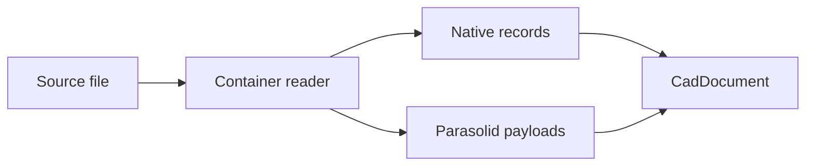

# SOLIDWORKS adapter

## Purpose and scope

Kit registers one SOLIDWORKS adapter with part and assembly identifiers.
Its primary `format_id` is `solidworks.sldprt`.
Its `aliases` field contains `solidworks.sldasm`.
The adapter reads source records.
It is not registered as a writer, so Kit cannot produce `.SLDPRT` or `.SLDASM` files.
It does not invoke SOLIDWORKS during production conversion.

| Identifier          | Suffix    |
| ------------------- | --------- |
| `solidworks.sldprt` | `.SLDPRT` |
| `solidworks.sldasm` | `.SLDASM` |

`available_adapters()` returns one entry for this adapter.
Read its `aliases` field to find the assembly identifier.
See [format selection](../../Tasks/SelectFormat.md) for a discovery example.

Registration is not evidence of complete feature-family support.
Inspect the exact source, target, and capability results for each conversion.

## Container and records

The container layer handles physical streams and compression.
The logical record layer interprets serialized objects and their references.
Keep these layers separate when diagnosing a failed file.

| Stream                               | Information                          |
| ------------------------------------ | ------------------------------------ |
| `Contents/Config-0-ResolvedFeatures` | Serialized feature records           |
| `Contents/Config-0-Partition`        | Cached Parasolid geometry            |
| `swXmlContents/KeyWords`             | Metadata useful for feature identity |
| `Contents/Definition`                | Native document definition records   |
| `Contents/CMgr`                      | Configuration-related records        |
| `Contents/Config-0-ModelHeader`      | Model header records                 |

The implemented container uses encoded stream names and compressed data.
A valid stream directory does not prove valid native feature records.
A valid feature record does not establish a successful vendor rebuild.

## Read flow

The reader combines available feature, geometry, and assembly information.
Source metadata and diagnostics qualify the decoded result.
The cached body geometry and feature history provide different evidence.

## Feature history

The resolved-feature grammar includes class definitions and object references.
The archive map changes as records are read.
Structural edits require consistent identifiers and map indices.
See [feature resolution](SolidworksFeatures.md) for the observed grammar.

The `moCompFeature_c` record supplies feature-tree ordering information in the documented research families.
Do not infer rebuild order from physical stream order alone.
Boss and cut behavior can depend on several related records.
A single flag change is not a general operation converter.

## Writing

Kit does not write SOLIDWORKS files.
A conversion to a `.SLDPRT` or `.SLDASM` destination raises `AdapterNotFoundError` and creates no file.

The earlier writer did not generate its streams from format rules.
Each supported family re-emitted a recorded payload, which is a typed recording of one saved stream.
Every generated file also took its `Config-0` stream from one recorded configuration program.
The [recorded payload removal](../../Changes/Solidworks/SolidworksRecordedPayloadRemoval.md) deleted that writer.
CI now rejects any recorded field program in `src`.

A future writer must derive each emitted structure from known format rules.
The container, archive, configuration manager, definition, and resolved-feature codecs remain as its starting point.
Do not present a carrier or a mode label as a completed translation.

The [shared count primitives](../../Changes/Solidworks/Model/SolidworksArchiveCountPrimitives.md)
begin the generative archive layer in `src/convert/adapters/solidworks/Archive/Counts/`.
They encode integer cardinalities and decode bounded byte buffers for the distinct vendor and framework count grammars.
The research archive calls these functions directly, so its process checks cover the production implementation.
This promotion adds no public writing capability.

The [shared tag primitives](../../Changes/Solidworks/Model/SolidworksArchiveTagPrimitives.md)
classify structural markers and references before descriptor parsing or map resolution.
The research archive reads and writes its tags through this production layer.
The [2026 grammar record](../../../re/solidworks/records/ArchiveTagGrammar2026.md) binds the encodings to complete native functions.
Noncanonical input widths are not retained.

The [typed string primitives](../../Changes/Solidworks/Model/SolidworksArchiveStrings.md)
derive Unicode payloads and length headers from supplied text.
They preserve source encoding explicitly during reconstruction and reject repeated Unicode markers.
The [2026 string record](../../../re/solidworks/records/CStringArchive2026.md) distinguishes ordinary framing from excluded DB and ANSI semantic behavior.
The research archive uses this production layer directly.
The [complete modeled-archive process check](../../Changes/Solidworks/Model/SolidworksStringArchiveProcesses.md)
adds two-process string boundary and malformed-frame checks without a donor container or saved-stream passthrough.
Its first remote execution passes ten positive cases and three malformed-frame controls; reduced containers establish archive compatibility only.

The [shared object and map model](../../Changes/Solidworks/Model/SolidworksArchiveObjectModel.md)
tracks typed descriptors, node identities, recursive ownership, and inherited map snapshots.
The research archive delegates actual class/object operations to these production components.
Its compatibility bridge preserves lazy field providers and explicit unknown-schema prefix bindings.
No feature fields or native construction defaults come from this infrastructure.

The [2026 archive map handoff](../../Changes/Solidworks/SolidworksArchiveMapHandoff.md)
and [locked source controls](../../Changes/Solidworks/SolidworksOracleControls.md)
extend the research instruments without establishing writer support.
The [oracle diagnostic correction](../../Changes/Solidworks/Inspection/SolidworksOracleDiagnostics.md)
records why the original source batch did not establish per-feature error status.
The [oracle identity record](../../Changes/Solidworks/Inspection/SolidworksOracleBuildIdentity.md)
defines the executable build check used by clean inspection and retained tracing.
The [process exit-status record](../../Changes/Solidworks/Inspection/SolidworksOracleExitStatus.md)
distinguishes observed termination codes from lost COM connections.
The [native stage reports](../../Changes/Solidworks/Inspection/SolidworksOracleStageReports.md)
preserve open results when later measurement or cleanup fails.
The [critical repair observer](../../Changes/Solidworks/Inspection/SolidworksCriticalRepairTracing.md)
tracks the current native rejection without establishing a serializer correction.
The [minimal repair profile](../../Changes/Solidworks/Inspection/SolidworksMinimalRepairProfile.md)
limits instruction hooks to the confirmed application flag boundaries.
The [matching open-mode action](../../Changes/Solidworks/Inspection/SolidworksObserverModeComparison.md)
separates writable inspection from the default read-only action.
The [initial-frame observer](../../Changes/Solidworks/Inspection/SolidworksInitialFrameObservation.md)
records the template update target and native exception details.
Its measurements require healthy controls and do not establish native acceptance.
The [model appearance constructor](../../Changes/Solidworks/SolidworksModelVisualProperties.md)
replaces a null model appearance with an independently generated owned record.
The measured prior fault and each constructor-derived field are documented.
The generated replacement opens and rebuilds without errors or warnings, but
its sketch and extrusion are suppressed and it has no body. Native acceptance
remains unfinished.
The [suppression diagnostic](../../Changes/Solidworks/Inspection/SolidworksSuppressionDiagnostic.md)
observes a vendor intervention on copied research parts without counting the
changed state as generated-output acceptance.
The [configuration progress operation](../../Changes/Solidworks/SolidworksConfigurationProgress.md)
derives the completed-history marker from the generated persistent-ID allocator.
The first generated prism now opens and regenerates one solid without vendor
intervention. Editing, saved-copy reopening and broader coverage remain under
measurement.
The [native depth-edit inspection](../../Changes/Solidworks/Inspection/SolidworksNativeDepthEditInspection.md)
checks generated geometry, a live parameter change and a saved-copy reopen in
fresh application processes against explicit neutral-model expectations.
The [three-case measured polygon batch](../../Changes/Solidworks/SolidworksPolygonNativeMeasurements.md)
passes those checks with healthy controls and unchanged inputs. It remains
research evidence; the public adapter still refuses writing.
The [visible viewport inspector](../../Changes/Solidworks/Inspection/SolidworksNativeViewportInspection.md)
captures the application's actual model view for separate visual inspection.
The [standard-view constructor](../../Changes/Solidworks/SolidworksStandardViewConstruction.md)
generates the missing canonical rotations from native constructor rules.
The [canonical-view measurements](../../Changes/Solidworks/Inspection/SolidworksCanonicalViewMeasurements.md)
confirm nine named rotations and visible selected-view depth for three polygon cases at their recorded source revision.
The [current polygon measurements](../../Changes/Solidworks/Inspection/SolidworksCurrentPolygonMeasurements.md)
also cover the later configuration/profile changes: three generated parts pass controlled views,
depth edits, saving and fresh reopening at the recorded byte hashes.
Their system material-folder labels change on saved-copy reopening, so full name preservation is not established.
Initial-camera parity also remains unestablished.
The [material-folder flag correction](../../Changes/Solidworks/SolidworksMaterialFolderFlagEncoding.md)
now derives the current-format archive word from two fresh runtime Boolean states.
Earlier measurements remain bound to their recorded hashes; changed bytes need their own controlled measurements.
The [canonical-flag polygon measurements](../../Changes/Solidworks/Model/SolidworksCanonicalFlagPolygonMeasurements.md)
now measure those changed bytes directly: all three files pass geometry, visible selected
views and depth-edit/save/fresh-reopen checks between healthy controls.
All 72 neutral scalar comparisons pass, with maximum center-of-mass error
`2.6020852139652106e-18 m`; all 90 named-view arrays match the controls.
The material-folder label still changes after reopening, so full feature-name
preservation fails. Initial-camera parity remains unestablished.
The [later polygon interruption](../../Changes/Solidworks/Inspection/SolidworksControlledPolygonInterruption.md)
records the earlier disconnected heptagon query and unavailable trailing control.
That incomplete batch is not counted as a format crash; the subsequent controlled repeats passed.
The [quaternion half-angle gotcha](../../Gotchas/Conversion/Solidworks/Model/QuaternionRotationUsesNegativeHalfAngle.md)
records the native negative half-angle and the refuted positive-factor assumption.
The [controlled curve source authoring tool](../../Changes/Solidworks/Inspection/SolidworksCurveSourceAuthoring.md)
prepares independent discovery and held-out inputs before curved-sketch writer
implementation. A two-case source preflight passed creation, reopen and driving edits with healthy controls.
The later full-family source lock is recorded below; Kit-written curve acceptance remains pending.
The [first full source attempt](../../../re/solidworks/measurements/2026/CurveSourceAttempt01.json)
passed eighteen discovery cases and stopped on an annulus relation-count assertion with healthy controls.
The [binding-aware source harness](../../Changes/Solidworks/Inspection/SolidworksCurveRelationBindings.md)
now verifies exact native relation entities; controlled annulus and capsule remeasurement remains pending.
The [explicit oracle interface bindings](../../Changes/Solidworks/Inspection/SolidworksExplicitOracleInterfaces.md)
avoid automatic type discovery on child objects that reject `GetTypeInfo`.
The [type-library inventory](../../Changes/Solidworks/Inspection/SolidworksTypeLibraryInventory.md)
selects installed API declarations and enum constants without activating CAD.
The [thin-revolve archive schemas](../../Changes/Solidworks/Inspection/SolidworksThinRevolveArchive.md)
add three structural research classes with a version-19000 guard.
Their constructors, native thin round trips and usable generated output remain unproved.
The [revolved-radius dimension schema](../../Changes/Solidworks/Inspection/SolidworksRevolvedRadiusDimensionArchive.md)
adds the separate feature-dimension class structurally at version `19000`; its actual case reachability and constructor rules remain unproved.
The [approved-session handoff tool](../../Changes/Solidworks/Inspection/SolidworksApprovedSessionHandoff.md)
closes an explicitly selected clean session after user authorization, while measurement guards continue to refuse existing processes.
The [existing-session inventory](../../Changes/Solidworks/Inspection/Sessions/SolidworksExistingSessionInventory.md)
attaches only to an active object and reads its identity and document metadata.
It never activates, closes or terminates an application, process or license server.
The [published inventory and selected handoff](../../../re/solidworks/measurements/2026/OracleExistingSessionInventory.json)
record stable zero-document snapshots and a separate confirmed graceful exit, with observed licensing daemons retained.
The [host deadline supervisor](../../Changes/Solidworks/Inspection/SolidworksOracleHostDeadline.md)
bounds one owned oracle transport with a host monotonic deadline and records guest state as unknown after a timeout.
It does not cancel guest jobs, recover the VM or establish native acceptance.
The [interrupted source preflight](../../Changes/Solidworks/Inspection/SolidworksCurveSourceInterruption.md)
completed rectangle-control authoring, then stalled while reopening that control.
No candidate or healthy trailing control was measured, so no family lock or format-crash attribution follows.
The [next source preflight](../../../re/solidworks/measurements/2026/CurveSourcePreflight08ActivationFailure.json)
failed both control activations before any candidate or runtime executable identity was obtained.
The host transport ended normally with exit `2`; no deadline fired and no native acceptance follows.
The [later annulus/capsule source preflight](../../Changes/Solidworks/Inspection/Relations/SolidworksCurveBindingPreflight.md)
passes ten phases and 121 numeric checks between healthy controls, confirming the repaired native bindings.
Its two-case selection establishes no full-family lock or Kit-written curve acceptance.
The [complete curve-source family lock](../../Changes/Solidworks/Inspection/Relations/SolidworksCurveSourceFamilyLock.md)
now records 30 passing source cases, 66 fresh phases, 797 passing numeric checks and healthy controls before and after.
All 32 source hashes were locked before fresh curve-writer implementation; six held-out native payloads remain sealed during derivation.
The [portable lock](../../../re/solidworks/v2026/heldout/CurveSourceLock.json) permits discovery analysis and establishes no Kit-written curve acceptance.
The [research schema-usage report](../../Changes/Solidworks/Model/SolidworksArchiveSchemaUsage.md)
separates actual load/store and linked-seed schema admission from byte identity.
Its strict option rejects used provisional or missing schemas and incomplete operations;
registry status alone does not establish field semantics or native writer acceptance.
The [curve discovery preparer](../../Changes/Solidworks/Model/SolidworksCurveDiscoveryCorpus.md)
selects only the 24 locked discovery cases and two controls, records framed privacy
transformations and leaves full archive-schema checks to remote CI.
The [first complete source archive report](../../../re/solidworks/measurements/2026/CurveArchiveAdmission01.json)
records all 234 requested byte identities and zero unread tails, while strict
declaration admission fails on 77 primary and 75 linked provisional owners.
The [geometry](../../Changes/Solidworks/Model/SolidworksGeometryArchiveOwners.md),
[common-part](../../Changes/Solidworks/Model/SolidworksCommonPartArchiveOwners.md),
[material/display](../../Changes/Solidworks/Model/SolidworksMaterialDisplayArchiveOwners.md)
and [annotation](../../Changes/Solidworks/Model/SolidworksAnnotationArchiveOwners.md)
definitions provide native evidence for 76 owners. Their [changed-revision report](../../../re/solidworks/measurements/2026/CurveDiscoveryAdmission42525.json)
preserves all 234 byte identities and leaves only the framework string-map count
dependency provisional, with no missing schemas. Strict admission passes 156
primary streams and zero linked streams; both strict process cases still fail.
The [complete decoded field inventory](../../Changes/Solidworks/Model/SolidworksCurveFieldInventory.md)
adds separate remote correlation reports with exact integer text, decoded float bits,
complete retained graph identities and byte-field hashes. Its process checks retain
strict schema admission; field correlations do not establish construction rules or
Kit-written curve acceptance.
The [MFC runtime-view probe](../../Changes/Solidworks/Model/SolidworksMfcRuntimeViewInspection.md)
can inspect effective exports in its own x64 analysis process without invoking
archive methods. Raw file discovery and mapped export identity remain separate
from proving a count implementation or accepting a CAD output.
Its [process-architecture admission](../../Changes/Solidworks/Model/SolidworksMfcProcessArchitectureAdmission.md)
requires the actual process-machine query and matching raw/mapped executable
identities after the original WOW64-based guard rejected the first probe before
MFC loading. That failure supplies no count or native CAD acceptance.
The optional [complete count-body capture](../../Changes/Solidworks/Model/SolidworksMfcCountBodyCapture.md)
can compare the two exact reached implementations with independently bounded
original-file bytes. It adds no archive-method invocation or production dependency.
The [separate framework count owner](../../Changes/Solidworks/Model/SolidworksMfcCountArchiveOwner.md)
uses that pinned native evidence for the ordinary-version-19000 string-to-int map,
preserving the vendor archive's independent count grammar. Remote admission of
the new definition and native writer acceptance remain separate checks.
The [usage-summary verifier](../../Changes/Solidworks/Model/SolidworksArchiveUsageSummaryVerification.md)
checks aggregate schema unions against complete stream/dependency phases without
treating a summary as a phase snapshot. Existing strict source gates remain active.
The [local curve and radial construction rules](../../Changes/Solidworks/SolidworksCurveReferenceConstruction.md)
bound both native reference scans and distinguish circle-marker updates from
ordinary polygon points. These static rules do not establish curve acceptance.
The [radial presentation rules](../../Changes/Solidworks/Inspection/SolidworksRadialPresentationRules.md)
derive radius and diameter prefixes and separate runtime selectors from archive fields.
They classify individual flag operations, rather than a universal saved flag word.
The [radial parameter lifecycle](../../Changes/Solidworks/Inspection/SolidworksRadialParameterLifecycle.md)
separates concrete reference-count methods, parameter connections and persistent IDs.
The [radial construction boundaries](../../Changes/Solidworks/Inspection/SolidworksRadialConstructionBoundaries.md)
separate geometry references, optional lookup indices, nullable tolerance and empty-list finalization.
These bounded rules do not establish final saved curve state or native acceptance.
The [bounded curve lifecycle observer](../../Changes/Solidworks/Inspection/SolidworksCurveLifecycleObservation.md)
retains the point/arc state and independent counters needed for controlled training observations.
The [radial training attempt](../../../re/solidworks/measurements/2026/RadialTrainingAuthor02.json)
activated all 36 hooks and measured healthy controls, then stopped before circle authoring on an RPC argument error.
The [explicit reset repair](../../Changes/Solidworks/Inspection/Sketches/SolidworksTrainingResetArguments.md)
passes the capture Boolean directly and preserves strict validation.
The [corrected training repeat](../../Changes/Solidworks/Inspection/Sketches/SolidworksRadialTrainingRepeat.md)
records two native authoring cases and fresh-process radius/diameter edits with forty-six matching numeric checks.
These observations retain separate source, process, observer and control evidence; they provide no generated-output acceptance.
The [public circle dispatch probe](../../Changes/Solidworks/Inspection/Sketches/SolidworksCircleApiDispatchProbe.md)
adds an independently pinned observation site for the forwarded COM target; its controlled run installed all hooks but emitted no required public-dispatch event and remains unqualified.
The [single-circle sketch synthesis](../../Changes/Solidworks/Model/SolidworksCircleSketchSynthesis.md)
adds a constructor-derived research graph with computed topology, IDs and counts. Two remote process candidates passed strict archive comparisons and file-read guards; both also passed controlled native sketch load/rebuild/save/fresh-reopen measurements. This free-sketch result is separate from the radial and body rungs below.
The [controlled circle sketch inspector](../../Changes/Solidworks/Inspection/Sketches/SolidworksCircleSketchInspection.md)
checks local geometry, authored plane, zero-body topology, rebuild state, save and fresh-process reopen between controls. Its first native run passed four phases and 48 numeric/frame comparisons matching to six significant figures; held-out family acceptance remains unestablished.
The [circle lifecycle rules](../../Changes/Solidworks/Model/SolidworksCircleLifecycleRules.md)
bind actual solver/data ownership, conditional status/color rules and separate coordinate/stamp operations. They supply no feature-specific solved defaults.
The [radial sketch synthesis](../../Changes/Solidworks/Model/SolidworksRadialSketchSynthesis.md)
adds a front-plane radius/diameter value, parameter, handle and display graph with explicit presentation inputs. Its free-center candidates passed remote generation and six controlled native load/edit/save/fresh-reopen phases with 104 matching numeric/frame checks. No family or extrusion acceptance is established.
The [radial sketch inspector](../../Changes/Solidworks/Inspection/Sketches/SolidworksRadialSketchInspection.md)
adds explicit driving-value edits and fresh reopening of edited sketches while retaining geometry, plane, ownership and control gates. The [fixed-center relation](../../Changes/Solidworks/Model/SolidworksCircleCenterFixation.md) also passed six controlled native phases and 104 numeric/frame checks with fully constrained status and exact center bindings.
The [circle blind boss synthesis](../../Changes/Solidworks/Model/SolidworksCircleExtrusionSynthesis.md)
composes that constrained sketch with the shared blind feature/end-spec model. Both generated candidates passed six native load/rebuild/edit/save/fresh-reopen phases, with one body, fully constrained sketches and all 200 numeric comparisons matching to six significant figures between healthy controls. Saved-file archive/semantic comparison, general frames, complete presentation and held-out family acceptance remain unestablished; the public adapter still writes none.
The [saved-circle input preparer](../../Changes/Solidworks/Model/SolidworksSavedCircleReaderInputs.md)
binds six vendor-saved derivatives to the native receipt and neutral edit targets, with bounded metadata redaction and no archive-schema execution during preparation. These are reader fixtures, not additional generated outputs.
The [saved-circle process checks](../../Changes/Solidworks/Model/SolidworksSavedCircleReaderVerification.md)
require 54 complete primary/linked stream comparisons and 108 neutral semantic/frame comparisons across those six derivatives. Their remote outcome is recorded independently from the native body measurements.
The [archive failure diagnostics](../../Changes/Solidworks/Model/SolidworksArchiveFailureOwnership.md)
retain the exact typed owner and cursor at a rejected archive boundary; diagnostics do not turn a failed comparison into acceptance.
The [principal-plane circle rung](../../Changes/Solidworks/Model/SolidworksCirclePrincipalFrames.md)
computes explicit world/local radial placement for the existing Front, Right and Top model frames; new-frame native acceptance is pending.
The [conditional part master grammar](../../Changes/Solidworks/Model/SolidworksSheetMetalMasterArchive.md)
owns the directly serialized sheet-metal master that native saves may add before the common ID map, even when the visible feature tree contains only a circle boss. Repaired remote replay remains pending.
The [COM instance probe](../../Changes/Solidworks/Inspection/SolidworksOracleInstanceProbe.md)
can check process separation before changing any application or document state.
The [oracle ownership guard](../../Changes/Solidworks/Inspection/SolidworksOracleSessionOwnership.md)
preserves existing sessions and limits dialog responses to registered live processes.
The fresh [model component constructors](../../Changes/Solidworks/Model/SolidworksModelConstruction.md)
and [metadata constructors](../../Changes/Solidworks/SolidworksMetadataConstruction.md)
build research object graphs from authored semantics and native constructor rules.
Their process checks do not establish a complete, loadable native document.
The [fresh profile-reference repair](../../Changes/Solidworks/SolidworksProfileReferenceOwnership.md)
gives the origin and ordinary sketch separate owned reference objects.

The [2026 archive research](../../Changes/Solidworks/SolidworksArchiveResearch.md)
adds version-specific class schemas and a byte-identity checker under `re/`.
Remote process checks use eight redacted, vendor-authored controls.
These checks measure schema coverage. They do not establish generated output,
held-out acceptance, or a production writer.

## Geometry cache boundary

The partition stream can contain geometry derived from feature history.
Some measured research cases permit regeneration by the vendor application.
That observation does not authorize deleting caches in arbitrary documents.
Verify the field, source family, and vendor version before relying on regeneration.

## Inspect a result

1. Record the part or assembly format identifier.
2. Record the selected configuration.
3. Inspect native and carrier transfers separately.
4. Check body and feature-history evidence.
5. Check assembly references when applicable.
6. Obtain the required target-application measurements.

Expected result: the report identifies both implemented behavior and unresolved acceptance conditions.
See [result evaluation](../../Tasks/InspectResult.md).

## Sources

- [Adapter implementation](../../../src/convert/adapters/solidworks/Core/Adapter.py)
- [Format metadata](../../../src/convert/adapters/solidworks/Container/Format.py)
- [Container](../../../src/convert/adapters/solidworks/Container/Container.py)
- [Archive](../../../src/convert/adapters/solidworks/Container/Archive.py)
- [Research grammar](../../../re/solidworks/archive/Grammar.md)
- [SOLIDWORKS research index](../../../re/solidworks/README.md)
