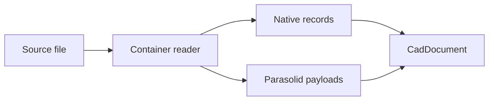

# SOLIDWORKS adapter

## Purpose and scope

Kit registers one SOLIDWORKS adapter with part and assembly identifiers.
Its primary `format_id` is `solidworks.sldprt`.
Its `aliases` field contains `solidworks.sldasm`.
The adapter reads source records.
It is not registered as a writer, so Kit cannot produce `.SLDPRT` or `.SLDASM` files.
It does not invoke SOLIDWORKS during production conversion.

| Identifier          | Suffix    |
| ------------------- | --------- |
| `solidworks.sldprt` | `.SLDPRT` |
| `solidworks.sldasm` | `.SLDASM` |

`available_adapters()` returns one entry for this adapter.
Read its `aliases` field to find the assembly identifier.
See [format selection](../../Tasks/SelectFormat.md) for a discovery example.

Registration is not evidence of complete feature-family support.
Inspect the exact source, target, and capability results for each conversion.

## Container and records

The container layer handles physical streams and compression.
The logical record layer interprets serialized objects and their references.
Keep these layers separate when diagnosing a failed file.

| Stream                               | Information                          |
| ------------------------------------ | ------------------------------------ |
| `Contents/Config-0-ResolvedFeatures` | Serialized feature records           |
| `Contents/Config-0-Partition`        | Cached Parasolid geometry            |
| `swXmlContents/KeyWords`             | Metadata useful for feature identity |
| `Contents/Definition`                | Native document definition records   |
| `Contents/CMgr`                      | Configuration-related records        |
| `Contents/Config-0-ModelHeader`      | Model header records                 |

The implemented container uses encoded stream names and compressed data.
A valid stream directory does not prove valid native feature records.
A valid feature record does not establish a successful vendor rebuild.

## Read flow

The reader combines available feature, geometry, and assembly information.
Source metadata and diagnostics qualify the decoded result.
The cached body geometry and feature history provide different evidence.

## Feature history

The resolved-feature grammar includes class definitions and object references.
The archive map changes as records are read.
Structural edits require consistent identifiers and map indices.
See [feature resolution](SolidworksFeatures.md) for the observed grammar.

The `moCompFeature_c` record supplies feature-tree ordering information in the documented research families.
Do not infer rebuild order from physical stream order alone.
Boss and cut behavior can depend on several related records.
A single flag change is not a general operation converter.

## Writing

Kit does not write SOLIDWORKS files.
A conversion to a `.SLDPRT` or `.SLDASM` destination raises `AdapterNotFoundError` and creates no file.

The earlier writer did not generate its streams from format rules.
Each supported family re-emitted a recorded payload, which is a typed recording of one saved stream.
Every generated file also took its `Config-0` stream from one recorded configuration program.
The [recorded payload removal](../../Changes/Solidworks/SolidworksRecordedPayloadRemoval.md) deleted that writer.
CI now rejects any recorded field program in `src`.

A future writer must derive each emitted structure from known format rules.
The container, archive, configuration manager, definition, and resolved-feature codecs remain as its starting point.
Do not present a carrier or a mode label as a completed translation.

The [2026 archive map handoff](../../Changes/Solidworks/SolidworksArchiveMapHandoff.md)
and [locked source controls](../../Changes/Solidworks/SolidworksOracleControls.md)
extend the research instruments without establishing writer support.
The [oracle diagnostic correction](../../Changes/Solidworks/Inspection/SolidworksOracleDiagnostics.md)
records why the original source batch did not establish per-feature error status.
The [oracle identity record](../../Changes/Solidworks/Inspection/SolidworksOracleBuildIdentity.md)
defines the executable build check used by clean inspection and retained tracing.
The [process exit-status record](../../Changes/Solidworks/Inspection/SolidworksOracleExitStatus.md)
distinguishes observed termination codes from lost COM connections.
The [native stage reports](../../Changes/Solidworks/Inspection/SolidworksOracleStageReports.md)
preserve open results when later measurement or cleanup fails.
The [critical repair observer](../../Changes/Solidworks/Inspection/SolidworksCriticalRepairTracing.md)
tracks the current native rejection without establishing a serializer correction.
The [minimal repair profile](../../Changes/Solidworks/Inspection/SolidworksMinimalRepairProfile.md)
limits instruction hooks to the confirmed application flag boundaries.
The [matching open-mode action](../../Changes/Solidworks/Inspection/SolidworksObserverModeComparison.md)
separates writable inspection from the default read-only action.
The [initial-frame observer](../../Changes/Solidworks/Inspection/SolidworksInitialFrameObservation.md)
records the template update target and native exception details.
Its measurements require healthy controls and do not establish native acceptance.
The [model appearance constructor](../../Changes/Solidworks/SolidworksModelVisualProperties.md)
replaces a null model appearance with an independently generated owned record.
The measured prior fault and each constructor-derived field are documented.
The generated replacement opens and rebuilds without errors or warnings, but
its sketch and extrusion are suppressed and it has no body. Native acceptance
remains unfinished.
The [suppression diagnostic](../../Changes/Solidworks/Inspection/SolidworksSuppressionDiagnostic.md)
observes a vendor intervention on copied research parts without counting the
changed state as generated-output acceptance.
The [configuration progress operation](../../Changes/Solidworks/SolidworksConfigurationProgress.md)
derives the completed-history marker from the generated persistent-ID allocator.
The first generated prism now opens and regenerates one solid without vendor
intervention. Editing, saved-copy reopening and broader coverage remain under
measurement.
The [native depth-edit inspection](../../Changes/Solidworks/Inspection/SolidworksNativeDepthEditInspection.md)
checks generated geometry, a live parameter change and a saved-copy reopen in
fresh application processes against explicit neutral-model expectations.
The [three-case measured polygon batch](../../Changes/Solidworks/SolidworksPolygonNativeMeasurements.md)
passes those checks with healthy controls and unchanged inputs. It remains
research evidence; the public adapter still refuses writing.
The [visible viewport inspector](../../Changes/Solidworks/Inspection/SolidworksNativeViewportInspection.md)
captures the application's actual model view for separate visual inspection.
The [standard-view constructor](../../Changes/Solidworks/SolidworksStandardViewConstruction.md)
generates the missing canonical rotations from native constructor rules.
Its new bytes still require controlled geometry and viewport measurements.
The [quaternion half-angle gotcha](../../Gotchas/Conversion/Solidworks/Model/QuaternionRotationUsesNegativeHalfAngle.md)
records the native negative half-angle and the refuted positive-factor assumption.
The [controlled curve source authoring tool](../../Changes/Solidworks/Inspection/SolidworksCurveSourceAuthoring.md)
prepares independent discovery and held-out inputs before curved-sketch writer
implementation. Its native preflight and full-family lock remain pending.
The fresh [model component constructors](../../Changes/Solidworks/SolidworksModelConstruction.md)
and [metadata constructors](../../Changes/Solidworks/SolidworksMetadataConstruction.md)
build research object graphs from authored semantics and native constructor rules.
Their process checks do not establish a complete, loadable native document.
The [fresh profile-reference repair](../../Changes/Solidworks/SolidworksProfileReferenceOwnership.md)
gives the origin and ordinary sketch separate owned reference objects.

The [2026 archive research](../../Changes/Solidworks/SolidworksArchiveResearch.md)
adds version-specific class schemas and a byte-identity checker under `re/`.
Remote process checks use eight redacted, vendor-authored controls.
These checks measure schema coverage. They do not establish generated output,
held-out acceptance, or a production writer.

## Geometry cache boundary

The partition stream can contain geometry derived from feature history.
Some measured research cases permit regeneration by the vendor application.
That observation does not authorize deleting caches in arbitrary documents.
Verify the field, source family, and vendor version before relying on regeneration.

## Inspect a result

1. Record the part or assembly format identifier.
2. Record the selected configuration.
3. Inspect native and carrier transfers separately.
4. Check body and feature-history evidence.
5. Check assembly references when applicable.
6. Obtain the required target-application measurements.

Expected result: the report identifies both implemented behavior and unresolved acceptance conditions.
See [result evaluation](../../Tasks/InspectResult.md).

## Sources

- [Adapter implementation](../../../src/convert/adapters/solidworks/core/Adapter.py)
- [Format metadata](../../../src/convert/adapters/solidworks/container/Format.py)
- [Container](../../../src/convert/adapters/solidworks/container/Container.py)
- [Archive](../../../src/convert/adapters/solidworks/container/Archive.py)
- [Research grammar](../../../re/solidworks/archive/Grammar.md)
- [SOLIDWORKS research index](../../../re/solidworks/README.md)
