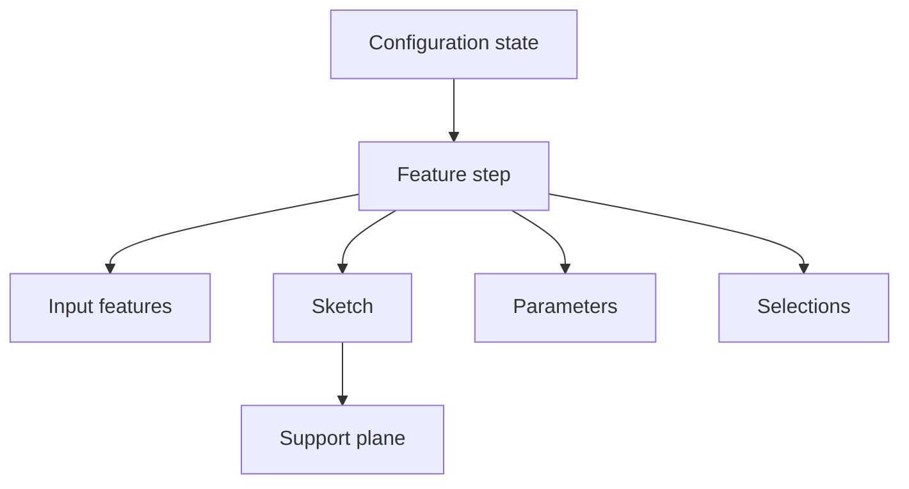

# Parametric feature model

## Purpose

The feature model represents modeling operations and their dependencies.
It preserves information needed for editable history.
A shape or mesh alone cannot supply that history.

## Feature records

| Field                  | Meaning                                        |
| ---------------------- | ---------------------------------------------- |
| `id`, `name`           | Stable identity and display name               |
| `kind`                 | Feature category                               |
| `order`                | Position in the timeline                       |
| `input_feature_ids`    | Dependencies on earlier features               |
| `sketch_id`            | Associated sketch                              |
| `parameter_ids`        | Parameters used by the feature                 |
| `operation`            | Boolean operation where applicable             |
| `definition`           | Typed feature parameters                       |
| `selection_ids`        | Referenced selections                          |
| `suppressed`           | Suppression state                              |
| `configuration_states` | State and parameter overrides by configuration |
| `provenance`           | Source evidence for the record                 |
| `attributes`           | Additional information                         |

The definition contract validates the supplied feature definition.
It does not prove that every writer can emit that feature.

## Plane intersection axes

Both axis forms use two ordered local `SupportPlane` selections. Their IDs
must match the reference step's `selection_ids` in order. The support frames
and axis endpoints share model-space millimetres, independent of the document's
display unit.

`PlaneAxis` retains two authored or measured endpoints. Its serialized type is
`PlaneIntersectionAxis`, with the original four fields. The endpoints and
segment direction must agree with the current intersection line. A support
edit that moves the line requires a new endpoint snapshot.

`BoundPlaneAxis` derives its endpoints from two ordered, independently owned
driving length parameters. Supply their IDs as `StartParameterId` and
`EndParameterId`, and put both IDs in the same order in the step's
`parameter_ids`. These parameters are signed literal distances from the
projection of the first support origin onto the intersection. Positive stations
follow the cross product of the first and second normals. The two stations
may run in either order and define the finite segment direction.
[`ResolveAxis`](../../../src/interchange/Features/Axes/ResolveAxis.py) evaluates these
endpoints from the selected frames and current parameters. Pass the document's
`configurations` to apply its active variant, as document validation does.
An override replaces the value of the linked length parameter while retaining
its ownership. The closest override in the active configuration's parent chain
controls each station. With no active configuration, the base values apply.
Base suppression, or suppression by either record in the active chain, keeps
the bound definition and resolves to no segment.

The signed stations establish the direction of a bound segment. Both generated
endpoints must remain finite, distinct, and within the line tolerance at model
precision. Endpoint snapshots also have an independent angular tolerance.

The measured SOLIDWORKS hinge has zero live extent dimensions. Its finite
size comes from clipping the line at the first support's display boundary.
`PlaneAxis` retains that evaluated native extent. `BoundPlaneAxis` represents
an explicitly authored portable extent binding.

## Supporting records

A sketch contains geometry and constraints on a support plane.
A parameter contains a value and its associated meaning or units.
A selection identifies geometry used by an operation.
Configurations can change parameter values and suppression states.

Preserve these references when changing a feature.
An identifier can remain syntactically valid while referring to the wrong entity.

## Operation families

Extrusion uses a profile, direction, extent, and end condition.
A depthless through-all extrusion stores an explicit null length. Other extrusion end conditions require a primary length.
Existing records can retain an explicit length with through-all, including a length stored in a native FreeCAD pocket.
Revolution uses a profile, axis, and angle.
Boolean operations define how geometry combines with existing bodies.
Other families use their own typed definitions.

Do not infer complete family coverage from the presence of an enumeration value.
Check the source reader, neutral definition, target writer, and acceptance evidence separately.

## Expressions and units

A parameter can contain an expression or a literal value.
Preserve its language and unit context.
A retained native expression is not necessarily executable in another application.
A translated expression requires evidence that its references and evaluation retain the intended result.

Distinguish a driving parameter from a measured or driven value.
Do not substitute a final measurement for an editable design relationship.

## Review an edit

1. Identify the changed driving parameter or feature definition.
2. Check every dependent feature reference.
3. Check the selected configuration.
4. Check unit conversions.
5. Inspect the writer's capability report.
6. Obtain the required remote oracle evidence.

Expected result: the target feature tree retains the required history and changes correctly after a dimension edit.
A successful initial load is insufficient.

## Sources

- [Feature step](../../../src/interchange/Features/FeatureStep.py)
- [Feature definitions](../../../src/interchange/Features/)
- [Feature validation](../../../src/interchange/document/Validation/DocumentFeatureValidate.py)
- [SOLIDWORKS feature records](../Adapters/SolidworksFeatures.md)
