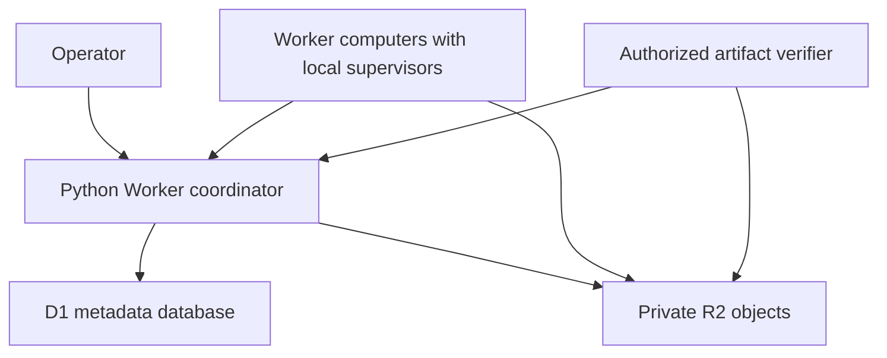

<!--
SPDX-License-Identifier: LicenseRef-PolyForm-Strict-1.0.0
SPDX-FileCopyrightText: Copyright (c) 2026 Parashell, Odin Glynn-Martin

This SPDX license identifier and copyright notice must not be
removed, altered, or obscured. Doing so is a material breach of
the PolyForm Strict License 1.0.0 and voids all licenses granted
to you under it immediately and permanently.
-->

# Cloudflare research coordinator plan

## Decision and delivery boundary

Use Cloudflare Workers for a coordinator API, D1 for coordination records, and private R2 storage for research files.
Existing worker computers perform CAD decoding, comparison, inference, and licensed application operations.
The coordinator requires no always-on home server or mini PC.
GitHub distributes reviewed software revisions and does not transport live jobs or research results.

This is a proposed architecture and implementation plan, not deployed functionality.
The planning owner is Codex, on branch `codex/plan-cloudflare-coordinator`, in a separate planning PR targeting `main`.
The baseline is main `7079d911a939366596b99f2097b6900c92fb25b7`.
The integration dependency is [PR #158](https://github.com/TryUniCAD/Kit/pull/158), inspected at `0b66cc014bac58e5171585c926b0773a9cdd570e`.
Its local [adapter contract](https://github.com/TryUniCAD/Kit/blob/0b66cc014/re/automation/Adapters.py) is the remote adapter's starting boundary.
Its controller, supervisor, corpus identities, and native acceptance rules remain owned by that programme.

This PR authorizes planning only.
It creates no Cloudflare resources, credentials, billing subscription, production data upload, or deletion operation.
Implementation tasks remain unassigned until explicitly claimed.

## Components and scope

The API assigns work and validates state changes.
Each node retains local process ownership, resource measurement, deadlines, bounded logs, and cleanup.
Nodes initiate outbound HTTPS connections and need no public inbound endpoint.
Private R2 objects carry inputs, outputs, logs, and immutable receipts.
The API transports small metadata records and issues narrowly scoped transfer authorization.

Reuse each node's existing SQLite and immutable artifact-storage foundation for a durable delivery outbox.
Do not add local PostgreSQL or an independent local scheduler.
The [delivery and recovery specification](CloudflareDeliveryRecovery.md) defines commit ordering, acknowledgements, offline execution, backup, and restoration.

Use one project, one Worker service, one D1 database, and one private Standard-class R2 bucket for the pilot.
Use Python for the API and desktop adapter, following the repository's backend standard.
Cloudflare supports [Python Workers and service bindings](https://developers.cloudflare.com/workers/languages/python/).
Compatibility and free-tier CPU measurements are implementation gates, not assumed properties of the current controller.
No CAD package, native application, model provider, arbitrary shell command, or decoder runs inside the Worker.
An initial dashboard can use the API's status response; a new web application is outside this plan.

## Database records

Names below describe proposed tables, not implemented migrations.
Use explicit foreign keys, project-scoped uniqueness, bounded values, and parameterized SQL.
Store bulk JSON documents and binary data in R2 instead of D1 rows.

| Record         | Essential fields and constraints                                                                                           |
| -------------- | -------------------------------------------------------------------------------------------------------------------------- |
| Projects       | Project identity, enabled state, running-job limit, quota policy, schema version, coordinator recovery epoch               |
| Runs           | Project and run identity, lifecycle state, immutable manifest digest, final export digest, cleanup policy                  |
| Nodes          | Project and node identity, credential digest, allowed job kinds, OS, approved worker revision, enabled state               |
| NodeSessions   | Node identity, random session identity, increasing session generation, lease expiry, available local slots                 |
| Jobs           | Run and job identity, kind, state, generation, priority, definition digest, tool/rule revisions, deadline, attempt budget  |
| Dependencies   | Child and parent job identities, required accepted generation and selected result digest                                   |
| Attempts       | Job generation, attempt number, node session, hashed lease credential, fixed execution deadline, outcome and result digest |
| Resources      | Installation identity, project, owning node, exact application build, capacity, available or quarantined state             |
| ResourceClaims | Resource, attempt, reserved quantity; uniqueness and capacity enforced with the job claim                                  |
| Artifacts      | Run, role, declared SHA-256, size, private sealed object key, verification state, verifier receipt digest                  |
| Mutations      | Project, recovery epoch, actor session, operation and idempotency key, request digest, bounded response reference          |
| Events         | Run, monotonic event sequence, actor, transition type, observed timestamp, small payload digest                            |

Index ready-job selection by project, state, kind, priority, and stable enqueue order.
Index dependencies by parent and artifacts by run and verification state.
Keep heartbeat expiry outside unnecessary secondary indexes to reduce write amplification.
Make attempt identity and mutation keys unique within their project and session.
Never derive a remote node's private path from another node's filesystem path.

Preserve existing job outcomes, fingerprints, generations, retry budgets, and evidence classifications from PR #158.
Separate execution completion from semantic qualification and native acceptance.
Changing a rule, tool revision, input digest, or accepted dependency result invalidates dependent work.
Publish invalidation and dependency readiness through bounded, resumable transactions.
Partially updated dependency sets cannot release a job.

## Atomic claims, leases, and failure recovery

Use D1's primary for scheduling, ownership, resource reservations, completion, and cleanup decisions.
Keep read replication disabled for the pilot's coordination paths.
An eventual status view must not authorize a mutation.

Claim one ready job with a conditional database mutation.
Use transactional constraints or triggers to create its attempt and reserve all required resources atomically.
A failed capacity, generation, dependency, or ownership check must roll back the entire transition.
Separate Worker-level reads followed by unconditional writes are prohibited.
An implementation must demonstrate these invariants through actual competing requests before release.

D1 uses auto-commit and provides transactional [prepared-statement batches](https://developers.cloudflare.com/d1/worker-api/d1-database/#batch).
Port local SQLite transaction boundaries to that API explicitly.
A statement that changes zero rows does not itself fail a batch.
Guarded follow-on changes must therefore depend on the successful claim, or raise a constraint failure.
Do not assume a local `BEGIN` sequence or PostgreSQL row-locking syntax works unchanged.

A node session receives one server-timed lease covering its current attempts.
Start with a 120-second heartbeat interval and a 600-second node lease.
Each attempt also retains its existing fixed execution deadline.
Effective authorization ends at the earlier deadline or node lease expiry.
The API compares server timestamps and never trusts a worker's wall clock for ownership.

Aggregate heartbeats per node rather than updating every running attempt.
Record state changes as events; do not append an event for every heartbeat.
An expired session cannot be revived by a delayed heartbeat.
Recovery installs a new session generation and rejects results or renewals from older generations.

Every mutation carries an idempotency key bound to its authenticated actor and canonical request digest.
An identical retry returns the previous outcome.
Reusing the key with different content refuses the operation.
Completion requires the current job generation, attempt, node session, valid lease credential, and unchanged dependency fingerprints.
Accept at most one result for that job generation; duplicate execution remains possible after failure.

Offline jobs can retry after ownership expires, within their attempt budget.
Native application resource claims enter quarantine when ownership is uncertain.
A lost network connection does not prove an application process stopped.
Only a matching owned-process recovery receipt can release or rearm that installation.
Keep one active operation per registered installation, as required by the existing application-worker contract.
Model execution stays disabled.

The remote protocol must also carry a coordinator recovery epoch and expose authenticated completion-receipt lookup.
The [delivery state table](CloudflareDeliveryRecovery.md#delivery-states-and-acknowledgements) defines accepted, unknown, stale, and locally retained outcomes.
Outbox replay cannot extend an expired lease or silently repeat a native application operation.

## Artifact transfer and integrity

1. Authorize an upload for one run, role, maximum size, and unique staging key.
2. Return a short-lived [R2 presigned URL](https://developers.cloudflare.com/r2/api/s3/presigned-urls/) for that staging object.
3. Let the node upload directly to R2, outside the coordinator request body.
4. Copy the staged object to a unique sealed key that worker credentials cannot overwrite.
5. Have an authorized verifier stream the sealed object and measure its SHA-256 and actual size.
6. Accept artifact metadata only when the measured bytes match the declared artifact and current attempt.
7. Commit the accepted result and artifact references in one D1 transition.

The verifier can run on an existing worker computer with a separate verification role.
Full-file hashing must not depend on the Worker's 10 ms free CPU allowance.
Presigned staging URLs remain reusable until expiry, so verification of the staging object alone cannot establish immutable accepted bytes.
R2 ETags and uploader-supplied digests are not substitutes for the measured SHA-256.
Keep bucket access private and expose no public listing or development bucket endpoint.

R2 publication and D1 commit do not form one distributed transaction.
Publish and verify sealed bytes before the database references them.
Retain uncommitted objects for bounded recovery, then collect them through the run cleanup protocol.
Readers verify downloaded bytes and use a bounded local digest cache.
Deduplication is limited to a run initially, so deleting one run cannot remove another run's inputs.

## API and trust boundary

| Operation                  | Contract                                                                                             |
| -------------------------- | ---------------------------------------------------------------------------------------------------- |
| Register or disable node   | Operator-only enrollment, approved capabilities, scoped credential issuance and revocation           |
| Submit run or jobs         | Operator-authorized immutable definitions, bounded dependency graph, explicit software revisions     |
| Begin session or claim     | Authenticated compatible node, current generation, project and resource capacity checks              |
| Heartbeat                  | Current session only, bounded progress summary, fixed attempt deadlines preserved                    |
| Authorize transfer         | Current run and attempt, exact object operation, short expiry and size policy                        |
| Verify artifact            | Separate verifier scope, sealed object identity, measured digest and size                            |
| Complete or reject attempt | Current ownership, idempotent outcome, verified artifacts, dependency snapshot validation            |
| Resolve completion receipt | Authenticated node lookup by immutable mutation identity; accepted, rejected, or unknown disposition |
| Read status                | Project-scoped pagination, bounded event ranges, no secret or signed-URL disclosure                  |
| Export and clean run       | Verified final delivery acknowledgement, lifecycle fences, resumable cleanup status                  |

Use separate operator, worker, and verifier credentials.
Workers receive no Cloudflare account token, database administration access, or general R2 secret.
Store credential digests and compare authentication material through a constant-time implementation.
Rotate credentials and revoke an individual node without replacing all project credentials.
Restrict each worker to its approved runner inventory and immutable software revisions.
Keep native installation paths, proprietary software, model credentials, and unrelated local files on their owning machines.

Reject oversized metadata, duplicate JSON keys, invalid identifiers, unsupported schema versions, cycles, and unauthorized cross-project references.
Rate-limit enrollment, claims, status polling, and transfer authorization per principal.
Never log bearer credentials, presigned URLs, CAD content, or complete request bodies.
Cloudflare authentication protects access; hashes establish byte identity, not CAD correctness or authorship.

## Run completion and automatic cleanup

The requested default is ephemeral cloud coordination.
The selected policy wipes all Cloudflare run data after final results are exported and verified.
GitHub is the final destination for reviewed code, documentation, and selected publishable evidence.
Published GitHub results survive Cloudflare cleanup.
It is not the live coordination queue or the default destination for every CAD file and log.
This planning PR performs no deletion.

Completion requires every required job to reach an accepted terminal outcome, with no active attempts or quarantined installations.
Before cleanup, export a manifest containing results, required receipts, source/tool/rule identities, and every retained artifact digest.
An authorized publisher collects coherent source changes into one task branch and normal pull request.
Use ordinary commits and a non-forced branch push, following the repository's current commit and file policies.
Read back the exact accepted GitHub commit and verify the exported file contents and manifest against their expected hashes.
PR creation or an upload request alone is not evidence of durable delivery.
Do not merge or publish a release without the separate authorization required by repository policy.

The run's export manifest must name an explicit destination for every required final artifact.
Large CAD files and full logs require an approved downloadable asset destination or verified operator download.
Expiring GitHub Actions artifacts cannot serve as the sole final archive for a run.
Proprietary vendor software, credentials, and private customer inputs are excluded from public exports.
A missing destination or failed verification leaves the run in `export_ready` and blocks cleanup.
Give GitHub publication credentials only to the publisher, outside ordinary CAD workers.
The receiving operator or designated publisher acknowledges the verified export digest and destination commit or asset identities.
Worker completion alone cannot acknowledge delivery or authorize deletion of the only useful copy.
Failed runs require the same export acknowledgement or an explicit operator discard decision.

Use lifecycle states `active`, `draining`, `export_ready`, `delivery_acknowledged`, `cleaning`, and `wiped`.
Entering `cleaning` blocks new submissions, claims, renewals, transfer grants, and result acceptance for that run.
Wait for outstanding transfer URLs to expire before removing their staging objects.
Drain copy and verification operations before deletion; an unresolved storage operation blocks the final wipe acknowledgement.
Clear local worker caches and sessions through explicit acknowledgements; report an offline node as outstanding cleanup.
Cloudflare acceptance alone cannot erase the last local recovery copy; require the separate verified final export acknowledgement.
Purge temporary run backups under the same policy and preserve final export/deletion acknowledgements outside Cloudflare for future restore reconciliation.
Remote deletion cannot prove a powered-off computer erased its local copy.

List and delete run-scoped R2 staging, sealed objects, multipart uploads, exports, and logs in resumable bounded pages.
Delete D1 artifacts, dependencies, attempts, mutation responses, events, and job records only after object deletion succeeds.
Keep a minimal cleanup tombstone containing an opaque run token, cleanup progress, and expiry for 24 hours.
The tombstone contains no CAD content, filenames, credentials, or artifact digests.
Only the operator can create a new server-assigned run identity.
Worker and callback routes never recreate a missing run.
Expired run authorization refuses even after the tombstone is removed.
Remove the tombstone after its fixed retry window, then report all live run metadata removed.
Retain shared schema, service configuration, and node enrollment for the next run.

Define `wiped` as deletion from live application storage, with separate evidence for local-node cleanup.
D1's free [Time Travel](https://developers.cloudflare.com/d1/platform/limits/) retains recovery history for seven days.
Live deletion is not immediate secure erasure from provider recovery history, exports, or copies already downloaded elsewhere.
A restored database must start paused and reconcile previous deletions before jobs or artifact access resume.
Document provider retention and recovery behavior during implementation before making stronger erasure claims.

## Free-tier budget and pilot envelope

These published limits were inspected on 2026-11-18.
They are quotas, not measured cluster capacity or a guarantee of zero cost at arbitrary scale.

| Service     | Free allowance relevant to this design                                                             | Proposed pilot control                                                                         |
| ----------- | -------------------------------------------------------------------------------------------------- | ---------------------------------------------------------------------------------------------- |
| Workers     | 100,000 requests/day; 10 ms CPU/request; 128 MB memory                                             | Small metadata requests, aggregated node heartbeats, idle polling backoff, measured Python CPU |
| D1          | 500 MB per database; 5 GB total account storage; 5 million rows read/day; 100,000 rows written/day | One database, indexed claims, bounded history, no per-attempt heartbeat writes                 |
| R2 Standard | 10 GB-month; 1 million Class A and 10 million Class B operations/month; free outbound bandwidth    | Private objects, local caches, run-scoped cleanup, transfer admission and retention limits     |

Sources: [Workers limits](https://developers.cloudflare.com/workers/platform/limits/), [D1 limits](https://developers.cloudflare.com/d1/platform/limits/), [D1 pricing](https://developers.cloudflare.com/d1/platform/pricing/), and [R2 pricing](https://developers.cloudflare.com/r2/pricing/).
D1 charges index maintenance against written-row usage.
One D1 database processes queries serially; adding worker machines does not create parallel database writers.
See [Cloudflare coordination limits](../../Gotchas/Research/Cloudflare/CloudflareDatabaseLimits.md).

Start with two nodes and eight offline slots per node.
Exercise four nodes and 32 total slots only after the smaller pilot meets its budgets.
At 120-second heartbeats, four continuously connected nodes generate 2,880 heartbeat requests per day.
Four idle nodes polling every 30 seconds add 11,520 requests per day.
Claims, completions, artifact operations, status reads, retries, and cleanup add usage beyond these counts.
Measure written rows and index costs rather than equating API requests with database operations.

Pause new admission at 70 percent of each measured free allowance, while preserving a reserved settlement and cleanup budget.
Aggregate counters and reconcile them with provider metrics; do not create a database write for every status read.
Set explicit per-run byte and operation reservations before accepting uploads.
Account for simultaneous uploads and orphaned objects against the storage reserve.
R2 overages can incur charges; a free allowance is not an automatic spend cap.
Automatic paid-plan changes are outside scope.

## Implementation work and acceptance

The parent backlog entry is B15, separate from PR #158's existing A01-A16 scope.
This document completes the proposed design artifact only; implementation acceptance remains open.

| Task                                       | Owner      | Dependency                               | Exit condition                                                                                                        |
| ------------------------------------------ | ---------- | ---------------------------------------- | --------------------------------------------------------------------------------------------------------------------- |
| C01: define remote protocol and migrations | Unassigned | This plan and refreshed PR #158 contract | Versioned requests, states, constraints, indexes, and upgrade/rollback behavior reviewed                              |
| C02: implement D1 coordination             | Unassigned | C01                                      | Competing hosted requests preserve ownership, dependency, capacity, and idempotency invariants                        |
| C03: implement private artifact transport  | Unassigned | C01                                      | Changed staging objects, wrong digests, stale attempts, interrupted copies, and orphan recovery handled correctly     |
| C04: connect local supervisors             | Unassigned | C02-C03 and PR #158                      | Two nodes use the remote adapter and durable SQLite/file outbox while retaining local process and resource safeguards |
| C05: implement export and cleanup          | Unassigned | C02-C04 and approved export destinations | Verified GitHub or download delivery precedes resumable deletion; late callbacks cannot recreate a cleaned run        |
| C06: measure offline pilot                 | Unassigned | C04-C05                                  | Matching result digests, node failure/recovery, quota accounting, and measured multi-node throughput recorded         |
| C07: qualify native workers                | Unassigned | C06 and licensed hosts                   | Partitioned sessions quarantine installations and owned-process recovery safely restores availability                 |

Use integration, process, compatibility, and end-to-end coverage through the repository's existing CI and merge-queue paths.
Test competing claims, expired leases, changed dependencies, duplicate completions, response loss, revocation, and partial storage failures.
Test cleanup interruption, repeated deletion, undelivered exports, live native sessions, expired transfer grants, and provider restore reconciliation.
Require real D1/R2 observations alongside local emulation before declaring Cloudflare compatibility.
The [interruption matrix](CloudflareDeliveryRecovery.md#interruption-acceptance-matrix) adds power loss, lost acknowledgements, full disks, stale backups, and restoration scenarios.
Record exact software revisions, selected free/paid plans, query metrics, resource measurements, and total run cost.
Do not extrapolate the historical single-machine sixteen-worker benchmark into demonstrated cluster throughput.

## Migration, rollback, and operational evidence

Keep the local adapter available and unchanged during remote development.
Give the remote adapter a distinct explicit configuration and protocol version.
Do not mount the local SQLite database over a network share or share its singleton supervisor owner among nodes.
An opt-in migration exports a quiescent local store and verifies all referenced bytes before submitting a new remote run.
Preserve historical corpus and receipt identities; migration does not grant new native acceptance.

For rollback, disable new remote claims and drain current work.
Quarantine uncertain application sessions and export accepted results before selecting the local adapter again.
Never silently run the same native task under both controllers.
Retain the last compatible deployment until active attempts drain before applying incompatible schema changes.

Monitor queue age, accepted throughput, retries, expired sessions, quarantined installations, API latency, D1 row usage, and R2 storage/operations.
Expose cleanup progress and outstanding local-node acknowledgements without retaining deleted run content in logs.
Keep backup, restore, credential rotation, quota exhaustion, and deployment procedures in the implementation's operator guide.
Use the [checkpoint and restore contract](CloudflareDeliveryRecovery.md#backup-contract-and-recovery-targets) before enrolling remote workers.
The pilot pauses new admission when its independent backup is stale and provides no automatic second-cloud failover.

## Planning verification

The design was checked against the cited Cloudflare documentation and the pinned PR #158 adapter and ownership contracts.
The planning PR must record formatting, local link checks, path-policy checks, and its exact remote CI and review evidence.
No hosted service, credential, load test, native application test, or deletion test has been executed for this plan.
Full language-standard conformance and representative-user evaluation remain unverified.
The [change entry](../../Changes/Research/Infrastructure/CloudflareCoordinatorPlan.md) records this delivery boundary.
