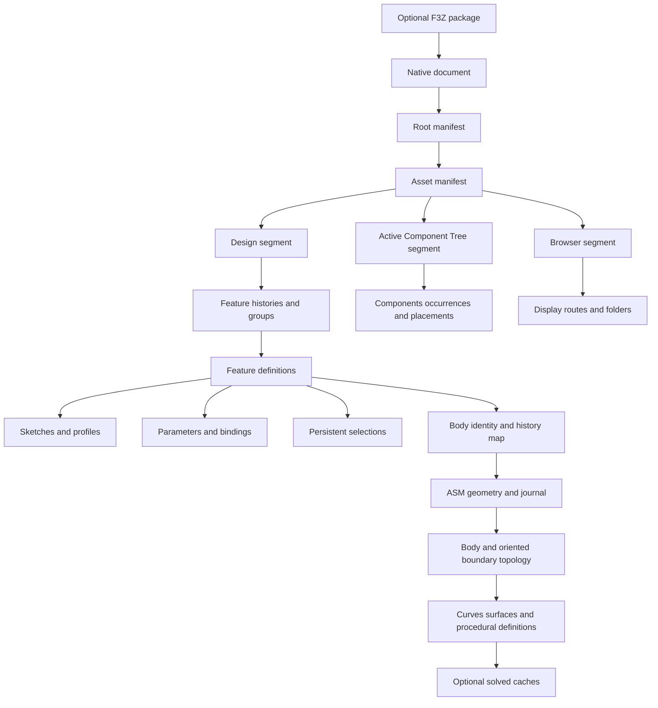

# Fusion native persistence data model

## Scope and evidence

This reference separates observed wire grammar, recovered semantics, and unresolved fields.
It describes the native persistence model and the implementation work required for independent reading and writing.
It does not establish complete Fusion interoperability.

The current checkout contains 712 tracked study archives with 21,269 ZIP members.
Their central directories declare 10,732 stored members and 10,537 Zstandard members.
The [inventory](../../../re/Fusion/Reconstruction/CorpusInventory.json) records each archive path, size, digest, member count, and compression methods.
This inventory inspected file structure without executing Kit or tests.

Historical measurements have a separate status.
The [archive study](../../../re/Fusion/Notes/Archive.md) records 2,139 reconstructed stream pairs and 713 Browser root payloads.
The [class catalogue](../../../re/Fusion/Study/fusion-class-catalog.json) records 403 class GUIDs across 707 archives.
Only 76 classes have observed semantic labels in that catalogue.
A class label does not establish its complete field schema.

The [geometry frontier](../../../re/Fusion/Study/asm-geometry-frontier-current.json) records 1,160 blobs and 3,761 initial body graphs.
Its scope excludes complete feature definitions, unexplained fields, trailing states, and native writing.
These historical measurements were not rerun for this document.

The independent [cadmpeg project](https://github.com/cadmpeg/cadmpeg/tree/de2726870ff728352163f601ab4e60bbd54fbade) supplies additional format research.
Its code uses Apache-2.0, and its specifications use CC-BY-4.0 with attribution to cadmpeg.
This reference attributes upstream findings explicitly and uses the pinned revision above.
Kit's local evidence remains the basis for the implemented parameter grammar.

## Why the format is difficult

An F3D file combines several linked databases inside a ZIP container.
Each database has a different identity namespace, ordering rule, and versioned schema.
Unpacking the container exposes those databases without resolving their relationships.

| Difficulty                                          | Consequence for a reader or writer                                   |
| --------------------------------------------------- | -------------------------------------------------------------------- |
| Class numbers come from each segment's registry     | A numeric class tag cannot identify a feature across files           |
| Primary and inherited records have separate indexes | A complete object can occupy several nonadjacent records             |
| Timeline order comes from explicit references       | Physical order and object numbers cannot reconstruct feature history |
| Design IDs differ from kernel entity numbers        | An integer match across the two domains is insufficient              |
| Body maps select geometry histories                 | A convenient blob or its first BODY can describe the wrong object    |
| Persistent names survive topology changes           | Current face order cannot replace feature selection identity         |
| Solved caches accompany procedural definitions      | A plausible NURBS surface can differ from the exact model            |
| Several caches repeat parameter values              | Editing one binary64 field can leave inconsistent feature state      |
| Unknown fields can affect regeneration              | Byte replay cannot prove independent document generation             |
| ZIP method 93 is uncommon in older readers          | A generic archive tool can fail before inspecting any CAD records    |

## Container and document families

| Family          | Structure and required interpretation                                                           |
| --------------- | ----------------------------------------------------------------------------------------------- |
| `.f3d`          | Native document archive with manifests, indexed segments, geometry blobs, and auxiliary members |
| `.f3z`          | Package containing related documents and a document dependency description                      |
| `.f2d`          | Drawing document that can occur as a package root                                               |
| `.f2t`          | Drawing template family, requiring separate drawing semantics                                   |
| `.smb`, `.smbh` | Embedded ASM binary streams, interpreted through headers and owning body maps                   |
| `.sat`, `.smt`  | Text geometry representations encountered in external research                                  |
| `.tsm`          | T-spline control-cage source, separate from committed B-rep geometry                            |
| `.paramesh`     | Mesh-body storage, separate from exact B-rep and parametric feature history                     |

The local `.f3z` example contains nine F3D members, `Manifest.json`, and `DesignDescription.json`.
REA 6.8.0 identified those eleven entries and their digests in the [saved evidence](../../../re/Fusion/Reconstruction/ReaAssemblyEvidence.json).
REA did not infer Fusion-specific semantics from that inventory.
Its F3D inspection rejected the study's ZIP method 93 compression.
See the [tool limitation](../../Gotchas/Conversion/FusionArchiveInspection.md).

The upstream [F3D specification](https://github.com/cadmpeg/cadmpeg/blob/de2726870ff728352163f601ab4e60bbd54fbade/docs/formats/f3d.md) describes additional package variants.
An F3Z root can be an F2D drawing with a derived F3D model.
Extracting only that model loses the drawing's sheets and annotations.
File extensions alone therefore cannot select a lossless package projection.

## Logical document graph

The manifest selects assets and segment identities.
Design owns the model's parametric definitions and references to geometry history.
ACT and Browser store additional component and presentation relationships.
Their successful parsing does not independently authenticate the matching Design snapshot.

### Identity domains

Every persistent reference must retain its domain and owning scope.
The recommended logical identity is `(document, asset, segment, domain, value)`.
Kernel references additionally require the geometry blob and history state.

| Domain                   | Value representation                | Scope                               | Required join                                                 |
| ------------------------ | ----------------------------------- | ----------------------------------- | ------------------------------------------------------------- |
| Asset identity           | GUID text                           | Document manifests                  | Root declaration to asset declaration                         |
| Snapshot token           | GUID text                           | Asset and ACT routing               | Exact declared token, without assuming content authentication |
| Type identity            | Class GUID plus version information | Segment registry                    | Registry row to class schema                                  |
| Wire class code          | Decimal integer text                | One segment                         | Registry position starting at 256                             |
| Design object identity   | Unsigned 64-bit integer             | One segment                         | Primary record and indexed inherited records                  |
| Parameter ordinal        | Unsigned 32-bit integer             | Parameter collection                | Ordered collection membership                                 |
| Bound parameter rank     | Unsigned 32-bit integer             | Qualified bound-parameter sequence  | Count only parameters with feature bindings                   |
| Owner control slot       | Unsigned 32-bit integer             | One feature owner                   | Owner's ordered control definitions                           |
| ASM entity pointer       | Signed 64-bit integer               | Blob and history state              | Entity table, with negative sentinels handled by schema       |
| Stored BODY handle       | Typed attribute value               | Referenced geometry history         | Design body map to matching kernel BODY identifier            |
| Persistent name key      | Schema-specific typed value         | Naming registry and feature lineage | Verified registry, creator, and selection route               |
| Journal ordinal          | History-specific value              | Kernel journal                      | Journal sequence and state transition                         |
| Inline subtype reference | Schema-specific slot                | Local subtype table                 | Local subtype resolution, never global entity indexing        |

## Primitive wire types

The supported Design grammar uses little-endian integers and binary64 numbers.
String counts measure encoded units, not Python string length.

| Primitive                 | Wire representation                        | Validation                                               |
| ------------------------- | ------------------------------------------ | -------------------------------------------------------- |
| `u32`                     | Four little-endian bytes                   | Exact unsigned range                                     |
| `u64`                     | Eight little-endian bytes                  | Exact unsigned range                                     |
| `f64`                     | Eight IEEE-754 little-endian bytes         | Finite value for the recovered parameter profile         |
| ASCII string              | `u32` byte count followed by bytes         | Bounded count and valid encoding                         |
| UTF-16 string             | `u32` code-unit count followed by UTF-16LE | Bounded encoded length and field-specific control policy |
| Local reference           | `01`, `u64` identity, `00 00`              | Exact marker and suffix                                  |
| Absent optional reference | `00`                                       | Distinct from a present reference containing zero        |
| Ordered reference list    | `u32` count followed by local references   | Bounded count and context-specific uniqueness            |

The two suffix bytes belong to reference framing.
Other reference dialects require their own schemas.
The supported parameter writer does not silently emit cross-segment references.

## Indexed segments

### Metadata object

Kit's [MetaSegment](../../../src/convert/formats/Fusion/SegmentCodec/Metadata/MetaSegment.py) retains these fields in native order:

| Field         | Type                               | Interpretation                                                                 |
| ------------- | ---------------------------------- | ------------------------------------------------------------------------------ |
| Header        | `MetaHeader`                       | Segment kind, segment ID, namespace, magic, version, and retained header words |
| Classes       | Ordered `MetaClass` rows           | Class GUID, base GUID, flags, class namespace, and owned object IDs            |
| StoredIds     | Ordered `u64` values               | Retained identity sequence, separate from timeline order                       |
| Primary       | Ordered `(object_id, offset)` rows | Primary BulkStream records                                                     |
| Continuations | Ordered `(object_id, offset)` rows | Inherited BulkStream records                                                   |
| NextId        | `u64`                              | Retained allocation state                                                      |
| Reserved      | `u32`                              | Retained field without an invented meaning                                     |
| Properties    | Ordered `(name, value)` rows       | Retained named unsigned properties                                             |

Observed core segments use metadata version 8.
The supported header carries magic 1234 and repeats its segment kind.
Design, ACT, and Browser are distinct segment kinds.
The exact header codec is [ReadWireHead](../../../src/convert/formats/Fusion/SegmentCodec/Metadata/ReadWireHead.py).

### Bulk record

An indexed BulkStream record begins with an ASCII decimal class code and a `u64` object identity.
The decimal code has a preceding `u32` byte count.
The next indexed offset determines the payload boundary.
There is no general payload-length field that can replace the metadata index.

The class code equals 256 plus the registry row position.
The corresponding GUID identifies the native class.
An inherited record retains the primary object's identity but selects an ancestor class.
The indexer verifies this ancestry before accepting a continuation.

The [segment writer](../../../src/convert/formats/Fusion/SegmentCodec/EmitSegment.py) derives both offset tables from emitted record positions.
Changing a string length therefore moves later records without requiring offset patches.
Registry order, record order, and timeline order remain separate inputs.

## Parametric data

### History and groups

A history payload contains six zero bytes, an owner reference, and an ordered list of feature references.
Group records carry group state, an ordered membership list, and a counted name.
The [chronology writers](../../../src/convert/formats/Fusion/SegmentCodec/Chronology) construct the supported layouts directly.

A reader must preserve owner-specific histories.
When one archive contains multiple histories, choosing a physical first record is ambiguous.
The explicit research reader accepts a selected native history identity.
Suppression, grouping, rollback state, and occurrence ownership require their associated native records.

### Parameter collection

The collection class GUID is `B0556F58-EE09-46A7-B18F-E296F48E5B13`.
Its supported full payload begins with a zero `u32` version.
The following offsets start after that version word.

| Offset            | Field                      | Width              |
| ----------------- | -------------------------- | ------------------ |
| 0                 | Fixed zero prefix          | 11 bytes           |
| 11                | Stored header counter      | 4 bytes            |
| 15                | Name registry reference    | 11 bytes           |
| 26                | Zero separator             | 1 byte             |
| 27                | Member count               | 4 bytes            |
| 31                | Ordered member references  | `11 * count` bytes |
| `31 + 11 * count` | Owning component reference | 11 bytes           |

The supported writer derives both counts from the member sequence.
The permissive reader and semantic proof retain different acceptance levels.
A contradictory redundant counter can remain observable while preventing complete source proof.
Every member must reciprocate the owning collection in its numeric record.

### Name registry

The registry class GUID is `E276745D-D84E-40D5-88BC-8C94DD4ACCDF`.
Its supported payload begins with a zero version word, byte `01`, and a dependency count.
Each dependency row contains an eleven-byte reference and four zero bytes.
The first row references the collection, followed by its members in the qualified collection order.

A zero separator precedes the name count.
Each name row contains counted UTF-16LE text and a member reference.
Names and member identities must each be unique.
Name-row order is retained separately from collection order.
These dependency rows describe registry membership, not expression dependencies.

### Numeric parameter

The numeric parameter class GUID is `7A6A3D31-BE74-4E19-9115-20642944C2E4`.
The supported full payload begins with a zero version word.
The body then contains these fields in order:

| Field         | Encoding                      | Meaning                                           |
| ------------- | ----------------------------- | ------------------------------------------------- |
| Header        | Seven zeros, `06`, four zeros | Qualified numeric body profile                    |
| Comment       | Counted UTF-16LE              | CR, LF, and TAB are allowed                       |
| NativeIndex   | `u32`                         | Collection ordinal                                |
| BindingId     | Optional local reference      | Absent for the supported user-parameter profile   |
| Formula       | Counted UTF-16LE              | Saved expression text                             |
| Metadata      | Ten or eleven bytes           | Qualified profile described below                 |
| RoleName      | Counted UTF-16LE              | User role or feature control role                 |
| Reserved text | Empty counted string          | Required empty in this profile                    |
| DisplayUnit   | Counted UTF-16LE              | Display unit, separate from numeric storage scale |
| ParamName     | Counted UTF-16LE              | Identifier matching `[A-Za-z_][A-Za-z_0-9]*`      |
| Number        | Finite binary64               | Stored evaluated value                            |
| Separator     | Zero byte                     | Footer framing                                    |
| CollectionId  | Local reference               | Actual owning parameter collection                |

The footer is a reference, not a constant byte sequence.
The original reader accepted only collection 16.
The updated reader retains the stored `CollectionId` and exposes `fusion.collection_id` in projected attributes.
Graph-level source proof still requires reciprocal collection membership.

The supported metadata profiles are:

| Profile                | Derived bytes                        | Constraint                           |
| ---------------------- | ------------------------------------ | ------------------------------------ |
| User numeric           | Seven zeros, favourite flag, `00 01` | No binding and role `User Parameter` |
| Bound numeric          | Seven zeros, favourite flag, `00 00` | Binding present                      |
| Extended bound numeric | Eleven zeros                         | Binding present and favourite false  |

The favourite flag is zero or one.
The extra byte's general meaning remains unresolved.
The encoder accepts these exact profiles and reconstructs their bytes from the qualified fields.
It rejects other metadata instead of copying unexplained metadata into output.

### Numeric binding

The supported floating binding class is `D91D429C-1BB5-4640-B49F-69AF14F463E9`.
Its full payload contains a zero version word followed by an 85-byte body.
Offsets below start after the version word.

| Offset | Field          | Encoding         |
| ------ | -------------- | ---------------- |
| 0      | Binding header | `01 01 00 00 00` |
| 5      | OwnerId        | Local reference  |
| 16     | SlotIndex      | `u32`            |
| 20     | Separator      | Zero             |
| 21     | Number         | Binary64         |
| 29     | ParamId        | Local reference  |
| 40     | BoundRank      | `u32`            |
| 44     | Reserved       | Four zeros       |
| 48     | Repeated owner | Local reference  |
| 59     | Fixed field    | `01 00 00`       |
| 62     | BookId         | Local reference  |
| 73     | Separator      | Zero             |
| 74     | Terminal owner | Local reference  |

All three owner references must agree.
The parameter's binding reference and binding's parameter reference must reciprocate.
The binding cache must match the parameter's binary64 bytes, including signed zero.
SlotIndex selects the owner's control, while BoundRank excludes user parameters.
Neither value replaces the collection ordinal.

Integer binding class `A085449A-5144-4B2B-B455-7F7035A40559` has a related 82-byte body.
Its value occupies five bytes: marker `01` and a `u32`.
The subsequent fields shift three bytes earlier.
Complete typed integer writing is outside the implemented floating profile.

The bookkeeping class is `6CCF41D5-40BE-48ED-A834-18F3EAED6C57`.
Its 43-byte payload contains sixteen zeros, a binding reference, a raw `u64`, and eight zeros.
The raw value's units and epoch remain unproven.
A writer must not invent a timestamp interpretation or default.

### Expressions, units, and sketches

Numeric parameter lengths use centimetres in the qualified captures.
Angles use radians, while display units can specify millimetres, inches, or degrees.
Unitless values remain distinct from lengths and angles.
Preserve signed zero and exact cached floating values when reproducing records.

Expressions retain source spelling independently of their evaluated cache.
Derived dependencies require a verified component scope, exact name resolution, parsed syntax, and compatible units.
Generic native graph membership does not establish expression edges.
The dependency counterexample is recorded in [Parameters](../../../re/Fusion/Notes/Parameters.md).

Sketch geometry requires its own local frame, support-plane definition, primitives, constraints, dimensions, and profile selections.
A solved plane matrix does not explain the construction rule that must regenerate it.
A profile is an explicit selection of bounded curve portions, not every curve in a sketch.
Feature writers must retain those definitions and the corresponding parameter bindings.

## B-rep and procedural geometry

### ASM envelope

The observed binary envelope begins with the fifteen-byte signature `ASM BinaryFile8`.
Four signed 64-bit words follow: version, stored record count, stored entity count, and flags.
Three tagged strings identify product, kernel version, and creation-date text.
Three tagged doubles retain units in millimetres, resolution tolerance, and normal tolerance.

The [study token reader](../../../re/Fusion/Study/asm_records.py) bounds each field and records its original offset.
The independent [ezdxf SAB implementation](https://github.com/mozman/ezdxf/blob/master/src/ezdxf/acis/sab.py) supplied token vocabulary.
Its general ACIS support does not supply Fusion's parametric persistence schema.

| Tag    | Observed payload                     | Interpretation                                      |
| ------ | ------------------------------------ | --------------------------------------------------- |
| 4      | Signed 64-bit integer                | Integer token                                       |
| 6      | Binary64                             | Double token                                        |
| 7      | Byte length and UTF-8 bytes          | String token                                        |
| 10, 11 | No following payload                 | Boolean tokens                                      |
| 12     | Signed 64-bit integer                | Entity pointer                                      |
| 13     | Byte length and UTF-8 bytes          | Entity name                                         |
| 14     | Byte length and UTF-8 bytes          | Entity name prefix                                  |
| 15, 16 | No following payload                 | Subtype delimiters                                  |
| 17     | No following payload                 | Record end                                          |
| 18     | Signed 64-bit length and UTF-8 bytes | Literal string                                      |
| 19, 20 | Three binary64 values                | Position or direction vector                        |
| 21     | Signed 64-bit integer                | Enumeration token                                   |
| 23     | Eight bytes                          | Context-dependent value, requiring an owning schema |

Tag 23 is an integer only within the verified `int64_attrib-name_attrib-gen-attrib` schema.
Treating every tag 23 as a floating value corrupts stored identities.
Treating every tag 23 as an integer also exceeds the evidence.

### Geometry states

Explicit markers separate initial geometry, history, and trailing states.
The observed markers include `Begin-of-ASM-History-Data`, `End-of-ASM-History-Section`, and `End-of-ASM-data`.
Entity pointers require their owning state and blob.
The first geometry state is not automatically the document's final visible model.

Design body maps name a blob and a stored body identity.
The [body identifier evidence](../../../re/Fusion/Study/body-asm-identifier-decoding.json) disproves mapping bodies by root order.
Resolve the referenced blob, then match its typed BODY identifier.
Do not infer the correct body from file order, equal volume, or a nearest geometric match.

### Topology model

| Object    | Required relationships                                                        |
| --------- | ----------------------------------------------------------------------------- |
| Body      | Owning document/component, lumps or sheets, placement, persistent identity    |
| Lump      | Owning body and shells                                                        |
| Shell     | Faces and shell orientation or sidedness                                      |
| Face      | Supporting surface, oriented loops, tolerance, attributes, persistent name    |
| Loop      | Ordered coedge cycle and owning face                                          |
| Coedge    | Edge use, next/previous links, mate relation, direction, optional UV curve    |
| Edge      | Curve, parameter interval, endpoint vertices, tolerance, persistent name      |
| Vertex    | Point, tolerance, incident topology, persistent name                          |
| Curve     | Analytic, spline, intersection, or procedural definition and parameter domain |
| Surface   | Analytic, spline, offset, blend, loft, or other procedural definition         |
| Attribute | Typed ownership and payload with its own schema                               |

Topology must preserve orientation and parameterization separately from geometric coordinates.
An edge's XYZ curve and a coedge's UV curve can use different parameter maps.
Matching endpoints alone does not determine that map.
Seams and periodic surfaces require chart-aware trimming.

### Exact definitions and caches

The data model must distinguish an exact definition from an approximation cache.
Each cache needs its owner, parameter domain, representation, tolerance evidence, and provenance.
An unexplained trailer remains unresolved even when the control grid is readable.

The [ASM cache study](../../../re/Fusion/Notes/AsmCaches.md) records a loft cache deviation of approximately 2.85 micrometres at sampled points.
It also records pcurve discrepancies reaching approximately 0.00616 UV units in sampled comparisons.
Those values are neither global bounds nor interchangeable units.
They demonstrate why a decoded NURBS cache cannot automatically replace the original procedural definition.

Rational spline points and weights must retain their storage convention.
The observed rational layouts store Euclidean coordinates followed by weights.
The surface grid order can differ from the API's control-point order.
Knot multiplicities, periodicity, explicit bounds, and subtype references require independent interpretation.

## Native writing obligations

Complete native writing requires more than each stream's syntactic serializer.
The writer must construct a mutually consistent document graph from semantic inputs.

1. Allocate identities separately within each native domain.
2. Build the class registry and inheritance graph.
3. Emit component definitions and occurrence placements.
4. Emit sketch definitions, constraints, and profile selections.
5. Emit parameters, name registries, bindings, and feature controls.
6. Emit explicit history order, groups, suppression, and rollback state.
7. Emit exact B-rep definitions and applicable kernel history.
8. Emit body maps, persistent naming, and selection lineage.
9. Emit matching ACT, Browser, manifests, and auxiliary members.
10. Derive indexes, lengths, compression frames, and ZIP checksums.

The existing core archive builder satisfies only part of these obligations.
It still accepts caller-supplied record payloads.
New numeric serializers account for their supported payload bytes directly.
They do not provide the missing feature, bookkeeping, kernel, or presentation semantics.

The upstream [generation implementation](https://github.com/cadmpeg/cadmpeg/blob/de2726870ff728352163f601ab4e60bbd54fbade/crates/cadmpeg-codec-f3d/src/writer/generate/mod.rs) has explicit limitations too.
It rejects several source-less ACT, asset, SubD, tessellation, and configuration cases.
Its existence does not establish complete independent parametric generation.

## Verification boundaries

| Evidence                      | What it establishes                                  | What remains unverified                           |
| ----------------------------- | ---------------------------------------------------- | ------------------------------------------------- |
| ZIP inventory                 | Declared members, sizes, compression, archive digest | CAD semantics                                     |
| Bounded stream decoding       | Recognized fields and structural consistency         | Meaning of unexplained fields                     |
| Byte-exact record re-encoding | Reproducibility of the admitted grammar              | Regeneration and independent document generation  |
| Saved API comparisons         | Captured semantics for named controls                | Uncaptured variants and current output acceptance |
| PR CI                         | Checks executed on the reported revision             | Deferred queue checks and vendor behavior         |
| Fusion open and rebuild       | Actual vendor acceptance for measured outputs        | Untested feature families                         |

No Fusion oracle is available for this work.
Vendor loadability, body properties, feature editability, and rebuild acceptance remain unverified.
The format investigation and implementation continue independently of that missing evidence.
Production discovery must remain disabled until the complete acceptance requirements are met.
