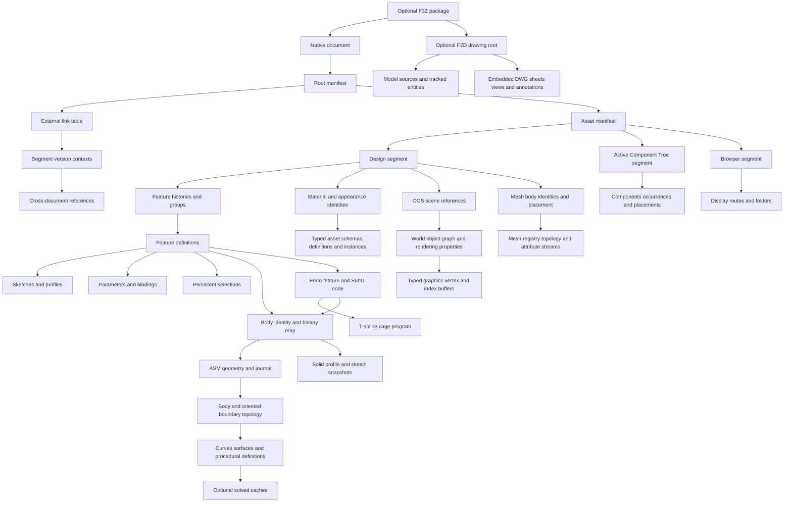

# Fusion native persistence data model

## Scope and evidence

This reference separates observed wire grammar, recovered semantics, and unresolved fields.
It describes the native persistence model and the implementation work required for independent reading and writing.
It does not establish complete Fusion interoperability. [The acceptance evidence matrix](FusionAcceptanceEvidence.md) distinguishes complete document authoring, corpus entity coverage, component reconstruction, standalone geometry, and preserved bundle members.

The current checkout contains 712 tracked study archives with 21,269 ZIP members.
Their central directories declare 10,732 stored members and 10,537 Zstandard members.
The [inventory](../../../re/Fusion/Reconstruction/CorpusInventory.json) records each archive path, size, digest, member count, and compression methods.
This inventory inspected file structure without executing Kit or tests.

Historical measurements have a separate status.
The [archive study](../../../re/Fusion/Notes/Archive.md) records 2,139 reconstructed stream pairs and 713 Browser root payloads.
The [class catalogue](../../../re/Fusion/Study/fusion-class-catalog.json) records 403 class GUIDs across 707 archives.
Only 76 classes have observed semantic labels in that catalogue.
A class label does not establish its complete field schema.

The new [binary catalogue](../../../re/Fusion/Reconstruction/BinaryClasses.json) supplies 1,218 class-identifier mappings from 14 installed libraries.
Its full-corpus inventory names all 403 declared Design classes: 283 have primary objects and 120 are registry-only declarations.
Across 712 archives it records 120,210 class declarations and 227,625 primary objects, with zero metadata extraction failures.
Each captured class has only one stored version in that corpus, so this coverage does not prove historical migration support.
The [parameter registration evidence](../../../re/Fusion/Reconstruction/BinaryParameters.json) records exact field types, inheritance, version branches, and method addresses with source binary digests.
The local [schema dump](../../../re/Fusion/LocalOracle/Allocation/ParameterSchema.xml) independently lists 155 current types and 404 member names.

The [geometry frontier](../../../re/Fusion/Study/asm-geometry-frontier-current.json) records 1,160 blobs and 3,761 initial body graphs.
Its scope excludes complete feature definitions, unexplained fields, trailing states, and native writing.
These historical measurements were not rerun for this document.

The independent [cadmpeg project](https://github.com/cadmpeg/cadmpeg/tree/de2726870ff728352163f601ab4e60bbd54fbade) supplies additional format research.
Its code uses Apache-2.0, and its specifications use CC-BY-4.0 with attribution to cadmpeg.
This reference attributes upstream findings explicitly and uses the pinned revision above.
Kit's local evidence remains the basis for the implemented parameter grammar.

## Why the format is difficult

An F3D file combines several linked databases inside a ZIP container.
Each database has a different identity namespace, ordering rule, and versioned schema.
Unpacking the container exposes those databases without resolving their relationships.

The difficulty is cumulative.
Each layer below can be solved alone, but a writer must satisfy all layers in the same file.
A file that passes the checks of one layer can still fail to load, rebuild, or measure correctly in Fusion.
Fusion does not report every such failure as an error.
Some failures appear only as a changed area or volume after conversion.

| Difficulty                                                    | Consequence for a reader or writer                                   |
| ------------------------------------------------------------- | -------------------------------------------------------------------- |
| Class numbers come from each segment's registry               | A numeric class tag cannot identify a feature across files           |
| Primary and inherited records have separate indexes           | A complete object can occupy several nonadjacent records             |
| Timeline order comes from explicit references                 | Physical order and object numbers cannot reconstruct feature history |
| Design IDs differ from kernel entity numbers                  | An integer match across the two domains is insufficient              |
| Body maps select geometry histories                           | A convenient blob or its first BODY can describe the wrong object    |
| Persistent names survive topology changes                     | Current face order cannot replace feature selection identity         |
| Solved caches accompany procedural definitions                | A plausible NURBS surface can differ from the exact model            |
| Several caches repeat parameter values                        | Editing one binary64 field can leave inconsistent feature state      |
| Unknown fields can affect regeneration                        | Byte replay cannot prove independent document generation             |
| ZIP method 93 is uncommon in older readers                    | A generic archive tool can fail before inspecting any CAD records    |
| Archived kernel states are not stored in rollback order       | Physical state order cannot replace the delta-state graph            |
| Periodic faces can close a solid without edges                | A polygon Euler check rejects valid spheres and tori                 |
| T-spline root links are orientation state                     | Re-rooting a valid control cage changes the converted body           |
| Edit counters change during ordinary edits                    | A changed counter is not evidence of a schema or topology change     |
| Serializer framing depends on the class, not on its name      | Two similarly named classes can use different identity framing       |
| Native mass caches have their own numeric precision           | An exact analytic check rejects valid saved mass properties          |
| A T-spline unit declaration disagrees with stored coordinates | A literal unit conversion scales the control cage by a factor of 100 |
| Legacy collections keep stale counters                        | A plausible counter is not a timeline position                       |
| Fusion does not recompute features on open                    | A writer must store the solved geometry of every feature state       |
| A Form body comes from stored BRep, not from its cage         | A Form writer must store the exact converted body                    |
| G1 cap weights have no recovered closed form                  | Each Form cage layout needs a measured conversion table              |
| ASM subtype references index one table per stream             | Reordering or subsetting records must renumber or inline definitions |
| Each bulletin names its entity on the new side                | A wrong backup chain opens but terminates Fusion on close            |
| A drawing's DWG member holds its views and annotations        | Entity segments alone cannot author or regenerate a drawing          |
| Saved bulk streams can end with unexplained bytes             | A strict reader rejects valid Fusion saves                           |
| Protein assets carry heap residue from the saving machine     | A fixture can leak account data that outer-member scans miss         |
| Configured designs need an unrestricted account               | No configuration layout can be observed with the current account     |

### Container layer

The ZIP container uses method 93, which is Zstandard compression.
The study corpus declares 10,732 stored members and 10,537 Zstandard members.
Generic archive tools and the REA F3D inspector reject method 93 before they read any CAD record.
A writer must produce Zstandard members that the Fusion reader accepts.
See the [tool limitation](../../Gotchas/Conversion/Fusion/FusionArchiveInspection.md).

Fusion writes stored, zero-byte directory entries.
It also opens deflated directory entries that hold the 2-byte empty Deflate stream.
See the [directory entry gotcha](../../Gotchas/Conversion/Fusion/Records/FusionDeflatedDirectories.md).

Material and appearance assets are nested ZIP archives inside `.protein` members.
Their property members can hold uninitialized heap bytes from the saving machine.
In saved fixtures, that residue held account identifiers, display names and home directory paths.
A privacy scan must therefore recurse into every nested archive and scan decompressed bytes.
Kit's readers do not decode the residue.
See the [heap residue gotcha](../../Gotchas/Conversion/Fusion/Records/FusionProteinHeapResidue.md).

### Object-graph layer

Each indexed segment pairs a bulk stream with a metadata stream.
The metadata stream declares a class registry that is local to that segment.
The same class can have a different number in another segment or file.
A class identifier is therefore a GUID, not a number.
The corpus declares 403 class GUIDs, and only the installed libraries name most of them.

A primary record and its inherited records have separate indexes.
A complete object is the join of those records, not one contiguous byte range.
Each class also has its own schema and inheritance versions.
`Ns::MemberSet::addNewMember` registers members in two maps and a vector.
That decompiled routine shows that map order is not wire order.
The persistence visitor sets the wire order.

The timeline comes from explicit references in `DcCreationOrderFeatures.representationFeatures`.
Physical record order, object numbers, and the legacy `m_curFeatureId` field do not give the timeline.
That legacy field has the value 1 in both one-feature and two-feature controls.
See the [legacy feature state gotcha](../../Gotchas/Conversion/Fusion/Api/FusionLegacyFeatureState.md).

A saved bulk stream can end with bytes after its last indexed record.
Two exports of one saved document carried different trailing bytes, so the bytes are not record data.
Kit keeps them within per-stream limits, as [Trailing stream bytes](#trailing-stream-bytes) describes.

### Identity layer

Four identity domains occur in one document.
They use similar integers for unrelated objects.

| Domain                  | Scope                                   | Example failure when it is confused                      |
| ----------------------- | --------------------------------------- | -------------------------------------------------------- |
| Design entity IDs       | Records in the Design segment           | A feature points to an unrelated kernel body             |
| ASM entity pointers     | Records inside one SMB or SMBH stream   | A face points to a record in a different state           |
| Delta-state identifiers | States of the kernel history stream     | Rollback restores the wrong state                        |
| Persistent entity tags  | Named topology across states            | A feature selects a different face after a rebuild       |

The journal header stores the current state, the maximum allocated state, a retained-state limit, and the next entity tag.
A rolled-back native stream stores `3,10,0,6`, so the current and maximum states differ.
A writer must not derive one counter from another.
A mesh body uses `pMeshUuid`, which equals the component registry `fusion_uuid`.
Neither the filename UUID nor the container mesh UUID is that identity.

A document that references other designs adds a cross-document scope.
A link GUID joins the root manifest, the asset manifest, the version contexts and the bundle graph.
A version-context token keys each cross-document reference within one segment.
A reference update replaces the link GUID and the tokens.
See [External references, assemblies and configurations](#external-references-assemblies-and-configurations).

### Geometry layer

Geometry is stored as ASM SMB and SMBH binary streams.
An SMBH stream contains the kernel `HISTORY_STREAM`, `DELTA_STATE`, and `BULLETIN_BOARD` graph.
Each bulletin records an insertion, deletion, or replacement of one entity.
Archived states can be physically ordered `14, 2, 9` while the rollback order is `14 → 9 → 2`.

A face carries a procedural or analytic carrier and also a solved cache.
A sphere or torus face can close a solid with no loops, edges, or vertices.
A full circle can store its arc from 0 to 2π while its snapshot edge runs from −π to +π.
A circle sketch snapshot contains an open planar sheet with an unpartnered coedge.
Each of these valid native states fails a validator that assumes closed polygon solids.

Spline surfaces, interpolated curves and parameter-space curves are subtype scopes inside ordinary ASM records.
A `ref N` scope indexes one subtype table for the whole stream.
Record order and record subsets therefore change what a reference names.
An edge can have one to four coedge uses, and a free face or free edge can occupy a root slot.
Each bulletin names its entity on its new side and stores a backup only on its old side.
Fusion opened journals that broke this rule, then terminated while it closed them.
See [Complex surface geometry](#complex-surface-geometry-and-explicit-nurbs-bodies) and [Journal structure](#journal-structure).

### Evaluation-state layer

Some fields change the solved result but look like bookkeeping.
T-spline face origins, edge origins, and vertex orientation links are evaluation state.
A cage with the same points and faces but different roots converts to a different body.
The difference is about 4.5e-7 in relative area.
It is deterministic and survives edits, save, and reopen.
See the [orientation gotcha](../../Gotchas/Conversion/Fusion/TSpline/RootLinksAreOrientation.md).

Other fields look like state but are only counters.
The TSM `ver` record increments during ordinary edits.
Setting it to the native value does not change the solved body.

Fusion 2706.1.17 does not recompute features when it opens a document.
Truncated journals and persisted dirty flags opened as stale geometry with healthy timeline items.
Only `computeAll` produced the feature geometry.
A Form body likewise comes from its stored BRep members, not from a conversion of its cage.
Correct geometry after an open therefore proves only that Fusion read the stored solved state.
See the [stale open gotcha](../../Gotchas/Conversion/Fusion/Features/FeatureStaleOpen.md) and the [Form authority gotcha](../../Gotchas/Conversion/Fusion/TSpline/StoredFormBrepAuthority.md).

Fusion converts each Form cage layout with a fixed linear map from grips to converted poles.
No closed form was found for the G1 cap weights around extraordinary vertices.
A writer must therefore apply a measured table for each qualified layout.
See [Stencil cage conversion](#stencil-cage-conversion).

Numeric caches have their own precision.
A native cylinder save stores transverse moments `17.385321755015763` and `17.38532263840058` for one axisymmetric body.
The reported integration precision is about `4.8e-4`.
An exact analytic symmetry check rejects that valid save.
See the [mass precision gotcha](../../Gotchas/Conversion/Fusion/Api/FusionCircularMassPrecision.md).

### Display and auxiliary layer

The OGS graphics scene, ParaMesh streams, materials, previews, and configurations are separate members.
Each member has its own serializer and identity rules.
The OGS serializer selects resource framing per class.
`PrimitiveLODGeometryNode` clears the resource flag, but `SimpleMesh`, `VertexBuffer`, and `CircleArc<double>` keep it.
See the [inline graphics gotcha](../../Gotchas/Conversion/Fusion/Graphics/FusionInlineGraphics.md).
Complete document acceptance reconstructs these members instead of omitting them.
Two members are outside typed reconstruction.
Kit writes a drawing's embedded DWG database as opaque bytes from a read drawing.
Nonempty configuration sidecars are unknown, because no configured control exists.
See [DWG authority](#dwg-authority) and [Configurations](#configurations).

### Tooling and oracle layer

External tools identify names but do not establish field widths or meanings.
The installed universal Mach-O libraries require an arm64 slice before decompilation.
Upstream structural research labels some T-spline fields differently from the native getters.
The Fusion API is also not a perfect oracle.
One axial torus request ignored its supplied center.
Only measured native load, rebuild, edit, save, and reopen results decide a disputed field.

Some native limits come from the account, not from the format.
`Design.createConfiguredDesign` failed because the account is restricted.
Uploads under the Personal-use licence stayed read-only, so an edited drawing could not be saved.

### Method that resolved the format

| Step                    | Evidence produced                                                                |
| ----------------------- | -------------------------------------------------------------------------------- |
| Corpus inventory        | 712 tracked archives, 21,269 members, and every declared class GUID              |
| Binary symbol evidence  | 1,218 class-identifier mappings from 14 installed libraries                      |
| External inventories    | `reverse-engineer` and REA outputs that bind exported names to library digests   |
| Controlled variants     | One-variable native files, such as the T-spline root and edge variants           |
| Byte-exact re-emission  | Typed decode and encode that reproduce native members without source bytes      |
| Independent authoring   | New files from dimensions, cages, or analytic bodies, with no source template    |
| Native acceptance       | Fusion 2706.1.17 load, rollback, rebuild, edit, save, and reopen measurements    |

A field is qualified only when all applicable steps agree.
An unexplained field is a rejection boundary, not a retained opaque value.
Two uninterpreted byte ranges are retained by explicit, bounded rules.
They are trailing bytes after the last record of a bulk stream and the embedded DWG of a drawing.

## Container and document families

| Family          | Structure and required interpretation                                                           |
| --------------- | ----------------------------------------------------------------------------------------------- |
| `.f3d`          | Native document archive with manifests, indexed segments, geometry blobs, and auxiliary members |
| `.f3z`          | Package containing related documents and a document dependency description                      |
| `.f2d`          | Drawing document that can occur as a package root                                               |
| `.f2t`          | Drawing template family, requiring separate drawing semantics                                   |
| `.smb`, `.smbh` | Embedded ASM binary streams, interpreted through headers and owning body maps                   |
| `.sat`, `.smt`  | Text geometry representations encountered in external research                                  |
| `.tsm`          | T-spline control-cage source, separate from committed B-rep geometry                            |
| `.paramesh`     | Mesh-body storage, separate from exact B-rep and parametric feature history                     |

The local `.f3z` example contains nine F3D members, `Manifest.json`, and `DesignDescription.json`.
REA 6.8.0 identified those eleven entries and their digests in the [saved evidence](../../../re/Fusion/Reconstruction/ReaAssemblyEvidence.json).
REA did not infer Fusion-specific semantics from that inventory.
REA's Ghidra provider also decompiled `Ns::MemberSet::addNewMember` from an arm64 slice of the installed data-model library.
The [binary-tool evidence](../../../re/Fusion/Reconstruction/ReaBinaryEvidence.json) records the exact input digest, address, tool versions, evidence identifier, and the resulting registration-map observations.
The universal Mach-O input first required thinning; generic archive inspection and native-code decompilation are distinct REA capabilities.
Its F3D inspection rejected the study's ZIP method 93 compression.
See the [tool limitation](../../Gotchas/Conversion/Fusion/FusionArchiveInspection.md).

The upstream [F3D specification](https://github.com/cadmpeg/cadmpeg/blob/de2726870ff728352163f601ab4e60bbd54fbade/docs/formats/f3d.md) describes additional package variants.
An F3Z root can be an F2D drawing with a derived F3D model.
Extracting only that model loses the drawing's sheets and annotations.
File extensions alone therefore cannot select a lossless package projection.

## Logical document graph



The manifest selects assets and segment identities.
Design owns the model's parametric definitions and references to geometry history.
ACT and Browser store additional component and presentation relationships.
Their successful parsing does not independently authenticate the matching Design snapshot.

### Identity domains

Every persistent reference must retain its domain and owning scope.
The recommended logical identity is `(document, asset, segment, domain, value)`.
Kernel references additionally require the geometry blob and history state.

| Domain                   | Value representation                | Scope                               | Required join                                                 |
| ------------------------ | ----------------------------------- | ----------------------------------- | ------------------------------------------------------------- |
| Asset identity           | GUID text                           | Document manifests                  | Root declaration to asset declaration                         |
| Snapshot token           | GUID text                           | Asset and ACT routing               | Exact declared token, without assuming content authentication |
| Type identity            | Class GUID plus version information | Segment registry                    | Registry row to class schema                                  |
| Wire class code          | Decimal integer text                | One segment                         | Registry position starting at 256                             |
| Design object identity   | Unsigned 64-bit integer             | One segment                         | Primary record and indexed inherited records                  |
| Parameter creation index | Unsigned 32-bit integer             | Parameter collection                | Persistent allocation index; deletion leaves gaps             |
| Runtime parameter ID     | Unsigned 64-bit integer             | Design-capture parameter            | `DcParameter.rparamId`; distinct from the parameter entity ID |
| Observer-vector index    | Signed 32-bit integer               | Referenced subject entity           | Position of this observer in the subject's observer vector    |
| ASM entity pointer       | Signed 64-bit integer               | Blob and history state              | Entity table, with negative sentinels handled by schema       |
| Stored BODY handle       | Typed attribute value               | Referenced geometry history         | Design body map to matching kernel BODY identifier            |
| Persistent name key      | Schema-specific typed value         | Naming registry and feature lineage | Verified registry, creator, and selection route               |
| Delta-state identity     | Native signed 32-bit integer        | Kernel history stream               | State-tree links and feature-to-history transitions           |
| Current/max state IDs    | Independent signed 32-bit integers  | Kernel history stream               | Selected state versus allocation watermark                    |
| Next entity tag          | Native signed 32-bit allocator      | Kernel history stream               | Entity tag allocation, separate from record indexes           |
| Inline subtype reference | Schema-specific slot                | Local subtype table                 | Local subtype resolution, never global entity indexing        |
| Link GUID                | GUID text                           | Root manifest link table            | Asset link row, version contexts and bundle `neutronRole`     |
| Version-context token    | Unsigned 64-bit integer             | One segment's version contexts      | Cross-document reference to its context row                   |

## Primitive wire types

The supported Design grammar uses little-endian integers and binary64 numbers.
String counts measure encoded units, not Python string length.

| Primitive                 | Wire representation                              | Validation                                               |
| ------------------------- | ------------------------------------------------ | -------------------------------------------------------- |
| `u32`                     | Four little-endian bytes                         | Exact unsigned range                                     |
| `u64`                     | Eight little-endian bytes                        | Exact unsigned range                                     |
| `f64`                     | Eight IEEE-754 little-endian bytes               | Finite value for the recovered parameter profile         |
| ASCII string              | `u32` byte count followed by bytes               | Bounded count and valid encoding                         |
| UTF-16 string             | `u32` code-unit count followed by UTF-16LE       | Bounded encoded length and field-specific control policy |
| Local reference           | `01`, `u64` identity, `00 00`                    | Exact marker and suffix                                  |
| Cross-document reference  | `01`, `u64`, `01`, `u64` token, `00`, GUID, `00` | Known token and a 36-character counted class GUID        |
| Absent optional reference | `00`                                             | Distinct from a present reference containing zero        |
| Ordered reference list    | `u32` count followed by local references         | Bounded count and context-specific uniqueness            |

The two suffix bytes belong to reference framing.
A cross-document reference sets the byte after the object number to 1 and adds a version-context token.
It is 60 bytes long, as [Cross-document references](#cross-document-references) describes.
Other reference dialects require their own schemas.
The supported parameter writer does not silently emit cross-segment references.

## Indexed segments

### Metadata object

Kit's [MetaSegment](../../../src/convert/formats/Fusion/SegmentCodec/Metadata/MetaSegment.py) retains these fields in native order:

| Field         | Type                               | Interpretation                                                                 |
| ------------- | ---------------------------------- | ------------------------------------------------------------------------------ |
| Header        | `MetaHeader`                       | Segment kind, segment ID, namespace, magic, version, and retained header words |
| Classes       | Ordered `MetaClass` rows           | Class GUID, base GUID, schema version, class namespace, and owned object IDs   |
| StoredIds     | Ordered `u64` values               | Retained identity sequence, separate from timeline order                       |
| Primary       | Ordered `(object_id, offset)` rows | Primary BulkStream records                                                     |
| Continuations | Ordered `(object_id, offset)` rows | Inherited BulkStream records                                                   |
| NextId        | `u64`                              | Retained allocation state                                                      |
| Reserved      | `u32`                              | Version-context count, equal to the number of `Contexts` rows                  |
| Contexts      | Ordered `MetaContext` rows         | Token, link GUID, document GUID, version URN, asset GUID and segment number    |
| Properties    | Ordered `(name, value)` rows       | Retained named unsigned properties                                             |

Observed core segments use metadata version 8.
The supported header carries magic 1234 and repeats its segment kind.
Design, ACT, and Browser are distinct segment kinds.
The exact header codec is [ReadWireHead](../../../src/convert/formats/Fusion/SegmentCodec/Metadata/ReadWireHead.py).

### Bulk record

An indexed BulkStream record begins with an ASCII decimal class code and a `u64` object identity.
The decimal code has a preceding `u32` byte count.
The next indexed offset determines the payload boundary.
There is no general payload-length field that can replace the metadata index.

`Ns::EntityMetaType::save` then writes a counted root-identity string, an entity-subjects flag, and optional subject data.
A separate flag precedes optional named metadata.
The four zero bytes at the start of an ordinary payload are the empty root-string count, not a class version.
Class schema versions belong to the metadata registry, represented by `MetaClass.SchemaVersion`.
Old captured numeric parameters use schema 9, while the new local captures use schema 10.

An entity-subjects list begins with an unsigned count.
Each row contains a passive reference and a signed `indexInObserverVec`.
That index locates this entity's observer interface in the referenced subject's observer vector; `-1` is the unavailable sentinel.
It is not a feature-control position.

Member traversal uses lexical member-name order, separately for each class member set.
Native registration order and C++ in-memory field offsets therefore do not define wire order.
Inherited member sets and custom serializers still require their own traversal rules.

The class code equals 256 plus the registry row position.
The corresponding GUID identifies the native class.
An inherited record retains the primary object's identity but selects an ancestor class.
The indexer verifies this ancestry before accepting a continuation.

The [segment writer](../../../src/convert/formats/Fusion/SegmentCodec/EmitSegment.py) derives both offset tables from emitted record positions.
Changing a string length therefore moves later records without requiring offset patches.
Registry order, record order, and timeline order remain separate inputs.

## Parametric data

### History and groups

A history payload contains six zero bytes, an owner reference, and an ordered list of feature references.
Group records carry group state, an ordered membership list, and a counted name.
The [chronology writers](../../../src/convert/formats/Fusion/SegmentCodec/Chronology) construct the supported layouts directly.

A reader must preserve owner-specific histories.
When one archive contains multiple histories, choosing a physical first record is ambiguous.
The explicit research reader accepts a selected native history identity.
Suppression, grouping, rollback state, and occurrence ownership require their associated native records.

### Parameter collection

The collection class GUID is `B0556F58-EE09-46A7-B18F-E296F48E5B13`.
Its supported full payload begins with an empty root-identity string encoded as a zero `u32` count.
The following offsets start after that count word.

| Offset            | Field                      | Width              |
| ----------------- | -------------------------- | ------------------ |
| 0                 | Fixed zero prefix          | 11 bytes           |
| 11                | Allocation high-water mark | 4 bytes            |
| 15                | Name registry reference    | 11 bytes           |
| 26                | Zero separator             | 1 byte             |
| 27                | Member count               | 4 bytes            |
| 31                | Ordered member references  | `11 * count` bytes |
| `31 + 11 * count` | Owning component reference | 11 bytes           |

The installed binary names this class `Ns::Parameters::ParameterTable` and the field at body offset 11 `highWaterMark`.
It registers that field as an unsigned 32-bit integer, independently of the member list.
The writer takes `HighWaterMark` explicitly and derives only the actual member count.
It must not reset allocation history to the number of surviving members.
The current semantic proof admits only the stricter dense-ordinal profile in which this mark equals the member count.
Other allocation histories remain outside that proof; this restriction does not establish that those documents are invalid.
Every member must reciprocate the owning collection in its numeric record.

The [controlled allocation captures](../../../re/Fusion/LocalOracle/Allocation/Capture.json) establish an observed sequence:

| Operation             | Current member count | High-water mark | Surviving creation indexes |
| --------------------- | -------------------- | --------------- | -------------------------- |
| Create two parameters | 2                    | 2               | 1, 2                       |
| Delete the first      | 1                    | 2               | 2                          |
| Create a third        | 2                    | 3               | 2, 3                       |

The binary `getNextID` increments the mark and returns it; removal does not decrement it.

### Name registry

The registry class GUID is `E276745D-D84E-40D5-88BC-8C94DD4ACCDF`.
The installed binary names it `Ns::Parameters::ParameterSearchByNameHelper`.
Its supported payload begins with an empty root-string count, byte `01`, and an entity-subject count.
Each dependency row contains an eleven-byte reference and four zero bytes.
The first row references the collection, followed by its members in the qualified collection order.

A zero separator precedes the name count.
Each name row contains counted UTF-16LE text and a member reference.
Names and member identities must each be unique.
Name-row order is retained separately from collection order.
These subject rows describe native observer relationships, not expression dependencies.

### Numeric parameter

The numeric parameter class GUID is `7A6A3D31-BE74-4E19-9115-20642944C2E4`.
The installed binary names it `Ns::Parameters::Parameter`.
The supported full payload begins with an empty root-string count.
The body then contains these fields in order:

| Field         | Encoding                      | Meaning                                           |
| ------------- | ----------------------------- | ------------------------------------------------- |
| Header        | Seven zeros, `06`, four zeros | Qualified numeric body profile                    |
| Comment       | Counted UTF-16LE              | CR, LF, and TAB are allowed                       |
| NativeIndex   | `u32`                         | Persistent `creationIndex` allocation value       |
| BindingId     | Optional local reference      | Absent for the supported user-parameter profile   |
| Formula       | Counted UTF-16LE              | Saved expression text                             |
| Metadata      | Ten or eleven bytes           | Qualified profile described below                 |
| RoleName      | Counted UTF-16LE              | User role or feature control role                 |
| Reserved text | Empty counted string          | Required empty in this profile                    |
| DisplayUnit   | Counted UTF-16LE              | Display unit, separate from numeric storage scale |
| ParamName     | Counted UTF-16LE              | Identifier matching `[A-Za-z_][A-Za-z_0-9]*`      |
| Number        | Finite binary64               | Stored evaluated value                            |
| Separator     | Zero byte                     | Footer framing                                    |
| CollectionId  | Local reference               | Actual owning parameter collection                |

The footer is a reference, not a constant byte sequence.
The original reader accepted only collection 16.
The updated reader retains the stored `CollectionId` and exposes `fusion.collection_id` in projected attributes.
Graph-level source proof still requires reciprocal collection membership.

The supported metadata profiles are:

| Profile           | Derived bytes                                        | Constraint                                     |
| ----------------- | ---------------------------------------------------- | ---------------------------------------------- |
| User numeric      | Seven zeros, favourite flag, `00 01`                 | No binding and role `User Parameter`           |
| Bound numeric     | Seven zeros, favourite flag, `00 00`                 | Binding present                                |
| Schema 10 numeric | Eight zeros, favourite flag, orphan false, user flag | `isExternal` is false in the supported profile |

The favourite flag is zero or one.
Schema 10 inserts the `isExternal` Boolean before `isFavourite`.
The extra byte is not trailing padding.
The encoder accepts these exact profiles and reconstructs their bytes from the qualified fields.
It rejects other metadata instead of copying unexplained metadata into output.

The complete schema-10 member set has this lexical order:

| Native member     | Registered type   | Supported numeric-profile interpretation          |
| ----------------- | ----------------- | ------------------------------------------------- |
| `UserDefaultUnit` | Boolean           | False                                             |
| `actIdentifier`   | Internal string   | Empty                                             |
| `birthday`        | `u32`             | Expression-engine version, observed value 6       |
| `booleanValue`    | Boolean           | False for numeric values                          |
| `comment`         | Internal string   | User comment                                      |
| `creationIndex`   | `u32`             | Persistent allocation index                       |
| `dcParameter`     | Passive reference | Optional design-capture binding                   |
| `expression`      | Internal string   | Formula text                                      |
| `expressionType`  | `u32`             | Zero in the admitted numeric profile              |
| `group`           | Passive reference | Null in the admitted profile                      |
| `isDirty`         | Boolean           | False in the admitted profile                     |
| `isDriven`        | Boolean           | False in the admitted profile                     |
| `isExternal`      | Boolean           | Added in schema 10; false in the admitted profile |
| `isFavourite`     | Boolean           | Favorite flag                                     |
| `isOrphan`        | Boolean           | False in the admitted profile                     |
| `isUserDefined`   | Boolean           | True for an unbound user parameter                |
| `name`            | Internal string   | Role name such as `User Parameter`                |
| `textValue`       | Internal string   | Empty for numeric values                          |
| `unit`            | Internal string   | Display unit                                      |
| `userName`        | Internal string   | Parameter identifier                              |
| `value`           | Binary64          | Evaluated numeric value                           |

The constructor gets `birthday` from the expression engine's `latestVersion`; it is not a date.
The terminal zero byte is an inherited null `CommonBaseEntity.rClientObject` reference.
The following collection reference is inherited `ManagedEntity.rParent`.
Member registration alone is insufficient to select persistent fields: member options exclude some registered fields, including the observed `expanded` member.

### Numeric binding

The supported floating binding class is `D91D429C-1BB5-4640-B49F-69AF14F463E9`.
The installed binary names it `Na::DesignCapture::DcDoubleParameter`.
Its full payload contains an empty root-string count followed by an 85-byte body.
Offsets below start after that count word.

| Offset | Field          | Encoding         |
| ------ | -------------- | ---------------- |
| 0      | Binding header | `01 01 00 00 00` |
| 5      | OwnerId        | Local reference  |
| 16     | ObserverIndex  | `i32`            |
| 20     | Separator      | Zero             |
| 21     | Number         | Binary64         |
| 29     | ParamId        | Local reference  |
| 40     | RuntimeParamId | `u64`            |
| 48     | Repeated owner | Local reference  |
| 59     | Fixed field    | `01 00 00`       |
| 62     | BookId         | Local reference  |
| 73     | Separator      | Zero             |
| 74     | Terminal owner | Local reference  |

All three owner references must agree.
The parameter's binding reference and binding's parameter reference must reciprocate.
The binding cache must match the parameter's binary64 bytes, including signed zero.
`ObserverIndex` describes the entity-subject relationship, not a feature-control slot.
`RuntimeParamId` is the native `rparamId` member and uses all 64 bits.
The historical dense captures made it resemble a bound-parameter rank, which does not establish its general allocation policy.

Integer binding class `A085449A-5144-4B2B-B455-7F7035A40559` has a related 82-byte body.
Its five-byte value region contains `isRoundToNearestInt` followed by a signed `i32` value.
The subsequent fields shift three bytes earlier.
Complete typed integer writing is outside the implemented floating profile.

The bookkeeping class is `6CCF41D5-40BE-48ED-A834-18F3EAED6C57`.
Its 43-byte payload contains sixteen zeros, a binding reference, a raw `u64`, and eight zeros.
The installed binary names the class `Na::DesignCapture::DynamicUpdateData` and the unsigned 64-bit member `timeStamp`.
The timestamp's units, epoch, and initialization contract remain unproven.
A writer must not invent those semantics or a default.

Binary inspection shows `DynamicUpdateData.mark` stores the raw return from `std::chrono::system_clock::now`.
The inspected macOS libc++ header defines that clock's duration as microseconds.
This platform-specific fact does not establish a portable epoch, cross-platform representation, or a safe invented initialization value.

### Expressions, units, and sketches

Numeric parameter lengths use centimetres in the qualified captures.
Angles use radians, while display units can specify millimetres, inches, or degrees.
Unitless values remain distinct from lengths and angles.
Preserve signed zero and exact cached floating values when reproducing records.

Expressions retain source spelling independently of their evaluated cache.
Derived dependencies require a verified component scope, exact name resolution, parsed syntax, and compatible units.
Generic native graph membership does not establish expression edges.
The dependency counterexample is recorded in [Parameters](../../../re/Fusion/Notes/Parameters.md).

Sketch geometry requires its own local frame, support-plane definition, primitives, constraints, dimensions, and profile selections.
A solved plane matrix does not explain the construction rule that must regenerate it.
A profile is an explicit selection of bounded curve portions, not every curve in a sketch.
Feature writers must retain those definitions and the corresponding parameter bindings.

## B-rep and procedural geometry

### ASM envelope

The observed binary envelope begins with the fifteen-byte signature `ASM BinaryFile8`.
Four signed 64-bit words follow: version, optional stored record count, top-level entity count including `asmheader`, and flags.
Three tagged strings identify product, kernel version, and creation-date text.
Three tagged doubles retain units in millimetres, resolution tolerance, and normal tolerance.

Native disassembly resolves the modern internal version as `version * 100 + ((flags >> 1) & 127)`.
The low history bit is not sufficient to infer journal presence because a header rewrite can clear it; explicit stream markers remain authoritative.
The standalone binary importer converts lengths to Fusion centimetres using restored units divided by ten.
See [binary route and header evidence](../../../re/Fusion/Reconstruction/BinaryImport/StaticEvidence.json).

The [study token reader](../../../re/Fusion/Study/asm_records.py) bounds each field and records its original offset.
The independent [ezdxf SAB implementation](https://github.com/mozman/ezdxf/blob/master/src/ezdxf/acis/sab.py) supplied token vocabulary.
Its general ACIS support does not supply Fusion's parametric persistence schema.

| Tag    | Observed payload                       | Interpretation                                      |
| ------ | -------------------------------------- | --------------------------------------------------- |
| 4      | Signed 64-bit integer                  | Integer token                                       |
| 6      | Binary64                               | Double token                                        |
| 7      | Byte length and UTF-8 bytes            | String token up to 255 bytes                        |
| 8      | Unsigned 16-bit length and UTF-8 bytes | String token above 255 bytes                        |
| 10, 11 | No following payload                   | Boolean tokens                                      |
| 12     | Signed 64-bit integer                  | Entity pointer                                      |
| 13     | Byte length and UTF-8 bytes            | Entity name                                         |
| 14     | Byte length and UTF-8 bytes            | Entity name prefix                                  |
| 15, 16 | No following payload                   | Subtype delimiters                                  |
| 17     | No following payload                   | Record end                                          |
| 18     | Signed 64-bit length and UTF-8 bytes   | Literal string                                      |
| 19, 20 | Three binary64 values                  | Position or direction vector                        |
| 21     | Signed 64-bit integer                  | Enumeration token                                   |
| 23     | Eight bytes                            | Context-dependent value, requiring an owning schema |

Tag 23 is an integer only within the verified `int64_attrib-name_attrib-gen-attrib` schema.
Treating every tag 23 as a floating value corrupts stored identities.
Treating every tag 23 as an integer also exceeds the evidence.

### Geometry states

Explicit markers separate initial geometry, history, and trailing states.
The observed markers include `Begin-of-ASM-History-Data`, `End-of-ASM-History-Section`, and `End-of-ASM-data`.
Entity pointers require their owning state and blob.
The first geometry state is not automatically the document's final visible model.

Design body maps name a blob and a stored body identity.
The [body identifier evidence](../../../re/Fusion/Study/body-asm-identifier-decoding.json) disproves mapping bodies by root order.
Resolve the referenced blob, then match its typed BODY identifier.
Do not infer the correct body from file order, equal volume, or a nearest geometric match.

### Topology model

| Object    | Required relationships                                                        |
| --------- | ----------------------------------------------------------------------------- |
| Body      | Owning document/component, lumps or sheets, placement, persistent identity    |
| Lump      | Owning body and shells                                                        |
| Shell     | Faces and shell orientation or sidedness                                      |
| Face      | Supporting surface, oriented loops, tolerance, attributes, persistent name    |
| Loop      | Ordered coedge cycle and owning face                                          |
| Coedge    | Edge use, next/previous links, mate relation, direction, optional UV curve    |
| Edge      | Curve, parameter interval, endpoint vertices, tolerance, persistent name      |
| Vertex    | Point, tolerance, incident topology, persistent name                          |
| Curve     | Analytic, spline, intersection, or procedural definition and parameter domain |
| Surface   | Analytic, spline, offset, blend, loft, or other procedural definition         |
| Attribute | Typed ownership and payload with its own schema                               |

Topology must preserve orientation and parameterization separately from geometric coordinates.
An edge's XYZ curve and a coedge's UV curve can use different parameter maps.
Matching endpoints alone does not determine that map.
Seams and periodic surfaces require chart-aware trimming.

### Exact definitions and caches

The data model must distinguish an exact definition from an approximation cache.
Each cache needs its owner, parameter domain, representation, tolerance evidence, and provenance.
Every field of the 116 complex corpus members is consumed by a typed subtype rule.
A field outside those rules remains a rejection boundary even when the control grid is readable.

The [ASM cache study](../../../re/Fusion/Notes/AsmCaches.md) records a loft cache deviation of approximately 2.85 micrometres at sampled points.
It also records pcurve discrepancies reaching approximately 0.00616 UV units in sampled comparisons.
Those values are neither global bounds nor interchangeable units.
They demonstrate why a decoded NURBS cache cannot automatically replace the original procedural definition.

Rational spline points and weights must retain their storage convention.
The observed rational layouts store Euclidean poles with weights kept separately.
Surface poles are stored in V rows with U changing fastest, while the API uses U-major order.
Stored knots are distinct values with multiplicities, and a clamped end has multiplicity equal to the degree.
The API instead uses p+1 end copies.
Periodicity, explicit bounds and subtype references follow [Complex surface geometry](#complex-surface-geometry-and-explicit-nurbs-bodies).

## Native writing obligations

Independent analytic cylinder generation is now established for standalone text SMT and binary SMB.
The [detailed BRep model](../../../re/Fusion/Reconstruction/BrepDataModel.md) names the topology fields, orientation rules, dimensional values, persistent attributes, and observed insertion journal.
The writer allocates all 26 cylinder records from radius, height, and base coordinates, with no source payload input.
Fusion accepted both formats, measured the expected topology, volume, and spatial bounds, then saved and reopened the solids as native documents.
The [text acceptance](../../../re/Fusion/LocalOracle/Brep/ProductionAcceptance.json) and [binary acceptance](../../../re/Fusion/LocalOracle/Brep/ProductionBinaryAcceptance.json) both use the production Python codecs.
Neither standalone body includes an editable feature graph or independently authored F3D envelope.

Complete native writing requires more than each stream's syntactic serializer.
The writer must construct a mutually consistent document graph from semantic inputs.

1. Allocate identities separately within each native domain.
2. Build the class registry and inheritance graph.
3. Emit component definitions and occurrence placements.
4. Emit sketch definitions, constraints, and profile selections.
5. Emit parameters, name registries, bindings, and feature controls.
6. Emit explicit history order, groups, suppression, and rollback state.
7. Emit the solved B-rep of every feature state and its kernel history, because Fusion does not recompute on open.
8. Emit body maps, persistent naming, and selection lineage.
9. Emit matching ACT, Browser, manifests, link tables, version contexts, and auxiliary members.
10. Derive indexes, lengths, compression frames, and ZIP checksums.

The existing core archive builder satisfies only part of these obligations.
It still accepts caller-supplied record payloads.
New numeric serializers account for their supported payload bytes directly.
They do not provide the missing feature, bookkeeping, kernel, or presentation semantics.

The upstream [generation implementation](https://github.com/cadmpeg/cadmpeg/blob/de2726870ff728352163f601ab4e60bbd54fbade/crates/cadmpeg-codec-f3d/src/writer/generate/mod.rs) has explicit limitations too.
It rejects several source-less ACT, asset, SubD, tessellation, and configuration cases.
Its existence does not establish complete independent parametric generation.

## Native member schemas

The read-only reflection bridge recovered 1,958 registered metatypes from Fusion 2706.1.17: 1,718 entity types, 198 value types, 36 other member metatypes, and six other types.
The initial snapshot contained 1,916 distinct entity/value member sets, of which 260 were initialized, exposing 938 registered fields.
The field categories were 492 intrinsic values, 158 collections, 130 strong references, 98 value types, 59 passive references, and one optional value.
Uninitialized sets remain unknown; a null member list must not be treated as an empty serialized class.
The snapshot initially covered initialized schemas for 174 of the 403 declared corpus classes.
After 64 separately dispatched representative imports, the [expanded capture](../../../re/Fusion/LocalOracle/Reflection/Schema064.json) contains 488 initialized member sets and 1,910 fields.
Those fields comprise 909 intrinsic values, 369 strong references, 320 collections, 179 value types, 132 passive references, and one optional value.
[Coverage accounting](../../../re/Fusion/LocalOracle/Reflection/Coverage.json) identifies initialized schemas for 401 of 403 corpus classes.
The remaining two are the `Ns::Entity` root and `Ns::EntityTracking::ProgenitorAuxDataValueMetaType`; their uninitialized member sets must not be silently treated as complete empty schemas.
All 64 source archives opened successfully in the isolated run, whose final report records zero open documents.
The [import log](../../../re/Fusion/LocalOracle/Reflection/WarmProgress.json) records source digests and per-import schema digests; the intermediate raw snapshots are retained in `Reflection/Snapshots.tar.xz`.
Opening vendor-authored controls supplies schema evidence, not acceptance of Kit-generated documents.

[Schema bridge evidence](../../../re/Fusion/LocalOracle/BridgeEvidence.json) records exact C++ method signatures, RTTI checks, compiler ABI checks, native binary hashes, and bounded read-only traversal.
[The raw native snapshot](../../../re/Fusion/LocalOracle/Reflection/Schema.json) preserves member registration order, script names, declared type encodings, native member categories, and option masks.
Registration order differs from the lexical name traversal used by the studied persistence visitor.
A member's C++ memory offset is not its wire offset.

[Static feature-member extraction](../../../re/Fusion/Reconstruction/BinaryFeatureMembers.json) independently recovers 38 versioned registration schemas across 12 classes.
All 80 current own fields match the runtime reflection in name, declared type, options, registration order, lexical persistence order, and inheritance.
The source `Ns::Entity` root has no recovered initializer and is explicitly left unresolved.
Neither agreement nor a complete registration trace proves that a class has no custom save/load implementation.

The exact-version getter capture exposes 494 initialized class/version pairs, including six older schemas retained after the corpus imports.
There are 1,641 absent and 1,428 uninitialized lookup results; neither category authorizes treating the schema as empty.
The [version differences](../../../re/Fusion/LocalOracle/Reflection/VersionDifferences.json) establish these own-field changes:

| Native class            | Observed versions | Registered-field change                                                                    |
| ----------------------- | ----------------- | ------------------------------------------------------------------------------------------ |
| `DcDraftFeature`        | 5 → 6             | Adds `m_fixedPlaneDraftAngleMode`                                                          |
| `DRMatrix`              | 15 → 16           | `arcLengthForPeriodicFace` changes from a double to a strong `DcDoubleParameter` reference |
| `Parameters::Parameter` | 9 → 10            | Adds `isExternal`                                                                          |
| `ComponentBaseInstance` | 10 → 11           | Adds `initialTransform`                                                                    |
| `BaseOccurrencePath`    | 4 → 5             | Replaces `instanceIndices` with `passiveOccurrencePath`                                    |
| `PMISettings`           | 2 → 4             | Adds leading/trailing-zero and precision settings plus general-note size and custom size   |

These are observed registered-field differences, not inferred migration algorithms.
The directly requested own-set version is known; a returned base pointer does not expose its historical version.
A reader must select every class's schema from the archive registry rather than assuming the current application version or inheriting the derived class's version number.

The member constructor initializes its option mask to `0x33`.
The studied persistence visitor uses bit `0x1` to decide persistence; clearing that bit excludes a registered field from the saved sequence.
For example, `DcSketch.rLastFeatureBeforeActivate` has mask `0x32`, while its nine other current members retain `0x33`.
`DcFeature.startCacheHS` and `endCacheHS` are also excluded, whereas `startModelHS` and `endModelHS` persist.
Other option bits retain their raw values unless their visitor context has been established.

The current extrusion inheritance chain is:

```text
DcExtrudeFeature v8
  DcProfileBasedFeature v1
    DcMultiBodyFeature v2
      DcBodyFeature v0
        DcFeature v4
          DcComputableAction v3
            DcAction v0
              DcNode v2
                ManagedEntity v1
                  Entity
```

`DcMultiBodyFeature` accounts for the previously unexplained body collections: `cachedDcBodies` is a set of strong body references, `dcBodies` is a vector of strong body references, and `removedBodies` is a vector of passive body references.
All three persist and precede `DcBodyFeature.targetDataRefs` in the inherited traversal.
The controlled extrusion stores its `ManagedEntity.rParent` in a separate continuation record; the class registry and actual record boundaries must be preserved when grouping inherited bytes.

The [reflected feature codec evidence](../../../re/Fusion/Reconstruction/ReflectedFeaturePayloads.json) closes every byte of ten selected records across the three new controls: three 253-byte sketch payloads, two 450-byte extrusion payloads, and five 15-byte managed-entity continuations.
The decoder accounts for all 1,734 bytes and agrees with all 238 native field observations.
After converting the decoded values through JSON, the independent encoder reconstructs each original payload exactly, receiving no original payload or residual-byte argument.
The admitted profile uses current class versions, null or local numeric references, and empty named metadata; unsupported forms are rejected.
This proves the measured feature-record grammar rather than complete archive generation.
UUID-valued members such as `associationId` use a counted UTF-16 UUID string, while `AcGeVector3d` writes three doubles; native serializer addresses and binary digests support both representations.

The following table lists the current own fields for the two feature classes; inherited members are listed separately in the evidence artifact.
Enum fields that use the native uint32 intrinsic metatype are encoded as unsigned 32-bit values even when their declared C++ type is an enum.

| Class              | Member                          | Declared type                                  | Persisted |
| ------------------ | ------------------------------- | ---------------------------------------------- | --------- |
| `DcSketch`         | `bIsAGDDcSketchFeature`         | `bool`                                         | Yes       |
| `DcSketch`         | `dcParameters`                  | `vector<StrongRef<DcParameter>>`               | Yes       |
| `DcSketch`         | `isVisibleBeforeRollback`       | `bool`                                         | Yes       |
| `DcSketch`         | `meshSections`                  | `vector<StrongRef<DcSketchMeshPlanarSection>>` | Yes       |
| `DcSketch`         | `rLastFeatureBeforeActivate`    | `PassiveRef<DcFeature>`                        | No        |
| `DcSketch`         | `rSketch`                       | `StrongRef<MSketch>`                           | Yes       |
| `DcSketch`         | `rSketchPlaneMatrix`            | `StrongRef<DRMatrix>`                          | Yes       |
| `DcSketch`         | `sketchIsoCurves`               | `vector<StrongRef<DcSketchIsoCurve>>`          | Yes       |
| `DcSketch`         | `sketchProjects`                | `vector<StrongRef<DcSketchProject>>`           | Yes       |
| `DcSketch`         | `sketchSurfaces`                | `vector<StrongRef<DcSketchSurface>>`           | Yes       |
| `DcExtrudeFeature` | `ProfileFromEntityRef`          | `StrongRef<ModelDataRef>`                      | Yes       |
| `DcExtrudeFeature` | `bIsAGDExtrudeFeature`          | `bool`                                         | Yes       |
| `DcExtrudeFeature` | `bPreviewNormal`                | `bool`                                         | Yes       |
| `DcExtrudeFeature` | `booleanOperation`              | `unsigned int`                                 | Yes       |
| `DcExtrudeFeature` | `directionType`                 | `EDirectionType`                               | Yes       |
| `DcExtrudeFeature` | `extendFaceOption`              | `unsigned int`                                 | Yes       |
| `DcExtrudeFeature` | `isFlipDirection`               | `bool`                                         | Yes       |
| `DcExtrudeFeature` | `isSolidOperation`              | `bool`                                         | Yes       |
| `DcExtrudeFeature` | `profileLocaltionType`          | `EProfileLocationType`                         | Yes       |
| `DcExtrudeFeature` | `profileNormal`                 | `AcGeVector3d`                                 | Yes       |
| `DcExtrudeFeature` | `profileOffset`                 | `StrongRef<DcDoubleParameter>`                 | Yes       |
| `DcExtrudeFeature` | `rAgainstDistance`              | `StrongRef<DcDoubleParameter>`                 | Yes       |
| `DcExtrudeFeature` | `rAlongDistance`                | `StrongRef<DcDoubleParameter>`                 | Yes       |
| `DcExtrudeFeature` | `rExtrudeToolBody`              | `StrongRef<DcExtrudeToolBody>`                 | Yes       |
| `DcExtrudeFeature` | `rFromEntityRef`                | `StrongRef<ModelDataRef>`                      | Yes       |
| `DcExtrudeFeature` | `rTaperAngle`                   | `StrongRef<DcDoubleParameter>`                 | Yes       |
| `DcExtrudeFeature` | `rToEntityRef`                  | `StrongRef<ModelDataRef>`                      | Yes       |
| `DcExtrudeFeature` | `side1ExtentType`               | `EExtentType`                                  | Yes       |
| `DcExtrudeFeature` | `side1Offset`                   | `StrongRef<DcDoubleParameter>`                 | Yes       |
| `DcExtrudeFeature` | `side1SolutionType`             | `ESolutionType`                                | Yes       |
| `DcExtrudeFeature` | `side2ExtendFaceOption`         | `unsigned int`                                 | Yes       |
| `DcExtrudeFeature` | `side2ExtentType`               | `EExtentType`                                  | Yes       |
| `DcExtrudeFeature` | `side2FlipDirection`            | `bool`                                         | Yes       |
| `DcExtrudeFeature` | `side2Offset`                   | `StrongRef<DcDoubleParameter>`                 | Yes       |
| `DcExtrudeFeature` | `side2SolutionType`             | `ESolutionType`                                | Yes       |
| `DcExtrudeFeature` | `side2TaperAngle`               | `StrongRef<DcDoubleParameter>`                 | Yes       |
| `DcExtrudeFeature` | `startDirectionFlip`            | `bool`                                         | Yes       |
| `DcExtrudeFeature` | `symmetricMeasurementType`      | `ESymmetricMeasurementType`                    | Yes       |
| `DcExtrudeFeature` | `thinExtrude`                   | `bool`                                         | Yes       |
| `DcExtrudeFeature` | `thinExtrudeSide1WallLocation`  | `EWallLocation`                                | Yes       |
| `DcExtrudeFeature` | `thinExtrudeSide1WallThickness` | `StrongRef<DcDoubleParameter>`                 | Yes       |
| `DcExtrudeFeature` | `thinExtrudeSide2WallLocation`  | `EWallLocation`                                | Yes       |
| `DcExtrudeFeature` | `thinExtrudeSide2WallThickness` | `StrongRef<DcDoubleParameter>`                 | Yes       |

## Bundle and vertex semantics

The [F3Z bundle codec](../../Changes/Fusion/FusionBundleCodec.md) models the outer manifest, closed document graph, identity joins, reference groups, and complete serialized members. The [bundle data model](../../../re/Fusion/Reconstruction/BundleAuthoring/BundleDataModel.md) documents all envelope fields and the nine-document corpus example. This envelope qualification does not claim arbitrary nested F3D or F2D conversion. Native F3Z acceptance uses [asynchronous cloud upload](../../Gotchas/Conversion/Fusion/FusionBundleUpload.md). The reconstructed nine-document bundle now passes root load, all eight reference resolutions, full rebuild, parameter editing, and cloud save/reopen, with 87 timeline entries and 160 occurrences preserved.

The production BRep reader retains vertex edge indices independently from mapped record ordinals. A native `(2, 0)` cylinder history now passes semantic reconstruction and native edit/rebuild/save/reopen; [the index gotcha](../../Gotchas/Conversion/Fusion/FusionVertexEdgeIndices.md) records the evidence and restricted value set.

The [sketch split model](../../../re/Fusion/Reconstruction/EntityGraph/SketchSplitSemantics.md) identifies one-based curve-fragment ordinals, total fragments, compatible final-fragment matching, and the `UINT32_MAX` direction wildcard. These explain all 21 initially rejected production corpus archives without treating observed defaults as format constants.

The [BRep corpus classification](../../Changes/Fusion/FusionBrepCorpusCoverage.md) inventories all 1,170 embedded geometry/history streams and identifies planar topology, attribute, and journal requirements beyond the accepted cylinder. The [ranked semantic expansion plan](../../../re/Fusion/Reconstruction/BrepCoverage/ExpansionPlan.md) separates ownership candidates from complete native acceptance.

The [packaged native schema catalog](../../Changes/Fusion/FusionNativeSchemaCatalog.md) selects exact archive-declared versions and dependency closure without reading research fixtures. The [planar geometry writer](../../Changes/Fusion/FusionPlanarGeometry.md) independently derives cuboid topology; both its SMT and SMB outputs pass native measurements and save/reopen with a translated 17×23×31 mm solid. This standalone geometry qualification does not yet establish parametric rectangle-document authoring.

The [native generic-tag semantics](../../Changes/Fusion/FusionGenericTagSemantics.md) distinguish primary byte lengths, primary identifier bytes, signed secondary identities, ordered operation identities, and approach identities. The earlier selector/generation-reference terminology is superseded by native serializer evidence. The [complete controlled cuboid history model](../../../re/Fusion/Reconstruction/CuboidHistory/CuboidHistoryModel.md) specifies 102 initial records and their 101-insertion journal, with verified Design/progenitor identity joins.

The [ASCII sketch attribute model](../../Changes/Fusion/FusionSketchAttributeSemantics.md) resolves unsigned curve identities, direction wildcards, role flags, and one-based fragment ordinals. Its role-flags position differs from the binary Design callback, which explains why reusing one positional tuple would silently misread the two forms.

## Verification boundaries

The expanded [typed entity graph research](../../Changes/Fusion/FusionTypedEntityGraphs.md) establishes byte-exact reconstruction of 824 Design records and 75,675 payload bytes in three controlled files. The subsequent [full corpus coverage](../../Changes/Fusion/FusionCorpusEntityCoverage.md) decodes all 261,141 indexed Design records and 25,458,293 payload bytes across all 712 archives with no unexplained suffixes.
It includes generic references and containers, nested values and custom callbacks; three recipe members remain typed but incompletely named semantically.
Custom value callbacks can override ordinary lexical order, as demonstrated by RGBA color persistence. The [extended callback model](../../../re/Fusion/Reconstruction/EntityGraph/ExtendedCallbacks.md) specifies AcGe line, ellipse and NURBS arrays, recursive ASM selection recipes, tag tables, UV orders, and lazy progenitor metadata, with native serializer evidence.

The [latest native geometry acceptance](../../../re/Fusion/LocalOracle/Features/FullBrepAcceptance.json) reconstructs all 289 Design records and replaces both BRep members with independently authored cylinder/profile topology and history.
The archive opens with correct 19 mm geometry before recomputation, reports healthy features, rolls back to sketch-only state and restores, then preserves a 23 mm edit through native save/reopen.
The [production embedded geometry entry](../../Changes/Fusion/FusionEmbeddedGeometry.md) records the promoted serializers and their separate native acceptance.
That geometry experiment retains its own source envelope. Separate [independent document authoring](../../Changes/Fusion/FusionIndependentAuthoring.md) now establishes complete parameter, circular-sketch, and circular-extrusion F3D generation without a source archive or template.
Fusion accepts these independent documents, including correct initial solid geometry, healthy editable history, rollback/restore, parameter rebuild, and native save/reopen. Each further feature family needs its own acceptance, as [Independently authored part features](#independently-authored-part-features) records. The [production document codec](../../Changes/Fusion/FusionNativeDocumentCodec.md) now implements the same complete authoring path entirely under `src/`. A separate report records its successful native load, rollback, edit, save, and reopen.
The [envelope research](../../../re/Fusion/Reconstruction/DocumentEnvelope/EnvelopeRecipe.md) fully decodes controlled manifests and ACT/Browser records.
The [material serialization entry](../../Changes/Fusion/Materials/FusionMaterialSerialization.md) records complete controlled instance decoding and native acceptance of regenerated material packages.
The [production material codec](../../Changes/Fusion/Materials/FusionMaterialCodec.md) promotes typed binary store reading/writing and records native acceptance of deliberately changed density and appearance values.
The [metadata header interpretation](../../Changes/Fusion/FusionMetadataHeaderSemantics.md) identifies packed software versions, current-version UUIDs, and ancestry framing.

| Evidence                      | What it establishes                                  | What remains unverified                           |
| ----------------------------- | ---------------------------------------------------- | ------------------------------------------------- |
| ZIP inventory                 | Declared members, sizes, compression, archive digest | CAD semantics                                     |
| Bounded stream decoding       | Recognized fields and structural consistency         | Meaning of unexplained fields                     |
| Byte-exact record re-encoding | Reproducibility of the admitted grammar              | Regeneration and independent document generation  |
| Saved API comparisons         | Captured semantics for named controls                | Uncaptured variants and current output acceptance |
| PR CI                         | Checks executed on the reported revision             | Deferred queue checks and vendor behavior         |
| Fusion open without recompute | That Fusion reads the stored solved state            | That the stored state equals a regeneration       |
| Fusion open and rebuild       | Actual vendor acceptance for measured outputs        | Untested feature families                         |

A local Fusion installation is now available and authorized for controlled captures.
Fusion 2706.1.17 accepted the [Kit-edited parameter archive](../../../re/Fusion/LocalOracle/Rewritten/Acceptance.json), exposed its changed values and comments, rebuilt a new dependent expression, and retained that expression after native save and reopen.
That archive preserves its own non-parameter source records and contains no modeled bodies or feature timeline.
The result establishes this parameter-edit path, not independent full-document generation, B-rep writing, or complete feature-history acceptance.
The subsequent [controlled extrusion acceptance](../../../re/Fusion/LocalOracle/Features/Acceptance.json) includes a circular sketch, an extrusion, one solid body, and a dependent model parameter.
Kit's Python serializers rewrote the user parameter and its numeric binding from 7 mm to 19 mm, preserving the same source document's other records.
Fusion opened the edited archive with the new parameter values and both timeline entries intact.
Before full rebuild, the saved body still had the source's 7 mm height and 2.1991148575129498 cm³ volume.
After `computeAll()`, its height was 19 mm and its volume was 5.969026041820864 cm³.
A subsequent native edit to 23 mm, export, and reopen retained the two timeline entries and a 7.225663103256217 cm³ body.
This distinguishes a functioning same-source parametric edit from an independent B-rep writer: the latter must also derive the cached geometry and history state without the vendor runtime.

The [controlled source captures](../../../re/Fusion/LocalOracle/Features/Capture.json) and [native entity graph capture](../../../re/Fusion/LocalOracle/Features/GraphCapture.json) tie the measured parameters, dimensions, topology counts, and property values to archive digests.
The property queries yielded 211 records for the sketch and 243 for each extrusion control, with 14 and 15 named roots explicitly skipped.
The initial JSON-reference command form returned `Invalid entity ref` for all entries; querying positive numeric IDs in each active import succeeded.
The property visitor can omit members without its JSON callbacks, so these files are semantic observations rather than a complete wire schema.
Installed binary symbols and member-registration code provide additional field-name and type evidence.
They do not replace measured load and rebuild results.
The public registry discovers `fusion.f3d`, as [Public conversion boundary](#public-conversion-boundary) describes.
Each profile that it admits must meet its own acceptance requirements, and other inputs are rejected.

Fusion 2706.1.17 does not recompute features when it opens a document.
An open with correct geometry therefore shows only that Fusion read the stored solved state.
Feature acceptance also needs every rollback marker, `computeAll`, a driving edit and a reopen.
Each stage is compared with a native control built in the same session.

| Current boundary        | Evidence and limit                                                                                                          |
| ----------------------- | --------------------------------------------------------------------------------------------------------------------------- |
| Form cage conversion    | Seven tabled stencil layouts and qualified open grids only, as [Stencil cage conversion](#stencil-cage-conversion) lists    |
| Part feature families   | Eleven authored families, with revolve, sweep, loft, draft and six others captured as records only                          |
| Configured designs      | No control exists, because `Design.createConfiguredDesign` is blocked for the account                                       |
| Saved-document census   | 14 of 1,159 F3D and F3Z files are still unreadable, as [Saved-document census](#saved-document-census-and-acceptance) lists |
| Drawings                | No DWG object decoding or drawing authoring, and no verified save after a model edit                                        |
| Procedural ASM geometry | Read and re-emitted, but not evaluated, and procedural edits do not update stored approximations                            |

## Complete planar cuboid histories

The production `BrepCodec.Prism` reader and writer qualify the ordinary axis-aligned rectangular extrusion history: 86 topology/geometry records, sixteen owned identity attributes, and a two-state journal with all 101 entity insertions. `PrismFrame` preserves parameter frames separately from dimensional geometry: face ordering and senses, loop start corners, line origins and displacement scales, edge intervals, optional carrier bounds, vertex ownership and plane bases. These fields are necessary for a lossless semantic reader; dimensions alone do not describe a stored BRep. Canonical output reallocates all record IDs and remaps references without retaining raw records.

Both a typed native read/re-emission and an independently generated history passed local Fusion import, rollback, full rebuild, native distance edit from 25 to 37 mm, save and reopen. Geometry changed from 30 to 44.4 cm³ with six faces, twelve edges and eight vertices. Each acceptance archive retained its own surrounding source Design, so complete independent rectangular document authoring remains a separate boundary. See [the API and scope](../../Changes/Fusion/FusionPrismHistory.md), [the controlled semantic model](../../../re/Fusion/Reconstruction/CuboidHistory/CuboidHistoryModel.md), and [native evidence](../../../re/Fusion/LocalOracle/PrismHistory/NativeAcceptance.json).

## Controlled sketch dimension transitions

A four-state native capture separates rectangle geometry, driving dimensions and user-parameter bindings. The baseline has four shared-endpoint lines and no reported geometric constraints or dimensions. Adding horizontal and vertical distance dimensions creates two distinct model parameters whose expressions refer to the existing user parameters. Editing those users changes both lengths but also moves the unanchored lower boundary. Dimensions therefore cannot be modeled as coordinates or assumed origin constraints. [The capture entry](../../Changes/Fusion/FusionSketchDimensionCaptures.md) lists exact source hashes and observed transitions; these are native research inputs, not independent dimension-authoring acceptance.

## Analytic circular frusta

Independent SMT/SMB authoring now includes positive-radius expanding and shrinking circular frusta and the equal-radius cylindrical limit. The conical carrier stores a base ellipse, signed slope sine/cosine and longitudinal parameter scale; that scale is a length, not a second radius. The complete 26-record topology is derived from dimensions, and six native artifacts passed volume, area, center, bounds, topology and save/reopen checks. [The feature entry](../../Changes/Fusion/FusionFrustumGeometry.md) and [cone data model](../../../re/Fusion/Reconstruction/FrustumModel/FrustumModel.md) bind formulas to native serialization/evaluation evidence. These standalone solids are separate from the complete history profile below.

## Independent rectangular documents and material identity

The production document writer now constructs rectangle sketches and ordinary cuboid extrusions from dimensions without a source archive. Four shared corner entities and four Line3D entities establish the closed boundary; four curve-progenitor recipes retain endpoint-adjacent tag sets. The generated region recipe uses explicit perimeter order, which passed native regeneration. By default, width and depth are authoring inputs, while height is a driving user parameter. The optional constrained profile described below adds native width/depth dimensions. [Rectangle authoring](../../Changes/Fusion/FusionRectangleAuthoring.md) records the complete graph, analytic mass cache, body-history joins and native 17×23×31 mm acceptance, including a height edit to 37 mm.

The first authored solids had correct geometry and cached geometric centers but no valid physical material identity. Native mass and density were zero, `body.material` failed with an empty-identity error, and the API reported a zero mass center. Assigning a native material fixed those values without changing geometry, isolating the missing package/identity links. The production correction constructs four material assets and nine schema declarations from semantic inputs, assigns fresh definition/instance/library/package identities, regenerates the complete material package and links it through the Design asset manager to both body material and appearance. No assigned native control package enters the production author.

The default explicit generic material has density 1000 kg/m³. Native cylinder and cuboid documents now report valid material identities and correct mass centers through rollback, rebuild, driving-height edits and native save/reopen. The full 108,583-byte cuboid—including three segments, 228 entity records, one history, nine material schemas and four assets—reconstructs byte for byte through `ReadDocument`/`EmitParsed`. Editing its two typed density fields to 2870 kg/m³ changes native mass as expected and survives the same lifecycle. See [independent materials](../../Changes/Fusion/Materials/FusionAuthoredMaterials.md), [typed package model](../../Changes/Fusion/Materials/FusionMaterialPackages.md), [byte-exact evidence](../../../re/Fusion/LocalOracle/RectangleAuthoring/TypedReemission.json), and [edited-material native acceptance](../../../re/Fusion/LocalOracle/RectangleAuthoring/EditedMaterialNativeAcceptance.json).

## Complete circular frustum history

The 35-record cylinder-like inventory also represents tapered extrusions. Classification must inspect the conical carrier and journal, not only record count. The [typed frustum codec](../../Changes/Fusion/FusionTaperedHistory.md) recovers 26 geometric/topological records, nine attribute records and the complete 34-insertion journal. The semantic model stores lower/upper radii, height, base placement, identities, tags, journal states and a typed parameterization frame.

Native taper controls orient the upper ellipse carrier along −Z, flip both incident coedge senses, and store upper closed-edge vertex index two. Fresh coherent geometry can use a +Z upper carrier and zero vertex index. The Boolean field tags 10 and 11 therefore belong to one structural category during correspondence discovery; actual values remain strictly checked during semantic reconstruction. Exact source centimetre doubles, seam points and dimensional vectors remain in the typed frame. No raw record or payload replay is needed.

The cone longitudinal scale remains independent of physical radius. A native source-frame reconstruction, fresh geometry construction, scale change to 3.125 cm and independent five-degree holdout all [passed native history acceptance](../../../re/Fusion/LocalOracle/TaperedHistory/NativeAcceptance.json). Each retained its own source Design, passed rollback/rebuild, changed height to 27 mm and taper to −3 degrees, then survived native save/reopen. This establishes the complete history codec separately from complete independent document authoring. The [detailed history model](../../../re/Fusion/Reconstruction/TaperedHistory/TaperedHistoryModel.md) records every field difference and the unsupported journal cases.

## Constraint graph versus solved sketch state

[Controlled rectangular constraints](../../../re/Fusion/Reconstruction/SketchConstraints/ConstraintModel.md) now distinguish geometric constraint entities, driving dimensions and fixed-point flags. Horizontal and vertical `SketchGeomConstraint` version-3 entities have type values 64 and 128, a passive line reference and an observer subscription; `MSketch.constraints` owns them. Fixing a corner changes only its existing `Point3D.isFixed` semantic field. The native sketch becomes fully constrained after two driving dimensions are added, yet all four non-origin point records still retain `isFullyConstrained=false`. These stored point flags therefore cannot substitute for the native solver result. The nine-stage control decodes all 2,360 records and 224,888 payload bytes, and edits 17×23 mm to 19×29 mm without moving the anchor.

## Independently authored tapered documents

`DocumentSpec(ProfileKind="frustum", TaperDegrees=...)` generates the complete circular sketch, ordinary extrusion feature, height and angle parameters, geometry/history, analytic mass cache and fresh physical/appearance package. The taper parameter has degree display units and expression but stores radians both in its model parameter and compute binding. The base radius is the circular profile radius; the upper radius is `r + h·tan(angle)`. Volume, area, centroid and origin inertia derive from the same input dimensions.

[Native acceptance](../../../re/Fusion/LocalOracle/TaperedAuthoring/NativeAcceptance.json) covers independently authored expansion, contraction and zero taper with density 2870 kg/m³. Each has correct geometry and physical properties before recomputation, passes rollback/rebuild, accepts a height change to 27 mm and taper change to −3 degrees, then saves/reopens successfully. The full XYZ inertia tensor is measured against analytic values. All three [read and re-emit byte exactly](../../../re/Fusion/LocalOracle/TaperedAuthoring/TypedReemission.json), including three segments, 213 entity records, one history, nine material schemas and four assets. See [the API and measured values](../../Changes/Fusion/FusionTaperedDocuments.md).

## Native snapshots and configuration sidecars

A native extrusion snapshot `.smb` contains three bodies: the solved solid, a double-sided profile and a single-sided sketch sheet. Its header root count four includes the ASM header. The complete cuboid profile has 168 records: 100 for the solid without the two history-specific body attributes, and two 34-record rectangular regions. `PrismSnapshot` preserves typed solid/region frames, carrier bounds and directions, topology orders, vertex ownership and identity tags; it reconstructs every record independently and rejects unsupported fields. Two source-specific snapshot replacements [passed native load, rollback, rebuild, driving-height edits and save/reopen](../../../re/Fusion/LocalOracle/PrismSnapshot/NativeAcceptance.json).

`DocumentModel.Snapshots` and `.Configurations` retain qualified snapshots and the paired empty configuration sidecars. Configuration names and roles must match their exact Design serializer triggers. Nonempty configuration contents remain unsupported, because no configured control exists, as [Configurations](#configurations) explains. The qualified OGS scene profile below now completes both controlled native envelopes. Additional graphics callbacks still fail explicitly. See [the complete snapshot model](../../../re/Fusion/Reconstruction/NativeAuxiliary/SnapshotModel.md) and [API/verification entry](../../Changes/Fusion/FusionNativeSnapshots.md).

## Independently authored constrained rectangles

`DocumentSpec.ConstrainRectangle=True` constructs four orientation constraints, a fixed lower-left corner, and two driving linear dimensions. Each dimension links its own user parameter, model parameter, numeric binding and update node. Its primary record combines `FusionSketchLinearDim` and `SketchDimension`; the continuation starts at `Dimension`, rather than at the first namespace change. Observer slots are allocated independently for each target entity, including the shared corner and settings entity. Parameter names and creation indices follow the existing parameter-table watermark.

Both the standalone sketch and cuboid report fully constrained in Fusion. Width 17→19 mm and depth 23→29 mm edits preserve the origin; the cuboid also survives rollback/rebuild and height 31→37 mm. The resulting 19×29×37 mm solid has volume 20.387 cm³ and mass 0.05851069 kg at 2870 kg/m³. Native save/reopen preserves the dimensions, constraint state, feature health and material. The complete independently authored archives reconstruct byte exactly through public typed read/write: 57,994 bytes/203 entity records for the sketch and 113,517 bytes/246 records plus history/material for the cuboid. See [the API and persistent graph](../../Changes/Fusion/FusionConstrainedRectangles.md), [native evidence](../../../re/Fusion/LocalOracle/DimensionAuthoring/NativeAcceptance.json) and [typed reconstruction evidence](../../../re/Fusion/LocalOracle/DimensionAuthoring/TypedReemission.json).

## Distinct history state and entity-tag counters

Native save routines and named accessors resolve the first four journal scalars as current state ID, maximum allocated state ID, retained-state limit and next entity tag. Current and maximum state can differ: a rolled-back native stream stores `3,10,0,6`. The board scalar is the enum mainline/stacked/succeeded/failed, not an arbitrary board ordinal. `HistoryState` now preserves these distinctions while retaining the default authored bytes. [The API correction](../../Changes/Fusion/FusionHistoryStates.md) links exact binary instruction evidence and 69 framed histories, and explicitly excludes unresolved multi-state/archive semantics.

## Mesh container research

All 103 indexed `.paramesh` members have a version-2 envelope, a protobuf registry, a MessagePack stream-name table and six compressed streams. The [field model](../../../re/Fusion/Reconstruction/ParaMesh/WireModel.md) resolves all 141,403 member bytes, 7,691 positions, 14,935 triangles, octahedral normal tables and corner overrides, feature-edge pairs and face-group selections. Registry references establish stream roles; the entry UUID, container UUID, `fusion_uuid`, resource UUIDs and group UUIDs remain distinct. Position coordinates require the owning Design placement. The known decoded size is part of LZMA framing, and corner topology uses a different terminal-word rule from other delta streams. These are research findings, not production mesh support or native acceptance; [the evidence entry](../../Changes/Fusion/Mesh/FusionMeshContainerResearch.md) records the exact boundary.

## Complete native graphics and material compatibility

The OGS world is a versioned shared-object graph, with separate typed mesh allocations. Root-world dispatch differs from nested optional world references. Group/render/text nodes, object handles, entity links, property serializers, vertex formats, texture-mapping caches and BRep/sketch LOD branches each have their own framing. `DocumentModel.Graphics` holds the decoded scene; document validation joins its entity references to primary owners in the named segments. The [graphics model](../../Changes/Fusion/Graphics/FusionNativeGraphics.md) links exact field order, native instructions and version evidence. Unsupported world callbacks and buffer layouts remain explicit errors.

Two original native envelopes now cross `ReadDocument` → `EmitParsed` completely: three entity segments, a history, a solid/profile/sketch snapshot, a material package, two configuration sidecars and the graphics scene. Their world/mesh pairs reconstruct exactly at 14,552/860 and 24,382/956 bytes. The complete archives contain 347 and 246 entity records and 39 and 41 shared graphics objects. [Native control/reconstruction comparison](../../../re/Fusion/LocalOracle/NativeDocuments/NativeAcceptance.json) matches geometry, mass, density, inertia, material/appearance identities and colors, parameters, sketches and timeline state through rollback, rebuild, height edits and save/reopen. This goes beyond source-specific replacement of a single member. Preview images remain explicit image assets.

The native browser adds an exact version-zero empty-own-member `VisualAnalysesBrowserEntry` schema. Material resolution also requires an explicit compatibility rule: native priority two prefers an existing base asset's `_Post2015` partner when both exist. A body can therefore name the base reference while its definition/library identify the partner. The codec applies the proven resolver and then checks role, definition and library joins; it does not accept arbitrary similar assets or a missing base. Both instances and their original identities remain present in the typed package.

## Public conversion boundary

The public registry now discovers `fusion.f3d` and `f3d` in both directions. `MakeFusionDoc(DocumentSpec(...))` constructs neutral parameters, sketches, constraints, feature history, analytic topology and typed materials for six qualified profiles: parameter, circle, rectangle, circular extrusion, cuboid and frustum. `DocumentSpec.Features` adds ordered part features to the cuboid or `part` profile, as [Independently authored part features](#independently-authored-part-features) describes. Its versioned `fusion.authoring` contract contains a semantic specification. Emission requires exact agreement with the complete neutral graph independently derived from that specification.

Strict reading retains decoded native state in a versioned `fusion.native_state` contract using an explicit dataclass/enum allowlist. No archive, Design byte block or donor geometry block is retained in this route. The only byte-valued assets are validated preview images. Writing independently emits the typed model and verifies both the decoded model and neutral projection before staging output. Modified neutral fields cannot be silently superseded by retained native state. The initial public projection accepts constructor-shaped profiles only; complete native-envelope codec support described above is broader than this initial neutral projector.

`CadDocument.materials` carries material identity, density in kg/m³ and normalized RGBA. Writers must explicitly support typed materials or reject the document before staging, including materials in nested components. Existing body material IDs alone do not establish density/color support. See [the public adapter contract and usage](../../Changes/Fusion/Adapter/FusionPublicAdapter.md), including explicit unsupported cases and the separate legacy partial-reader behavior.

Native-state contract version 2 additionally projects ordinary native rectangle extrusions by traversing saved references. It retains actual parameter names/expressions and `(segment, entity)` identities, follows line endpoint incidence, and joins the extrusion to its body serializer, operation map, history and snapshot. It admits fully decoded graphics and configuration parts. The two native controls have different allocations and parameter tables; neither requires a constructor template comparison. [The reference-driven projector](../../Changes/Fusion/Adapter/FusionNativeRectangleProjection.md) documents strict geometry, placement, class/member and history limits. Its public outputs are byte-identical to the two complete archives already accepted by Fusion. Stored physical labels remain distinct from library-localized display names.

## Archived geometry revisions and linear journals

The production [linear journal codec](../../Changes/Fusion/History/FusionLinearJournals.md) separates active entity ordinals, archived physical revisions, stable logical slots, state-node ordinals, state IDs and persistent entity/feature tags. Its typed records hold named topology, analytic carrier and attribute fields; original tokens or opaque payload spans are not part of the model. A replacement bulletin connects an archived physical version to the logical slot represented by its new version. Rollback must resolve references through that alias relation before checking liveness and record classes.

`ReadJournal`, `EmitJournal`, `Materialize` and `PermuteJournal` support the qualified linear stream and validate every materialized state. Draft and offset-cylinder controls contain states physically ordered `14, 2, 9`; actual rollback is `14 → 9 → 2`, with `35 → 36 → 1` live entities. Their archived tables contain 22 and 25 complete prior records, respectively. The extra historical face-tracking attribute stores signed 32-bit ID 271, joining a source Design `BrepRefMetaType` owned by the final feature. State IDs and tracking IDs are separate from entity allocation.

Independent reversal of each active/archive allocation partition, followed by reference and bulletin remapping, changes the entire history allocation without changing the native result. The [complete field model](../../../re/Fusion/Reconstruction/JournalStates/JournalModel.md) includes native offsets, state framing, bulletin operations, aliases, cross-layer joins and explicit unknown boundaries. Branches, merges, nonempty final state lists and unresolved owner references remain rejected. These APIs qualify complete history members; broader whole-document dispatch and feature projection remain separate.

## Typed ParaMesh geometry components

The [production ParaMesh codec](../../Changes/Fusion/Mesh/FusionParaMeshCodec.md) reconstructs the complete version-2 component envelope, protobuf registry, MessagePack stream-name identities, descriptors and six known-length LZMA streams. Immutable semantic fields retain float32 vertex coordinates, ordered triangle corners, octahedral normal pairs, explicit corner overrides, feature edges and per-triangle face-group keys. Container, Design, normal-resource and face-group UUIDs belong to distinct namespaces. The corner stream uses a different terminal difference rule from the other integer streams; the terminal corner word remains an explicit integer with unresolved higher-level meaning.

The writer derives every encoded stream and compression block from these fields. Independent research hashes cover all 103 indexed components in 52 archives, with 7,691 vertices and 14,935 triangles. Native control comparisons additionally qualify five reconstructed components across grouped-octahedron and hollowed-tetrahedron documents. Those experiments preserve each original's own non-mesh members. Whole-document mesh ownership/placement, additional graphics callbacks and native feature projection require their own joins and qualification; component acceptance does not supply them automatically. See the [full wire model](../../../re/Fusion/Reconstruction/ParaMesh/WireModel.md).

## Complete mesh document ownership

`DocumentModel.Meshes` stores typed components with asset-relative member names. Every `ParaMeshGeometry` has a local, reciprocal serializer-trigger reference whose inherited `partName` selects exactly one component. Its `pMeshUuid` equals the component registry's `fusion_uuid`; neither the filename UUID nor the container mesh UUID is that identity. All historical geometry records participate, including parts owned by previous feature stages. Body placement and baked-transform fields remain distinct in the entity graph.

[Complete document reconstruction](../../Changes/Fusion/Mesh/FusionMeshDocuments.md) now includes three entity segments, all mesh histories, materials, configurations and ordinary graphics. The two complete outputs preserve combine/shell feature behavior through native rollback, edit, rebuild and save/reopen. This broadens the component proof above to those complete native archives; neutral mesh projection and other custom graphics branches remain separate.

## Shape-independent closed planar topology

The [planar journal view](../../Changes/Fusion/Geometry/FusionPolyhedra.md) walks body/lump/shell/face/loop/coedge ownership, validates reciprocal mates and endpoint evaluation, and recovers ordered convex face rings. It checks carrier planes, face sense, connected uses, two opposite uses per edge, shell convexity and Euler characteristic. It supports tetrahedra and triangular prisms without substituting cuboid templates. `CreatePolyBody` derives all topology and straight/planar carriers from explicit vertices and oriented faces.

A typed body transform contains three basis columns, translation in centimetres, one scale and rotation/reflection/shear flags. Coordinate evaluation applies scale to the basis product before translation. Volume follows the absolute determinant. Independent native acceptance covers a 90° rotation, scale 1.25 and translation `(11,-7,5)` mm. The journal preserves source state identities and archived allocations independently of this geometric view. General snapshots and whole-document dispatch require their own qualification.

## General current geometry and document history dispatch

`DocumentBody.History` now retains the complete typed `JournalModel` when its state graph or entity inventory exceeds a qualified two-state analytic insertion view. Parsing the complete journal precedes this view selection; parser failures never trigger a permissive fallback. `DocumentSnap.Snapshot` also admits a typed `GeometryState` with explicit body roots, including circular sheets, mixed solid/profile/sketch snapshots and multiple bodies.

An edge used by one coedge has a null partner. Two incident uses require reciprocal partners. Saved documents extend this to rings of three or four uses, as [Journal structure](#journal-structure) describes. Loop next/prior references remain reciprocal in every case. Header root counts equal active body roots, free faces and free edges, plus the ASM header. Allocation permutations preserve active body-root order even when tags are absent. These rules support open tetrahedra and two-body mesh conversions without treating every body as a convex closed solid. [Complete document geometry](../../Changes/Fusion/Geometry/FusionDocumentGeometry.md) records the exact schema, bounds and native acceptance.

## Fusion-saved document coverage

`ReadDocument` followed by `EmitParsed` must read and re-emit each document that Fusion saves.
The re-emitted document must read to an equal model.
Gaps in classes, graphics, body ids, journal records and journal structure blocked earlier Fusion saves.
Each fix rests on native registration evidence or a corpus census, and on native acceptance.
The [saved document coverage entry](../../Changes/Fusion/Records/FusionSavedDocumentCoverage.md) gives the API and the remaining failures by cause.

### Saved-only classes and versions

`SavedClasses.json` holds classes that Fusion saves but Kit does not author.
`ReadDocSchemas` reads it.
`AuthorSchemas` does not read it, so authored class tables do not change.

| Class                                                          | Version | Base                                   | Own members |
| -------------------------------------------------------------- | ------- | -------------------------------------- | ----------- |
| `TransientEntityHolder` `D87EC2D8-35C1-4AA2-A308-09AF07C490FF` | 0       | `98542EB9-A4F2-4137-A808-DBB5B3CD6159` | None        |
| `DcDraftFeature` `F4163A07-9E71-4C46-BD92-ACE5B5B40BED`        | 6       | `666BFBBC-2150-4C5F-AAF7-09AB3C3D9E47` | 13          |

`DcDraftFeature` version 6 adds `m_fixedPlaneDraftAngleMode`, a `u32` at native registration index 12.
The other twelve members are the same as in version 5.
Wire order is the ASCII order of the member names.

| Field                             | Wire type                                    |
| --------------------------------- | -------------------------------------------- |
| `MovingPartingLineDraftAngleType` | `u32`                                        |
| `draftType`                       | `u32`                                        |
| `m_bFlipped`                      | `bool`                                       |
| `m_bTangentPropagation`           | `bool`                                       |
| `m_directionType`                 | `u32`                                        |
| `m_draftAngle1`                   | `ref` `D91D429C-1BB5-4640-B49F-69AF14F463E9` |
| `m_draftAngle2`                   | `ref` `D91D429C-1BB5-4640-B49F-69AF14F463E9` |
| `m_facePickPoint`                 | `struct` of `x` and `y` as `f64`             |
| `m_facesRef`                      | `ref` `2CA5A1CD-C99B-4C9B-91AF-57989148E841` |
| `m_fixedPlaneDraftAngleMode`      | `u32`                                        |
| `m_rFixedEdgesDataRef`            | `ref` `2CA5A1CD-C99B-4C9B-91AF-57989148E841` |
| `m_rRefPlaneDataRef`              | `ref` `2CA5A1CD-C99B-4C9B-91AF-57989148E841` |
| `rPartingLineToolDataRef`         | `ref` `2CA5A1CD-C99B-4C9B-91AF-57989148E841` |

The seven version 6 records in the corpus have `m_fixedPlaneDraftAngleMode` 1, `draftType` 1, `m_directionType` 1 and `MovingPartingLineDraftAngleType` 3.
The [saved-only class gotcha](../../Gotchas/Conversion/Fusion/Records/FusionSavedOnlyClasses.md) gives the registration evidence.

Segment metadata lists only classes that have records.
A class that the type closure reaches only through a reference, a value type or a base has no metadata row.
`PickSchema` then selects the newest catalog version.
For each of the six classes with two catalog versions, the newest version is the current Fusion 2706.1.17 registration.
A version that the metadata states must still match exactly.
The [unused version gotcha](../../Gotchas/Conversion/Fusion/Records/FusionUnusedVersionClosure.md) gives the six classes.

`DRMatrix` version 16 `matrix3d` qualifies 16 row-major `f64` values.
Version 16 changed only `arcLengthForPeriodicFace`, from a double to a strong reference.
Saved offset and fillet documents store translations in `matrix3d`.
The [matrix row gotcha](../../Gotchas/Conversion/Fusion/Records/FusionMatrixVersionRows.md) gives the rows.

### Graphics, body ids and typed views

| Topic                | Saved form                                                                                                      | Gotcha                                                                                |
| -------------------- | --------------------------------------------------------------------------------------------------------------- | ------------------------------------------------------------------------------------- |
| Triangle strips      | `OgsSimpleMesh` primitive code 5 is a triangle strip. Sketch dimensions use four-vertex strips without indexes. | [Strip primitive](../../Gotchas/Conversion/Fusion/Records/FusionStripPrimitive.md)    |
| Body entity ids      | Saved cylinder and frustum histories can store ids on faces 4, 5 and 6 and on vertices 20 and 21.               | [Entity ids](../../Gotchas/Conversion/Fusion/Records/FusionRotationalEntityIds.md)    |
| Scene display items  | Body LODs hold display items of types 0, 6 and 7, with geometry in the `Fusion_mesh_NNN` stream family.         | [Display items](../../Gotchas/Conversion/Fusion/Records/SceneDisplayItems.md)         |
| Billboard version    | Older scene globals declare `BillBoardAttribute` version 1, which has no `FlipVisibility`.                      | [Billboard version](../../Gotchas/Conversion/Fusion/Records/SceneBillboardVersion.md) |
| Typed view selection | A typed view that rejects the stored tokens leaves the exact journal or geometry model in place.                | [Typed view](../../Gotchas/Conversion/Fusion/Records/FusionTypedViewFallback.md)      |

`XferMeshMut` accepts primitive codes 2 to 5, and `XferRenderMut` accepts codes 2 to 4.
`EntityIds` keeps the five face and vertex ids in `HistoryModel.Tracking` and `FrustumHistory.Tracking`.
`EnhancedEdge` and `EnhancedFace` hold the edge and face display items.
`ReadBodyPart` and `ReadSnapPart` decode the exact journal or geometry model before they try the typed view.
A journal or geometry parse error still rejects the document.
Typed views put records in a canonical order, while journal and geometry models re-emit their stored bytes.

### Journal records

Saved journals hold these records in addition to the records that Kit authors.

| Record                                                             | Kit model       | Saved content                                                                       |
| ------------------------------------------------------------------ | --------------- | ----------------------------------------------------------------------------------- |
| `name_attrib-gen-attrib` and `int64_attrib-name_attrib-gen-attrib` | `NameAttrib`    | A name and an optional signed 64-bit integer with tag 23                            |
| `no_merge_attribute-st-attrib`                                     | `NoMergeAttrib` | A system attribute with links and no payload                                        |
| Nested `generic_tag_attrib_def`                                    | `NestedTag`     | A child tag with an empty identifier, its owner and an operation number             |
| `FDM_feature_attrib_def`                                           | `FeatureAttrib` | Data name, feature tag, flags, layout count, type code, points and a tail value     |
| `wire`                                                             | `WireNode`      | Next wire, first coedge, owner shell, a reserved reference and an out or in logical |

An `FDM_feature_attrib_def` carries a `feature_data` layout or a `thread_face_data` layout.
The thread layout has three points and a tail of 0 or 1.
Shell slot 6 is the first wire of the shell.
A saved wire is a sketch tool wire that a shell owns and that owns a coedge.
The [nested tag gotcha](../../Gotchas/Conversion/Fusion/Records/JournalNestedTag.md), the [wide integer gotcha](../../Gotchas/Conversion/Fusion/Records/JournalWideInteger.md), the [thread attribute gotcha](../../Gotchas/Conversion/Fusion/Geometry/ThreadAttributeLayouts.md) and the [wire shell gotcha](../../Gotchas/Conversion/Fusion/Geometry/WireShellSlots.md) give the layouts.

### Journal structure

| Shape              | Rule                                                                                               | Gotcha                                                                             |
| ------------------ | -------------------------------------------------------------------------------------------------- | ---------------------------------------------------------------------------------- |
| Open working delta | `WorkingNode` equals `ActiveNode`, with `StateId` 0, one empty board and a next node               | [Working delta](../../Gotchas/Conversion/Fusion/Records/StructureWorkingDelta.md)  |
| Record size        | One board holds at most 4,096 changes, and one journal record holds at most 16,384 tokens          | [Board size](../../Gotchas/Conversion/Fusion/Records/StructureBoardSize.md)        |
| Free roots         | The header root count includes faces without a shell and edges without a coedge                    | [Free roots](../../Gotchas/Conversion/Fusion/Records/StructureFreeRoots.md)        |
| Apex edge          | A live edge without a curve closes a cone face at its apex, and its start vertex is its end vertex | [Degenerate edge](../../Gotchas/Conversion/Fusion/Geometry/DegenerateHoleEdges.md) |
| Torus sign         | A torus carrier can have a negative minor radius with a smaller magnitude than the major radius    | [Torus sign](../../Gotchas/Conversion/Fusion/Records/StructureTorusSign.md)        |
| Edge rings         | An edge has 1 to 4 coedge uses, and three or four uses form one partner ring with both senses      | [Edge rings](../../Gotchas/Conversion/Fusion/Records/StructureEdgeRing.md)         |

Thin extrudes write 4-use rings with alternating senses.
Boundary fill journals keep cell bodies in older states.
These states hold 3-use rings and 4-use rings with equal senses next to each other.

### Trailing stream bytes

Current Fusion saves can end a bulk stream with bytes after its last indexed record.
Kit keeps them as `ParsedSegment.BulkSlack`, writes them back unchanged and does not interpret them.

| Stream  | Trailing bytes kept | Evidence                                                                                 |
| ------- | ------------------- | ---------------------------------------------------------------------------------------- |
| ACT     | Any number          | [ACT slack gotcha](../../Gotchas/Conversion/Fusion/Records/FusionActBulkSlack.md)        |
| Design  | 0 to 16             | [Design padding gotcha](../../Gotchas/Conversion/Fusion/Assembly/FusionStreamPadding.md) |
| Browser | 0                   | Strict check                                                                             |

Three Fusion exports of one saved Kit assembly root ended the Design stream with 10 bytes.
The two later exports had trailing bytes that differ from the first, so the bytes are not record data.
A longer Design tail still raises `ValueError`.

### Saved-document census and acceptance

| Corpus scope                                      | Before       | After          |
| ------------------------------------------------- | ------------ | -------------- |
| `re/Fusion/LocalOracle/**/vendor_*.f3d`           | 126 of 159   | 159 of 159     |
| All F3D and F3Z files under `re/` and `examples/` | 859 of 1,072 | 1,058 of 1,072 |

Each passing file reads, re-emits and reads again to an equal model.
The complex geometry change added nine history archives that all pass, so the full census is 1,145 of 1,159.
The 14 failures are unchanged.
Three example files from an older Fusion declare 48 class versions that the catalog does not hold.
The other 11 failures are research files that Kit made.

The [native acceptance report](../../../re/Fusion/LocalOracle/ReaderCoverage/NativeAcceptance.json) compares a control and a re-emitted document for each of 26 cases.
The stages are open, rebuild, rollback, restore, save and reopen.
Fusion 2706.1.17 accepted all 26 cases.

## Periodic carriers and trim-free solids

The [sphere/torus research](../../Changes/Fusion/Geometry/FusionRoundCarrierResearch.md) binds native text, binary fields and installed kernel save/restore/evaluation instructions. Sphere parameterization stores separate reference and pole directions; torus parameterization stores axis, two signed-length fields and reference direction. Neither is defined only by a display mesh. Four optional U/V bounds follow the carrier-specific fields.

Owned sphere and torus bodies have one face, zero edges and zero vertices. A periodic untrimmed carrier can close a solid without explicit edge loops. Closed polygon-shell validation must remain a separate geometric specialization. The native request also cannot replace measured ground truth: one axial torus API call ignored its supplied center, while explicit transformation produced the intended persisted carrier. This finding is confined to the captured call/build and is not a format placement convention. These records were research when first captured. The [round body section](#authored-round-bodies-and-trimmed-round-histories) now adds production authoring and acceptance.

## Circular sketch display resources

The [circular graphics extension](../../Changes/Fusion/Graphics/FusionCircularGraphics.md) resolves regular/nonculling sketch-node lists, inline primitive LOD nodes and shared render-mesh, vertex-buffer and circular-arc resources. Class names alone do not determine identity framing: serializer constructors clear the resource flag for primitive LOD nodes but retain it for the mesh and analytic primitive. The generic render mesh uses a different vertex path from Fusion's body mesh override. Circle-arc graphics store their sampling interval, radius, center, normal, angular interval and reference point as distinct typed fields.

Native circle/cylinder/frustum documents now reconstruct their complete graphics worlds and mesh streams exactly. Their independent parameter edits and save/reopen acceptance include the authoritative entity graph, BRep, snapshots, materials and configurations as well as the display state. [The public circular projection](../../Changes/Fusion/Adapter/FusionNativeCircularProjection.md) joins those decoded records through their actual references and retains the full native state.

## T-spline control cages and orientation

A Fusion Form body stores its T-spline control cage as a `.tsm` text program.
The converted BRep body is separate committed geometry.
The production codec is `ReadTspline`, `EmitTspline`, and `MakeClosedCage` in `convert.formats.Fusion.TSplineCodec`.
The [field model](../../../re/Fusion/Reconstruction/TSpline/FieldModel.md) binds each field to native serializers and getters in `libtsplines.14.dylib`.

### Declaration profile

| Record             | Qualified value                                    |
| ------------------ | -------------------------------------------------- |
| `#TS0200`          | Format-family signature                            |
| `degree`           | 3                                                  |
| `cap-type`         | `G1CAPS`                                           |
| `star-smoothness`  | 0                                                  |
| `units`            | Scale 1 and the literal `meters`                   |
| `end-conditions`   | `SUBD_CREASES`                                     |
| `star-knot-rule`   | `NURCCS`                                           |
| `tol`, `geom-tol`  | Positive finite binary64 values                    |
| `ver`              | Edit counter, not a schema number                  |
| `behavior-version` | 14.2.0                                             |
| `compat-version`   | 13.3.0                                             |

The stored grip coordinates are Fusion centimetres, although the text declares `meters`.
A reader must keep the declaration and the coordinates as separate values.

### Topology and control points

| Record | Fields in wire order                                              | Meaning                                         |
| ------ | ----------------------------------------------------------------- | ----------------------------------------------- |
| `f`    | Origin link, hidden-face bit                                      | Face origin used by the blending functions      |
| `e`    | Origin link, knot interval                                        | Edge origin and binary64 knot interval          |
| `v`    | Orientation link, direction                                       | Vertex frame, such as `NORTH`                   |
| `l`    | Previous, next, opposite, vertex, face, edge, valence offset       | One 28-byte native half-edge link               |
| `ec`   | Edge index, end condition                                         | Binary64 end condition, not a crease flag       |
| `0g`   | x, y, z, weight                                                   | Weighted control point in centimetres           |
| `0m`   | Odd-grip map or compound spoke layout                             | Grip ownership around a vertex                  |

Table indexes are implicit positions in each record family.
Face `-1` marks a boundary half-edge.
The low two bits of the last link word are the native `Link_valenceOffset`.
The codec rejects higher bits that are not proven.

### Extension namespaces

| Namespace | Native class           | Model                                               |
| --------- | ---------------------- | --------------------------------------------------- |
| 100       | `tskern::ExCrease`     | Creased edge and vertex index sets                  |
| 105       | `tskern::ExSymmetry`   | One planar symmetry frame and six correspondence maps |
| 50000     | `tskern::ExSmartGrip`  | Ordered smart-grip index set                        |
| 50001     | `tskern::ExFreeze`     | Not supported and rejected                          |

The `105a` correspondence maps separate each index pair with two spaces.
The writer reproduces that separator, so all twelve controlled native files re-emit byte for byte.

### Orientation roots

The `f`, `e`, and `v` root links are orientation state of the T-spline basis functions.
`libtsplines` exports them as `Face_originLink`, `Edge_originLink`, and `Vert_orientLink`.
It also exports `Vert_orientDirection`, `FnTopology_setFaceOrigin`, and `SurfOrient_makeCanonical`.

Controlled imports used a 17 × 23 × 31 mm box cage with the control points, creases, and face incidence of the Fusion box primitive.

| Cage roots                         | Default area (cm²)  | Very-high-accuracy center | Equal to primitive |
| ---------------------------------- | ------------------- | ------------------------- | ------------------ |
| First incident links               | 12.710561939032758  | Differs                   | No                 |
| Native face origins                | 12.7105676688771    | Differs by about 3e-6 cm  | No                 |
| Native face and edge origins       | 12.7105676688771    | Differs by about 3e-6 cm  | No                 |
| Native face, edge, and vertex roots | 12.710567668877099 | Equal                     | Yes                |

Face origins control the default-accuracy area and volume.
Vertex and edge roots then control the very-high-accuracy center of mass.
`MakeClosedCage` takes the face origin from the first vertex of each face loop.
`CageOrientation(Spokes, EdgeOrigins)` sets the vertex and edge roots explicitly.
The native box primitive starts each edge at its lower vertex index.
A larger native box has ten of 48 edges in the other direction, so that order is a convention.

### T-spline acceptance

[Native acceptance](../../../re/Fusion/LocalOracle/TSplineCodec/NativeAcceptance.json), SHA-256 `c6f6973215fbb0f46cc454f2fc998132d988e2f76fc03ec002981e4c8551964d`, accepted 13 cases in Fusion 2706.1.17.

| Case group             | Native result                                                                       |
| ---------------------- | ----------------------------------------------------------------------------------- |
| Twelve native controls | Byte-identical re-emission and equal observations through import, edit, save, and reopen |
| Authored closed cage   | Equal to the native box primitive at every stage within 1e-8                        |
| Authored initial body  | Area 12.710567668877099 cm²                                                          |
| Authored edited body   | Area 12.43421957296201 cm² and volume 3.8361736781260087 cm³                         |

Rational evaluation, arbitrary T-junctions, radial symmetry, and deleted slots remain rejection boundaries.
[Form documents](#form-documents) describes the F3D graph that joins a cage to its converted body.

## Form documents

A Form document joins one T-spline control cage to one converted BRep body.
The cage is the `.tsm` member in `TSplines.BlobParts`.
The converted body is committed ASM geometry in `Breps.BlobParts`.
`ReadDocument` reads the complete graph, and `EmitParsed` writes it again.
`DocumentModel.Forms` holds one `DocumentForm(Name, Surface)` for each TSM member.
The [Form document change entry](../../Changes/Fusion/TSpline/FusionFormDocuments.md) gives the API and the complete procedure.

### Form design graph

The Design segment adds these classes to an ordinary body document.

| Class                                                                             | Fields that join the graph                                                                             | Target                                                         |
| --------------------------------------------------------------------------------- | ------------------------------------------------------------------------------------------------------ | -------------------------------------------------------------- |
| `DcTSplineFeature`                                                                | `rTSplineToolBody`, `subDInfoMap`, `dcBodies`, `childNodes`, `rProgenitorTable`, `rDirectModelingData` | Tool body, surface node, `DcBody`, progenitor tables           |
| `493A89BA-E146-498D-9033-2783FE727AF4`                                            | `rBaseFeature`                                                                                         | The Form feature                                               |
| `DcTSplineToolBody`                                                               | `rTSplineFeature`, `toolbodyCaches`                                                                    | The Form feature, `ETCachedTopology`                           |
| `TsSurface`                                                                       | `rSerializer`, `frame`, `rVSurface`, `tess`                                                            | Serializer, control frame, surface node, `SurfaceTessellation` |
| `TSplineSerializer`                                                               | `partName`, `rSurface`                                                                                 | `TSplines.BlobParts/TSpline.<uuid>.tsm`, `TsSurface`           |
| `ControlFrameMesh`                                                                | `facets`, `edges`, `vertices`, `grips`, `rSurface`                                                     | Frame entities, `TsSurface`                                    |
| `ControlFrameFacet`, `ControlFrameEdge`, `ControlFrameVertex`, `ControlFrameGrip` | `rMesh`, `tsID`                                                                                        | `ControlFrameMesh`, TSM table index                            |
| `SubDSurfaceNode`                                                                 | `rDcTSplineFeature`, `rSurface`, `rGroupParent`, named `BASEFEAT_PM_BODIES_REF`                        | Feature, `TsSurface`, cache `Bodies`, converted `Body`         |
| `Body`                                                                            | Named `FORMFEAT_DM_SUBD_REF`, `rGroupParent`                                                           | `SubDSurfaceNode`, history `Bodies`                            |
| `TSplineEntityProgenitor`                                                         | `entityType`, `tsEntityProgenitors`                                                                    | TSM faces and parameter windows                                |

The `subDInfoMap` maps the surface node to an operation identifier and a `ProgenitorTable`.
That table lists one `TSplineEntityProgenitor` for each named face or boundary edge of the converted body.
Each entry lists TSM face indexes with a `(uLow, uHigh, vLow, vHigh)` window.
Type 0 entries have full windows and name converted faces.
Type 1 entries collapse one parameter and name boundary edges.
The plane control has one type 0 entry and four type 1 entries.
The box controls have six type 0 entries.

The component has two `Bodies` groups.
The history group owns the converted `Body` and the `BRepHistorySerializer` of the `.smbh` member.
The cache group, `FusionComponent.rCacheBodies`, owns the surface node and the `BRepSerializer` of the `.smb` member.

### Form joins

`CheckDocForms` runs during read and before emission.

| Join                   | Rule                                                                               |
| ---------------------- | ---------------------------------------------------------------------------------- |
| Serializer and part    | Each `partName` names one TSM member, and each member has one serializer           |
| Serializer and surface | `TsSurface.rSerializer` names the serializer that names the surface                |
| Control frame          | Facet, edge, vertex and grip `tsID` values are `range(n)` for the TSM table counts |
| Surface node           | `TsSurface.rVSurface` names the node, and the node names the surface               |
| Converted body         | The node vector names each `Body`, and each `Body` names the node back             |
| Embedded program       | Every T-spline program in the `.smb` and `.smbh` members equals a TSM member       |

### Converted BRep grammar

The converted body uses three ASM entity kinds with T-spline subtype content.

| Entity           | Subtype scope        | Contents                                                                                                                                              |
| ---------------- | -------------------- | ----------------------------------------------------------------------------------------------------------------------------------------------------- |
| `spline-surface` | `t_spl_sur` or `ref` | Revision, exact bicubic `nubs` surface, fit tolerance, six jump arrays, four optional ranges, type code, `t_spl_subtrans_object` or `ref`, face index |
| `intcurve-curve` | `exact_int_cur`      | Revision, cached `nubs` curve, fit tolerance, null supports, cache bounds, three jump arrays, extension, two ranges, two codes                        |
| `pcurve`         | `exp_par_cur`        | Cached 2D `nubs` curve, fit tolerance, `spline` support with a `t_spl_sur` definition or `ref`, four optional bounds, U and V offsets                 |

The `t_spl_subtrans_object` scope stores the complete TSM program and a patch program.
The patch program has one line for each converted face.
Each line lists TSM faces with a window and an offset.
Text uses tag 7 up to 255 bytes and tag 8 above.
Subtype references follow the stream-wide table in [Subtype references](#subtype-references).
The [subtype table gotcha](../../Gotchas/Conversion/Fusion/TSpline/SplineSubtypeTable.md) and the [text width gotcha](../../Gotchas/Conversion/Fusion/TSpline/SplineTextWidth.md) give the measured values.

### Converted body authority

Fusion 2706.1.17 takes the editable cage from the TSM member.
It takes the body from the stored BRep members.
It did not convert the cage again on open, on `computeAll`, or on an empty edit.
It refused to open a Form document without the BRep members.
It accepted a stale BRep with health 0.
The [authority gotcha](../../Gotchas/Conversion/Fusion/TSpline/StoredFormBrepAuthority.md) gives the variants.

`t_spl_sur` derives from `exact_spl_sur`.
Its stored B-spline surface is the exact face geometry, not an approximation of the program.
The kernel refuses a `t_spl_sur` without that surface.
Fusion used a moved stored surface as the face geometry.
A set `TsSurface.bConversionFailed` flag did not start a conversion.
The [converted surface gotcha](../../Gotchas/Conversion/Fusion/TSpline/ConvertedSurfaceIsExact.md) gives the kernel and native evidence.
A Form writer must therefore store the exact converted body.

### Grid cage conversion

`ConvertGrid` converts a qualified open grid cage exactly.
A qualified cage has valence-4 interior vertices, unit knot intervals, unit weights and no interior creases.
Its limit surface is one bicubic B-spline whose poles are the grips in grid order.
The vertex spoke frame and the compound grips decide that order.
Fusion also records each interior knot with a third-derivative jump in the surface and curve discontinuity lists.
`SwapGridCage` puts a new cage of the same grid layout into a Form document.
The [pole order gotcha](../../Gotchas/Conversion/Fusion/TSpline/GridCagePoleOrder.md) and the [discontinuity gotcha](../../Gotchas/Conversion/Fusion/TSpline/ConvertedDiscontinuityLists.md) give the rules.

### Stencil cage conversion

Fusion converts each cage layout with a fixed linear map from the grips to the converted poles and points.
The layout is the topology with its root links, grip mapping, creases, smart grips, header rules and grip weights.
Single-grip probes recovered the map for seven layouts.
Further moves of all grips confirmed each map within 2.1e-14 cm.
Regular regions use small dyadic and triadic fractions.
Vertex limit points use the Catmull–Clark limit mask.

No closed form was found for the G1 cap weights around extraordinary vertices.
They are not small fractions or simple quadratic surds.
They repeat between layouts with the same corner neighbourhood.
`ConvertCage` therefore applies a packaged table measured for the cage layout.
`SwapFormCage` writes the result into a document of that layout.
Fusion records each interior knot in the discontinuity list of the lowest derivative order that jumps there.
The [linearity gotcha](../../Gotchas/Conversion/Fusion/TSpline/ConversionIsLinear.md) and the [valence gotcha](../../Gotchas/Conversion/Fusion/TSpline/CageValenceAboveFour.md) give the evidence.

| Layout                                    | Grips         | Faces, edges, vertices             | Source                            |
| ----------------------------------------- | ------------- | ---------------------------------- | --------------------------------- |
| Box primitive and symmetric box           | 26            | 6, 12, 8                           | Fusion primitive                  |
| Creased plane                             | 34            | 2, 7, 6                            | Fusion plane with 11 crease edges |
| Creased box                               | 26            | 6, 13, 9                           | Fusion box with one crease edge   |
| Box with 3 × 3 faces per side             | 56            | 6, 12, 8                           | Kit cage                          |
| Valence-5, valence-6 and valence-8 prisms | 32, 38 and 50 | 15, 35, 22; 18, 42, 26; 24, 56, 34 | Kit cages                         |

Kit refuses every other stencil layout, non-unit knot intervals and non-unit weights.
Weight 2 on every grip of the box shrank its area to a quarter.
Fusion therefore divides the stored grip coordinates by the weight.
Kit cannot read the converted cache of a weighted cage, as the [weighted grip gotcha](../../Gotchas/Conversion/Fusion/TSpline/WeightedGripCoordinates.md) shows.

The geometry follows the map, but the crease edges do not keep one structure.
Fusion stores a crease as `tangent` while its faces meet flat and as `unknown` once they bend.
It split some bent creases into two edges, at a root of the dihedral function or at the start of a flat part.
`ClassifyEdges` measures the crease angle and sets the class, or refuses a crease that Fusion might split.
Fusion also refuses a cage whose faces fold back, and `CheckFolds` refuses the same bodies.
The [crease edge class gotcha](../../Gotchas/Conversion/Fusion/TSpline/CreaseEdgeClass.md) and the [folded cage gotcha](../../Gotchas/Conversion/Fusion/TSpline/FoldedCageRefusal.md) give the evidence.

### Source-free Form documents

`EmitFormDoc` writes a complete Form document from a typed cage and a typed converted body, without a source archive.
It authors the progenitor tables, frame records, Form feature, SubD node, serializer, body records, timeline and naming.
Every identity is new.
`CreateFormBrep` writes the history journal and the snapshot of the converted body.
The document has no graphics segment.
A closed body needs `bodyType` 2, and the cached tool entity needs a top-entity identity.
Without either, `computeAll` drops the body.
`ConvertForm` derives the body from the cage alone.
It uses `GridBody` for an open grid and `CageBody` for a stencil layout.
`CageBody` places the stencil result in the packaged body shape of the layout.
It then classifies the crease edges and checks for folds.
A body shape keeps the edge and face structure, pcurves, fit tolerances, labels, progenitor windows, edge bounds and patch cells of one native carrier.
These fields stay fixed when the grips of a layout move, apart from rounding noise, labels and the crease edge class.

### Form document verification

The production round trip read 32 local Form archives.
All 32 gave an equal model after emission.
Their members were byte-equal, except for canonical `.protein` packages.
The three edited archives store graphics world kind 2, which Kit reads with the BRep level-of-detail layout.
The [edited world gotcha](../../Gotchas/Conversion/Fusion/TSpline/EditedFormGraphicsWorld.md) gives the layout.

[Native acceptance](../../../re/Fusion/LocalOracle/FormDocuments/Acceptance/NativeAcceptance.json) compared four re-emitted documents with their native controls in Fusion 2706.1.17.
All four cases have status `accepted`.

| Case          | Faces, edges, vertices | Area after edit (cm²) | Volume after edit (cm³) |
| ------------- | ---------------------- | --------------------- | ----------------------- |
| Plane         | 1, 4, 4                | 3.75882224444742      | None                    |
| Creased plane | 2, 7, 6                | 3.7597048123427688    | None                    |
| Box           | 6, 12, 8               | 23.229292504382165    | 9.339333654763482       |
| Symmetric box | 6, 12, 8               | 22.896262895240067    | 9.137857029717933       |

Each re-emitted document reported the same values as its control after open, edit, save, and reopen.
The Form health stayed 0, and zero documents remained open.

[Grid acceptance](../../../re/Fusion/LocalOracle/FormDocuments/Grid/NativeAcceptance.json) accepted two Kit-converted plane documents.
Each equalled Fusion's own conversion of the same cage within 1e-8 cm after open, edit, conversion, save and reopen.

| Case   | Area as loaded (cm²) | Area after edit (cm²) |
| ------ | -------------------- | --------------------- |
| Affine | 3.981294020792737    | 3.9230459543150173    |
| Warped | 4.005512887961321    | 3.9455217633195576    |

Three further runs accepted documents that Kit wrote without a source archive or a native carrier.
Each run compared the Kit document with Fusion's conversion of the same TSM within 1e-8 cm.
The stages were open, edit, conversion, save and reopen.

| Report                                                                                              | Kit documents                         |
| --------------------------------------------------------------------------------------------------- | ------------------------------------- |
| [Source-free bodies](../../../re/Fusion/LocalOracle/FormDocuments/Sourceless/NativeAcceptance.json) | 9 cages with typed bodies             |
| [Cage documents](../../../re/Fusion/LocalOracle/FormDocuments/CageDocuments/NativeAcceptance.json)  | 14 cages with `ConvertForm` bodies    |
| [Stencil swaps](../../../re/Fusion/LocalOracle/FormDocuments/StencilAccept/NativeAcceptance.json)   | 8 cages swapped into native documents |

The cage documents cover a warped plane grid and every tabled stencil layout.
Their fresh, bent, sagged, twisted and sheared cages took no part in any fit.
An offline comparison of the saved oracles found equal structure and edge classes.
Its largest point gap was 1.2e-13 cm, as the [shape report](../../../re/Fusion/Reconstruction/FormDocuments/Cages/StencilShapes.json) records.
[FusionAcceptanceEvidence.md](FusionAcceptanceEvidence.md#form-documents) lists the digests of all five reports.

## Authored round bodies and trimmed round histories

`CreateRoundBody(Model, History, Stamp)` authors a complete `JournalModel` from a `SphereBody` or a `TorusBody`.
The authored body has one closed periodic face, one loop-free shell, and one lump.
It has no edges and no vertices.
The reader admits a loop-free face only on an unbounded sphere or torus carrier that terminates its shell.
Native `sphere::save_data` and `torus::save_data` establish the stored field order.
The writer admits positive stored radii only.
The reader also admits a negative torus minor radius whose magnitude is smaller than the major radius.
[Journal structure](#journal-structure) records that saved form.

| Carrier | Stored fields in native order                                        | Rejected values                                  |
| ------- | -------------------------------------------------------------------- | ------------------------------------------------ |
| Sphere  | Center, signed radius, reference direction, pole direction, V reversal, four optional bounds | Radius that is not positive, nonfinite values |
| Torus   | Center, axis, major radius, signed minor radius, reference direction, V reversal, four optional bounds | Horn or spindle torus, non-unit or skew frame |

[Native acceptance](../../../re/Fusion/LocalOracle/RoundBodies/NativeAcceptance.json), SHA-256 `7ce52b6fd762408fd9aa0fe98380ad9cd4e223588c26882ef1e285c0c6025b9f`, has status `accepted` in Fusion 2706.1.17.

| Case                         | Native measurement                                                    |
| ---------------------------- | --------------------------------------------------------------------- |
| Authored sphere, r 19 mm     | Volume 28.73091201462985 cm³ and area 45.36459791783661 cm²            |
| Authored torus, 31/9 mm      | Volume 49.56515330227076 cm³ and area 110.14478511615724 cm²           |
| Four native carriers         | Byte-exact `.smb` regeneration and equal bodies                        |
| Partial closed pipe history  | `d3` to 8 mm, volume 3.46423114478236 → 6.158633146279758 cm³          |
| Composite circular pipe      | `d3` to 6 mm, volume 1.166559470517908 → 2.6247588086652924 cm³        |
| Rule-all-rounds fillets      | `d7` to 0.8 mm, volume 37.96633332328521 → 37.97836761590841 cm³       |

The authored volumes and areas equal the analytic sphere and torus formulas.
Each trimmed history kept every active and archived record and every state through rollback, rebuild, edit, save, and reopen.
See the [round body change entry](../../Changes/Fusion/Geometry/FusionRoundBodies.md).

## Complex surface geometry and explicit NURBS bodies

Spline surfaces, interpolated curves and parameter-space curves are subtype scopes inside ordinary ASM records.
Kit reads and writes them in the typed journal codec.
It also authors explicit NURBS sheets and closed solids.
The [complex geometry entry](../../Changes/Fusion/Geometry/FusionComplexGeometry.md) gives the API, the limits and the native acceptance.

### Spline and tolerant record kinds

| Entity                   | Subtype slot        | Other fields                                                                     |
| ------------------------ | ------------------- | -------------------------------------------------------------------------------- |
| `spline-surface`         | `surface`           | Reversal flag, four optional parameter bounds                                    |
| `intcurve-curve`         | `curve`             | Reversal flag, two optional parameter bounds                                     |
| `pcurve`                 | `pcurve` for form 0 | Form, reversal flag, U and V offsets                                             |
| `tcoedge-coedge`         | None                | Coedge fields, parameter range, curve reference, curve form, inline curve, stamp |
| `tedge-edge`             | None                | Edge fields, tolerance, save version, stamp                                      |
| `tvertex-vertex`         | None                | Vertex fields, sentinel, two tolerances, stamp                                   |
| `stitch_hint-sys-attrib` | None                | System attribute links, three doubles                                            |
| `vertedge-sys-attrib`    | None                | System attribute links, count, edge pointer and version-gated integer pairs      |

The `wire`, `FDM_feature_attrib_def` and `no_merge_attribute-st-attrib` records also occur beside spline geometry.
[Journal records](#journal-records) defines them once for every saved document.

A `pcurve` of form -2, -1, 1 or 2 has no subtype scope.
It names an `intcurve-curve` record that holds the parameter curve.
The absolute form selects the first or second 2D B-spline block of that intcurve.
A negative form reverses the selected curve.
In the corpus, negative forms occur only on reversed coedges and positive forms only on forward coedges.
A coedge record keeps a pointer to its `pcurve` record, and -1 means no pcurve.

The 8 corpus `tvertex-vertex` records have a tolerance equal to the largest tolerance of their `tedge-edge` records plus 1e-10.
Kit refuses a tolerant vertex that is tighter than one of its tolerant edges.
It also refuses a referenced form whose sign disagrees with the coedge sense.
The [referenced pcurve form gotcha](../../Gotchas/Conversion/Fusion/Geometry/ReferencedPcurveForms.md) and the [tolerant vertex gotcha](../../Gotchas/Conversion/Fusion/Geometry/TolerantVertexOrder.md) give the corpus counts and the native cases.

### Subtype grammar

A subtype scope opens with tag 15 and a name and closes with tag 16.
The name selects a fixed field sequence.
The sequence can contain nested subtype scopes, B-spline blocks and optional fields.
Every field of the 116 complex corpus members is consumed by a typed rule.

| Family     | Subtype names                                                                                                                                                                        |
| ---------- | ------------------------------------------------------------------------------------------------------------------------------------------------------------------------------------ |
| `surface`  | `exact_spl_sur`, `cyl_spl_sur`, `sum_spl_sur`, `helix_spl_line`, `sweep_sur`, `loft_spl_sur`, `cl_loft_spl_sur`, `srf_srf_v_bl_spl_sur`, `VBL_SURF`, `g2_blend_spl_sur`, `t_spl_sur` |
| `curve`    | `exact_int_cur`, `par_int_cur`, `int_int_cur`, `spring_int_cur`, `helix_int_cur`                                                                                                     |
| `pcurve`   | `exp_par_cur`                                                                                                                                                                        |
| `subtrans` | `t_spl_subtrans_object`                                                                                                                                                              |

Every corpus subtype except `helix_int_cur` and `helix_spl_line` contains at least one B-spline block.
In `exact_spl_sur`, `exact_int_cur` and `exp_par_cur`, the B-spline is the definition itself.
In the procedural subtypes, B-spline blocks are approximations or nested definitions beside the defining data.
The installed kernel save routines give the field order of `exp_par_cur`, `exact_spl_sur` and the shared `spl_sur` data.
The [kernel evidence](../../../re/Fusion/Reconstruction/ComplexGeometry/KernelEvidence.json) records each routine and its address range.

Eleven subtypes read into frozen records with named fields.
The grammar rules still define the byte layout.
`CurveContext` holds the shared intcurve data, and `SplineCommon` holds the shared spline-surface data.
`BlendFrame` holds the shared blend data.
`BlendSupport`, `OffsetRadius` and `InterpRadius` hold the blend supports and radii.
The kernel slice gives 92 derived and 65 inferred field names in 27 record classes.
The [kernel fields](../../../re/Fusion/Reconstruction/ComplexGeometry/TypedFields/KernelFields.json) give the routine of each name.
`cl_loft_spl_sur`, `cyl_spl_sur`, `sum_spl_sur` and the helix subtypes keep the positional tree.
The [typed field order gotcha](../../Gotchas/Conversion/Fusion/Geometry/TypedSubtypeFieldOrder.md) gives the rule for edits.

### Subtype references

A `ref N` scope indexes one table for the complete stream.
Each inline definition adds one entry in pre-order, and a reference adds none.
The target is always earlier in the stream.
The slot sets the family of the target, but not its subtype name.
A surface slot of the corpus names nine different surface subtypes.
The [reference targets](../../../re/Fusion/Reconstruction/ComplexGeometry/SubtypeTargets.json) give the counts.

An entity permutation must renumber every reference.
A subset of entities must inline each definition that it no longer contains.
An order that puts a reference before its definition cannot be written.
The [subtype family gotcha](../../Gotchas/Conversion/Fusion/Geometry/SubtypeFamilies.md) gives the workaround.

### B-spline blocks

| Item                  | Stored form                                           |
| --------------------- | ----------------------------------------------------- |
| Header                | Rational form, degrees, closure and singularity codes |
| Knots                 | Distinct values with their multiplicities             |
| Clamped end           | Multiplicity equal to the degree                      |
| Pole count            | `sum(multiplicity) - degree + 1` in each direction    |
| Surface poles         | V rows, with U changing fastest inside each row       |
| Weights               | Separate from the Euclidean poles                     |
| Surface rational form | `both`, `u` or `v`                                    |

The Fusion API uses p+1 end copies and a U-major pole order.
The [end knot gotcha](../../Gotchas/Conversion/Fusion/Geometry/SplineEndKnots.md) and the [pole order gotcha](../../Gotchas/Conversion/Fusion/Geometry/SplinePoleOrder.md) give the conversions.

### Pcurve sense, seams and collapsed sides

A pcurve runs on the edge range when the coedge and pcurve reversal flags agree.
It runs on the negated edge range when they differ.
The [pcurve sense gotcha](../../Gotchas/Conversion/Fusion/Geometry/PcurveSense.md) gives the corpus counts and the exceptions.

A seam edge of a closed spline face has two uses in one loop with opposite senses.
Each use has its own `pcurve` record.
One of the two records has an `OffsetU` or `OffsetV` of one period, and the other has none.
The 31 corpus seams put the offset on the forward use 21 times and on the reversed use 10 times.
A collapsed side of a B-spline surface has no edge.
Each of the 4 corpus faces with a collapsed side has one seam edge and one closed edge.
Coedges on plane, cone and torus faces store no `pcurve`.
The [seam gotcha](../../Gotchas/Conversion/Fusion/Geometry/SeamPcurveOffsets.md), the [collapsed side gotcha](../../Gotchas/Conversion/Fusion/Geometry/SingularSplineSides.md) and the [analytic coedge gotcha](../../Gotchas/Conversion/Fusion/Geometry/AnalyticFacePcurves.md) give the counts and the native results.

### Complex geometry corpus coverage

The 712 study archives contain 1,170 BRep members, of which 1,083 are unique.
116 unique members contain complex records, and all 116 round-trip byte for byte.
The [inventory summary](../../../re/Fusion/Reconstruction/ComplexGeometry/InventorySummary.json) and the [bounds census](../../../re/Fusion/Reconstruction/ComplexGeometry/VerifyBounds.json) record these counts.

| Record                   | Active records | Members |
| ------------------------ | -------------- | ------- |
| `pcurve`                 | 2,076          | 116     |
| `intcurve-curve`         | 1,242          | 112     |
| `spline-surface`         | 475            | 116     |
| `tcoedge-coedge`         | 16             | 2       |
| `tedge-edge`             | 8              | 2       |
| `tvertex-vertex`         | 8              | 2       |
| `stitch_hint-sys-attrib` | 4              | 4       |
| `vertedge-sys-attrib`    | 4              | 2       |

The largest corpus record has 6,687 tokens, and the largest bulletin board has 2,224 changes.
At that census, 1,020 of the 1,083 unique members round-tripped byte for byte.
Its 63 remaining errors were qualified fields, root counts, an attribute kind, history variants, edge-use counts, one torus radius and one missing reference.
[Fusion-saved document coverage](#fusion-saved-document-coverage) later qualified the root-count, attribute, edge-use and torus-sign families.
Its census counts whole files, so this reference does not restate a later member count.

### Complex geometry native evidence

Fusion 2706.1.17 accepted three authored NURBS bodies, one typed pole edit, eight byte-exact snapshots and six byte-exact histories in the first pass.
The authored bodies reported `adsk::core::NurbsSurface` faces with zero pole, knot and weight drift.
Fusion reported their straight cubic edges as `Line3D`.

Fusion did not repeat its own rebuild of a rule fillet.
Two control runs differed by a relative 5.06e-5.
The [rule fillet gotcha](../../Gotchas/Conversion/Fusion/Geometry/RuleFilletRebuildDrift.md) gives the comparison rule.
The `.smb` snapshot of a fillet archive holds the bodies before the fillet.
The [snapshot gotcha](../../Gotchas/Conversion/Fusion/Geometry/SnapshotFeatureInputs.md) gives the measured bodies.

Nine corpus histories with helix subtypes, thread attributes, wire records, a degenerate edge or the largest records were re-emitted byte for byte.
Fusion opened each one and its control with equal values at every stage within 1e-8.

The second pass sent 11 consistent edits.
A knot insertion in a `cl_loft_spl_sur`, `sum_spl_sur`, `cyl_spl_sur`, `par_int_cur`, `int_int_cur` or `exp_par_cur` B-spline kept the shape.
A refined `cyl_spl_sur` profile reached through a `curve` reference changed the reported edge.
Fusion reported the refined B-spline pole for pole in each edited face, coedge or edge, except one pcurve.
Fusion reported that refined `int_int_cur` pcurve as the same curve with the inserted knot at full multiplicity.
The [refined pcurve knots gotcha](../../Gotchas/Conversion/Fusion/Geometry/RefinedPcurveKnots.md) gives the comparison.
Fusion reported an edited tolerant edge and tolerant vertex with the stored values.
An edited stitch hint survived a Fusion export in a separate diagnostic run.

Fusion accepted five more authored bodies in the second pass.
They are two sheets with an inner loop or a collapsed side, two seamed solids with plane faces and a doubly closed torus.
Each kept its topology, area and surface poles through save and reopen, and each solid kept its volume.
Fusion reported each seam coedge curve with its offset added.
It also reported coedge curves on plane and cylinder faces that store no `pcurve`.
`BRepBody.volume` of two seamed solids differed by up to 3.26e-5 relative.
The very high accuracy volume agreed within 2.4e-10.
The [body volume gotcha](../../Gotchas/Conversion/Fusion/Geometry/BodyVolumeAccuracy.md) gives the values.
[FusionAcceptanceEvidence.md](FusionAcceptanceEvidence.md#complex-surface-geometry) lists each run, its status and its digest.

### Complex geometry boundaries

Kit does not evaluate procedural surfaces or curves.
An edit of a procedural field does not update the stored approximation.
No native case changed a procedural field.
The authoring path writes exact B-spline subtypes, plane and cone records only.
`helix_int_cur`, `helix_spl_line` and `wire` records went to Fusion only as byte-identical re-emissions.
`vertedge-sys-attrib` records have byte-level evidence only.
57 of the 62 history snapshots hold bodies that are outside the history.
Fusion exited once in a run whose next case had a form sign against its coedge sense.
No consistent input repeated the exit, and Kit now refuses that edit.

## Independently authored part features

`DocumentSpec.Features` adds an ordered tuple of part features to an unconstrained cuboid or to a part profile.
With `ProfileKind="part"`, the first feature must be a `new` `ExtrudeSpec`, and no other feature may create a body.
`CheckFeatures` accepts at most 16 features, requires a shell to be last and reserves generated `d<digits>` parameter names.
`SolvePart` applies each feature to an exact prism model in millimetre inputs and centimetre geometry.
The model is a stack of slabs with vertical walls and flat caps.
Every authored surface is therefore a plane or a vertical cylinder.
Rejected profiles, missed bodies, collapsed sides and over-thick shells raise `ValueError` before any record is written.
The [part feature change entry](../../Changes/Fusion/Features/FusionPartFeatures.md) gives the API and the limits.

| Family              | Design feature         | Operations          | Journal state | Driving parameters                                               |
| ------------------- | ---------------------- | ------------------- | ------------- | ---------------------------------------------------------------- |
| Sketch extrusion    | `DcExtrudeFeature`     | 3 with its sketch   | One           | `AlongDistance`, `AgainstDistance`, `TaperAngle`                 |
| Hole                | `DcHoleFeature`        | 1                   | One           | `HoleDiameter`, `HoleDepth`, `TipAngle`, `CBDiameter`, `CBDepth` |
| Rectangular pattern | `DcRectangularPattern` | `CountU` × `CountV` | One           | `countU`, `CountV`, `uSpaceDistance`, `vSpaceDistance`           |
| Circular pattern    | `DcCircularPattern`    | `Count`             | One           | `countU`, `TotalAngle`                                           |
| Offset plane        | `DcWorkPlane`          | 1                   | None          | `AlongDistance`, `ExtraOffset`                                   |
| Construction axis   | `DcWorkAxis`           | 1                   | None          | None                                                             |
| Construction point  | `DcWorkPoint`          | 1                   | None          | None                                                             |
| Mirror              | `DcMirrorPattern`      | 2                   | One           | `countU`, `mirrorStitchTolerance`                                |
| Fillet              | `DcFilletEdgeFeature`  | 1                   | One           | `TangencyWeight`, `Radius`                                       |
| Chamfer             | `DcChamferFeature`     | 1                   | One           | `Distance`, `Distance 1`, `Distance 2`, `Rotate Angle`           |
| Shell               | `DcShellFeature`       | 2                   | One           | `innerThickness`                                                 |

### Extrusions and holes

A sketch extrusion writes a `DcSketch` on the origin XY plane with its lines, arcs and circles, the region recipe and the profile.
A `new` extrusion owns the body.
A `join`, `cut` or `intersect` extrusion adds a body target with tracking type 8.
One-sided, flipped, symmetric and two-sided extents use the native extent records.

A hole writes a `DRPoint` on the current top face and a `DRVector` with `refType` 19 along +Z.
Both carry `param`, the offset of the hole centre from the plane root of the top face.
An extruded cap face has its root at the centre of the bounding box of its sketch profile.
Its u direction is +X and its v direction is +Y.
A hole at the root uses `refType` 6 and a plain face recipe.
Any other hole uses `refType` 17 and the bound face recipe of the top face.
A top face with one circular boundary uses a single-edge recipe that names the rim edge tag.
A through hole adds a body extent reference with tracking type 5.
A blind hole has a 180° tip, so its floor is a plane.
A counterbore adds `CBDiameter` and `CBDepth`.
The [hole placement gotcha](../../Gotchas/Conversion/Fusion/Features/FeatureHolePlacement.md) gives the recipes.

### Patterns and mirrors

A rectangular or circular pattern copies an earlier cut extrusion or hole.
A mirror copies one about an earlier offset plane parallel to YZ.
The copy writes `DcPatternSource`, a `ModelDataRef` and an `EntityDataRef` to the source feature.
It adds one `DcPatternBodyOccurrence` per copy and an `occOperationIdsMap` entry per copy after the source.
Rectangular occurrence tags follow `(u + v)(u + v + 1) / 2 + u + 1` with U varying fastest.
Circular and mirror occurrence tags count from 1.
Source walls and floors carry a `TrackAttrib` that names the source reference.
Copy faces, floors included, carry the source tag plus the pattern and copy operation identifiers.

A circular pattern or mirror names one face in `DcPatternSource.adjacentFaceCaches`.
For an extrusion source, Kit names the base face, where the source sketch lies.
With the top face, a later hole warned after the first `computeAll` in 36 of 82 probe runs.
A rectangular pattern uses the X and Y origin axes, and a circular pattern turns about the Z axis.
The mirror's `countU` and `mirrorStitchTolerance` stay out of `allParameters`.
The [copy occurrence gotcha](../../Gotchas/Conversion/Fusion/Features/FeatureCopyOccurrence.md) gives the probe results.

### Corner features

A fillet or chamfer writes one `BrepRef` under its `ModelDataRef` target for each selected vertical edge.
Each edge also adds one progenitor seed, and the progenitor table `tagId` is the edge count plus one.
The new faces carry primary identifiers 1, 2 and so on in selection order, all with the feature's single operation.
A chamfer writes one `primaryIDRowIndexMap` row per edge.
`DcChamferData.chamferType` is 1 for an equal distance, 2 for two distances and 3 for a distance and an angle.
Type 2 links `chamferDistanceTwoParam` to `Distance 2`, and type 3 links `chamferAngleParam` to `Rotate Angle`.
In both native controls, the first distance runs along the side that ends at the corner in the counter-clockwise profile.

### Construction geometry

An offset plane writes a `WorkPlane` before its `DcWorkPlane`.
It also writes a base `EntityDataRef` to the origin plane and a `DRMatrix` with the plane frame.
The plane has start and end state −1, an empty feature user name and the plane name on `WorkGeometry.userName`.
It consumes one operation identifier but no journal state.
The [stateless plane gotcha](../../Gotchas/Conversion/Fusion/Features/FeatureStatelessPlane.md) gives the native control.

A construction axis on a vertical body edge writes a `WorkAxis` before its `DcWorkAxis`, whose `creationType` is 4.
The axis `DRVector` has `refType` 8, `axisTrackType` 8 and the edge as `line3d`.
Its edge `BrepRef` has tracking type 33 and an `ETCachedLineSeg3d` cache.
The edge recipe names the incoming wall, the outgoing wall, the floor and the roof, with `ReferenceFaceIndex` 0.
The `WorkAxis` line starts at the bottom vertex and spans the edge, with parameters −0.1 to 1.1.

A construction point on the bottom vertex of that edge writes a `WorkPoint` and a `DcWorkPoint` whose `creationType` is 0.
Its `DRPoint` has `refType` 10.
The vertex `BrepRef` has tracking type 513 and an `ETCachedPoint3d` cache.
The vertex recipe lists the floor, the outgoing wall and the incoming wall.
Both features behave like the offset plane.
They have start and end state −1, an empty feature user name, one operation identifier and no journal state.
Each raises `highWaterMarkAxes` or `highWaterMarkPoints` on `WorkGeometries`.

### Timeline, journal and identity rules

Feature `n` takes the next state ID after the last solid feature.
`LinkTimeline` updates the creation order, the entity and feature identifier maps, the per-class `featureIndexMap` and the component `operationSeedId`.
Parameters use `d<n>` user names after the existing parameter watermark.
Their expressions omit a trailing `.0`.

`EmitPartHist` writes one journal state for each solid-changing feature.
Each state contains the complete solved body.
A face that keeps its draft key across two states is a modification and keeps its tag.
A face whose key changes is a deletion plus an insertion, and the inserted face receives a fresh tag.
The body claims tag 0 before any face.
That tag must equal the `mapBodyId` key of `BRepHistorySerializer`, or Fusion shows a body without geometry.
The [body tag gotcha](../../Gotchas/Conversion/Fusion/Features/FeatureBodyTag.md) gives the failure.

Every bulletin names the object entity on its new side.
A modified object keeps one entity, and each modification stores a backup of the earlier data on its old side only.
Kit first wrote each earlier version as the created entity and as the next backup.
Fusion opened and rolled back those journals.
It then terminated in `HISTORY_STREAM::delete_delta_states` while it disposed the closed documents.
The 43 native controls that the Kit journal reader accepts all follow the identity rule.
The [bulletin identity gotcha](../../Gotchas/Conversion/Fusion/Features/FeatureBulletinIdentity.md) gives the controls.

Every reference scope, `BrepRef.rScope` and `ETCachedTopology.scope`, carries the component `persistentId`.
A body identifier in this field still opens with correct geometry.
After `computeAll`, the shell then reports `Face 1 missing` and the body reverts to the extruded box.
The [reference rule gotcha](../../Gotchas/Conversion/Fusion/Features/FeatureReferenceRules.md) gives the variants.

### No recompute on open

Fusion 2706.1.17 does not recompute a feature when it opens a document.
Truncated native journals and five persisted dirty-flag variants opened as the stale box with healthy timeline items.
Only `computeAll` produced the feature geometry.
The writer must therefore emit the solved journal for every state.
The [stale open gotcha](../../Gotchas/Conversion/Fusion/Features/FeatureStaleOpen.md) gives the variants.

### Part feature acceptance

Native acceptance opens each Kit document without a recompute and compares it with a native API control built in the same session.
It walks every rollback marker, runs `computeAll`, applies the driving parameter edits, exports, reopens and recomputes again.
Each suite started and ended with no open document.

| Suite        | Families                                                           | Accepted cases |
| ------------ | ------------------------------------------------------------------ | -------------- |
| Corners      | Fillet, chamfer, shell                                             | 5 of 5         |
| Extrusions   | New, join, cut and intersect with every extent                     | 15 of 15       |
| Holes        | Simple and counterbore, blind and through                          | 4 of 4         |
| Patterns     | Offset plane, rectangular and circular patterns, mirror, hole grid | 5 of 5         |
| Multi        | `MultiPocketPart`, `MultiDiscPart`                                 | 2 of 2         |
| Edges        | Two-distance and distance-angle chamfers, multi-edge corners       | 5 of 5         |
| Construction | Offset plane, edge axis, vertex point                              | 2 of 2         |

`MultiPocketPart` combines a slot cut, a hole, a hole pattern, a fillet, a plane and a mirror.
`MultiDiscPart` combines a disc, a pocket, a circular pattern and a counterbore.
`CornerSetPart` and `ConstructionPart` add holes, corners, axes and points to a cut part.
[FusionAcceptanceEvidence.md](FusionAcceptanceEvidence.md#independently-authored-part-features) lists the seven reports and their digests.

Revolve, countersink, combine, sweep, loft, draft, split, move, copy-body and offset-face features are captured as [native family records](../../../re/Fusion/Reconstruction/FeatureAuthoring/FamilyRecords.json.xz) only.
Kit does not author them.
When they were captured, the draft and copy-body controls used class versions outside the typed catalog.
[Saved-only classes and versions](#saved-only-classes-and-versions) later added `DcDraftFeature` version 6 for reading.

## External references, assemblies and configurations

A Fusion design that inserts another cloud design keeps the link in five places.
Kit reads and writes all five places through `ReadDocument` and `EmitParsed`.
The [external reference entry](../../Changes/Fusion/Assembly/FusionExternalReferences.md) gives the reader model.
The [assembly authoring entry](../../Changes/Fusion/Assembly/FusionAssemblyAuthoring.md) gives the writer.

| Layer                     | Member                                             | Typed model                   | Join key                         |
| ------------------------- | -------------------------------------------------- | ----------------------------- | -------------------------------- |
| Root link table           | Root `Manifest.dat`                                | `RootManifest.Links`          | Link GUID                        |
| Asset link rows           | Asset `Manifest.dat`                               | `AssetHeader.Links`           | Link GUID                        |
| Version contexts          | Each `MetaStream.dat`                              | `MetaSegment.Contexts`        | Link GUID and token              |
| Cross-document references | Entity payloads                                    | `CrossRef`                    | Token                            |
| Bundle graph              | `RedirectionsStream.dat`, `DesignDescription.json` | `DocRedirects`, `BundleModel` | `neutronRole` equals a link GUID |

### Root and asset link rows

The root manifest has an ordered ancestry GUID list after the version table.
The link table follows the ancestry list.
The asset GUID and the terminal follow the link table.

| Link field   | Wire type              | Content                                                 |
| ------------ | ---------------------- | ------------------------------------------------------- |
| `LinkId`     | GUID                   | Link GUID                                               |
| `SourcePath` | UTF-16 text            | Export target path                                      |
| `CachePath`  | UTF-16 text            | Local cache file of the referenced design               |
| `XrefPath`   | UTF-16 text            | Local `_XRef_` cache file with an `_LV<version>` suffix |
| Words        | Four `u32`             | `2, 4, 1, 0` in all observed links                      |
| `Properties` | Count and UTF-16 pairs | Named text values                                       |

| Property             | Content                                                      |
| -------------------- | ------------------------------------------------------------ |
| `LineageId`          | Lineage URN of the referenced design                         |
| `LineageUrn`         | Same value as `LineageId` in every fixture link              |
| `toDocDisplayName`   | Name of the referenced design                                |
| `URL`                | Version URN, `urn:adsk.wipprod:fs.file:vf.<key>?version=<n>` |
| `linkedAssetGUID`    | Asset GUID of the referenced design                          |
| `linkClassification` | `OriginalDesign`, present after a cloud save                 |

The three paths are workstation values, and the properties hold cloud identities.
Fixtures replace both with placeholders, as the [link path gotcha](../../Gotchas/Conversion/Fusion/Assembly/FusionLinkPaths.md) describes.
The terminal is an export label for API exports.
It is a display name and a lineage URN for cloud bundle members.

The asset manifest stores its kind and subtype as one text, separated by a zero character.

| Asset link field | Content                                                                                                     |
| ---------------- | ----------------------------------------------------------------------------------------------------------- |
| `LinkId`         | Root manifest link GUID                                                                                     |
| `AssetId`        | Asset GUID of the referenced design, equal to `linkedAssetGUID`                                             |
| `SnapshotId`     | Snapshot GUID of the referenced design                                                                      |
| `LinkWord`       | 1 in all observed rows                                                                                      |
| Marker           | 2 in all observed rows                                                                                      |
| `PhysicalGuid`   | `physicalChangeGuid` asset property of the referenced design, or the zero GUID when that property is absent |

### Version contexts

The `u32` after `NextId` in `MetaStream.dat` is the context count.
The earlier model retained it as `Reserved` without a meaning.
The contexts come before the property list.
The [context count gotcha](../../Gotchas/Conversion/Fusion/Assembly/FusionContextCount.md) gives the evidence.

| Field        | Wire type   | Content                                                                  |
| ------------ | ----------- | ------------------------------------------------------------------------ |
| `Token`      | `u64`       | Key for `CrossRef` values in this segment                                |
| `LinkId`     | UTF-16 text | Root manifest link GUID                                                  |
| `RevisionId` | UTF-16 text | Document GUID of the referenced cloud design, the same for every version |
| `VersionUrn` | UTF-16 text | Version URN, equal to the link `URL` in every fixture context            |
| `AssetId`    | UTF-16 text | Equal to `linkedAssetGUID` in every fixture context                      |
| `SegmentId`  | `u32`       | 0 for Design and Browser, 1 for ACT                                      |

Each segment has one context for each link.
The Design and Browser contexts of a link share one token.
The ACT context of the same link has a different token.
The [context revision gotcha](../../Gotchas/Conversion/Fusion/Assembly/FusionContextRevision.md) explains the `RevisionId` value.

### Cross-document references

The observed cross-document reference has 60 bytes.

```text
u8        present = 1
u64       target object number
u8        cross_document = 1
u64       version context token
u8        0
LP-ASCII  target class GUID, 36 characters
u8        0
```

Each token equals a context token of the same segment.
The target object number addresses a record in the referenced design.
The class GUID names the class of the target record.

| Target           | Class GUID                             |
| ---------------- | -------------------------------------- |
| Design component | `E03784ED-5E19-4E14-B9F2-3B07017018CD` |
| ACT component    | `D956D02C-2806-4E57-8B2E-EFA323A5C2B8` |

cadmpeg documents a different cross-document grammar with a segment number, an asset GUID, a link name and an optional version URN.
It also documents a 51-byte inline-typed local form with length byte `0x24` after the object number.
Kit did not find either form in 15 native controls, 1,004 study F3D files or the example bundle members.
`ReadRefMut` raises `Unsupported inline-typed Fusion entity reference` for the `0x24` byte.

### Records of one external instance

The difference between the `R0_empty` and `R1_part_a` controls gives the records of one external instance.

| Segment | New record                            | Function                                                                                |
| ------- | ------------------------------------- | --------------------------------------------------------------------------------------- |
| Design  | `XRefManager`                         | Owner of the external references of the component                                       |
| Design  | `ComponentInstance`                   | Occurrence with `initialTransform`, `transform` and `rTargetComponent` as `CrossRef`    |
| Design  | `DcComponentInstance`                 | Compute node of the occurrence, primary and continued records                           |
| Design  | `DynamicUpdateData`, two records      | `timeStamp` and `xRefPredecessorsHash`                                                  |
| Design  | `DcXRefPCIFeature`                    | Timeline feature "Component Insert" with the placement transform                        |
| Design  | `DcStatus`                            | Compute status of the feature                                                           |
| Design  | `ProgenitorTable`                     | Progenitor table of the feature, primary and continued records                          |
| Design  | `DcOccurrence`                        | Occurrence path and transform state                                                     |
| ACT     | `ACTInstance`                         | Instance with `ACTRef` and `targetComponent` as `CrossRef`                              |
| ACT     | `RevGUIDACTDataMany`, two records     | Revision GUID for each tracked change type                                              |
| ACT     | `ACTRefdTable`                        | Referenced table with tracked change types, reference count, link name and revision map |
| Browser | `FusionComponentInstanceBrowserEntry` | Browser node with `CrossRef` subjects into the target                                   |

Existing records also change.
Examples are the ACT table, the instance roots, the component, the design fragment and the compute and dependency managers.

The occurrence matrix is stored in four Design fields of `R1_part_a`.
They are `ComponentInstance.initialTransform`, `ComponentInstance.transform`, the `DcXRefPCIFeature` placement and the `DcOccurrence` state.
The matrix is row-major with the translation in the fourth column, in centimetres.
No graphics value of `R1_part_a` equals this matrix.
A typed change of these four fields moves the occurrence in Fusion.
An identity placement stores an empty matrix value, as the [identity matrix gotcha](../../Gotchas/Conversion/Fusion/Assembly/FusionIdentityMatrix.md) records.

`ACTRefdTable::initializeMemberSet` in `NsACT10.dylib` registers six members for schema version 1.

| Member                      | Fusion type                                     | Saved | Content in the controls                                            |
| --------------------------- | ----------------------------------------------- | ----- | ------------------------------------------------------------------ |
| `ACTRefdTableEntries`       | `map<wstring, pair<set<string>, unsigned int>>` | Yes   | Target component identifier, tracked change types, reference count |
| `RevisionGuidForChangeType` | `map<string, uuid>`                             | Yes   | `revisionGuidForChangeType` of the target ACT table                |
| `CachedRevGuid`             | `uuid`                                          | Yes   | `RevisionGuid` of the target ACT table                             |
| `RefdAsset`                 | `int64` runtime pointer                         | No    | Not written                                                        |
| `RefdDocLinkName`           | `wstring`                                       | Yes   | Link GUID                                                          |
| `RefdAssetGuid`             | `uuid`                                          | Yes   | Target asset GUID                                                  |

The pair has no registered member names.
`addEntry` and `_replaceEntry` set the count to 1 for a new key and add 1 for an existing key.
`removeEntry` subtracts 1 and removes the key at 0.
Kit calls the count `referenceCount`.
`isOutOfDate` compares `CachedRevGuid` with the target revision, and then each tracked change type.

Saved roots with an as-built joint have two more graphics structures.
A render frame has a third link flag, `RenderFrame.HasEmptyLink`.
`SelectabilityAttribute` links an `AlphaImageSelectionQualifier` with one optional image path.
The [linked graphics gotcha](../../Gotchas/Conversion/Fusion/Assembly/FusionLinkedGraphics.md) gives the layouts.

### Assembly authoring rules

`EmitAssembly` writes a new root that references other designs.
These rules match the `R4_joint` control and a native insert of a Kit part.

| Item                              | Rule                                                                                                                                                             |
| --------------------------------- | ---------------------------------------------------------------------------------------------------------------------------------------------------------------- |
| Design object numbers             | `XRefManager`, then per placement: instance, compute node, update data, placement feature, update data, status, progenitor table, occurrence, nested occurrences |
| Ground pin                        | Directly after its placement: override, feature, data reference, recipe, external recipe, update data, status, progenitor table                                  |
| Joint                             | Joint, feature, nine occurrence references, update data, status, progenitor table, compute occurrence, joint occurrence                                          |
| ACT object numbers                | Instance, data, `ACTRefdTable` and data copy for each placement                                                                                                  |
| Feature numbers                   | From `operationSeedId`, in timeline order                                                                                                                        |
| Record order                      | Primary records by object number, each followed by its continuation                                                                                              |
| Observer index of a target object | One more than the largest index on that object in the target design                                                                                              |
| Identity placement                | Empty matrix value                                                                                                                                               |

`updateAllReferences` after a new version of Part A replaced the Part A link.

| Item                           | Before           | After                      |
| ------------------------------ | ---------------- | -------------------------- |
| Link GUID                      | Old              | New                        |
| `URL`                          | `?version=1`     | `?version=2`               |
| Design, Browser and ACT tokens | Old              | New                        |
| `ACTRefdTable` record          | Object 10        | Object 16                  |
| `linkClassification`           | `OriginalDesign` | Absent until the next save |

The subassembly link kept its GUID, tokens and version.
The [link renewal gotcha](../../Gotchas/Conversion/Fusion/Assembly/FusionLinkRenewal.md) gives the records.

### F3Z dependency graph

| Member                        | Typed model    | Content                                                                        |
| ----------------------------- | -------------- | ------------------------------------------------------------------------------ |
| `Properties.dat`              | `DocProps`     | Four zero bytes, or a length-prefixed JSON object with an optional `docstruct` |
| `RedirectionsStream.dat`      | `DocRedirects` | Designs and `XREF` references                                                  |
| `ComponentReferenceData.json` | Fixed          | `{}`                                                                           |
| `DesignDescription.json`      | `BundleModel`  | Bundle graph                                                                   |

The `docstruct` object has `version`, `type`, `subtype` and Boolean `attributes`.
The observed types are `part-design` and `assembly-design`.
The redirection designs of a member list the member itself and each design that it references.
Each reference has the properties `neutronRole` and `neutronData`.
`neutronRole` equals a root manifest link GUID of the member.
The `DesignDescription.json` edges of a member equal its redirection references.
All nine members of the example bundle satisfy these relations.
The [dependency graph entry](../../Changes/Fusion/Assembly/FusionDependencyGraph.md) gives the typed models.

### Configurations

A design has `DesignConfigurationTable.<GUID>.dsgcfg` and `DesignConfigurationRule.<GUID>.dsgcfgrule` sidecars.
A Design serializer trigger names each sidecar.
All observed sidecars contain `{}`, and no observed file has a sidecar larger than 2 bytes.
The configuration table, rule, row and cell layouts are not known.

`Design.createConfiguredDesign` failed in Fusion 2706.1.17 with an account restriction.
The error was `Cannot create configuration top table as the user is restricted.`
No configured control therefore exists.
The Fusion app bundle has 232 design files and 21 nested designs, and none has a configuration sidecar.
`FusionXLayer10.dylib` also holds `Cannot retrieve configuration top table as the user is restricted.`
The [app bundle scan](../../../re/Fusion/Reconstruction/LinksConfigs/AppConfigScan.json) records the search.
The [licence gotcha](../../Gotchas/Conversion/Fusion/Configuration/FusionConfigurationLicense.md) and the [configuration boundary entry](../../Changes/Fusion/Configuration/FusionConfigurationBoundary.md) give the evidence.
Configured designs remain outside Kit until an unrestricted account supplies controls.

### External reference verification

| Check                                                                           | Result                                                               |
| ------------------------------------------------------------------------------- | -------------------------------------------------------------------- |
| Native controls read and written                                                | 14 of 14, typed model equal after a second read                      |
| Byte-identical members                                                          | All except `.protein`, part `.smb` and part `.smbh`                  |
| Context count equals link count                                                 | 14 of 14 controls, all segments                                      |
| `CrossRef` tokens in the context set                                            | 14 of 14 controls                                                    |
| Example bundle graph relations                                                  | 9 of 9 members                                                       |
| Inline-typed references found                                                   | 0                                                                    |
| Nonempty configuration sidecars found                                           | 0 in 1,063 files                                                     |
| Fusion opens uploaded Kit outputs with resolved references                      | 2 of 2, largest transform error 0.0                                  |
| `updateAllReferences` on Kit outputs                                            | Part A v1 to v2, body height 0.5 cm to 0.8 cm                        |
| Save as version 2 and reopen                                                    | 2 of 2, references and transforms kept                               |
| Kit-authored root with two parts, a subassembly, a ground pin and a rigid joint | Resolved references, 3 of 3 transforms with error 0.0                |
| Kit-authored root after a Part A edit and a save as version 2                   | References, transforms, ground pin and joint kept, 0 unhealthy items |
| Kit read of three Fusion exports of the saved Kit root                          | 3 of 3, 10 trailing Design bytes kept and written back byte-equal    |

[FusionAcceptanceEvidence.md](FusionAcceptanceEvidence.md#external-references-and-assemblies) lists the reports, their statuses and their digests.

Kit authors rigid as-built joints only, because no native revolute control exists.
Kit does not author configured designs.
`ReadDocument` does not read the example bundle members, because of mesh stream members and unqualified PCB classes.
The inline-typed reference form and the cadmpeg cross-document grammar are not qualified.

## Drawing documents

An F2D drawing stores its model link and tracked model elements in entity segments.
It stores its sheets, views and annotations in an embedded AutoCAD database.
Kit reads and re-emits modern F2D drawings, the historical drawing example and drawing-root F3Z bundles.
It does not author drawings.
The [drawing codec entry](../../Changes/Fusion/Drawing/FusionDrawingCodec.md) gives the API.
The [drawing persistence entry](../../Changes/Fusion/FusionDrawingPersistenceModel.md) gives the earlier native field evidence.

### Drawing package layer

An F2D file is a ZIP package with contiguous entries, no extra fields and no archive comment.
Kit reproduces every observed entry with these layouts.

| Entry kind                           | Method         | Flags  | Creator | Extract | External attributes |
| ------------------------------------ | -------------- | ------ | ------- | ------- | ------------------- |
| Directory                            | 0              | 0x0800 | 814     | 10      | 0x41ED0010          |
| Modern file                          | 93 (Zstandard) | 0x0800 | 814     | 20      | 0x81A40000          |
| Modern `ComponentReferenceData.json` | 0              | 0x0800 | 814     | 20      | 0x81A40000          |
| Historical directory                 | 0              | 0x0000 | 814     | 10      | 0x41FD0010          |
| Historical file                      | 8 (Deflate)    | 0x0000 | 814     | 20      | 0x81B40000          |

Deflate members use level 6 with a raw window of 15 bits and memory level 8.
Zstandard members use level 3, a checksum and no content size.
The [frame gotcha](../../Gotchas/Conversion/Fusion/Drawing/FusionDrawingZstdFrames.md) explains the dependency on the encoder build.

The active asset folder of a modern drawing is `Documentation[Active]/`.

| Member                                            | Content                                          |
| ------------------------------------------------- | ------------------------------------------------ |
| `Manifest.dat`                                    | Root manifest, version 20                        |
| `Properties.dat`                                  | Document properties                              |
| `ComponentReferenceData.json`                     | Component references, `{}` in the controls       |
| `Documentation[Active]/Manifest.dat`              | Asset manifest, version 20                       |
| `Documentation[Active]/DrawingManifest.json`      | Active sheet, sheet size, standard, units, zones |
| `Documentation[Active]/AutomationSettings/*.json` | Nine drawing automation settings                 |
| `FusionDrawingDesignSegmentType1/`                | Drawing entity segment, metadata and bulk        |
| `FusionDrawingACTSegmentType1/`                   | Drawing ACT segment, metadata and bulk           |
| `Dwg.BlobParts/ExtFile.<guid>.dwg`                | Embedded AutoCAD database                        |
| `SheetThumbnails/*.png`, `Previews/small.png`     | Sheet and document images                        |

### Drawing manifests

The modern root manifest has magic 1234 and version 20.
It stores a 64-bit software word and an optional save label after the document name.
The legacy root manifest has version 10 and a 32-bit software word.
Each legacy reference row has an extra unresolved string.

| Value in the Kit controls | Root manifest        | Asset manifest                         |
| ------------------------- | -------------------- | -------------------------------------- |
| Modules                   | `("Application", 2)` | `("Application", 4)`, `("Server", 36)` |
| Software word             | 3046685422794047505  | Not present                            |
| Kind                      | Not present          | `Neutron3DAssetType`                   |
| Link word, allocation     | Not present          | 1, 3                                   |
| Change word               | Not present          | 8                                      |
| Segments                  | Not present          | Design segment 0, ACT segment 1        |

The root reference row joins the drawing to its design.
Its properties include the design display name, version URL and lineage URN.
Its three paths are workstation cache paths, so fixtures replace them, as the [private path gotcha](../../Gotchas/Conversion/Fusion/Drawing/FusionDrawingPrivatePaths.md) records.

### Drawing entity segments

Both modern segments use the ordinary metadata and bulk grammar.
A drawing-specific vocabulary adds 14 class schemas to the design catalog.
`BuildVocabulary.py` generates it from the native reflection dump with SHA-256 `947d0a61e2e68b00b6fb57579cc8b4e8318de44080b2ab275526c132688f2187`.
The [vocabulary record](../../../re/Fusion/Reconstruction/Drawings/Vocabulary.json) holds that digest and the 14 emitted classes.

| Class                       | Version | Typed content in the controls                            |
| --------------------------- | ------- | -------------------------------------------------------- |
| `FusionDocExternalFileRefs` | 12      | References to model sources, sheets and tracked entities |
| `ExtFileSerializer`         | 0       | `persistedFileName`, the DWG member name                 |
| `FusionDocSheets`           | 2       | `activeSheetId` `2E50`                                   |
| `FusionDocSheet`            | 4       | Sheet identity, order, thumbnails and title-block path   |
| `FusionDocModelSources`     | 3       | Next identifiers and the last model source               |
| `FusionDocModelSource`      | 12      | Design link name, source identifier, sheet list, filters |
| `TrackedEntity`             | 0       | One record for each tracked model element                |
| `TrackedBrep`               | 1       | Body persistent identifier and version                   |
| `TrackedOccurrence`         | 2       | Occurrence scope                                         |

`FusionDocModelSource.animationMarker` is a native `std::pair<std::wstring,double>`.
Kit reads it as a pair of a UTF-16 string and a double.
All three controls store an empty string and 0.0.

`FusionDocComponentFilterValue.comps` maps `BaseOccurrencePathValue` keys to `FusionDocComponentState` values.
The value type has no reflected members, so Kit cannot decode a nonempty map.
The controls store an empty map.
The drawing profile selects `BaseOccurrencePathValue` version 5, which is the reflected current version.
Classes of the other segment are selected at the version that its own metadata declares.
The catalog holds some drawing classes at two versions, so a version-free choice is ambiguous.

| Control      | Design primaries | ACT primaries | Tracked entities | Native dimensions |
| ------------ | ---------------- | ------------- | ---------------- | ----------------- |
| A0 views     | 39               | 5             | 1                | 0                 |
| A1 dimension | 51               | 5             | 3                | 1                 |
| A2 automatic | 69               | 5             | 6                | 3                 |

No segment class stores a view, a view curve or a dimension.
Adding one dimension to the A0 drawing raised the tracked-entity count from 1 to 3.

### DWG authority

The embedded DWG holds the sheet layout, the views and the annotations.
`ReadInventory` reads its file header, page map, section map, class table and handle map.
It does not decode objects, and Kit writes the DWG member as opaque bytes taken from a read drawing.

The DWG is not a cache that Fusion regenerates from the segments.
A drawing without its DWG member showed the dialog `Cannot find the specified drawing file.` and its open did not complete.
A drawing with the A0 segments and the A1 DWG opened with the A1 dimension and views.
On open, Fusion writes the embedded DWG and a SAB export of the referenced body to a temporary folder.
It then starts the drawing engine, which runs one `VIEWEDIT` command for each view.
View curves are therefore recomputed from the referenced body, but view definitions come from the DWG.
The [missing database gotcha](../../Gotchas/Conversion/Fusion/Drawing/FusionDrawingMissingDatabase.md) and the [engine stall gotcha](../../Gotchas/Conversion/Fusion/Drawing/FusionDrawingEngineStall.md) give the observations.

### Historical drawing example

The installed public drawing example supplies one unique F3Z with an F2D root and three dependent F3Ds.
Its version-two metadata has a 32-bit legacy software version, 44 class declarations, 27 primaries and two inherited continuations.
The historical example uses `Design1/` for its single entity segment.
It also has a root `RedirectionsStream.dat` and no sheet or settings members.
Its DWG declares `AC1027` and 46 classes, including `ACDBVIEWREP` and `ACDBVIEWREPBLOCKREFERENCE`.
Companion F3Ds share the older single-segment layout, so metadata generation must be separated from document family.
The [historical metadata gotcha](../../Gotchas/Conversion/Fusion/Drawing/FusionHistoricalDrawingMetadata.md) gives the framing.

### Drawing-root bundles

A drawing-root F3Z holds `Manifest.json`, `DesignDescription.json`, the F2D and the referenced F3D files.
The drawing object has a `DERIVED` relationship to its design.
`RouteBundle` returns a `DrawingBundle` when the root object is an F2D.
The historical bundle uses an older description grammar, as the [grammar gotcha](../../Gotchas/Conversion/Fusion/Drawing/FusionHistoricalBundleGrammar.md) records.

### Drawing acceptance

The [drawing acceptance report](../../../re/Fusion/Reconstruction/Drawings/NativeAcceptance.json) records native runs in Fusion 2706.1.17.
The historical bundle and the modern A1 control both re-emit byte for byte.
Each variant was uploaded as a drawing-root F3Z.

| Variant          | Content                                   | Result                                                 |
| ---------------- | ----------------------------------------- | ------------------------------------------------------ |
| `P0Control`      | A1 control as Fusion saved it             | Opened with 3 views and 1 dimension                    |
| `H0Historical`   | Historical example bundle                 | Opened with 1 view and 0 dimensions                    |
| `M1Reemitted`    | A1 control read and emitted by Kit        | Opened with the same measurements as `P0Control`       |
| `P4ViewsControl` | A0 control as Fusion saved it             | Opened with 3 views and 0 dimensions                   |
| `P2NoDwg`        | A1 control without its DWG member         | Engine error dialog, and the open never completed      |
| `P3SwappedDwg`   | A1 segments with the A0 DWG               | No engine session header within 207 seconds            |
| `P5ReverseSwap`  | A0 segments with the A1 DWG               | Opened with 3 views and 1 dimension, as in the A1 DWG  |
| `M2Reemitted`    | A1 control emitted by Kit, uploaded twice | Files were read-only, so the edit and save did not run |

The A1 control and its Kit re-emission gave these measurements.

| Item               | Value                                                       |
| ------------------ | ----------------------------------------------------------- |
| Sheet              | 420 mm by 297 mm with `ISO_TITLEBLOCK`                      |
| Base view          | Type 0, orientation 3, scale 4.0 and 5 curves               |
| Base view outline  | x from 100.47 mm to 260.47 mm, y from 80.61 mm to 160.61 mm |
| Hole circle        | Center (220.47 mm, 120.61 mm) and radius 16 mm              |
| Projected views    | 4 curves each                                               |
| Document reference | Source design version 1, not out of date                    |

The orientation and scale getters fail on the projected views, as the [getter gotcha](../../Gotchas/Conversion/Fusion/Drawing/FusionProjectedViewGetters.md) records.

An edit run changed `kitWidth` from 40 mm to 60 mm in the referenced design.
The body volume changed from 7.4973 cm³ to 11.4973 cm³.

| Stage                         | Reference version | Out of date | Base view x range      |
| ----------------------------- | ----------------- | ----------- | ---------------------- |
| Before the edit               | 1                 | No          | 100.47 mm to 260.47 mm |
| After open, before the update | 1                 | Yes         | 100.47 mm to 260.47 mm |
| After `updateAllReferences()` | 2                 | No          | 60.47 mm to 300.47 mm  |

The [reference update gotcha](../../Gotchas/Conversion/Fusion/Drawing/FusionDrawingReferenceUpdate.md) explains why the update call is needed.
That run then timed out while it waited for the drawing cloud save, so the report gives it status `failed`.
The Personal-use licence kept new uploads read-only, as the [read-only gotcha](../../Gotchas/Conversion/Fusion/Drawing/FusionPersonalReadOnlySave.md) records.
Save and reopen after a model edit are therefore not verified.
A new drawing would need DWG view and annotation objects, which Kit does not decode or write.

## External corroboration

Two kinds of external evidence corroborate the model.
Neither kind replaces native acceptance.

### Binary inventories

The npm package `reverse-engineer` `0.1.0-alpha.1` inventoried three installed Fusion libraries.
It reads Mach-O headers, export tries, and string tables without executing the target.
The [saved inventories](../../../re/Fusion/External/ReverseEngineer/README.md) record each command and replace local paths.

| Library                 | SHA-256 prefix | Corroborated model element                                          |
| ----------------------- | -------------- | ------------------------------------------------------------------- |
| `libtsplines.14.dylib`  | `820d4a39`     | TSM orientation exports and the TSM keyword table                   |
| `NsDataModel10.dylib`   | `47ddbeca`     | Paired bulk and metadata streams and XML attribute keys             |
| `libASMkern232.dylib`   | `816da13b`     | `HISTORY_STREAM`, `DELTA_STATE`, and `BULLETIN_BOARD` journal graph |

The earlier REA `rea-agents` 6.8.0 evidence remains separate.
It inventoried the F3Z example and decompiled `Ns::MemberSet::addNewMember` through Ghidra.

### Comparison with cadmpeg

The [cadmpeg comparison](../../../re/Fusion/External/CadmpegComparison.md) reads cadmpeg at commit `de2726870ff728352163f601ab4e60bbd54fbade`.
It cites both projects by path and line, and Kit copies no cadmpeg code.
Both projects read the same container bytes, and most container differences are names only.

| Comparison                 | cadmpeg                                                      | Kit                                                                                                                                           |
| -------------------------- | ------------------------------------------------------------ | --------------------------------------------------------------------------------------------------------------------------------------------- |
| Breadth                    | 58 feature families, assemblies, configurations, Form bodies | Qualified sketch, extrusion, taper, round, mesh, T-spline and Form profiles, eleven part feature families, external references and assemblies |
| Field names                | Structural labels from file observation                      | Native class and member names from installed libraries                                                                                        |
| Writing modes              | Replay, patch, and source-free generation                    | Typed re-emission and source-free generation                                                                                                  |
| Native proof of new output | No recorded Fusion open of generated output                  | Fusion open, rollback, rebuild, edit, save, and reopen                                                                                        |
| Feature history replay     | Not implemented                                              | Not implemented, so authored features store a solved journal state                                                                            |

All 58 cadmpeg feature-family GUIDs resolve to `Dc*` classes in the Kit binary class catalogue.
Kit evidence resolves the cadmpeg history-preamble item HS-01 and the parameter-collection item DR-80.
It partly resolves DR-334 and the sketch mesh-section items DR-264, DR-288, and DR-289.

Kit evidence contradicts these cadmpeg statements.

| Topic                     | cadmpeg statement                              | Kit evidence                                                   |
| ------------------------- | ---------------------------------------------- | -------------------------------------------------------------- |
| TSM `l` record            | Next link, then previous link                  | Previous link, then next link, from `Link_prev`                |
| TSM `ec` record           | Crease marker with flags                       | Edge index and binary64 end condition, not a crease            |
| TSM namespaces 100, 50000 | Editor selections                              | `ExCrease` and `ExSmartGrip`                                   |
| TSM `ver`                 | Identifies the generating implementation       | Edit counter that changes during ordinary edits                |
| History preamble          | Two copies of a stream size                    | Current state and maximum allocated state                      |
| Header history bit        | Authoritative for journal presence             | Explicit stream markers are authoritative                      |
| MetaStream UUID           | Asset GUID                                     | Segment `currentVersion`                                       |
| Class `6CCF41D5`          | Presentation frame                             | `DynamicUpdateData`                                            |
| Version context           | Token, asset GUID and optional revision fields | Second field equals a root manifest link GUID in every control |

Kit now reads the observed cross-document reference form and the procedural and tolerant ASM records.
It reads procedural geometry without evaluating it.
cadmpeg still covers areas that Kit rejects today.
These areas include configuration rules, cadmpeg's alternative cross-document grammar and ParaMesh color channels.
They are the next research candidates, not supported Kit behavior.
