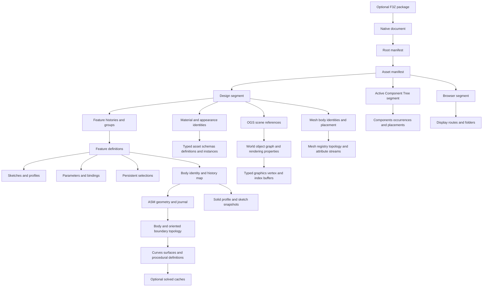

# Fusion native persistence data model

## Scope and evidence

This reference separates observed wire grammar, recovered semantics, and unresolved fields.
It describes the native persistence model and the implementation work required for independent reading and writing.
It does not establish complete Fusion interoperability. [The acceptance evidence matrix](FusionAcceptanceEvidence.md) distinguishes complete document authoring, corpus entity coverage, component reconstruction, standalone geometry, and preserved bundle members.

The current checkout contains 712 tracked study archives with 21,269 ZIP members.
Their central directories declare 10,732 stored members and 10,537 Zstandard members.
The [inventory](../../../re/Fusion/Reconstruction/CorpusInventory.json) records each archive path, size, digest, member count, and compression methods.
This inventory inspected file structure without executing Kit or tests.

Historical measurements have a separate status.
The [archive study](../../../re/Fusion/Notes/Archive.md) records 2,139 reconstructed stream pairs and 713 Browser root payloads.
The [class catalogue](../../../re/Fusion/Study/fusion-class-catalog.json) records 403 class GUIDs across 707 archives.
Only 76 classes have observed semantic labels in that catalogue.
A class label does not establish its complete field schema.

The new [binary catalogue](../../../re/Fusion/Reconstruction/BinaryClasses.json) supplies 1,218 class-identifier mappings from 14 installed libraries.
Its full-corpus inventory names all 403 declared Design classes: 283 have primary objects and 120 are registry-only declarations.
Across 712 archives it records 120,210 class declarations and 227,625 primary objects, with zero metadata extraction failures.
Each captured class has only one stored version in that corpus, so this coverage does not prove historical migration support.
The [parameter registration evidence](../../../re/Fusion/Reconstruction/BinaryParameters.json) records exact field types, inheritance, version branches, and method addresses with source binary digests.
The local [schema dump](../../../re/Fusion/LocalOracle/Allocation/ParameterSchema.xml) independently lists 155 current types and 404 member names.

The [geometry frontier](../../../re/Fusion/Study/asm-geometry-frontier-current.json) records 1,160 blobs and 3,761 initial body graphs.
Its scope excludes complete feature definitions, unexplained fields, trailing states, and native writing.
These historical measurements were not rerun for this document.

The independent [cadmpeg project](https://github.com/cadmpeg/cadmpeg/tree/de2726870ff728352163f601ab4e60bbd54fbade) supplies additional format research.
Its code uses Apache-2.0, and its specifications use CC-BY-4.0 with attribution to cadmpeg.
This reference attributes upstream findings explicitly and uses the pinned revision above.
Kit's local evidence remains the basis for the implemented parameter grammar.

## Why the format is difficult

An F3D file combines several linked databases inside a ZIP container.
Each database has a different identity namespace, ordering rule, and versioned schema.
Unpacking the container exposes those databases without resolving their relationships.

| Difficulty                                          | Consequence for a reader or writer                                   |
| --------------------------------------------------- | -------------------------------------------------------------------- |
| Class numbers come from each segment's registry     | A numeric class tag cannot identify a feature across files           |
| Primary and inherited records have separate indexes | A complete object can occupy several nonadjacent records             |
| Timeline order comes from explicit references       | Physical order and object numbers cannot reconstruct feature history |
| Design IDs differ from kernel entity numbers        | An integer match across the two domains is insufficient              |
| Body maps select geometry histories                 | A convenient blob or its first BODY can describe the wrong object    |
| Persistent names survive topology changes           | Current face order cannot replace feature selection identity         |
| Solved caches accompany procedural definitions      | A plausible NURBS surface can differ from the exact model            |
| Several caches repeat parameter values              | Editing one binary64 field can leave inconsistent feature state      |
| Unknown fields can affect regeneration              | Byte replay cannot prove independent document generation             |
| ZIP method 93 is uncommon in older readers          | A generic archive tool can fail before inspecting any CAD records    |

## Container and document families

| Family          | Structure and required interpretation                                                           |
| --------------- | ----------------------------------------------------------------------------------------------- |
| `.f3d`          | Native document archive with manifests, indexed segments, geometry blobs, and auxiliary members |
| `.f3z`          | Package containing related documents and a document dependency description                      |
| `.f2d`          | Drawing document that can occur as a package root                                               |
| `.f2t`          | Drawing template family, requiring separate drawing semantics                                   |
| `.smb`, `.smbh` | Embedded ASM binary streams, interpreted through headers and owning body maps                   |
| `.sat`, `.smt`  | Text geometry representations encountered in external research                                  |
| `.tsm`          | T-spline control-cage source, separate from committed B-rep geometry                            |
| `.paramesh`     | Mesh-body storage, separate from exact B-rep and parametric feature history                     |

The local `.f3z` example contains nine F3D members, `Manifest.json`, and `DesignDescription.json`.
REA 6.8.0 identified those eleven entries and their digests in the [saved evidence](../../../re/Fusion/Reconstruction/ReaAssemblyEvidence.json).
REA did not infer Fusion-specific semantics from that inventory.
REA's Ghidra provider also decompiled `Ns::MemberSet::addNewMember` from an arm64 slice of the installed data-model library.
The [binary-tool evidence](../../../re/Fusion/Reconstruction/ReaBinaryEvidence.json) records the exact input digest, address, tool versions, evidence identifier, and the resulting registration-map observations.
The universal Mach-O input first required thinning; generic archive inspection and native-code decompilation are distinct REA capabilities.
Its F3D inspection rejected the study's ZIP method 93 compression.
See the [tool limitation](../../Gotchas/Conversion/Fusion/FusionArchiveInspection.md).

The upstream [F3D specification](https://github.com/cadmpeg/cadmpeg/blob/de2726870ff728352163f601ab4e60bbd54fbade/docs/formats/f3d.md) describes additional package variants.
An F3Z root can be an F2D drawing with a derived F3D model.
Extracting only that model loses the drawing's sheets and annotations.
File extensions alone therefore cannot select a lossless package projection.

## Logical document graph



The manifest selects assets and segment identities.
Design owns the model's parametric definitions and references to geometry history.
ACT and Browser store additional component and presentation relationships.
Their successful parsing does not independently authenticate the matching Design snapshot.

### Identity domains

Every persistent reference must retain its domain and owning scope.
The recommended logical identity is `(document, asset, segment, domain, value)`.
Kernel references additionally require the geometry blob and history state.

| Domain                   | Value representation                | Scope                               | Required join                                                 |
| ------------------------ | ----------------------------------- | ----------------------------------- | ------------------------------------------------------------- |
| Asset identity           | GUID text                           | Document manifests                  | Root declaration to asset declaration                         |
| Snapshot token           | GUID text                           | Asset and ACT routing               | Exact declared token, without assuming content authentication |
| Type identity            | Class GUID plus version information | Segment registry                    | Registry row to class schema                                  |
| Wire class code          | Decimal integer text                | One segment                         | Registry position starting at 256                             |
| Design object identity   | Unsigned 64-bit integer             | One segment                         | Primary record and indexed inherited records                  |
| Parameter creation index | Unsigned 32-bit integer             | Parameter collection                | Persistent allocation index; deletion leaves gaps             |
| Runtime parameter ID     | Unsigned 64-bit integer             | Design-capture parameter            | `DcParameter.rparamId`; distinct from the parameter entity ID |
| Observer-vector index    | Signed 32-bit integer               | Referenced subject entity           | Position of this observer in the subject's observer vector    |
| ASM entity pointer       | Signed 64-bit integer               | Blob and history state              | Entity table, with negative sentinels handled by schema       |
| Stored BODY handle       | Typed attribute value               | Referenced geometry history         | Design body map to matching kernel BODY identifier            |
| Persistent name key      | Schema-specific typed value         | Naming registry and feature lineage | Verified registry, creator, and selection route               |
| Delta-state identity     | Native signed 32-bit integer        | Kernel history stream               | State-tree links and feature-to-history transitions           |
| Current/max state IDs    | Independent signed 32-bit integers  | Kernel history stream               | Selected state versus allocation watermark                    |
| Next entity tag          | Native signed 32-bit allocator      | Kernel history stream               | Entity tag allocation, separate from record indexes           |
| Inline subtype reference | Schema-specific slot                | Local subtype table                 | Local subtype resolution, never global entity indexing        |

## Primitive wire types

The supported Design grammar uses little-endian integers and binary64 numbers.
String counts measure encoded units, not Python string length.

| Primitive                 | Wire representation                        | Validation                                               |
| ------------------------- | ------------------------------------------ | -------------------------------------------------------- |
| `u32`                     | Four little-endian bytes                   | Exact unsigned range                                     |
| `u64`                     | Eight little-endian bytes                  | Exact unsigned range                                     |
| `f64`                     | Eight IEEE-754 little-endian bytes         | Finite value for the recovered parameter profile         |
| ASCII string              | `u32` byte count followed by bytes         | Bounded count and valid encoding                         |
| UTF-16 string             | `u32` code-unit count followed by UTF-16LE | Bounded encoded length and field-specific control policy |
| Local reference           | `01`, `u64` identity, `00 00`              | Exact marker and suffix                                  |
| Absent optional reference | `00`                                       | Distinct from a present reference containing zero        |
| Ordered reference list    | `u32` count followed by local references   | Bounded count and context-specific uniqueness            |

The two suffix bytes belong to reference framing.
Other reference dialects require their own schemas.
The supported parameter writer does not silently emit cross-segment references.

## Indexed segments

### Metadata object

Kit's [MetaSegment](../../../src/convert/formats/Fusion/SegmentCodec/Metadata/MetaSegment.py) retains these fields in native order:

| Field         | Type                               | Interpretation                                                                 |
| ------------- | ---------------------------------- | ------------------------------------------------------------------------------ |
| Header        | `MetaHeader`                       | Segment kind, segment ID, namespace, magic, version, and retained header words |
| Classes       | Ordered `MetaClass` rows           | Class GUID, base GUID, schema version, class namespace, and owned object IDs   |
| StoredIds     | Ordered `u64` values               | Retained identity sequence, separate from timeline order                       |
| Primary       | Ordered `(object_id, offset)` rows | Primary BulkStream records                                                     |
| Continuations | Ordered `(object_id, offset)` rows | Inherited BulkStream records                                                   |
| NextId        | `u64`                              | Retained allocation state                                                      |
| Reserved      | `u32`                              | Retained field without an invented meaning                                     |
| Properties    | Ordered `(name, value)` rows       | Retained named unsigned properties                                             |

Observed core segments use metadata version 8.
The supported header carries magic 1234 and repeats its segment kind.
Design, ACT, and Browser are distinct segment kinds.
The exact header codec is [ReadWireHead](../../../src/convert/formats/Fusion/SegmentCodec/Metadata/ReadWireHead.py).

### Bulk record

An indexed BulkStream record begins with an ASCII decimal class code and a `u64` object identity.
The decimal code has a preceding `u32` byte count.
The next indexed offset determines the payload boundary.
There is no general payload-length field that can replace the metadata index.

`Ns::EntityMetaType::save` then writes a counted root-identity string, an entity-subjects flag, and optional subject data.
A separate flag precedes optional named metadata.
The four zero bytes at the start of an ordinary payload are the empty root-string count, not a class version.
Class schema versions belong to the metadata registry, represented by `MetaClass.SchemaVersion`.
Old captured numeric parameters use schema 9, while the new local captures use schema 10.

An entity-subjects list begins with an unsigned count.
Each row contains a passive reference and a signed `indexInObserverVec`.
That index locates this entity's observer interface in the referenced subject's observer vector; `-1` is the unavailable sentinel.
It is not a feature-control position.

Member traversal uses lexical member-name order, separately for each class member set.
Native registration order and C++ in-memory field offsets therefore do not define wire order.
Inherited member sets and custom serializers still require their own traversal rules.

The class code equals 256 plus the registry row position.
The corresponding GUID identifies the native class.
An inherited record retains the primary object's identity but selects an ancestor class.
The indexer verifies this ancestry before accepting a continuation.

The [segment writer](../../../src/convert/formats/Fusion/SegmentCodec/EmitSegment.py) derives both offset tables from emitted record positions.
Changing a string length therefore moves later records without requiring offset patches.
Registry order, record order, and timeline order remain separate inputs.

## Parametric data

### History and groups

A history payload contains six zero bytes, an owner reference, and an ordered list of feature references.
Group records carry group state, an ordered membership list, and a counted name.
The [chronology writers](../../../src/convert/formats/Fusion/SegmentCodec/Chronology) construct the supported layouts directly.

A reader must preserve owner-specific histories.
When one archive contains multiple histories, choosing a physical first record is ambiguous.
The explicit research reader accepts a selected native history identity.
Suppression, grouping, rollback state, and occurrence ownership require their associated native records.

### Parameter collection

The collection class GUID is `B0556F58-EE09-46A7-B18F-E296F48E5B13`.
Its supported full payload begins with an empty root-identity string encoded as a zero `u32` count.
The following offsets start after that count word.

| Offset            | Field                      | Width              |
| ----------------- | -------------------------- | ------------------ |
| 0                 | Fixed zero prefix          | 11 bytes           |
| 11                | Allocation high-water mark | 4 bytes            |
| 15                | Name registry reference    | 11 bytes           |
| 26                | Zero separator             | 1 byte             |
| 27                | Member count               | 4 bytes            |
| 31                | Ordered member references  | `11 * count` bytes |
| `31 + 11 * count` | Owning component reference | 11 bytes           |

The installed binary names this class `Ns::Parameters::ParameterTable` and the field at body offset 11 `highWaterMark`.
It registers that field as an unsigned 32-bit integer, independently of the member list.
The writer takes `HighWaterMark` explicitly and derives only the actual member count.
It must not reset allocation history to the number of surviving members.
The current semantic proof admits only the stricter dense-ordinal profile in which this mark equals the member count.
Other allocation histories remain outside that proof; this restriction does not establish that those documents are invalid.
Every member must reciprocate the owning collection in its numeric record.

The [controlled allocation captures](../../../re/Fusion/LocalOracle/Allocation/Capture.json) establish an observed sequence:

| Operation             | Current member count | High-water mark | Surviving creation indexes |
| --------------------- | -------------------- | --------------- | -------------------------- |
| Create two parameters | 2                    | 2               | 1, 2                       |
| Delete the first      | 1                    | 2               | 2                          |
| Create a third        | 2                    | 3               | 2, 3                       |

The binary `getNextID` increments the mark and returns it; removal does not decrement it.

### Name registry

The registry class GUID is `E276745D-D84E-40D5-88BC-8C94DD4ACCDF`.
The installed binary names it `Ns::Parameters::ParameterSearchByNameHelper`.
Its supported payload begins with an empty root-string count, byte `01`, and an entity-subject count.
Each dependency row contains an eleven-byte reference and four zero bytes.
The first row references the collection, followed by its members in the qualified collection order.

A zero separator precedes the name count.
Each name row contains counted UTF-16LE text and a member reference.
Names and member identities must each be unique.
Name-row order is retained separately from collection order.
These subject rows describe native observer relationships, not expression dependencies.

### Numeric parameter

The numeric parameter class GUID is `7A6A3D31-BE74-4E19-9115-20642944C2E4`.
The installed binary names it `Ns::Parameters::Parameter`.
The supported full payload begins with an empty root-string count.
The body then contains these fields in order:

| Field         | Encoding                      | Meaning                                           |
| ------------- | ----------------------------- | ------------------------------------------------- |
| Header        | Seven zeros, `06`, four zeros | Qualified numeric body profile                    |
| Comment       | Counted UTF-16LE              | CR, LF, and TAB are allowed                       |
| NativeIndex   | `u32`                         | Persistent `creationIndex` allocation value       |
| BindingId     | Optional local reference      | Absent for the supported user-parameter profile   |
| Formula       | Counted UTF-16LE              | Saved expression text                             |
| Metadata      | Ten or eleven bytes           | Qualified profile described below                 |
| RoleName      | Counted UTF-16LE              | User role or feature control role                 |
| Reserved text | Empty counted string          | Required empty in this profile                    |
| DisplayUnit   | Counted UTF-16LE              | Display unit, separate from numeric storage scale |
| ParamName     | Counted UTF-16LE              | Identifier matching `[A-Za-z_][A-Za-z_0-9]*`      |
| Number        | Finite binary64               | Stored evaluated value                            |
| Separator     | Zero byte                     | Footer framing                                    |
| CollectionId  | Local reference               | Actual owning parameter collection                |

The footer is a reference, not a constant byte sequence.
The original reader accepted only collection 16.
The updated reader retains the stored `CollectionId` and exposes `fusion.collection_id` in projected attributes.
Graph-level source proof still requires reciprocal collection membership.

The supported metadata profiles are:

| Profile           | Derived bytes                                        | Constraint                                     |
| ----------------- | ---------------------------------------------------- | ---------------------------------------------- |
| User numeric      | Seven zeros, favourite flag, `00 01`                 | No binding and role `User Parameter`           |
| Bound numeric     | Seven zeros, favourite flag, `00 00`                 | Binding present                                |
| Schema 10 numeric | Eight zeros, favourite flag, orphan false, user flag | `isExternal` is false in the supported profile |

The favourite flag is zero or one.
Schema 10 inserts the `isExternal` Boolean before `isFavourite`.
The extra byte is not trailing padding.
The encoder accepts these exact profiles and reconstructs their bytes from the qualified fields.
It rejects other metadata instead of copying unexplained metadata into output.

The complete schema-10 member set has this lexical order:

| Native member     | Registered type   | Supported numeric-profile interpretation          |
| ----------------- | ----------------- | ------------------------------------------------- |
| `UserDefaultUnit` | Boolean           | False                                             |
| `actIdentifier`   | Internal string   | Empty                                             |
| `birthday`        | `u32`             | Expression-engine version, observed value 6       |
| `booleanValue`    | Boolean           | False for numeric values                          |
| `comment`         | Internal string   | User comment                                      |
| `creationIndex`   | `u32`             | Persistent allocation index                       |
| `dcParameter`     | Passive reference | Optional design-capture binding                   |
| `expression`      | Internal string   | Formula text                                      |
| `expressionType`  | `u32`             | Zero in the admitted numeric profile              |
| `group`           | Passive reference | Null in the admitted profile                      |
| `isDirty`         | Boolean           | False in the admitted profile                     |
| `isDriven`        | Boolean           | False in the admitted profile                     |
| `isExternal`      | Boolean           | Added in schema 10; false in the admitted profile |
| `isFavourite`     | Boolean           | Favorite flag                                     |
| `isOrphan`        | Boolean           | False in the admitted profile                     |
| `isUserDefined`   | Boolean           | True for an unbound user parameter                |
| `name`            | Internal string   | Role name such as `User Parameter`                |
| `textValue`       | Internal string   | Empty for numeric values                          |
| `unit`            | Internal string   | Display unit                                      |
| `userName`        | Internal string   | Parameter identifier                              |
| `value`           | Binary64          | Evaluated numeric value                           |

The constructor gets `birthday` from the expression engine's `latestVersion`; it is not a date.
The terminal zero byte is an inherited null `CommonBaseEntity.rClientObject` reference.
The following collection reference is inherited `ManagedEntity.rParent`.
Member registration alone is insufficient to select persistent fields: member options exclude some registered fields, including the observed `expanded` member.

### Numeric binding

The supported floating binding class is `D91D429C-1BB5-4640-B49F-69AF14F463E9`.
The installed binary names it `Na::DesignCapture::DcDoubleParameter`.
Its full payload contains an empty root-string count followed by an 85-byte body.
Offsets below start after that count word.

| Offset | Field          | Encoding         |
| ------ | -------------- | ---------------- |
| 0      | Binding header | `01 01 00 00 00` |
| 5      | OwnerId        | Local reference  |
| 16     | ObserverIndex  | `i32`            |
| 20     | Separator      | Zero             |
| 21     | Number         | Binary64         |
| 29     | ParamId        | Local reference  |
| 40     | RuntimeParamId | `u64`            |
| 48     | Repeated owner | Local reference  |
| 59     | Fixed field    | `01 00 00`       |
| 62     | BookId         | Local reference  |
| 73     | Separator      | Zero             |
| 74     | Terminal owner | Local reference  |

All three owner references must agree.
The parameter's binding reference and binding's parameter reference must reciprocate.
The binding cache must match the parameter's binary64 bytes, including signed zero.
`ObserverIndex` describes the entity-subject relationship, not a feature-control slot.
`RuntimeParamId` is the native `rparamId` member and uses all 64 bits.
The historical dense captures made it resemble a bound-parameter rank, which does not establish its general allocation policy.

Integer binding class `A085449A-5144-4B2B-B455-7F7035A40559` has a related 82-byte body.
Its five-byte value region contains `isRoundToNearestInt` followed by a signed `i32` value.
The subsequent fields shift three bytes earlier.
Complete typed integer writing is outside the implemented floating profile.

The bookkeeping class is `6CCF41D5-40BE-48ED-A834-18F3EAED6C57`.
Its 43-byte payload contains sixteen zeros, a binding reference, a raw `u64`, and eight zeros.
The installed binary names the class `Na::DesignCapture::DynamicUpdateData` and the unsigned 64-bit member `timeStamp`.
The timestamp's units, epoch, and initialization contract remain unproven.
A writer must not invent those semantics or a default.

Binary inspection shows `DynamicUpdateData.mark` stores the raw return from `std::chrono::system_clock::now`.
The inspected macOS libc++ header defines that clock's duration as microseconds.
This platform-specific fact does not establish a portable epoch, cross-platform representation, or a safe invented initialization value.

### Expressions, units, and sketches

Numeric parameter lengths use centimetres in the qualified captures.
Angles use radians, while display units can specify millimetres, inches, or degrees.
Unitless values remain distinct from lengths and angles.
Preserve signed zero and exact cached floating values when reproducing records.

Expressions retain source spelling independently of their evaluated cache.
Derived dependencies require a verified component scope, exact name resolution, parsed syntax, and compatible units.
Generic native graph membership does not establish expression edges.
The dependency counterexample is recorded in [Parameters](../../../re/Fusion/Notes/Parameters.md).

Sketch geometry requires its own local frame, support-plane definition, primitives, constraints, dimensions, and profile selections.
A solved plane matrix does not explain the construction rule that must regenerate it.
A profile is an explicit selection of bounded curve portions, not every curve in a sketch.
Feature writers must retain those definitions and the corresponding parameter bindings.

## B-rep and procedural geometry

### ASM envelope

The observed binary envelope begins with the fifteen-byte signature `ASM BinaryFile8`.
Four signed 64-bit words follow: version, optional stored record count, top-level entity count including `asmheader`, and flags.
Three tagged strings identify product, kernel version, and creation-date text.
Three tagged doubles retain units in millimetres, resolution tolerance, and normal tolerance.

Native disassembly resolves the modern internal version as `version * 100 + ((flags >> 1) & 127)`.
The low history bit is not sufficient to infer journal presence because a header rewrite can clear it; explicit stream markers remain authoritative.
The standalone binary importer converts lengths to Fusion centimetres using restored units divided by ten.
See [binary route and header evidence](../../../re/Fusion/Reconstruction/BinaryImport/StaticEvidence.json).

The [study token reader](../../../re/Fusion/Study/asm_records.py) bounds each field and records its original offset.
The independent [ezdxf SAB implementation](https://github.com/mozman/ezdxf/blob/master/src/ezdxf/acis/sab.py) supplied token vocabulary.
Its general ACIS support does not supply Fusion's parametric persistence schema.

| Tag    | Observed payload                     | Interpretation                                      |
| ------ | ------------------------------------ | --------------------------------------------------- |
| 4      | Signed 64-bit integer                | Integer token                                       |
| 6      | Binary64                             | Double token                                        |
| 7      | Byte length and UTF-8 bytes          | String token                                        |
| 10, 11 | No following payload                 | Boolean tokens                                      |
| 12     | Signed 64-bit integer                | Entity pointer                                      |
| 13     | Byte length and UTF-8 bytes          | Entity name                                         |
| 14     | Byte length and UTF-8 bytes          | Entity name prefix                                  |
| 15, 16 | No following payload                 | Subtype delimiters                                  |
| 17     | No following payload                 | Record end                                          |
| 18     | Signed 64-bit length and UTF-8 bytes | Literal string                                      |
| 19, 20 | Three binary64 values                | Position or direction vector                        |
| 21     | Signed 64-bit integer                | Enumeration token                                   |
| 23     | Eight bytes                          | Context-dependent value, requiring an owning schema |

Tag 23 is an integer only within the verified `int64_attrib-name_attrib-gen-attrib` schema.
Treating every tag 23 as a floating value corrupts stored identities.
Treating every tag 23 as an integer also exceeds the evidence.

### Geometry states

Explicit markers separate initial geometry, history, and trailing states.
The observed markers include `Begin-of-ASM-History-Data`, `End-of-ASM-History-Section`, and `End-of-ASM-data`.
Entity pointers require their owning state and blob.
The first geometry state is not automatically the document's final visible model.

Design body maps name a blob and a stored body identity.
The [body identifier evidence](../../../re/Fusion/Study/body-asm-identifier-decoding.json) disproves mapping bodies by root order.
Resolve the referenced blob, then match its typed BODY identifier.
Do not infer the correct body from file order, equal volume, or a nearest geometric match.

### Topology model

| Object    | Required relationships                                                        |
| --------- | ----------------------------------------------------------------------------- |
| Body      | Owning document/component, lumps or sheets, placement, persistent identity    |
| Lump      | Owning body and shells                                                        |
| Shell     | Faces and shell orientation or sidedness                                      |
| Face      | Supporting surface, oriented loops, tolerance, attributes, persistent name    |
| Loop      | Ordered coedge cycle and owning face                                          |
| Coedge    | Edge use, next/previous links, mate relation, direction, optional UV curve    |
| Edge      | Curve, parameter interval, endpoint vertices, tolerance, persistent name      |
| Vertex    | Point, tolerance, incident topology, persistent name                          |
| Curve     | Analytic, spline, intersection, or procedural definition and parameter domain |
| Surface   | Analytic, spline, offset, blend, loft, or other procedural definition         |
| Attribute | Typed ownership and payload with its own schema                               |

Topology must preserve orientation and parameterization separately from geometric coordinates.
An edge's XYZ curve and a coedge's UV curve can use different parameter maps.
Matching endpoints alone does not determine that map.
Seams and periodic surfaces require chart-aware trimming.

### Exact definitions and caches

The data model must distinguish an exact definition from an approximation cache.
Each cache needs its owner, parameter domain, representation, tolerance evidence, and provenance.
An unexplained trailer remains unresolved even when the control grid is readable.

The [ASM cache study](../../../re/Fusion/Notes/AsmCaches.md) records a loft cache deviation of approximately 2.85 micrometres at sampled points.
It also records pcurve discrepancies reaching approximately 0.00616 UV units in sampled comparisons.
Those values are neither global bounds nor interchangeable units.
They demonstrate why a decoded NURBS cache cannot automatically replace the original procedural definition.

Rational spline points and weights must retain their storage convention.
The observed rational layouts store Euclidean coordinates followed by weights.
The surface grid order can differ from the API's control-point order.
Knot multiplicities, periodicity, explicit bounds, and subtype references require independent interpretation.

## Native writing obligations

Independent analytic cylinder generation is now established for standalone text SMT and binary SMB.
The [detailed BRep model](../../../re/Fusion/Reconstruction/BrepDataModel.md) names the topology fields, orientation rules, dimensional values, persistent attributes, and observed insertion journal.
The writer allocates all 26 cylinder records from radius, height, and base coordinates, with no source payload input.
Fusion accepted both formats, measured the expected topology, volume, and spatial bounds, then saved and reopened the solids as native documents.
The [text acceptance](../../../re/Fusion/LocalOracle/Brep/ProductionAcceptance.json) and [binary acceptance](../../../re/Fusion/LocalOracle/Brep/ProductionBinaryAcceptance.json) both use the production Python codecs.
Neither standalone body includes an editable feature graph or independently authored F3D envelope.

Complete native writing requires more than each stream's syntactic serializer.
The writer must construct a mutually consistent document graph from semantic inputs.

1. Allocate identities separately within each native domain.
2. Build the class registry and inheritance graph.
3. Emit component definitions and occurrence placements.
4. Emit sketch definitions, constraints, and profile selections.
5. Emit parameters, name registries, bindings, and feature controls.
6. Emit explicit history order, groups, suppression, and rollback state.
7. Emit exact B-rep definitions and applicable kernel history.
8. Emit body maps, persistent naming, and selection lineage.
9. Emit matching ACT, Browser, manifests, and auxiliary members.
10. Derive indexes, lengths, compression frames, and ZIP checksums.

The existing core archive builder satisfies only part of these obligations.
It still accepts caller-supplied record payloads.
New numeric serializers account for their supported payload bytes directly.
They do not provide the missing feature, bookkeeping, kernel, or presentation semantics.

The upstream [generation implementation](https://github.com/cadmpeg/cadmpeg/blob/de2726870ff728352163f601ab4e60bbd54fbade/crates/cadmpeg-codec-f3d/src/writer/generate/mod.rs) has explicit limitations too.
It rejects several source-less ACT, asset, SubD, tessellation, and configuration cases.
Its existence does not establish complete independent parametric generation.

## Native member schemas

The read-only reflection bridge recovered 1,958 registered metatypes from Fusion 2706.1.17: 1,718 entity types, 198 value types, 36 other member metatypes, and six other types.
The initial snapshot contained 1,916 distinct entity/value member sets, of which 260 were initialized, exposing 938 registered fields.
The field categories were 492 intrinsic values, 158 collections, 130 strong references, 98 value types, 59 passive references, and one optional value.
Uninitialized sets remain unknown; a null member list must not be treated as an empty serialized class.
The snapshot initially covered initialized schemas for 174 of the 403 declared corpus classes.
After 64 separately dispatched representative imports, the [expanded capture](../../../re/Fusion/LocalOracle/Reflection/Schema064.json) contains 488 initialized member sets and 1,910 fields.
Those fields comprise 909 intrinsic values, 369 strong references, 320 collections, 179 value types, 132 passive references, and one optional value.
[Coverage accounting](../../../re/Fusion/LocalOracle/Reflection/Coverage.json) identifies initialized schemas for 401 of 403 corpus classes.
The remaining two are the `Ns::Entity` root and `Ns::EntityTracking::ProgenitorAuxDataValueMetaType`; their uninitialized member sets must not be silently treated as complete empty schemas.
All 64 source archives opened successfully in the isolated run, whose final report records zero open documents.
The [import log](../../../re/Fusion/LocalOracle/Reflection/WarmProgress.json) records source digests and per-import schema digests; the intermediate raw snapshots are retained in `Reflection/Snapshots.tar.xz`.
Opening vendor-authored controls supplies schema evidence, not acceptance of Kit-generated documents.

[Schema bridge evidence](../../../re/Fusion/LocalOracle/BridgeEvidence.json) records exact C++ method signatures, RTTI checks, compiler ABI checks, native binary hashes, and bounded read-only traversal.
[The raw native snapshot](../../../re/Fusion/LocalOracle/Reflection/Schema.json) preserves member registration order, script names, declared type encodings, native member categories, and option masks.
Registration order differs from the lexical name traversal used by the studied persistence visitor.
A member's C++ memory offset is not its wire offset.

[Static feature-member extraction](../../../re/Fusion/Reconstruction/BinaryFeatureMembers.json) independently recovers 38 versioned registration schemas across 12 classes.
All 80 current own fields match the runtime reflection in name, declared type, options, registration order, lexical persistence order, and inheritance.
The source `Ns::Entity` root has no recovered initializer and is explicitly left unresolved.
Neither agreement nor a complete registration trace proves that a class has no custom save/load implementation.

The exact-version getter capture exposes 494 initialized class/version pairs, including six older schemas retained after the corpus imports.
There are 1,641 absent and 1,428 uninitialized lookup results; neither category authorizes treating the schema as empty.
The [version differences](../../../re/Fusion/LocalOracle/Reflection/VersionDifferences.json) establish these own-field changes:

| Native class            | Observed versions | Registered-field change                                                                    |
| ----------------------- | ----------------- | ------------------------------------------------------------------------------------------ |
| `DcDraftFeature`        | 5 → 6             | Adds `m_fixedPlaneDraftAngleMode`                                                          |
| `DRMatrix`              | 15 → 16           | `arcLengthForPeriodicFace` changes from a double to a strong `DcDoubleParameter` reference |
| `Parameters::Parameter` | 9 → 10            | Adds `isExternal`                                                                          |
| `ComponentBaseInstance` | 10 → 11           | Adds `initialTransform`                                                                    |
| `BaseOccurrencePath`    | 4 → 5             | Replaces `instanceIndices` with `passiveOccurrencePath`                                    |
| `PMISettings`           | 2 → 4             | Adds leading/trailing-zero and precision settings plus general-note size and custom size   |

These are observed registered-field differences, not inferred migration algorithms.
The directly requested own-set version is known; a returned base pointer does not expose its historical version.
A reader must select every class's schema from the archive registry rather than assuming the current application version or inheriting the derived class's version number.

The member constructor initializes its option mask to `0x33`.
The studied persistence visitor uses bit `0x1` to decide persistence; clearing that bit excludes a registered field from the saved sequence.
For example, `DcSketch.rLastFeatureBeforeActivate` has mask `0x32`, while its nine other current members retain `0x33`.
`DcFeature.startCacheHS` and `endCacheHS` are also excluded, whereas `startModelHS` and `endModelHS` persist.
Other option bits retain their raw values unless their visitor context has been established.

The current extrusion inheritance chain is:

```text
DcExtrudeFeature v8
  DcProfileBasedFeature v1
    DcMultiBodyFeature v2
      DcBodyFeature v0
        DcFeature v4
          DcComputableAction v3
            DcAction v0
              DcNode v2
                ManagedEntity v1
                  Entity
```

`DcMultiBodyFeature` accounts for the previously unexplained body collections: `cachedDcBodies` is a set of strong body references, `dcBodies` is a vector of strong body references, and `removedBodies` is a vector of passive body references.
All three persist and precede `DcBodyFeature.targetDataRefs` in the inherited traversal.
The controlled extrusion stores its `ManagedEntity.rParent` in a separate continuation record; the class registry and actual record boundaries must be preserved when grouping inherited bytes.

The [reflected feature codec evidence](../../../re/Fusion/Reconstruction/ReflectedFeaturePayloads.json) closes every byte of ten selected records across the three new controls: three 253-byte sketch payloads, two 450-byte extrusion payloads, and five 15-byte managed-entity continuations.
The decoder accounts for all 1,734 bytes and agrees with all 238 native field observations.
After converting the decoded values through JSON, the independent encoder reconstructs each original payload exactly, receiving no original payload or residual-byte argument.
The admitted profile uses current class versions, null or local numeric references, and empty named metadata; unsupported forms are rejected.
This proves the measured feature-record grammar rather than complete archive generation.
UUID-valued members such as `associationId` use a counted UTF-16 UUID string, while `AcGeVector3d` writes three doubles; native serializer addresses and binary digests support both representations.

The following table lists the current own fields for the two feature classes; inherited members are listed separately in the evidence artifact.
Enum fields that use the native uint32 intrinsic metatype are encoded as unsigned 32-bit values even when their declared C++ type is an enum.

| Class              | Member                          | Declared type                                  | Persisted |
| ------------------ | ------------------------------- | ---------------------------------------------- | --------- |
| `DcSketch`         | `bIsAGDDcSketchFeature`         | `bool`                                         | Yes       |
| `DcSketch`         | `dcParameters`                  | `vector<StrongRef<DcParameter>>`               | Yes       |
| `DcSketch`         | `isVisibleBeforeRollback`       | `bool`                                         | Yes       |
| `DcSketch`         | `meshSections`                  | `vector<StrongRef<DcSketchMeshPlanarSection>>` | Yes       |
| `DcSketch`         | `rLastFeatureBeforeActivate`    | `PassiveRef<DcFeature>`                        | No        |
| `DcSketch`         | `rSketch`                       | `StrongRef<MSketch>`                           | Yes       |
| `DcSketch`         | `rSketchPlaneMatrix`            | `StrongRef<DRMatrix>`                          | Yes       |
| `DcSketch`         | `sketchIsoCurves`               | `vector<StrongRef<DcSketchIsoCurve>>`          | Yes       |
| `DcSketch`         | `sketchProjects`                | `vector<StrongRef<DcSketchProject>>`           | Yes       |
| `DcSketch`         | `sketchSurfaces`                | `vector<StrongRef<DcSketchSurface>>`           | Yes       |
| `DcExtrudeFeature` | `ProfileFromEntityRef`          | `StrongRef<ModelDataRef>`                      | Yes       |
| `DcExtrudeFeature` | `bIsAGDExtrudeFeature`          | `bool`                                         | Yes       |
| `DcExtrudeFeature` | `bPreviewNormal`                | `bool`                                         | Yes       |
| `DcExtrudeFeature` | `booleanOperation`              | `unsigned int`                                 | Yes       |
| `DcExtrudeFeature` | `directionType`                 | `EDirectionType`                               | Yes       |
| `DcExtrudeFeature` | `extendFaceOption`              | `unsigned int`                                 | Yes       |
| `DcExtrudeFeature` | `isFlipDirection`               | `bool`                                         | Yes       |
| `DcExtrudeFeature` | `isSolidOperation`              | `bool`                                         | Yes       |
| `DcExtrudeFeature` | `profileLocaltionType`          | `EProfileLocationType`                         | Yes       |
| `DcExtrudeFeature` | `profileNormal`                 | `AcGeVector3d`                                 | Yes       |
| `DcExtrudeFeature` | `profileOffset`                 | `StrongRef<DcDoubleParameter>`                 | Yes       |
| `DcExtrudeFeature` | `rAgainstDistance`              | `StrongRef<DcDoubleParameter>`                 | Yes       |
| `DcExtrudeFeature` | `rAlongDistance`                | `StrongRef<DcDoubleParameter>`                 | Yes       |
| `DcExtrudeFeature` | `rExtrudeToolBody`              | `StrongRef<DcExtrudeToolBody>`                 | Yes       |
| `DcExtrudeFeature` | `rFromEntityRef`                | `StrongRef<ModelDataRef>`                      | Yes       |
| `DcExtrudeFeature` | `rTaperAngle`                   | `StrongRef<DcDoubleParameter>`                 | Yes       |
| `DcExtrudeFeature` | `rToEntityRef`                  | `StrongRef<ModelDataRef>`                      | Yes       |
| `DcExtrudeFeature` | `side1ExtentType`               | `EExtentType`                                  | Yes       |
| `DcExtrudeFeature` | `side1Offset`                   | `StrongRef<DcDoubleParameter>`                 | Yes       |
| `DcExtrudeFeature` | `side1SolutionType`             | `ESolutionType`                                | Yes       |
| `DcExtrudeFeature` | `side2ExtendFaceOption`         | `unsigned int`                                 | Yes       |
| `DcExtrudeFeature` | `side2ExtentType`               | `EExtentType`                                  | Yes       |
| `DcExtrudeFeature` | `side2FlipDirection`            | `bool`                                         | Yes       |
| `DcExtrudeFeature` | `side2Offset`                   | `StrongRef<DcDoubleParameter>`                 | Yes       |
| `DcExtrudeFeature` | `side2SolutionType`             | `ESolutionType`                                | Yes       |
| `DcExtrudeFeature` | `side2TaperAngle`               | `StrongRef<DcDoubleParameter>`                 | Yes       |
| `DcExtrudeFeature` | `startDirectionFlip`            | `bool`                                         | Yes       |
| `DcExtrudeFeature` | `symmetricMeasurementType`      | `ESymmetricMeasurementType`                    | Yes       |
| `DcExtrudeFeature` | `thinExtrude`                   | `bool`                                         | Yes       |
| `DcExtrudeFeature` | `thinExtrudeSide1WallLocation`  | `EWallLocation`                                | Yes       |
| `DcExtrudeFeature` | `thinExtrudeSide1WallThickness` | `StrongRef<DcDoubleParameter>`                 | Yes       |
| `DcExtrudeFeature` | `thinExtrudeSide2WallLocation`  | `EWallLocation`                                | Yes       |
| `DcExtrudeFeature` | `thinExtrudeSide2WallThickness` | `StrongRef<DcDoubleParameter>`                 | Yes       |

## Bundle and vertex semantics

The [F3Z bundle codec](../../Changes/Fusion/FusionBundleCodec.md) models the outer manifest, closed document graph, identity joins, reference groups, and complete serialized members. The [bundle data model](../../../re/Fusion/Reconstruction/BundleAuthoring/BundleDataModel.md) documents all envelope fields and the nine-document corpus example. This envelope qualification does not claim arbitrary nested F3D or F2D conversion. Native F3Z acceptance uses [asynchronous cloud upload](../../Gotchas/Conversion/Fusion/FusionBundleUpload.md). The reconstructed nine-document bundle now passes root load, all eight reference resolutions, full rebuild, parameter editing, and cloud save/reopen, with 87 timeline entries and 160 occurrences preserved.

The production BRep reader retains vertex edge indices independently from mapped record ordinals. A native `(2, 0)` cylinder history now passes semantic reconstruction and native edit/rebuild/save/reopen; [the index gotcha](../../Gotchas/Conversion/Fusion/FusionVertexEdgeIndices.md) records the evidence and restricted value set.

The [sketch split model](../../../re/Fusion/Reconstruction/EntityGraph/SketchSplitSemantics.md) identifies one-based curve-fragment ordinals, total fragments, compatible final-fragment matching, and the `UINT32_MAX` direction wildcard. These explain all 21 initially rejected production corpus archives without treating observed defaults as format constants.

The [BRep corpus classification](../../Changes/Fusion/FusionBrepCorpusCoverage.md) inventories all 1,170 embedded geometry/history streams and identifies planar topology, attribute, and journal requirements beyond the accepted cylinder. The [ranked semantic expansion plan](../../../re/Fusion/Reconstruction/BrepCoverage/ExpansionPlan.md) separates ownership candidates from complete native acceptance.

The [packaged native schema catalog](../../Changes/Fusion/FusionNativeSchemaCatalog.md) selects exact archive-declared versions and dependency closure without reading research fixtures. The [planar geometry writer](../../Changes/Fusion/FusionPlanarGeometry.md) independently derives cuboid topology; both its SMT and SMB outputs pass native measurements and save/reopen with a translated 17×23×31 mm solid. This standalone geometry qualification does not yet establish parametric rectangle-document authoring.

The [native generic-tag semantics](../../Changes/Fusion/FusionGenericTagSemantics.md) distinguish primary byte lengths, primary identifier bytes, signed secondary identities, ordered operation identities, and approach identities. The earlier selector/generation-reference terminology is superseded by native serializer evidence. The [complete controlled cuboid history model](../../../re/Fusion/Reconstruction/CuboidHistory/CuboidHistoryModel.md) specifies 102 initial records and their 101-insertion journal, with verified Design/progenitor identity joins.

The [ASCII sketch attribute model](../../Changes/Fusion/FusionSketchAttributeSemantics.md) resolves unsigned curve identities, direction wildcards, role flags, and one-based fragment ordinals. Its role-flags position differs from the binary Design callback, which explains why reusing one positional tuple would silently misread the two forms.

## Verification boundaries

The expanded [typed entity graph research](../../Changes/Fusion/FusionTypedEntityGraphs.md) establishes byte-exact reconstruction of 824 Design records and 75,675 payload bytes in three controlled files. The subsequent [full corpus coverage](../../Changes/Fusion/FusionCorpusEntityCoverage.md) decodes all 261,141 indexed Design records and 25,458,293 payload bytes across all 712 archives with no unexplained suffixes.
It includes generic references and containers, nested values and custom callbacks; three recipe members remain typed but incompletely named semantically.
Custom value callbacks can override ordinary lexical order, as demonstrated by RGBA color persistence. The [extended callback model](../../../re/Fusion/Reconstruction/EntityGraph/ExtendedCallbacks.md) specifies AcGe line, ellipse and NURBS arrays, recursive ASM selection recipes, tag tables, UV orders, and lazy progenitor metadata, with native serializer evidence.

The [latest native geometry acceptance](../../../re/Fusion/LocalOracle/Features/FullBrepAcceptance.json) reconstructs all 289 Design records and replaces both BRep members with independently authored cylinder/profile topology and history.
The archive opens with correct 19 mm geometry before recomputation, reports healthy features, rolls back to sketch-only state and restores, then preserves a 23 mm edit through native save/reopen.
The [production embedded geometry entry](../../Changes/Fusion/FusionEmbeddedGeometry.md) records the promoted serializers and their separate native acceptance.
That geometry experiment retains its own source envelope. Separate [independent document authoring](../../Changes/Fusion/FusionIndependentAuthoring.md) now establishes complete parameter, circular-sketch, and circular-extrusion F3D generation without a source archive or template.
Fusion accepts these independent documents, including correct initial solid geometry, healthy editable history, rollback/restore, parameter rebuild, and native save/reopen. Other feature families remain separate acceptance boundaries. The [production document codec](../../Changes/Fusion/FusionNativeDocumentCodec.md) now implements the same complete authoring path entirely under `src/`, with a separate successful native load, rollback, edit, save, and reopen report.
The [envelope research](../../../re/Fusion/Reconstruction/DocumentEnvelope/EnvelopeRecipe.md) fully decodes controlled manifests and ACT/Browser records.
The [material serialization entry](../../Changes/Fusion/Materials/FusionMaterialSerialization.md) records complete controlled instance decoding and native acceptance of regenerated material packages.
The [production material codec](../../Changes/Fusion/Materials/FusionMaterialCodec.md) promotes typed binary store reading/writing and records native acceptance of deliberately changed density and appearance values.
The [metadata header interpretation](../../Changes/Fusion/FusionMetadataHeaderSemantics.md) identifies packed software versions, current-version UUIDs, and ancestry framing.

| Evidence                      | What it establishes                                  | What remains unverified                           |
| ----------------------------- | ---------------------------------------------------- | ------------------------------------------------- |
| ZIP inventory                 | Declared members, sizes, compression, archive digest | CAD semantics                                     |
| Bounded stream decoding       | Recognized fields and structural consistency         | Meaning of unexplained fields                     |
| Byte-exact record re-encoding | Reproducibility of the admitted grammar              | Regeneration and independent document generation  |
| Saved API comparisons         | Captured semantics for named controls                | Uncaptured variants and current output acceptance |
| PR CI                         | Checks executed on the reported revision             | Deferred queue checks and vendor behavior         |
| Fusion open and rebuild       | Actual vendor acceptance for measured outputs        | Untested feature families                         |

A local Fusion installation is now available and authorized for controlled captures.
Fusion 2706.1.17 accepted the [Kit-edited parameter archive](../../../re/Fusion/LocalOracle/Rewritten/Acceptance.json), exposed its changed values and comments, rebuilt a new dependent expression, and retained that expression after native save and reopen.
That archive preserves its own non-parameter source records and contains no modeled bodies or feature timeline.
The result establishes this parameter-edit path, not independent full-document generation, B-rep writing, or complete feature-history acceptance.
The subsequent [controlled extrusion acceptance](../../../re/Fusion/LocalOracle/Features/Acceptance.json) includes a circular sketch, an extrusion, one solid body, and a dependent model parameter.
Kit's Python serializers rewrote the user parameter and its numeric binding from 7 mm to 19 mm, preserving the same source document's other records.
Fusion opened the edited archive with the new parameter values and both timeline entries intact.
Before full rebuild, the saved body still had the source's 7 mm height and 2.1991148575129498 cm³ volume.
After `computeAll()`, its height was 19 mm and its volume was 5.969026041820864 cm³.
A subsequent native edit to 23 mm, export, and reopen retained the two timeline entries and a 7.225663103256217 cm³ body.
This distinguishes a functioning same-source parametric edit from an independent B-rep writer: the latter must also derive the cached geometry and history state without the vendor runtime.

The [controlled source captures](../../../re/Fusion/LocalOracle/Features/Capture.json) and [native entity graph capture](../../../re/Fusion/LocalOracle/Features/GraphCapture.json) tie the measured parameters, dimensions, topology counts, and property values to archive digests.
The property queries yielded 211 records for the sketch and 243 for each extrusion control, with 14 and 15 named roots explicitly skipped.
The initial JSON-reference command form returned `Invalid entity ref` for all entries; querying positive numeric IDs in each active import succeeded.
The property visitor can omit members without its JSON callbacks, so these files are semantic observations rather than a complete wire schema.
Installed binary symbols and member-registration code provide additional field-name and type evidence.
They do not replace measured load and rebuild results.
Production discovery must remain disabled until the complete acceptance requirements are met.

## Complete planar cuboid histories

The production `BrepCodec.Prism` reader and writer qualify the ordinary axis-aligned rectangular extrusion history: 86 topology/geometry records, sixteen owned identity attributes, and a two-state journal with all 101 entity insertions. `PrismFrame` preserves parameter frames separately from dimensional geometry: face ordering and senses, loop start corners, line origins and displacement scales, edge intervals, optional carrier bounds, vertex ownership and plane bases. These fields are necessary for a lossless semantic reader; dimensions alone do not describe a stored BRep. Canonical output reallocates all record IDs and remaps references without retaining raw records.

Both a typed native read/re-emission and an independently generated history passed local Fusion import, rollback, full rebuild, native distance edit from 25 to 37 mm, save and reopen. Geometry changed from 30 to 44.4 cm³ with six faces, twelve edges and eight vertices. Each acceptance archive retained its own surrounding source Design, so complete independent rectangular document authoring remains a separate boundary. See [the API and scope](../../Changes/Fusion/FusionPrismHistory.md), [the controlled semantic model](../../../re/Fusion/Reconstruction/CuboidHistory/CuboidHistoryModel.md), and [native evidence](../../../re/Fusion/LocalOracle/PrismHistory/NativeAcceptance.json).

## Controlled sketch dimension transitions

A four-state native capture separates rectangle geometry, driving dimensions and user-parameter bindings. The baseline has four shared-endpoint lines and no reported geometric constraints or dimensions. Adding horizontal and vertical distance dimensions creates two distinct model parameters whose expressions refer to the existing user parameters. Editing those users changes both lengths but also moves the unanchored lower boundary. Dimensions therefore cannot be modeled as coordinates or assumed origin constraints. [The capture entry](../../Changes/Fusion/FusionSketchDimensionCaptures.md) lists exact source hashes and observed transitions; these are native research inputs, not independent dimension-authoring acceptance.

## Historical drawing containers

The installed public drawing example supplies one unique F3Z with an F2D root and three dependent F3Ds. Its version-two metadata has a 32-bit legacy software version, 44 class declarations, 27 primaries and two inherited continuations. The drawing graph points to an embedded AC1027 DWG; decoding the Neutron wrapper does not decode drawing sheets and annotations. Companion F3Ds share the older single-segment layout, so metadata generation must be separated from document family. [The drawing persistence entry](../../Changes/Fusion/FusionDrawingPersistenceModel.md) links exact framing, native field evidence, dependency joins, historical identifier behavior and the remaining DWG boundary.

## Analytic circular frusta

Independent SMT/SMB authoring now includes positive-radius expanding and shrinking circular frusta and the equal-radius cylindrical limit. The conical carrier stores a base ellipse, signed slope sine/cosine and longitudinal parameter scale; that scale is a length, not a second radius. The complete 26-record topology is derived from dimensions, and six native artifacts passed volume, area, center, bounds, topology and save/reopen checks. [The feature entry](../../Changes/Fusion/FusionFrustumGeometry.md) and [cone data model](../../../re/Fusion/Reconstruction/FrustumModel/FrustumModel.md) bind formulas to native serialization/evaluation evidence. These standalone solids are separate from the complete history profile below.

## Independent rectangular documents and material identity

The production document writer now constructs rectangle sketches and ordinary cuboid extrusions from dimensions without a source archive. Four shared corner entities and four Line3D entities establish the closed boundary; four curve-progenitor recipes retain endpoint-adjacent tag sets. The generated region recipe uses explicit perimeter order, which passed native regeneration. By default, width and depth are authoring inputs, while height is a driving user parameter. The optional constrained profile described below adds native width/depth dimensions. [Rectangle authoring](../../Changes/Fusion/FusionRectangleAuthoring.md) records the complete graph, analytic mass cache, body-history joins and native 17×23×31 mm acceptance, including a height edit to 37 mm.

The first authored solids had correct geometry and cached geometric centers but no valid physical material identity. Native mass and density were zero, `body.material` failed with an empty-identity error, and the API reported a zero mass center. Assigning a native material fixed those values without changing geometry, isolating the missing package/identity links. The production correction constructs four material assets and nine schema declarations from semantic inputs, assigns fresh definition/instance/library/package identities, regenerates the complete material package and links it through the Design asset manager to both body material and appearance. No assigned native control package enters the production author.

The default explicit generic material has density 1000 kg/m³. Native cylinder and cuboid documents now report valid material identities and correct mass centers through rollback, rebuild, driving-height edits and native save/reopen. The full 108,583-byte cuboid—including three segments, 228 entity records, one history, nine material schemas and four assets—reconstructs byte for byte through `ReadDocument`/`EmitParsed`. Editing its two typed density fields to 2870 kg/m³ changes native mass as expected and survives the same lifecycle. See [independent materials](../../Changes/Fusion/Materials/FusionAuthoredMaterials.md), [typed package model](../../Changes/Fusion/Materials/FusionMaterialPackages.md), [byte-exact evidence](../../../re/Fusion/LocalOracle/RectangleAuthoring/TypedReemission.json), and [edited-material native acceptance](../../../re/Fusion/LocalOracle/RectangleAuthoring/EditedMaterialNativeAcceptance.json).

## Complete circular frustum history

The 35-record cylinder-like inventory also represents tapered extrusions. Classification must inspect the conical carrier and journal, not only record count. The [typed frustum codec](../../Changes/Fusion/FusionTaperedHistory.md) recovers 26 geometric/topological records, nine attribute records and the complete 34-insertion journal. The semantic model stores lower/upper radii, height, base placement, identities, tags, journal states and a typed parameterization frame.

Native taper controls orient the upper ellipse carrier along −Z, flip both incident coedge senses, and store upper closed-edge vertex index two. Fresh coherent geometry can use a +Z upper carrier and zero vertex index. The Boolean field tags 10 and 11 therefore belong to one structural category during correspondence discovery; actual values remain strictly checked during semantic reconstruction. Exact source centimetre doubles, seam points and dimensional vectors remain in the typed frame. No raw record or payload replay is needed.

The cone longitudinal scale remains independent of physical radius. A native source-frame reconstruction, fresh geometry construction, scale change to 3.125 cm and independent five-degree holdout all [passed native history acceptance](../../../re/Fusion/LocalOracle/TaperedHistory/NativeAcceptance.json). Each retained its own source Design, passed rollback/rebuild, changed height to 27 mm and taper to −3 degrees, then survived native save/reopen. This establishes the complete history codec separately from complete independent document authoring. The [detailed history model](../../../re/Fusion/Reconstruction/TaperedHistory/TaperedHistoryModel.md) records every field difference and the unsupported journal cases.

## Constraint graph versus solved sketch state

[Controlled rectangular constraints](../../../re/Fusion/Reconstruction/SketchConstraints/ConstraintModel.md) now distinguish geometric constraint entities, driving dimensions and fixed-point flags. Horizontal and vertical `SketchGeomConstraint` version-3 entities have type values 64 and 128, a passive line reference and an observer subscription; `MSketch.constraints` owns them. Fixing a corner changes only its existing `Point3D.isFixed` semantic field. The native sketch becomes fully constrained after two driving dimensions are added, yet all four non-origin point records still retain `isFullyConstrained=false`. These stored point flags therefore cannot substitute for the native solver result. The nine-stage control decodes all 2,360 records and 224,888 payload bytes, and edits 17×23 mm to 19×29 mm without moving the anchor.

## Independently authored tapered documents

`DocumentSpec(ProfileKind="frustum", TaperDegrees=...)` generates the complete circular sketch, ordinary extrusion feature, height and angle parameters, geometry/history, analytic mass cache and fresh physical/appearance package. The taper parameter has degree display units and expression but stores radians both in its model parameter and compute binding. The base radius is the circular profile radius; the upper radius is `r + h·tan(angle)`. Volume, area, centroid and origin inertia derive from the same input dimensions.

[Native acceptance](../../../re/Fusion/LocalOracle/TaperedAuthoring/NativeAcceptance.json) covers independently authored expansion, contraction and zero taper with density 2870 kg/m³. Each has correct geometry and physical properties before recomputation, passes rollback/rebuild, accepts a height change to 27 mm and taper change to −3 degrees, then saves/reopens successfully. The full XYZ inertia tensor is measured against analytic values. All three [read and re-emit byte exactly](../../../re/Fusion/LocalOracle/TaperedAuthoring/TypedReemission.json), including three segments, 213 entity records, one history, nine material schemas and four assets. See [the API and measured values](../../Changes/Fusion/FusionTaperedDocuments.md).

## Native snapshots and configuration sidecars

A native extrusion snapshot `.smb` contains three bodies: the solved solid, a double-sided profile and a single-sided sketch sheet. Its header root count four includes the ASM header. The complete cuboid profile has 168 records: 100 for the solid without the two history-specific body attributes, and two 34-record rectangular regions. `PrismSnapshot` preserves typed solid/region frames, carrier bounds and directions, topology orders, vertex ownership and identity tags; it reconstructs every record independently and rejects unsupported fields. Two source-specific snapshot replacements [passed native load, rollback, rebuild, driving-height edits and save/reopen](../../../re/Fusion/LocalOracle/PrismSnapshot/NativeAcceptance.json).

`DocumentModel.Snapshots` and `.Configurations` retain qualified snapshots and the paired empty configuration sidecars. Configuration names and roles must match their exact Design serializer triggers. Nonempty configuration contents remain unsupported. The qualified OGS scene profile below now completes both controlled native envelopes; additional graphics callbacks still fail explicitly. See [the complete snapshot model](../../../re/Fusion/Reconstruction/NativeAuxiliary/SnapshotModel.md) and [API/verification entry](../../Changes/Fusion/FusionNativeSnapshots.md).

## Independently authored constrained rectangles

`DocumentSpec.ConstrainRectangle=True` constructs four orientation constraints, a fixed lower-left corner, and two driving linear dimensions. Each dimension links its own user parameter, model parameter, numeric binding and update node. Its primary record combines `FusionSketchLinearDim` and `SketchDimension`; the continuation starts at `Dimension`, rather than at the first namespace change. Observer slots are allocated independently for each target entity, including the shared corner and settings entity. Parameter names and creation indices follow the existing parameter-table watermark.

Both the standalone sketch and cuboid report fully constrained in Fusion. Width 17→19 mm and depth 23→29 mm edits preserve the origin; the cuboid also survives rollback/rebuild and height 31→37 mm. The resulting 19×29×37 mm solid has volume 20.387 cm³ and mass 0.05851069 kg at 2870 kg/m³. Native save/reopen preserves the dimensions, constraint state, feature health and material. The complete independently authored archives reconstruct byte exactly through public typed read/write: 57,994 bytes/203 entity records for the sketch and 113,517 bytes/246 records plus history/material for the cuboid. See [the API and persistent graph](../../Changes/Fusion/FusionConstrainedRectangles.md), [native evidence](../../../re/Fusion/LocalOracle/DimensionAuthoring/NativeAcceptance.json) and [typed reconstruction evidence](../../../re/Fusion/LocalOracle/DimensionAuthoring/TypedReemission.json).

## Distinct history state and entity-tag counters

Native save routines and named accessors resolve the first four journal scalars as current state ID, maximum allocated state ID, retained-state limit and next entity tag. Current and maximum state can differ: a rolled-back native stream stores `3,10,0,6`. The board scalar is the enum mainline/stacked/succeeded/failed, not an arbitrary board ordinal. `HistoryState` now preserves these distinctions while retaining the default authored bytes. [The API correction](../../Changes/Fusion/FusionHistoryStates.md) links exact binary instruction evidence and 69 framed histories, and explicitly excludes unresolved multi-state/archive semantics.

## Mesh container research

All 103 indexed `.paramesh` members have a version-2 envelope, a protobuf registry, a MessagePack stream-name table and six compressed streams. The [field model](../../../re/Fusion/Reconstruction/ParaMesh/WireModel.md) resolves all 141,403 member bytes, 7,691 positions, 14,935 triangles, octahedral normal tables and corner overrides, feature-edge pairs and face-group selections. Registry references establish stream roles; the entry UUID, container UUID, `fusion_uuid`, resource UUIDs and group UUIDs remain distinct. Position coordinates require the owning Design placement. The known decoded size is part of LZMA framing, and corner topology uses a different terminal-word rule from other delta streams. These are research findings, not production mesh support or native acceptance; [the evidence entry](../../Changes/Fusion/Mesh/FusionMeshContainerResearch.md) records the exact boundary.

## Complete native graphics and material compatibility

The OGS world is a versioned shared-object graph, with separate typed mesh allocations. Root-world dispatch differs from nested optional world references. Group/render/text nodes, object handles, entity links, property serializers, vertex formats, texture-mapping caches and BRep/sketch LOD branches each have their own framing. `DocumentModel.Graphics` holds the decoded scene; document validation joins its entity references to primary owners in the named segments. The [graphics model](../../Changes/Fusion/Graphics/FusionNativeGraphics.md) links exact field order, native instructions and version evidence. Unsupported world callbacks and buffer layouts remain explicit errors.

Two original native envelopes now cross `ReadDocument` → `EmitParsed` completely: three entity segments, a history, a solid/profile/sketch snapshot, a material package, two configuration sidecars and the graphics scene. Their world/mesh pairs reconstruct exactly at 14,552/860 and 24,382/956 bytes. The complete archives contain 347 and 246 entity records and 39 and 41 shared graphics objects. [Native control/reconstruction comparison](../../../re/Fusion/LocalOracle/NativeDocuments/NativeAcceptance.json) matches geometry, mass, density, inertia, material/appearance identities and colors, parameters, sketches and timeline state through rollback, rebuild, height edits and save/reopen. This goes beyond source-specific replacement of a single member. Preview images remain explicit image assets.

The native browser adds an exact version-zero empty-own-member `VisualAnalysesBrowserEntry` schema. Material resolution also requires an explicit compatibility rule: native priority two prefers an existing base asset's `_Post2015` partner when both exist. A body can therefore name the base reference while its definition/library identify the partner. The codec applies the proven resolver and then checks role, definition and library joins; it does not accept arbitrary similar assets or a missing base. Both instances and their original identities remain present in the typed package.

## Public conversion boundary

The public registry now discovers `fusion.f3d` and `f3d` in both directions. `MakeFusionDoc(DocumentSpec(...))` constructs neutral parameters, sketches, constraints, feature history, analytic topology and typed materials for six qualified profiles: parameter, circle, rectangle, circular extrusion, cuboid and frustum. Its versioned `fusion.authoring` contract contains a semantic specification; emission requires exact agreement with the complete neutral graph independently derived from that specification.

Strict reading retains decoded native state in a versioned `fusion.native_state` contract using an explicit dataclass/enum allowlist. No archive, Design byte block or donor geometry block is retained in this route. The only byte-valued assets are validated preview images. Writing independently emits the typed model and verifies both the decoded model and neutral projection before staging output. Modified neutral fields cannot be silently superseded by retained native state. The initial public projection accepts constructor-shaped profiles only; complete native-envelope codec support described above is broader than this initial neutral projector.

`CadDocument.materials` carries material identity, density in kg/m³ and normalized RGBA. Writers must explicitly support typed materials or reject the document before staging, including materials in nested components. Existing body material IDs alone do not establish density/color support. See [the public adapter contract and usage](../../Changes/Fusion/Adapter/FusionPublicAdapter.md), including explicit unsupported cases and the separate legacy partial-reader behavior.
