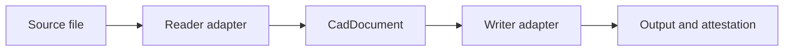

# Kit

Kit is a Python SDK for CAD interchange.
Readers build a neutral `CadDocument` from source files.
Writers produce target files and report how they represented the source information.
Production conversion runs without requiring CAD software.

[Wiki](https://github.com/TryUniCAD/Kit/wiki)

## Start here

1. Read the [installation guide](Documentation/Tasks/Install.md).
2. Select a [registered format](Documentation/Tasks/SelectFormat.md).
3. Follow the [conversion procedure](Documentation/Tasks/ConvertDocument.md).
4. Evaluate the [result and acceptance evidence](Documentation/Tasks/InspectResult.md).

The [documentation index](Documentation/Index.md) includes API, model, adapter, research, and maintenance references.
The [standards scope](Documentation/Standards/Scope.md) identifies the writing rules and current conformance limits.
The [completion roadmap](Roadmap.md) describes the path to full conversion support.
Use the [conversion backlog](Documentation/Maintenance/ConversionBacklog.md) to find task ownership, dependencies and existing PRs.

## Formats and limits

| Format               | Suffixes                  | Registration      |
| -------------------- | ------------------------- | ----------------- |
| SOLIDWORKS part      | `.SLDPRT`                 | Reader and writer |
| SOLIDWORKS assembly  | `.SLDASM`                 | Reader            |
| FreeCAD              | `.FCStd`                  | Reader and writer |
| CATIA V5             | `.CATPart`, `.CATProduct` | Reader and writer |
| Kit interchange JSON | `.json`                   | Reader and writer |
| Autodesk Fusion      | `.f3d`                    | Reader and writer |

Registration does not establish complete feature coverage or lossless translation.
Native replay and carrier preservation have different meanings from editable cross-format output.
Check the format reference and result for each input.
The SOLIDWORKS part writer generates one editable Front-plane line-loop blind boss
from a qualified neutral document. [Writer scope](Documentation/Reference/Adapters/Solidworks.md#writing)
The [Fusion public adapter](Documentation/Changes/Fusion/Adapter/FusionPublicAdapter.md) reads and writes qualified parameter, circle, rectangle, cylinder, cuboid, and frustum documents. Arbitrary feature graphs remain unsupported; `strict=False` explicitly selects the earlier partial reader.

## Command line

### Install Kit

Install Git and `uv`, then open the local Kit repository directory.
Use Python 3.14 to enable Fusion research, Fusion native inspection, and Fusion container stream extraction.

```sh
uv tool install --python 3.14 .
kit --version
kit --help
```

For a published release that includes the CLI, use `uv tool install unicad-kit`.
In a development environment, use `uv run --frozen kit` or `uv run --frozen python -m KitCli`.

### List formats, convert, and inspect files

These commands use local input files. Replace the example filenames with your own paths.
Choose unused output paths and quote paths that contain spaces.

| Command                                    | Use                                                       |
| ------------------------------------------ | --------------------------------------------------------- |
| `kit formats`                              | List registered formats and their read and write support. |
| `kit formats --json`                       | List format IDs, aliases, and suffixes in JSON.           |
| `kit convert model.f3d model.json`         | Convert a supported Fusion model to Kit interchange JSON. |
| `kit decode part.SLDPRT -o decoded.json`   | Save a neutral inspection report. Omit `-o` to print it.  |
| `kit decode part.SLDPRT --layer container` | List the records in a SOLIDWORKS or Fusion container.     |
| `kit decode model.f3d --layer native`      | Inspect supported typed Fusion native records.            |

`convert` selects the output format from the destination suffix. Use `--from` and `--to` to specify format IDs explicitly.
Conversion uses strict reading and applies the output policy before writing.
Use `--configuration NAME` for a named configuration or `--json` for a machine-readable conversion report.
For the measured SOLIDWORKS write path, see the requirements for [`--native-measurement`](Documentation/Changes/Solidworks/Construction/SolidworksMeasuredPartPublication.md).

`decode` wraps its neutral document in an inspection report. To create interchange JSON, use `kit convert` with a `.json` destination.
Use `--partial` with the neutral view or `--stream NAME` with the container view.
`--stream` includes one named record as base64 in the report.

Back up existing files before using `--overwrite` with `convert` or `decode`. Conversion can also replace managed companion files.
See the [command-line guide](Documentation/Tasks/CommandLine.md) for all options and [result evaluation](Documentation/Tasks/InspectResult.md) for acceptance evidence.

### Run research tools

For `kit research` and `kit run`, use `--root` with an absolute path to a trusted checkout.
Kit executes the research code and SDK from that checkout.
In the examples, replace `CHECKOUT` with that path and use new output directories.
Use a checkout that contains the research tools, manifests, and pinned Git objects required by your task.

| Research tool | Example or starting command                                                                       |
| ------------- | ------------------------------------------------------------------------------------------------- |
| `solidworks`  | `kit research --offline --root CHECKOUT solidworks --asset PINNED_PART --output SolidWorksExport` |
| `fusion`      | `kit research --offline --root CHECKOUT fusion --asset PINNED_DESIGN --output FusionExport`       |
| `corpus`      | `kit research --root CHECKOUT corpus check --manifest CHECKOUT/re/automation/Corpus.json`         |
| `controller`  | `kit research --root CHECKOUT controller --store ResearchState init --max-running 4`              |
| `supervisor`  | `kit research --root CHECKOUT supervisor --config Supervisor.json status`                         |
| `api`         | `kit research --root CHECKOUT api status solidworks`                                              |
| `codec-patch` | `kit research --root CHECKOUT codec-patch --help`                                                 |
| `compare`     | See [compare decoded exports](#compare-decoded-exports).                                          |

For `--asset`, use a repository-relative path listed by the selected reader's manifest.
Repeat `--asset` to batch Fusion designs. Keep the decoded documents and receipts together.
`--offline` skips native API verification. To verify through a CAD application, omit `--offline` after completing the API setup.
The API tool also supports Fusion add-in setup with `api enable fusion` and comparison with saved measurements through `api compare`.
See [native API setup and comparison](Documentation/Changes/Research/Automation/AutomaticNativeReaderVerification.md).

After controller initialization, use the same `--store` path with `status` to inspect jobs.
Configure the worker programs before using the supervisor.
With the same `--config`, use `submit Batch.json` to add jobs and `run --idle-seconds 30` to dispatch them.
On Windows, the supervisor requires Windows 10 or later, Python 3.14 or later, the `pywin32` development extra, and a compatible checkout.
Use `codec-patch` after a settled research run with a reviewed rule, measured controls, and a pinned container image.
See the [research CLI guide](Documentation/Tasks/ResearchCommandLine.md) for pinned input examples, queue setup, and the codec patch procedure.

### Start a file or catalogue investigation

Supply a local CAD file and choose a new run directory. Select `fusion`, `solidworks`, or `auto` by input type.

```sh
kit run --root CHECKOUT fusion --input model.f3d --directory FusionRun
kit run --root CHECKOUT solidworks --input part.SLDPRT --directory SolidWorksRun
kit run --root CHECKOUT auto --input unknown-file --directory DetectedRun
```

Inspect `FileScope.json` for the decode results and unresolved evidence.
To run a catalogue, use `--catalogue Catalog.sqlite` with `fusion` or `--catalogue FeaturePlan.json` with `solidworks` in place of `--input`.
See [catalogue setup, pause and resume, and optional advice](Documentation/Tasks/ResearchCommandLine.md#run-a-cad-catalogue-with-optional-advice).
Use `kit research --root CHECKOUT TOOL --help` or `kit run --root CHECKOUT fusion --help` for the selected tool's full options.

### Compare decoded exports

Install Kit from a trusted checkout containing [the comparison command](https://github.com/TryUniCAD/Kit/pull/275).
Use that checkout for `--root`. Supply two folders of decoded `CadDocument` JSON and a new output directory.
If the folders also contain receipts and summaries, use `--pattern document.json` to select the standard document filenames.

```sh
kit research --root CHECKOUT compare SolidWorks Fusion --unit mm -o Comparison
```

Kit pairs matching relative paths in the two folders.
When paths differ, supply a [pair manifest](https://github.com/TryUniCAD/Kit/blob/713a024b138fbb54f72e89748dd4e6acb2c48228/Documentation/Tasks/CompareDecodedDocuments.md#pair-independently-named-exports) with `--manifest Pairs.json` in place of both folders.
Use `--unit mm` only when both inputs report geometry in millimetres. Use `--left-unit` and `--right-unit` when units differ.
At zero tolerance, Kit copies the first folder's original JSON for each exact match with no unresolved issues to `Comparison/unified/`.
Review `Comparison/summary.json` for outcomes and paths, and `Comparison/reports/` for pair details.
The unified folder records agreement between the decoded exports. Independent measurements establish CAD acceptance.

## Conversion example

Call `convert(source, destination)` with the input and output paths.
Supply a real `bracket.SLDPRT` file and an unused output path before running this example.

```python
from convert import convert as ConvertDoc

Result = ConvertDoc("bracket.SLDPRT", "bracket.FCStd", allow_carrier=False)
```

Install [`unicad-kit`](#distribution) in the Python environment that runs your script.
The public import is `convert`.
The default `allow_carrier=True` permits preservation results subject to the registry policy.
Set `allow_carrier=False` for conversion acceptance work.
This option is independent of the reader's `strict` option.
The default does not waive the repository's lossless and parametric acceptance requirements.

A successful return reports writer evidence.
It does not prove that a target application can open, edit, and rebuild the output.
See [result evaluation](Documentation/Tasks/InspectResult.md) before making an acceptance claim.

## Architecture



The neutral document separates readers from writers.
Vendor applications run only in isolated validation workflows after output generation.

## Contribute

Activate [standard-pr-practice](.agents/skills/standard-pr-practice/SKILL.md) before repository work.
Use an isolated worktree and a separate PR.
Add a [change entry](Documentation/Changes/Index.md) for each repository addition.
Record each new discovery as a separate [gotcha](Documentation/Gotchas/README.md).
Run tests only in remote CI.

Core contributors: Odin Glynn-Martin, Stephen Harcourt, and James Harcourt.

## Star history

[](https://www.star-history.com/#TryUniCAD/Kit&Date)

## Distribution

Use the SDK in your Python project.

Use Python 3.11 or later.
Activate your project's virtual environment and install Kit from PyPI.

```sh
pip install unicad-kit
```

If no release is available, follow [repository installation](Documentation/Tasks/Install.md).
See [getting started](Documentation/GettingStarted.md) for uv project setup and output limits.
See [release publishing](Documentation/Changes/CommitReleases.md) for the release process.

## License

Kit uses the [MIT License](LICENSE).
Copyright (c) 2026 Odin Glynn-Martin, Stephen Harcourt, James Harcourt.
Third-party materials retain their own licenses.
See the [research artifact policy](Documentation/Reference/Research/ResearchArtifacts.md).
