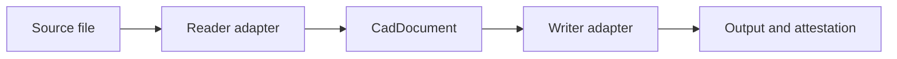

<!--
SPDX-License-Identifier: MIT
SPDX-FileCopyrightText: Copyright (c) 2026 Parashell, Odin Glynn-Martin, Stephen Harcourt
-->

<p align="center">
  
</p>

# Kit

Kit is a Python SDK for CAD interchange.
Readers build a neutral `CadDocument` from source files.
Writers produce target files and report how they represented the source information.
Production conversion does not use a CAD application.

## Start here

1. Read the [installation guide](Documentation/Tasks/Install.md).
2. Select a [registered format](Documentation/Tasks/SelectFormat.md).
3. Follow the [conversion procedure](Documentation/Tasks/ConvertDocument.md).
4. Evaluate the [result and acceptance evidence](Documentation/Tasks/InspectResult.md).

The [documentation index](Documentation/Index.md) includes API, model, adapter, research, and maintenance references.
The [standards scope](Documentation/Standards/Scope.md) identifies the writing rules and current conformance limits.

## Formats and limits

| Format               | Suffixes                  | Registration      |
| -------------------- | ------------------------- | ----------------- |
| SOLIDWORKS part      | `.SLDPRT`                 | Reader and writer |
| SOLIDWORKS assembly  | `.SLDASM`                 | Reader and writer |
| FreeCAD              | `.FCStd`                  | Reader and writer |
| CATIA V5             | `.CATPart`, `.CATProduct` | Reader and writer |
| Kit interchange JSON | `.json`                   | Reader and writer |

Registration does not establish complete feature coverage or lossless translation.
Native replay and carrier preservation have different meanings from editable cross-format output.
Check the format reference and result for each input.
The [Fusion reader](re/Fusion/README.md#research-reader) remains an explicit research interface outside production adapter discovery.

## Conversion example

Supply a real `bracket.SLDPRT` file and an unused output path before running this example.

```python
from convert import convert as ConvertDoc

Result = ConvertDoc("bracket.SLDPRT", "bracket.FCStd", allow_carrier=False)
```

The distribution name is `kit`, but the public import is `convert`.
The default `allow_carrier=True` permits preservation results subject to the registry policy.
Set `allow_carrier=False` when the task requires the stricter output policy.
This option is independent of the reader's `strict` option.

A successful return reports writer evidence.
It does not prove that a target application can open, edit, and rebuild the output.
See [result evaluation](Documentation/Tasks/InspectResult.md) before making an acceptance claim.

## Architecture



The neutral document separates readers from writers.
Vendor applications run only in isolated validation workflows after output generation.

## Contribute

Activate [standard-pr-practice](.agents/skills/standard-pr-practice/SKILL.md) before repository work.
Use an isolated worktree and a separate PR.
Add a [change entry](Documentation/Changes/Index.md) for each repository addition.
Record new discoveries in the [gotchas log](Documentation/Gotchas/README.md).
Run tests only in remote CI.

## License

Kit uses the [MIT License](LICENSE).
Copyright (c) 2026 Parashell, Odin Glynn-Martin, Stephen Harcourt.
Third-party materials retain their own licenses.
See the [vendor binary notice](re/binaries/README.md).
