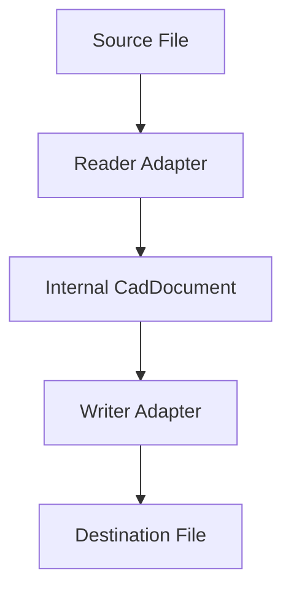

<!--
SPDX-License-Identifier: MIT
SPDX-FileCopyrightText: Copyright (c) 2026 Parashell, Odin Glynn-Martin, Stephen Harcourt
-->

---
title: "Introduction to Kit SDK"
wiki_page_id: "page-intro"
---

<details>
<summary>Relevant source files</summary>

The following files were used as context for generating this wiki page:

- [README.md](README.md)
- [re/Methodology.md](re/Methodology.md)
- [tests/convert/api/ApiMetadataTests.py](tests/convert/api/ApiMetadataTests.py)
- [AGENTS.md](AGENTS.md)
- [src/convert/adapters/solidworks/core/Adapter.py](src/convert/adapters/solidworks/core/Adapter.py)

</details>

# Introduction to Kit SDK

Kit is an open-source CAD interchange SDK. It translates geometry, feature trees, assemblies, and other metadata between proprietary CAD formats natively. Kit performs these translations without requiring the original CAD software to be installed on the system.

Sources: [README.md:12-14](README.md#L12-L14), [README.md:26](README.md#L26)

## Core Architecture

Kit follows a linear pipeline for every file conversion. The system reads a source file through a reader adapter, processes it via an internal model, and writes it using a writer adapter.



The diagram shows the data flow from a proprietary source format to a destination format through Kit's internal adapters.

Sources: [README.md:28-32](README.md#L28-L32), [src/convert/adapters/solidworks/core/Adapter.py:277-285](src/convert/adapters/solidworks/core/Adapter.py#L277-L285)

### Internal Modeling
Kit uses the `CadDocument` class as its central interchange model. During conversion, the reader adapter builds a `CadDocument` from the source bytes. This document contains:
*  **Source Metadata**: Format ID, path, and SHA256 hashes.
*  **Geometry**: B-rep models, meshes, and sketch entities.
*  **Parametric History**: Features, parameters, and selection sets.
*  **Assembly Data**: Definitions, instances, and mates.

Sources: [src/convert/adapters/solidworks/core/Adapter.py:246-271](src/convert/adapters/solidworks/core/Adapter.py#L246-L271), [src/convert/adapters/solidworks/core/Adapter.py:316-360](src/convert/adapters/solidworks/core/Adapter.py#L316-L360)

## Format Support

Kit provides native support for reading and writing specific proprietary suffixes.

| CAD Software | Extensions Supported |
| :--- | :--- |
| SOLIDWORKS | `.SLDPRT`, `.SLDASM` |
| FreeCAD | `.FCStd` |
| CATIA | `.CATPart`, `.CATProduct` |

Sources: [README.md:16-24](README.md#L16-L24), [tests/convert/api/ApiMetadataTests.py:38-40](tests/convert/api/ApiMetadataTests.py#L38-L40)

## Conversion Workflow

You perform conversions using the `convert` function. This function identifies the destination format by the file extension.

```python
from kit import convert

result = convert("bracket.SLDPRT", "bracket.FCStd")
```

The operation returns a `ConversionResult`. This object includes the document model, the write result, and an attestation. The attestation details which capabilities (e.g., geometry, parameters) survived the translation.

Sources: [README.md:34-42](README.md#L34-L42), [tests/convert/api/ApiMetadataTests.py:44-46](tests/convert/api/ApiMetadataTests.py#L44-L46)

### Strict Mode
Kit defaults to reversible swaps. You can enable strict mode by passing `allow_carrier=False`. In this mode, the conversion fails with an `ApplicationUsabilityError` if the output is not fully loadable by the vendor application or if data was dropped during the process.

Sources: [README.md:44-53](README.md#L44-L53), [tests/convert/api/ApiMetadataTests.py:47](tests/convert/api/ApiMetadataTests.py#L47)

## Development Methodology

Kit relies on a rigorous reverse-engineering playbook to handle proprietary binary formats. The development process follows six distinct phases.

| Phase | Action | Purpose |
| :--- | :--- | :--- |
| 1 | Container Framing | Enumerate streams and crack the file envelope (e.g., ZIP, CFBF). |
| 2 | Measurement Oracle | Build a way to verify file correctness using the vendor API. |
| 3 | Differential Corpus | Create files with single-property variances to locate fields. |
| 4 | Runtime Tracing | Use debuggers to find object boundaries and index arithmetic. |
| 5 | Static Decompilation | Determine field types, version gates, and enum branches. |
| 6 | Write Path | Implement the final native writer. |

Sources: [re/Methodology.md:30-41](re/Methodology.md#L30-L41)

### Verification Discipline
Kit enforces a "no-donor-block" policy. Implementations must avoid shipping vendor bytes and instead emit files from first principles. Developers use a "measurement oracle"—a script that drives the actual CAD software—to confirm that Kit's output matches vendor-produced geometry to floating-point exactness.

Sources: [re/Methodology.md:12-20](re/Methodology.md#L12-L20), [AGENTS.md:65](AGENTS.md#L65)

## Conclusion

Kit SDK provides a high-fidelity path for CAD interoperability by bypassing the need for vendor runtimes. By focusing on internal modeling and native writer implementation, it allows developers to integrate CAD translation directly into production workflows while maintaining parametric and geometric accuracy.
