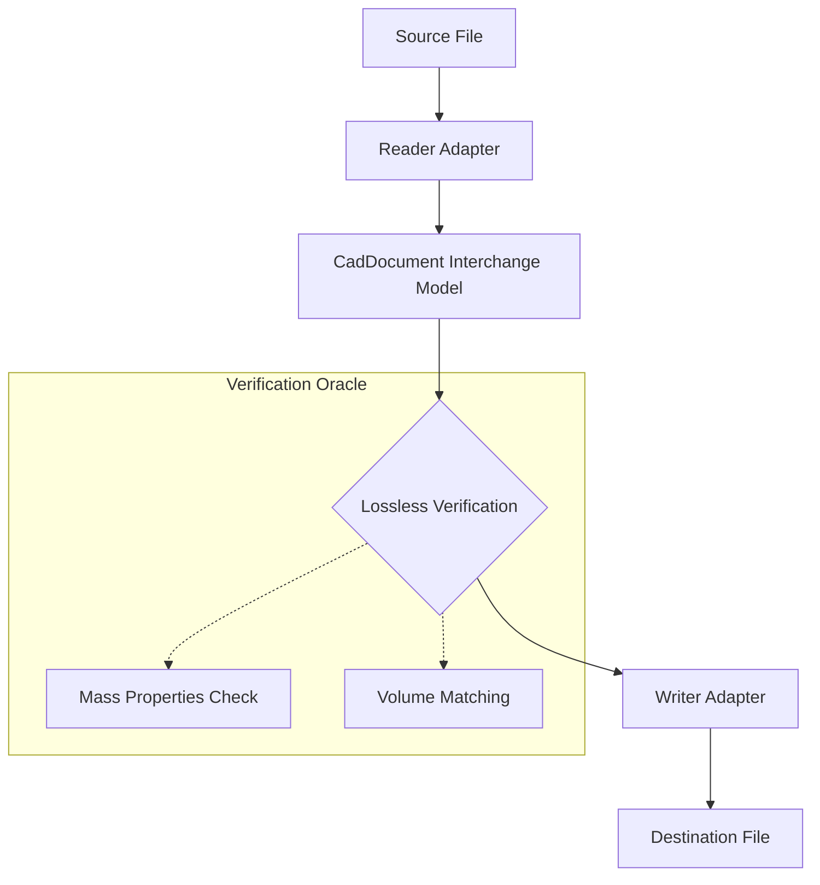
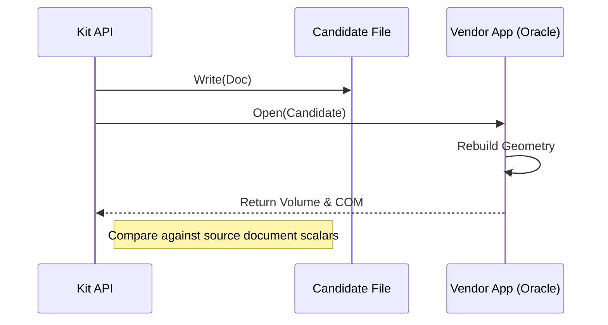

<details>
<summary>Relevant source files</summary>

The following files were used as context for generating this wiki page:

- [re/Methodology.md](re/Methodology.md)
- [tools/skills/Descriptions.py](tools/skills/Descriptions.py)
- [tools/steering/SteeringBaseline.txt](tools/steering/SteeringBaseline.txt)
- [src/convert/adapters/freecad/Archive.py](src/convert/adapters/freecad/Archive.py)
- [src/convert/adapters/freecad/Adapter.py](src/convert/adapters/freecad/Adapter.py)
- [src/convert/adapters/solidworks/core/Adapter.py](src/convert/adapters/solidworks/core/Adapter.py)
- [tests/convert/freecad/FreecadTests.py](tests/convert/freecad/FreecadTests.py)

</details>

# API Reference

The Kit API provides a programmatic interface for native CAD format conversion and reverse-engineering data extraction. It enables bidirectional interoperability between proprietary formats like SOLIDWORKS (`.SLDPRT`, `.SLDASM`), FreeCAD (`.FCStd`), and CATIA (`.CATPart`, `.CATProduct`) without requiring local CAD software installations.

The API architecture follows a modular adapter-based approach where each format is handled by a specialized adapter that implements a standardized contract for probing, reading, and writing documents.

Sources: [README.md](README.md), [src/convert/adapters/solidworks/core/Adapter.py:127-142](src/convert/adapters/solidworks/core/Adapter.py#L127-L142), [src/convert/adapters/freecad/Adapter.py:1519-1534](src/convert/adapters/freecad/Adapter.py#L1519-L1534)

## Core Conversion API

The primary entry point for converting files is the `convert` function. This function abstracts the selection of appropriate reader and writer adapters based on file extensions.

### Function: `convert`

Executes a full translation from a source file to a destination format.

| Parameter | Type | Description |
| :--- | :--- | :--- |
| `source` | `str \| Path \| BinaryIO` | The input CAD file path or stream. |
| `destination` | `str \| Path \| BinaryIO` | The output file path or stream. |
| `allow_carrier` | `bool` | If `False`, the write fails if the output is not application usable. Defaults to `True`. |
| `overwrite` | `bool` | Whether to overwrite the destination if it exists. |

Sources: [README.md](README.md), [tools/steering/SteeringBaseline.txt:19-32](tools/steering/SteeringBaseline.txt#L19-L32)

### Workflow Diagram

The following diagram illustrates the data flow through the conversion API:



This diagram shows the path from a source file through the internal interchange model to the final destination, including the measurement oracle check.

Sources: [README.md](README.md), [re/Methodology.md:9-16](re/Methodology.md#L9-L16)

## Adapter Interface

Every format adapter (e.g., `SldprtAdapter`, `FreeCADAdapter`) must implement a standard set of methods. This consistency allows the engine to handle different formats through a unified interface.

### Methods

| Method | Description |
| :--- | :--- |
| `probe(source)` | Returns a `ProbeResult` with a confidence score (0.0 to 1.0) indicating if the file matches the format. |
| `read(source, options)` | Parses the source into a `CadDocument` interchange model. |
| `write(doc, target, options)` | Serializes a `CadDocument` into the adapter's native format. |
| `supports(doc, target)` | Validates if the adapter can write the given document to the specified target. |

Sources: [src/convert/adapters/solidworks/core/Adapter.py:127-142](src/convert/adapters/solidworks/core/Adapter.py#L127-L142), [src/convert/adapters/freecad/Adapter.py:1519-1534](src/convert/adapters/freecad/Adapter.py#L1519-L1534)

### Data Structure: `ProbeResult`

The `probe` method returns this structure to indicate format detection results.

| Field | Type | Description |
| :--- | :--- | :--- |
| `FormatId` | `str` | The unique identifier for the detected format. |
| `Confidence` | `float` | A score between 0.0 and 1.0. |
| `Reason` | `str` | A human-readable explanation of the verdict. |

Sources: [src/convert/adapters/solidworks/core/Adapter.py:146-163](src/convert/adapters/solidworks/core/Adapter.py#L146-L163), [src/convert/adapters/freecad/Adapter.py:1448-1473](src/convert/adapters/freecad/Adapter.py#L1448-L1473)

## Native FreeCAD API

The FreeCAD adapter provides specialized functions for handling `.FCStd` archives and managing embedded Kit manifests.

### Archive Management

The `Archive.py` module handles low-level ZIP container operations and XML validation for FreeCAD's `Document.xml`.

```python
from convert.adapters.freecad.Archive import extract_manifest_from_fcstd

# Extracts the Kit document.json from an existing FreeCAD archive
manifest = extract_manifest_from_fcstd(data_bytes)
```

Sources: [src/convert/adapters/freecad/Archive.py:1649-1678](src/convert/adapters/freecad/Archive.py#L1649-L1678)

### Key Functions

| Function | Description |
| :--- | :--- |
| `build_fcstd_archive` | Constructs a valid `.FCStd` ZIP file from a manifest and optional sidecars. |
| `read_native_fcstd` | Performs a deep parse of a native FreeCAD file into the Kit model. |
| `extract_manifest` | Safely retrieves the embedded JSON manifest from an archive. |

Sources: [src/convert/adapters/freecad/Archive.py:1596-1630](src/convert/adapters/freecad/Archive.py#L1596-L1630), [src/convert/adapters/freecad/Native.py:1082-1147](src/convert/adapters/freecad/Native.py#L1082-L1147)

## Reverse Engineering Tooling

The project includes internal APIs in the `re/` directory for format discovery. These are used to build the measurement oracles and trace vendor readers.

### Serialization tracing

The `re/tooling/harness/Serialize.py` module provides functions to author SOLIDWORKS-compatible streams from first principles.

| Class/Function | Purpose |
| :--- | :--- |
| `EmitData` | Generates `ResolvedFeatures` and `Keywords` streams based on a `PartInfo` definition. |
| `GrowSkeleton` | Extends an existing donor skeleton to accommodate additional features. |
| `WriteNodesMut` | Directly patches object IDs and flags in the native binary tree. |

Sources: [re/tooling/harness/Serialize.py:393-417](re/tooling/harness/Serialize.py#L393-L417), [re/tooling/harness/Serialize.py:431-458](re/tooling/harness/Serialize.py#L431-L458)

### Measurement Oracle Logic

A critical part of the API is the ability to verify output correctness through quantitative measurements.



Sources: [re/Methodology.md:57-79](re/Methodology.md#L57-L79)

## Configuration and Options

The API uses `ReadOptions` and `WriteOptions` to control behavior such as including B-Rep data or enforcing strict compatibility.

| Option | Type | Default | Description |
| :--- | :--- | :--- | :--- |
| `include_brep` | `bool` | `True` | Includes the B-Rep (OpenCASCADE/Parasolid) geometry. |
| `include_tessellation`| `bool` | `True` | Includes mesh/triangulation data. |
| `strict` | `bool` | `True` | Fails on any validation error. |
| `allow_carrier` | `bool` | `True` | Allows "carrier-only" writes where native history isn't fully recovered. |

Sources: [src/convert/adapters/solidworks/core/Adapter.py:228-232](src/convert/adapters/solidworks/core/Adapter.py#L228-L232), [src/convert/adapters/freecad/Adapter.py:1477-1481](src/convert/adapters/freecad/Adapter.py#L1477-L1481)

The Kit API allows developers to bypass proprietary CAD runtimes by implementing the serialization grammar directly, as evidenced by the `SldprtArchive` and `CfvTwoArchive` implementations. This facilitates high-performance, headless conversion workflows.

Sources: [README.md](README.md), [re/Methodology.md:278-285](re/Methodology.md#L278-L285)
