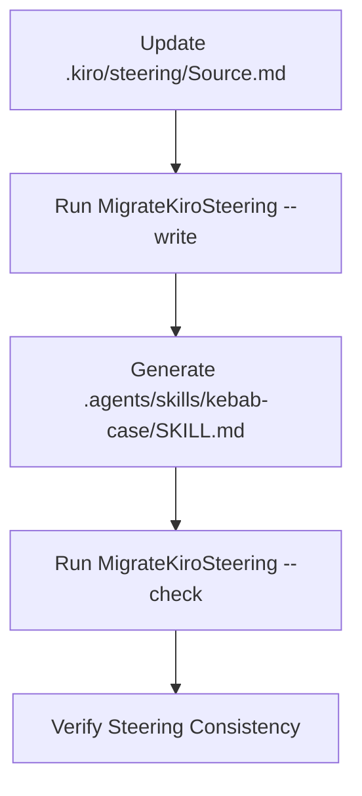

Relevant source files

The following files were used as context for generating this wiki page:

- [AGENTS.md](AGENTS.md)
- [tools/skills/Descriptions.py](tools/skills/Descriptions.py)
- [re/Methodology.md](re/Methodology.md)
- [re/solidworks/archive/Grammar.md](re/solidworks/archive/Grammar.md)
- [tools/steering/SteeringBaseline.txt](tools/steering/SteeringBaseline.txt)

# Agent Steering & Contribution Guidelines

Agent steering defines the constraints, behaviors, and skill-based workflows required for AI agents and human contributors within the Kit repository. The system uses a portable steering model where specific skills activate based on the task type to ensure consistent code quality, legal compliance, and architectural integrity.

The guidelines enforce a strict separation between production code and reverse-engineering workspaces, prohibited testing patterns, and automated formatting requirements. All automated steering lives in `.agents/skills/` as [Agent Skills](https://agentskills.io/specification), generated from source files in `.kiro/steering/`.

Sources: [AGENTS.md:1-12](AGENTS.md#L1-L12), [tools/skills/Descriptions.py:7-10](tools/skills/Descriptions.py#L7-L10)

## Portable Steering & Skill System

The Kit project implements a skill-based steering system. You must read and follow every skill whose description matches your current task. Steering files are synchronized between kebab-case `SKILL.md` files and PascalCase source files.

### Skill Lifecycle
To update steering, you must modify the `.kiro/steering/<PascalCaseName>.md` source. Never edit generated `SKILL.md` files directly. After modification, you must synchronize the portable version using project tools.

The diagram shows the workflow for maintaining and verifying portable agent steering.

Sources: [AGENTS.md:14-22](AGENTS.md#L14-L22), [tools/skills/Descriptions.py:12-44](tools/skills/Descriptions.py#L12-L44)

### Core Project Constraints
Every contributor and agent must adhere to these "Always-on" rules:
- **Git Safety**: Never write directly to the `main` branch. Use non-protected working branches.
- **Completeness**: Deliver verified work. Do not leave stubs, placeholders, or known failures.
- **Dependency Management**: Use `uv` for Python dependencies, except in `Parashell/` and `modules/` workspaces.
- **Header Notices**: Start new text files with the exact notice in `HEADER_NOTICE`.
- **User State**: Preserve unknown commits, branches, or staged changes as user-owned state.

Sources: [AGENTS.md:24-34](AGENTS.md#L24-L34), [tools/skills/Descriptions.py:19-20](tools/skills/Descriptions.py#L19-L20)

## Reverse Engineering Workspace

The `re/` directory tree is an unrestricted research workspace exempt from standard repository compliance. This exemption allows for rapid iteration and experimentation during the discovery phase of proprietary CAD formats.

### Workspace Exemptions
Within the `re/` tree, you are not required to follow:
- Code naming, formatting, or typing standards.
- Rationale comments or SPDX headers.
- Architecture or directory-density rules.
- Unit-test requirements.

Sources: [AGENTS.md:36-44](AGENTS.md#L36-L44), [re/Methodology.md:20-30](re/Methodology.md#L20-L30)

### Reverse Engineering Methodology
Successful reverse engineering follows a phased approach where cost and generality rise together.

| Phase | Activity | Buy-in / Result |
| :--- | :--- | :--- |
| 1 | Container Framing | Ability to read/write file envelope and enumerate streams. |
| 2 | Measurement Oracle | Unattended, quantitative correctness verdicts. |
| 3 | Differential Corpus | Identification of field locations for application variables. |
| 4 | Runtime Tracing | Object boundaries, index arithmetic, and hidden fields. |
| 5 | Static Decompilation | Authoritative types, version gates, and lookup tables. |
| 6 | Write Path | The final conversion product. |

Sources: [re/Methodology.md:32-41](re/Methodology.md#L32-L41), [re/solidworks/archive/Grammar.md:33-40](re/solidworks/archive/Grammar.md#L33-L40)

## Testing & Verification Policy

The project enforces a specific testing hierarchy that prioritizes real-world behavior over isolated component checks.

### Test Prohibitions
- **Unit Test Ban**: Unit tests are strictly prohibited. Do not add or restore tests for individual functions, methods, or classes in isolation.
- **Labeling Policy**: Do not relabel unit tests as "integration tests" to bypass the ban. This includes policy, security, and tooling unit tests.

### Required Validation
Behavior must be validated at real component boundaries through:
- Integration tests.
- End-to-end checks.
- Smoke and compatibility tests.
- Repository-wide policy checks.

Run tests only in pull request CI. Contributors must not run tests locally as a standard workflow.

Sources: [AGENTS.md:46-57](AGENTS.md#L46-L57), [re/Methodology.md:65-80](re/Methodology.md#L65-L80)

## Contribution Skills Mapping

Skills activate based on the specific directory or file type involved in a change.

| Work Area | Active Skills |
| :--- | :--- |
| User Responses | `chats` |
| Code Changes | `code-formatting`, `no-stubs`, `spdx-header` |
| Imports/Modules | `split-large-definitions` |
| Git Operations | `git-never-touch-main` |
| Python Setup | `python-package-manager` |
| CAD Parsing | `no-cad-runtime`, `no-donor-blocks`, `lossless-translation` |
| Frontend/React | `frontend-stack`, `component-architecture`, `design-system-discipline` |

Sources: [AGENTS.md:59-78](AGENTS.md#L59-L78), [tools/skills/Descriptions.py:12-44](tools/skills/Descriptions.py#L12-L44)

## Implementation Standards

### Formatting & Identifiers
Contributors must apply specific casing and naming conventions to ensure the codebase remains maintainable.

- **PascalCase**: Used for classes, functions, methods, variables, and constants.
- **Boolean Prefixing**: Prefix functions returning a boolean with `Is`, `Has`, or `Can`.
- **Declaration Splitting**: Split substantial declarations into focused files with exact symbol imports. Logical lines in a declaration must typically not exceed 30.

Sources: [tools/skills/Descriptions.py:21-41](tools/skills/Descriptions.py#L21-L41), [tools/steering/SteeringBaseline.txt:4-10](tools/steering/SteeringBaseline.txt#L4-L10)

### Binary Integrity
The project implements a "No Donor Blocks" policy for CAD format handling.
1. Never ship vendor bytes in the final implementation.
2. Reverse engineer proprietary formats until they can be emitted from first principles.
3. Use measurement oracles to confirm numerical correctness (e.g., solid volume and center of mass) rather than simple "opens" checks.

Sources: [tools/skills/Descriptions.py:31-34](tools/skills/Descriptions.py#L31-L34), [re/Methodology.md:65-70](re/Methodology.md#L65-L70)

## Summary

Agent steering in the Kit repository enforces a highly disciplined approach to software architecture and reverse engineering. By utilizing a portable skill system, the project ensures that agents deliver complete, verified, and losslessly translated code without relying on prohibited unit testing patterns or vendor-proprietary binary blocks. Significance is placed on quantitative verification through measurement oracles and the strict isolation of research workspaces from production code.
