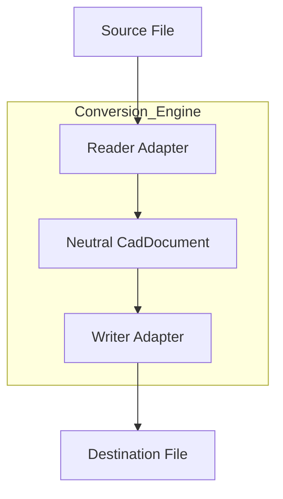
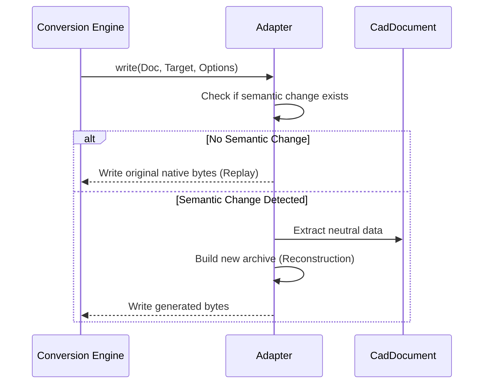

Relevant source files

The following files were used as context for generating this wiki page:

- [src/convert/api/ApiConvert.py](src/convert/api/ApiConvert.py)
- [README.md](README.md)
- [src/convert/adapters/freecad/Adapter.py](src/convert/adapters/freecad/Adapter.py)
- [src/convert/adapters/catia/Adapter.py](src/convert/adapters/catia/Adapter.py)
- [re/Methodology.md](re/Methodology.md)
- [tools/steering/SteeringBaseline.txt](tools/steering/SteeringBaseline.txt)

# Conversion Engine

The Conversion Engine provides the core pipeline for translating CAD data between different proprietary formats. It operates by abstracting source files into a neutral `CadDocument` format before writing them to a target format. This architecture ensures that adapters for different CAD systems remain independent and decoupled.

Sources: [README.md:21-25](README.md#L21-L25), [src/convert/api/ApiConvert.py:15-18](src/convert/api/ApiConvert.py#L15-L18)

## Conversion Pipeline Architecture

The engine follows a linear route for every conversion task. It first identifies the correct reader adapter for the source file, extracts the data into a neutral `CadDocument`, and then dispatches the document to a writer adapter for the destination format.

The diagram shows the standard flow of data from a source format to a destination format through the neutral document boundary.

Sources: [README.md:23-27](README.md#L23-L27), [src/convert/api/ApiConvert.py:38-45](src/convert/api/ApiConvert.py#L38-L45)

## Core Components

### API Layer
The `ConvertFile` function serves as the primary entry point for users. It configures `ReadOptions` and `WriteOptions` based on user input and triggers the conversion process via the internal engine.

| Parameter | Type | Description |
| :--- | :--- | :--- |
| `SourceData` | `Source` | Path, bytes, or stream of the input file. |
| `TargetData` | `Destination` | Path or stream for the output file. |
| `SourceFormat` | `str` | Optional explicit format ID for the source. |
| `DestFormat` | `str` | Optional explicit format ID for the target. |
| `AllowCarrier` | `bool` | Whether to allow "carrier" results if native conversion fails. |

Sources: [src/convert/api/ApiConvert.py:15-37](src/convert/api/ApiConvert.py#L15-L37)

### Registry and Adapters
The engine uses a registry to manage available adapters. Each adapter (e.g., FreeCAD, CATIA, SOLIDWORKS) implements a common interface for probing, reading, and writing files.

*  **Probing**: The engine asks adapters to inspect a source to determine if they can handle the format.
*  **Reading**: The reader adapter converts the binary source into a `CadDocument` object.
*  **Writing**: The writer adapter takes a `CadDocument` and produces the target binary format.

Sources: [src/convert/adapters/freecad/Adapter.py:1003-1025](src/convert/adapters/freecad/Adapter.py#L1003-L1025), [src/convert/adapters/catia/Adapter.py:117-125](src/convert/adapters/catia/Adapter.py#L117-L125), [tools/steering/SteeringBaseline.txt:6-7](tools/steering/SteeringBaseline.txt#L6-L7)

## Conversion Logic and Options

### Strict Mode and Carriers
By default, the engine attempts reversible swaps. If a full native conversion is not possible, it may produce a "carrier" result—a file that embeds the original data or a neutral representation. If `StrictMode` (or `allow_carrier=False`) is set, the engine refuses carrier results and throws an `ApplicationUsabilityError` if the output is not fully usable by the target vendor application.

Sources: [README.md:38-45](README.md#L38-L45), [src/convert/api/ApiConvert.py:27-36](src/convert/api/ApiConvert.py#L27-L36)

### Replay vs. Reconstruction
Adapters like the `FreeCadAdapter` and `CatiaAdapter` implement logic to decide between "exact native roundtrip" (replay) and "reconstruction."

*  **Exact Replay**: If the `CadDocument` has not changed semantically, the engine writes the original native bytes back to the target.
*  **Reconstruction**: If changes are detected, the engine rebuilds the archive from the neutral `CadDocument` data.

The sequence shows the decision path an adapter takes during the write phase to preserve native fidelity.

Sources: [src/convert/adapters/freecad/Adapter.py:966-995](src/convert/adapters/freecad/Adapter.py#L966-L995), [src/convert/adapters/catia/Adapter.py:157-190](src/convert/adapters/catia/Adapter.py#L157-L190)

## Reverse Engineering Methodology
The engine's ability to read and write proprietary formats is based on a structured reverse-engineering playbook. This includes:
1.  **Container Framing**: Cracking the file envelope (e.g., ZIP, CFBF).
2.  **Measurement Oracle**: Using vendor APIs to verify correctness quantitatively (e.g., comparing mass properties).
3.  **Differential Analysis**: Comparing files that differ by a single property to locate fields.
4.  **Decompilation**: Analyzing vendor serialization code to determine field types and version gates.

Sources: [re/Methodology.md:30-45](re/Methodology.md#L30-L45), [re/Methodology.md:95-105](re/Methodology.md#L95-L105)

## Conclusion
The Conversion Engine provides a robust framework for CAD interoperability by enforcing a neutral document boundary and utilizing specialized adapters. It balances high-fidelity native replays with the ability to reconstruct documents from neutral data, governed by user-defined strictness and usability requirements.
