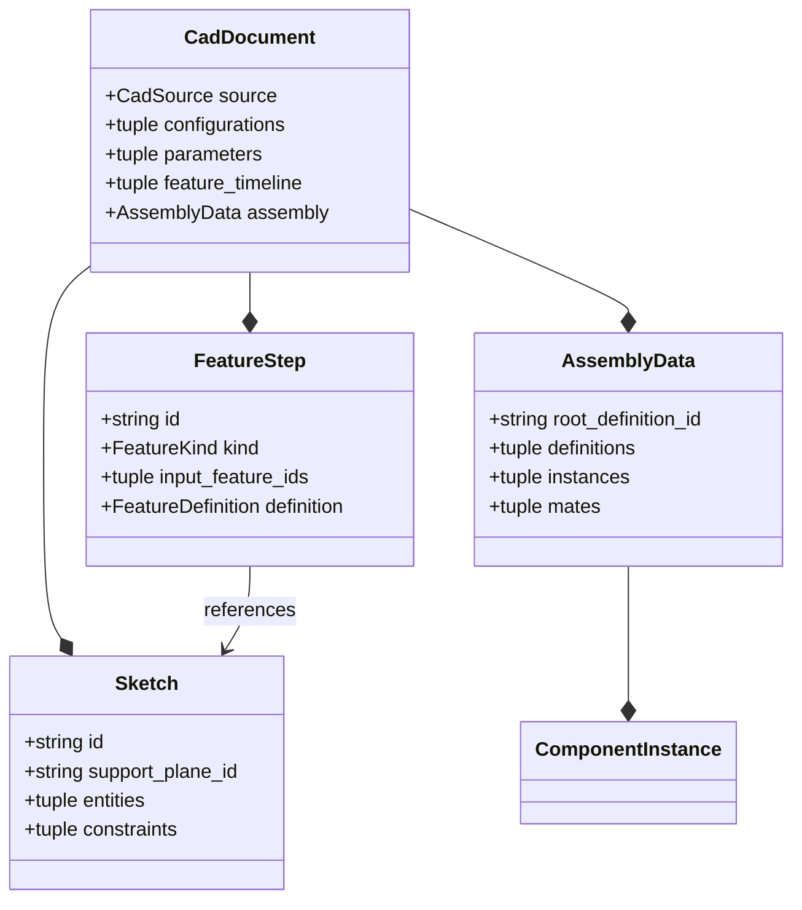
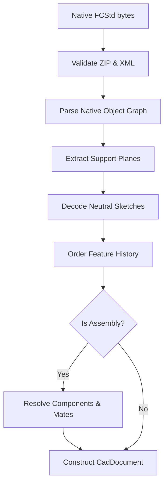

<!--
SPDX-License-Identifier: MIT
SPDX-FileCopyrightText: Copyright (c) 2026 Parashell, Odin Glynn-Martin, Stephen Harcourt
-->

---
title: "Neutral Document Model"
wiki_page_id: "page-interchange-core"
---

Relevant source files

The following files were used as context for generating this wiki page:

- [src/convert/adapters/freecad/Archive.py](src/convert/adapters/freecad/Archive.py)
- [src/convert/adapters/solidworks/core/Adapter.py](src/convert/adapters/solidworks/core/Adapter.py)
- [src/convert/adapters/freecad/Native.py](src/convert/adapters/freecad/Native.py)
- [tests/convert/freecad/FreecadTests.py](tests/convert/freecad/FreecadTests.py)
- [tests/convert/solidworks/core/SolidworksWriterTests.py](tests/convert/solidworks/core/SolidworksWriterTests.py)

# Neutral Document Model

The Neutral Document Model, represented by the `CadDocument` class, defines a vendor-independent intermediate format for CAD data within the Kit project. It enables bidirectional interoperability between proprietary formats like SOLIDWORKS and FreeCAD by abstracting geometry, parametric history, and assembly structures into a common schema.

This model provides a unified interface for CAD features including sketches, support planes, parameters, and B-Rep payloads. Adapters translate vendor-specific data into this neutral model during the read phase and reconstruct native records from it during the write phase.

Sources: [src/convert/adapters/freecad/Native.py](src/convert/adapters/freecad/Native.py), [src/convert/adapters/solidworks/core/Adapter.py](src/convert/adapters/solidworks/core/Adapter.py)

## Architecture and Components

The model organizes CAD data into logical collections that describe the design intent and final geometry. The root `CadDocument` object aggregates these components to form a complete document state.

### Core Model Components

| Component | Description |
| :--- | :--- |
| `source` | Identifies the original format, path, and versioning of the data. |
| `configurations` | Manages design variants and their active states. |
| `parameters` | Stores scalars, dimensions, and expressions used in the model. |
| `support_planes` | Defines planar reference frames for sketches and features. |
| `sketches` | Contains 2D entities and solver constraints. |
| `feature_timeline` | Represents the ordered history of modeling operations. |
| `bodies` | Describes discrete solid or surface geometry results. |
| `brep_payloads` | Carriers for native or neutral boundary representation data. |

Sources: [src/convert/adapters/freecad/Native.py:1126-1144](src/convert/adapters/freecad/Native.py#L1126-L1144), [src/convert/adapters/solidworks/core/Adapter.py:848-877](src/convert/adapters/solidworks/core/Adapter.py#L848-L877)

### Document Hierarchy

The following diagram illustrates the structural relationships within a `CadDocument`:

The diagram shows how geometric and structural data is nested within the document root.

Sources: [src/convert/adapters/freecad/Native.py:1126-1144](src/convert/adapters/freecad/Native.py#L1126-L1144), [src/convert/adapters/solidworks/core/Adapter.py:848-877](src/convert/adapters/solidworks/core/Adapter.py#L848-L877)

## Data Flow: Native to Neutral

Adapters perform a multi-stage decoding process to populate the Neutral Document Model from native archives.

1.  **Archive Validation**: The system validates the native file envelope (e.g., FreeCAD ZIP or SOLIDWORKS Compound Stream).
2.  **Object Graph Parsing**: Adapters traverse native object declarations and properties to identify planes, sketches, and features.
3.  **Geometric Translation**: Native geometry (e.g., `Part::GeomCircle` or SOLIDWORKS markers) is converted to neutral entities like `CircleGeometry`.
4.  **Parametric Mapping**: Native dimensions and equations are extracted into the `parameters` collection.
5.  **Assembly Reconstruction**: For assembly files, the adapter resolves component paths and translates native joints into neutral `mates`.

Sources: [src/convert/adapters/freecad/Native.py:1163-1200](src/convert/adapters/freecad/Native.py#L1163-L1200), [src/convert/adapters/solidworks/core/Adapter.py:1301-1400](src/convert/adapters/solidworks/core/Adapter.py#L1301-L1400)

### FreeCAD Read Flow

The flow summarizes the steps required to translate a FreeCAD file into the neutral model.

Sources: [src/convert/adapters/freecad/Native.py:1163-1200](src/convert/adapters/freecad/Native.py#L1163-L1200)

## Parametric and Expression Handling

The model preserves parametric relationships by separating parameter values from their usage in features.

*  **Parameter Aliasing**: FreeCAD adapters use a `ParamCatalog` to manage spreadsheet-style aliases for expressions.
*  **Expression Translation**: The system attempts to translate vendor-specific math functions (e.g., `abs`, `sqrt`, `pi`) into a neutral `kit` language for cross-format consistency.
*  **Driven vs Driving**: Parameters are flagged as `DRIVING` if they control geometry or `DRIVEN` if they report derived measurements.

Sources: [src/convert/adapters/freecad/Archive.py:465-510](src/convert/adapters/freecad/Archive.py#L465-L510), [src/convert/adapters/solidworks/core/Adapter.py:1610-1640](src/convert/adapters/solidworks/core/Adapter.py#L1610-L1640)

## Assembly and Component Structure

The model handles complex assemblies through the `AssemblyData` component. This structure manages hierarchical relationships and spatial positioning.

### Component definitions and instances
*  **Definitions**: Capture the properties of a unique component, including its kind (PART or ASSEMBLY) and its document source.
*  **Instances**: Represent specific occurrences of a definition in 3D space, defined by a 4x4 transformation matrix.
*  **Mates**: Neutralize proprietary joint logic into standard types like `coincident`, `concentric`, and `hinge`.

Sources: [src/convert/adapters/freecad/Native.py:734-770](src/convert/adapters/freecad/Native.py#L734-L770), [src/convert/adapters/solidworks/core/Adapter.py:1120-1160](src/convert/adapters/solidworks/core/Adapter.py#L1120-L1160)

## Geometry and B-Rep Payloads

While the model prioritizes parametric history, it retains B-Rep (Boundary Representation) data for fidelity and as a fallback.

*  **BrepPayload**: Holds binary geometry data, typically in Open Cascade or Parasolid formats.
*  **Role-based Payloads**: Payloads are assigned roles such as `BREP`, `TESSELLATION`, or `FEATURE_HISTORY`.
*  **Semantic Verification**: Payloads often carry a `sha256` hash to verify data integrity across translations.

Sources: [src/convert/adapters/freecad/Native.py:650-680](src/convert/adapters/freecad/Native.py#L650-L680), [tests/convert/freecad/FreecadTests.py:270-300](tests/convert/freecad/FreecadTests.py#L270-L300)

### Payload Classification
| Role | Content | Purpose |
| :--- | :--- | :--- |
| `BREP` | Binary B-Rep | High-fidelity precise geometry. |
| `TESSELLATION` | Mesh/Triangles | Fast display and visualization. |
| `DOCUMENT` | Native file bytes | Opaque roundtrip preservation. |
| `VERIFICATION` | Hash/Digest | Authenticity and integrity checks. |

Sources: [src/convert/adapters/freecad/Native.py:682-706](src/convert/adapters/freecad/Native.py#L682-L706), [tests/convert/freecad/FreecadTests.py:270-300](tests/convert/freecad/FreecadTests.py#L270-L300)

## Conclusion

The Neutral Document Model serves as the central data structure for the Kit project, decoupling CAD data from specific vendor implementations. By standardizing modeling history and geometric representation, it facilitates lossless or near-lossless translation and enables developers to build tools that operate on CAD data without requiring native runtime environments.
