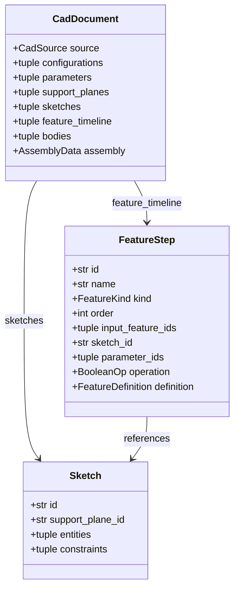
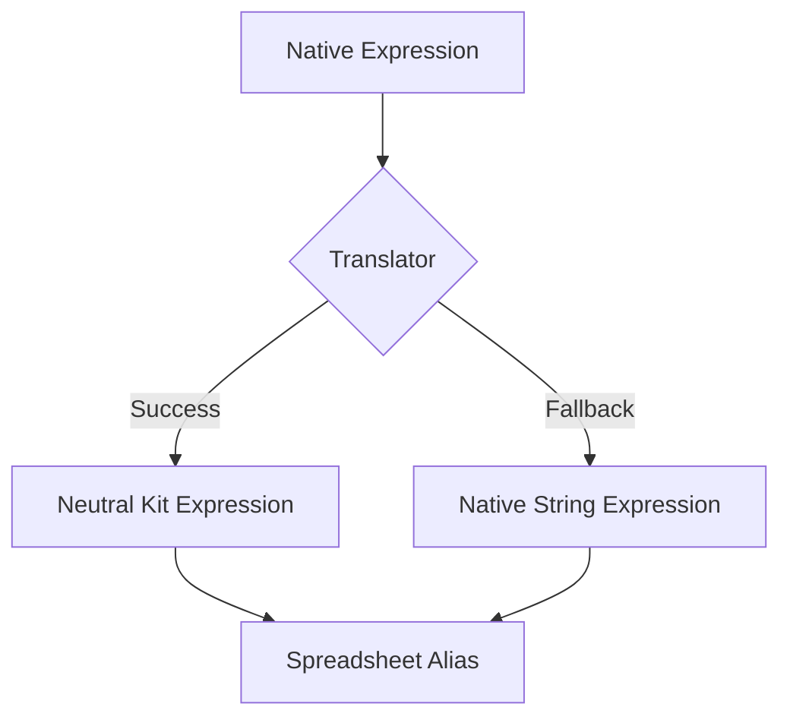

<!--
SPDX-License-Identifier: MIT
SPDX-FileCopyrightText: Copyright (c) 2026 Parashell, Odin Glynn-Martin, Stephen Harcourt
-->

---
title: "Parametric Features Model"
wiki_page_id: "page-interchange-features"
---

<details>
<summary>Relevant source files</summary>

The following files were used as context for generating this wiki page:

- [src/convert/adapters/freecad/Native.py](src/convert/adapters/freecad/Native.py)
- [src/convert/adapters/solidworks/core/Adapter.py](src/convert/adapters/solidworks/core/Adapter.py)
- [src/convert/adapters/freecad/Archive.py](src/convert/adapters/freecad/Archive.py)
- [re/solidworks/archive/Grammar.md](re/solidworks/archive/Grammar.md)
- [re/solidworks/features/RevolveDonorSpec.md](re/solidworks/features/RevolveDonorSpec.md)
- [tests/convert/freecad/FreecadTests.py](tests/convert/freecad/FreecadTests.py)
- [re/Methodology.md](re/Methodology.md)
</details>

# Parametric Features Model

The Parametric Features Model provides a neutral intermediate representation for CAD feature histories, enabling translation between proprietary formats like SOLIDWORKS, FreeCAD, and CATIA. It captures the design intent through a timeline of operations, sketches, parameters, and geometric relationships rather than just static boundary representation (B-rep) geometry.

Sources: [README.md](README.md), [re/Methodology.md:310-315](re/Methodology.md#L310-L315)

## Architecture and Components

The model organizes a CAD document into a structured hierarchy. Every parametric document contains a feature timeline, which is an ordered sequence of operations that build the solid model.

### Data Hierarchy

The following diagram illustrates the relationship between the primary components of the parametric model:



Sources: [src/convert/adapters/freecad/Native.py:46-95](src/convert/adapters/freecad/Native.py#L46-L95), [src/convert/adapters/solidworks/core/Adapter.py:48-98](src/convert/adapters/solidworks/core/Adapter.py#L48-L98)

### Key Data Structures

| Component | Description |
| :--- | :--- |
| **FeatureStep** | Represents a single operation in the model history (e.g., Extrude, Fillet). |
| **Sketch** | Defines 2D geometry and constraints on a specific support plane. |
| **Parameter** | Stores driving values, units, and expressions for features and sketches. |
| **SupportPlane** | Defines the 3D coordinate system and transform for a sketch or reference. |
| **Configuration** | Manages sets of parameter overrides and feature suppression states. |

Sources: [src/convert/adapters/freecad/Native.py:50-130](src/convert/adapters/freecad/Native.py#L50-L130), [src/convert/adapters/solidworks/core/Adapter.py:1260-1280](src/convert/adapters/solidworks/core/Adapter.py#L1260-L1280)

## Feature Operations

The model supports various standard CAD operations, categorized into additive, subtractive, and decorative features.

### Extrusion (Pad/Pocket)
Extrusions define a profile projected along a vector. The `ExtrudeFeature` class captures parameters such as:
- **Length**: Primary projection distance.
- **End Condition**: Blind, Through All, Up To Last, Up To Face, etc.
- **Symmetry**: Whether the extrusion projects equally in both directions.
- **Draft Angle**: Tapering of the side faces.

Sources: [src/convert/adapters/freecad/Native.py:1020-1050](src/convert/adapters/freecad/Native.py#L1020-L1050), [tests/convert/freecad/FreecadTests.py:726-745](tests/convert/freecad/FreecadTests.py#L726-L745)

### Revolution
Revolutions sweep a profile around an axis. This requires:
- **Angle**: The sweep extent in degrees or radians.
- **Axis**: A reference to a sketch centerline or a 3D reference axis.

Sources: [re/solidworks/features/RevolveDonorSpec.md:120-140](re/solidworks/features/RevolveDonorSpec.md#L120-L140), [src/convert/adapters/solidworks/core/Adapter.py:1800-1820](src/convert/adapters/solidworks/core/Adapter.py#L1800-L1820)

### Boolean Operations
Operations combine features using logic such as:
- **Join/Add**: Merges two solids.
- **Cut/Sub**: Removes the tool volume from the base solid.
- **Intersect**: Retains only the shared volume.

Sources: [src/convert/adapters/freecad/Archive.py:1570-1600](src/convert/adapters/freecad/Archive.py#L1570-L1600), [tests/convert/freecad/FreecadTests.py:590-610](tests/convert/freecad/FreecadTests.py#L590-L610)

## Parameters and Expressions

Design intent is preserved through parameters and mathematical relationships.

- **Parameters**: Each parameter carries a `ValueKind` (Length, Angle, Boolean, Integer, String) and optional units (mm, deg, rad).
- **Expressions**: The system translates proprietary expression formats into a neutral "Kit" language or preserves them as "native" strings.
- **Spreadsheet Integration**: In FreeCAD, parameters are often mapped to `Spreadsheet::Sheet` aliases for global control.



Sources: [src/convert/adapters/freecad/Archive.py:450-550](src/convert/adapters/freecad/Archive.py#L450-L550), [src/convert/adapters/freecad/Native.py:740-760](src/convert/adapters/freecad/Native.py#L740-L760)

## Implementation and Translation Logic

Translation involves mapping proprietary binary or XML records to the neutral model and back.

### Adapter Data Flow

```mermaid
sequenceDiagram
    participant S as Source File
    participant R as Reader Adapter
    participant N as Neutral Document
    participant W as Writer Adapter
    participant D as Destination File

    S->>R: Binary/XML Data
    R->>R: Object Segmentation
    R->>R: Decode Native Records
    R->>>N: Build CadDocument
    N->>W: Neutral Model
    W->>W: Select Skeletons/Donors
    W->>W: Patch Binary Buffers
    W->>D: Write Compound File
```

Sources: [re/Methodology.md:35-50](re/Methodology.md#L35-L50), [src/convert/adapters/solidworks/core/Adapter.py:120-160](src/convert/adapters/solidworks/core/Adapter.py#L120-L160)

### Native Model Patching
For high-fidelity round-trips, the system performs "Binary Patching." It identifies specific offsets in a "donor" or "skeleton" file and overwrites them with new parametric data.
1. **Locate**: Identify the byte offset of a parameter (e.g., Extrude Depth) using class markers and record schemas.
2. **Validate**: Ensure the target data matches the expected type (e.g., `double` for length).
3. **Patch**: Overwrite the bytes in the buffer before re-assembling the container.

Sources: [re/solidworks/archive/Grammar.md:150-200](re/solidworks/archive/Grammar.md#L150-L200), [src/convert/adapters/solidworks/core/Adapter.py:1450-1500](src/convert/adapters/solidworks/core/Adapter.py#L1450-L1500)

## Conclusion

The Parametric Features Model acts as a bridge between disparate CAD environments. By decomposing models into a neutral timeline of features and parameters, the system allows for editing and rebuilding designs across different software platforms without losing the original design intent.
