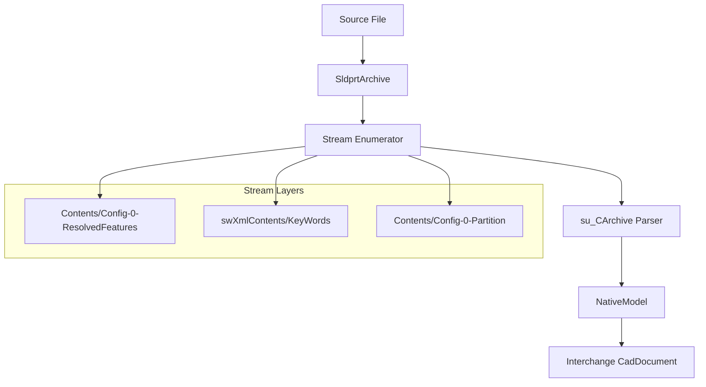
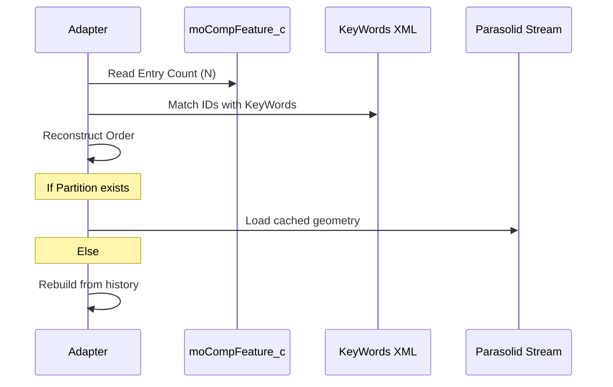

<!--
SPDX-License-Identifier: MIT
SPDX-FileCopyrightText: Copyright (c) 2026 Parashell, Odin Glynn-Martin, Stephen Harcourt
-->

---
title: "SOLIDWORKS Format Adapter"
wiki_page_id: "page-adapter-solidworks"
---

Relevant source files

The following files were used as context for generating this wiki page:

- [src/convert/adapters/solidworks/core/Adapter.py](src/convert/adapters/solidworks/core/Adapter.py)
- [src/convert/adapters/solidworks/container/Container.py](src/convert/adapters/solidworks/container/Container.py)
- [src/convert/adapters/solidworks/container/Archive.py](src/convert/adapters/solidworks/container/Archive.py)
- [re/Methodology.md](re/Methodology.md)
- [re/solidworks/archive/Grammar.md](re/solidworks/archive/Grammar.md)
- [re/solidworks/features/RevolveDonorSpec.md](re/solidworks/features/RevolveDonorSpec.md)

# SOLIDWORKS Format Adapter

The SOLIDWORKS Format Adapter enables the Kit SDK to read and write `.SLDPRT` and `.SLDASM` files. It translates proprietary binary records into a neutral CAD interchange model, supporting geometry, feature trees, and assembly structures without requiring a local SOLIDWORKS installation.

The adapter operates by parsing a proprietary container format that uses a raw-deflate stream archive with nibble-swapped names. It employs a "donor-based" writing strategy for complex features, where existing valid binary structures are patched with new parameters to ensure the output remains loadable by the vendor application.

Sources: [src/convert/adapters/solidworks/core/Adapter.py](src/convert/adapters/solidworks/core/Adapter.py), [re/solidworks/archive/Grammar.md:1-20](re/solidworks/archive/Grammar.md#L1-L20)

## Architecture and Components

The adapter uses a layered architecture to handle the complexity of the SOLIDWORKS format. It separates the physical container framing from the logical object serialization layer (`su_CArchive`).

This diagram shows the flow from a physical file through the archive and stream layers to the neutral document model.

### Key Classes

| Class | Description |
| :--- | :--- |
| `SldprtAdapter` | The primary entry point for probing, reading, and writing SOLIDWORKS files. |
| `SldprtArchive` | Manages the physical container, handling deflate decompression and stream access. |
| `NativeModel` | Represents the decoded SOLIDWORKS-specific feature tree and geometry before translation. |
| `su_CArchive` | Implements the vendor-specific version of MFC `CArchive` object serialization. |

Sources: [src/convert/adapters/solidworks/core/Adapter.py:270-310](src/convert/adapters/solidworks/core/Adapter.py#L270-L310), [re/solidworks/archive/Grammar.md:40-60](re/solidworks/archive/Grammar.md#L40-L60)

## Container Framing

SOLIDWORKS files are compound binary containers. The adapter identifies these files by a header version and a signature triplet consisting of a file ID and local/central/end signatures.

- **Stream Names**: Encoded using a nibble-swapped scheme (e.g., `Contents/Config-0-ResolvedFeatures`).
- **Body Cache**: The `Contents/Config-0-Partition` stream contains Parasolid geometry. If this stream is missing or deleted, SOLIDWORKS rebuilds the solid from the feature tree records.
- **Metadata**: XML side-streams like `swXmlContents/KeyWords` store document-level metadata and configuration info.

Sources: [re/solidworks/archive/Grammar.md:21-35](re/solidworks/archive/Grammar.md#L21-L35), [src/convert/adapters/solidworks/container/Container.py](src/convert/adapters/solidworks/container/Container.py)

## Object Serialization (su_CArchive)

The adapter implements a byte-compatible clone of MFC `CArchive` serialization. This layer handles the mapping of class definitions to numeric indices.

### Tag Grammar

| Tag Bytes | Meaning |
| :--- | :--- |
| `00 00` | Null object pointer. |
| `ff ff` | New class definition (followed by schema and name). |
| `t & 0x8000` | Class or object reference (index into the map). |

When you insert or delete an object, the adapter must renumber every subsequent class-reference token because the map counter increments for every new definition and object in stream order.

Sources: [re/solidworks/archive/Grammar.md:40-80](re/solidworks/archive/Grammar.md#L40-L80)

## Feature Tree Translation

The feature tree is controlled primarily by the `moCompFeature_c` record. This record is a fixed-stride array where each entry corresponds to a tree node (interleaving sketches and features).

The sequence diagram illustrates the prioritization of the feature tree and the optional nature of the geometry cache.

- **Rebuild Order**: SOLIDWORKS derives the rebuild order from the array order in `moCompFeature_c`, not from the physical order of objects in the stream.
- **Boss vs Cut**: This operation is often opaque and implied by derived face-identity records rather than a simple boolean flag.
- **Sketches**: 2D coordinates are stored as `float64` pairs in meters, wrapped in 18-byte prefixes.

Sources: [re/solidworks/archive/Grammar.md:85-150](re/solidworks/archive/Grammar.md#L85-L150), [re/solidworks/features/RevolveDonorSpec.md:10-30](re/solidworks/features/RevolveDonorSpec.md#L10-L30)

## Writing and Donor Patching

Because the full serialization layout for over 2,600 classes is not fully decompiled, the adapter uses **Donor Patching**.

1. **Select Skeleton**: You provide a donor file (skeleton) that matches the required feature topology (e.g., 2 extrusions, 1 sketch).
2. **Patch Parameters**: The adapter locates specific scalar offsets (like depth or angle) and overwrites them with new values.
3. **Stale Caches**: Derived caches, such as Bounding Box data or derived depth copies, are typically left "stale." SOLIDWORKS recomputes these upon opening and rebuilding the document.

Sources: [re/Methodology.md:200-250](re/Methodology.md#L200-L250), [re/solidworks/features/RevolveDonorSpec.md:150-180](re/solidworks/features/RevolveDonorSpec.md#L150-L180)

### Writable Parameters (Extrusions)
| Parameter | Status | Requirement |
| :--- | :--- | :--- |
| Depth | Patchable | `float64` at specific scalar offset. |
| End Condition | Patchable | Blind, ThroughAll, and MidPlane codes are verified. |
| Support Plane | Patchable | Plane ID and axis code must be updated in `moSketchChain_c`. |

Sources: [re/solidworks/archive/Grammar.md:150-200](re/solidworks/archive/Grammar.md#L150-L200)

## Summary

The SOLIDWORKS Format Adapter provides high-fidelity conversion by mastering the container and serialization layers of the `.SLDPRT` and `.SLDASM` formats. By combining static reverse-engineering of the `su_CArchive` grammar with a donor-based patching strategy, it ensures that converted documents remain application-usable and vendor-loadable while accurately reflecting neutral CAD data.
