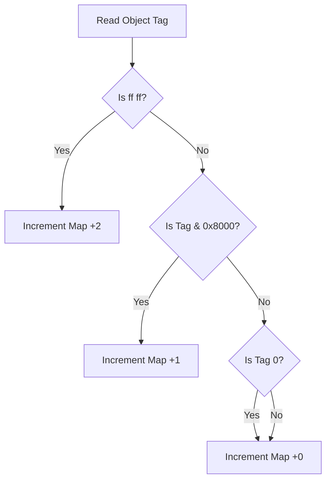
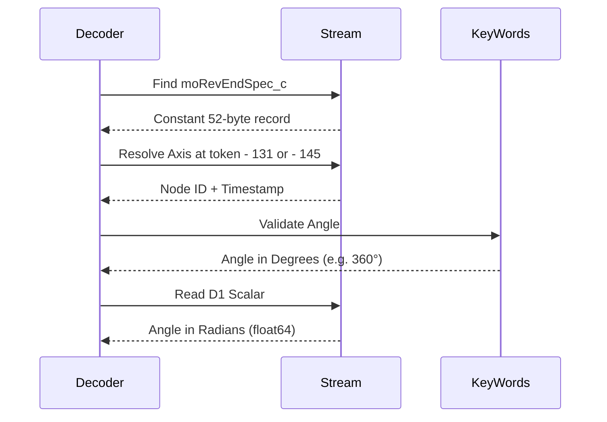

Relevant source files

The following files were used as context for generating this wiki page:

- [src/convert/adapters/solidworks/resolved/Core.py](src/convert/adapters/solidworks/resolved/Core.py)
- [re/Methodology.md](re/Methodology.md)
- [re/solidworks/archive/Grammar.md](re/solidworks/archive/Grammar.md)
- [re/solidworks/archive/Segmentation.md](re/solidworks/archive/Segmentation.md)
- [re/solidworks/features/Revolve.md](re/solidworks/features/Revolve.md)
- [src/convert/adapters/solidworks/core/Adapter.py](src/convert/adapters/solidworks/core/Adapter.py)

# SOLIDWORKS Feature Resolution

SOLIDWORKS Feature Resolution identifies and extracts geometric modeling history from proprietary `.SLDPRT` and `.SLDASM` files. The system processes the `Contents/Config-0-ResolvedFeatures` stream to reconstruct a feature timeline, support planes, and sketches. It bypasses the Parasolid geometry cache (`Contents/Config-0-Partition`) to ensure that the extracted history represents the authoritative source of the model's design intent.

The resolution process relies on a cracked MFC-style `su_CArchive` serialization grammar. This grammar allows the project to perform object segmentation and map-index renumbering, which are necessary for structural edits such as inserting, deleting, or reordering features within the tree.

Sources: [re/Methodology.md](re/Methodology.md), [re/solidworks/archive/Grammar.md:1-20](re/solidworks/archive/Grammar.md#L1-L20), [re/solidworks/archive/Segmentation.md](re/solidworks/archive/Segmentation.md)

## Serialization Architecture

The SOLIDWORKS feature stream uses `su_CArchive`, a byte-compatible clone of Microsoft Foundation Class (MFC) `CArchive` object serialization. The archive tracks a running map counter for every class definition and object instance.

### Tag Grammar

The archive categorizes data using specific 2-byte tags:

| Bytes | Meaning |
| :--- | :--- |
| `00 00` | `wNullTag` — Represents a null object pointer. |
| `ff ff` | `wNewClassTag` — Signals a new class definition. |
| `0x8000 | i` | Class Reference — Points to a class map index `i`. |
| `t < 0x8000` | Object Reference — Points to an object map index `t`. |

Sources: [re/solidworks/archive/Grammar.md:43-55](re/solidworks/archive/Grammar.md#L43-L55)

### Map Counter Increment Rules

Maintaining the integrity of the archive during modification requires following precise increment rules for the map counter:

The map counter does not start at 1; it begins at a base value (e.g., 109, 110, or 111) depending on the number of features. These early indices represent objects and classes defined in preceding streams like `CMgr` or `ModelHeader`.

Sources: [re/solidworks/archive/Segmentation.md:104-118](re/solidworks/archive/Segmentation.md#L104-L118)

## Feature Tree Structure (`moCompFeature_c`)

The `moCompFeature_c` record acts as the primary authority for the feature tree. It is a fixed-stride array that defines the sequence of features and links them to the `swXmlContents/KeyWords` oracle.

### Entry Layout

Each entry in the array typically represents two nodes per feature: one for the sketch and one for the extrusion.

| Offset | Width | Field | Description |
| :--- | :--- | :--- | :--- |
| `End - 12` | `u32` | Version | Constant `18000` (SOLIDWORKS 2025). |
| `End - 8` | `u32` | Node ID | Unique identifier matching `KeyWords`. |
| `End - 4` | `u32` | Timestamp | Unix `time_t` of the last modification. |

Sources: [re/solidworks/archive/Grammar.md:115-135](re/solidworks/archive/Grammar.md#L115-L135)

### Tree Rebuilding

The order of entries in the `moCompFeature_c` array determines the model's rebuild order. Swapping entry pairs in this array effectively reorders the feature tree in SOLIDWORKS, regardless of their physical positions in the binary stream.

Sources: [re/solidworks/archive/Grammar.md:162-166](re/solidworks/archive/Grammar.md#L162-L166)

## Geometric Feature Resolution

The system resolves specific feature types by mapping binary markers to neutral geometric parameters.

### Extrusion (Boss/Cut)

Extrusions are distinguished by their tree-node flag words and derived face-identity records. While `0x40000140` indicates a boss and `0x400201CA` indicates a cut, the flag word alone is insufficient to change the operation; the operation is also implied by internal class bodies (`moExtrusion_c` vs `moICE_c`).

| Feature Parameter | Binary Representation |
| :--- | :--- |
| Depth | Dimension-scalar record named `D1` as `float64` in meters. |
| End Condition | 1-byte field at `scalar - 818` (Blind=0, ThroughAll=1, MidPlane=6). |
| Reverse Direction | 1-byte flag at `scalar - 824`. |

Sources: [re/solidworks/archive/Grammar.md:200-220](re/solidworks/archive/Grammar.md#L200-L220), [re/solidworks/features/Revolve.md:65-75](re/solidworks/features/Revolve.md#L65-L75)

### Revolution

Revolutions use `moRevolution_c` (boss) or `moRevCut_c` (cut) classes. Unlike extrusions, switching between boss and cut for a revolve requires changing the class set, which alters all subsequent archive map indices.

The revolution axis is identified by a `<u32 feature id><u32 time_t>` pair found at a fixed offset relative to the `moRevEndSpec_c` object token:
- `token - 145`: Axis is a construction line inside a sketch.
- `token - 131`: Axis is a reference-axis feature.

Sources: [re/solidworks/features/Revolve.md:88-140](re/solidworks/features/Revolve.md#L88-L140), [re/solidworks/features/Revolve.md:165-175](re/solidworks/features/Revolve.md#L165-L175)

## Object Segmentation Logic

Segmentation is performed by tracing `su_CArchive::ReadObject` and `su_CArchive::ReadClass` calls in the `swccu.dll` module. This process recovers object boundaries by differencing consecutive buffer positions.

### `su_CArchive` Internal Layout

Field offsets derived through runtime calibration:

- `m_lpBufCur`: `0x38` (Current buffer pointer)
- `m_lpBufMax`: `0x40` (Buffer end pointer)
- `m_lpBufStart`: `0x48` (Buffer start pointer)
- `m_nMapCount`: `0x50` (Archive map counter)

Sources: [re/solidworks/archive/Segmentation.md:20-35](re/solidworks/archive/Segmentation.md#L20-L35)

### Validation of Segmentation

The correctness of the segmentation is proven by a symbolic re-emit process. The stream is parsed into a node list where all index references are converted to pointers. The model then re-computes indices and emits a new binary stream. If the emitted stream is byte-identical to the original input, the segmentation is verified as correct.

Sources: [re/solidworks/archive/Segmentation.md:85-92](re/solidworks/archive/Segmentation.md#L85-L92)

## Summary of Derived Caches

SOLIDWORKS stores redundant geometric caches that are derived from authored parameters. These caches can often be left stale as the application recomputes them upon opening.

| Cache Type | Binary Class | Responsibility |
| :--- | :--- | :--- |
| Bounding Box | `moBBoxCenterData_c` | Stores center coordinates and diameter. |
| Display Rectangles | `moRefPlane_c` | Stores UI visualization of planes. |
| Parasolid Blob | (Embedded) | Represents the supporting face surface. |

Sources: [re/solidworks/archive/Grammar.md:280-295](re/solidworks/archive/Grammar.md#L280-L295)
