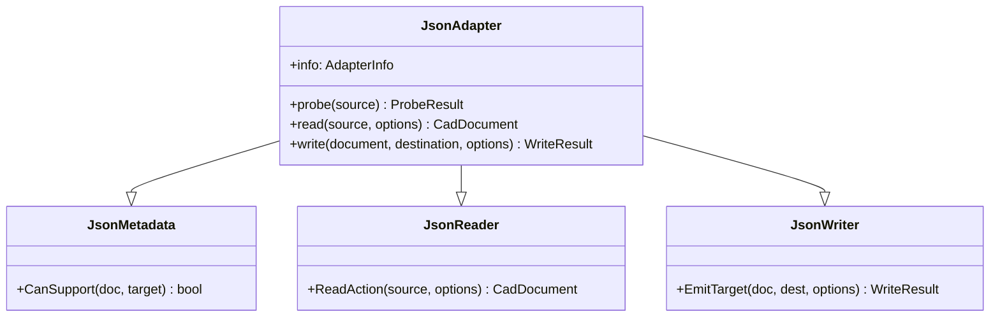
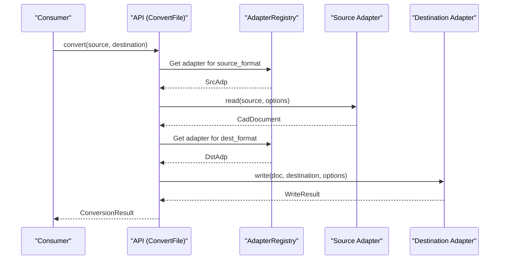

<details>
<summary>Relevant source files</summary>

The following files were used as context for generating this wiki page:

- [src/convert/adapters/json/Adapter.py](src/convert/adapters/json/Adapter.py)
- [src/convert/api/__init__.py](src/convert/api/__init__.py)
- [src/convert/adapters/freecad/Adapter.py](src/convert/adapters/freecad/Adapter.py)
- [src/convert/adapters/catia/Adapter.py](src/convert/adapters/catia/Adapter.py)
- [src/convert/adapters/solidworks/core/Adapter.py](src/convert/adapters/solidworks/core/Adapter.py)

</details>

# JSON & Registry Adapter

The **JSON Adapter** and the global **Adapter Registry** provide the primary infrastructure for CAD document conversion within the Kit project. The JSON Adapter enables the serialization and deserialization of the neutral `CadDocument` model to and from disk, serving as the common interchange format. The Adapter Registry manages the collection of available format-specific adapters, such as those for SOLIDWORKS, CATIA, and FreeCAD, and orchestrates format discovery.

Together, these components allow the system to identify the appropriate adapter for a given source file and perform bidirectional translations through a centralized API. The registry facilitates format-agnostic operations by exposing a unified interface for probing, reading, and writing various CAD formats.

Sources: [src/convert/adapters/json/Adapter.py](src/convert/adapters/json/Adapter.py), [src/convert/api/__init__.py:126-128](src/convert/api/__init__.py#L126-L128)

## Adapter Architecture

The system uses a modular adapter architecture where each format (JSON, FreeCAD, SOLIDWORKS, CATIA) implements a standard interface. The `JsonAdapter` composes functionality from metadata, reader, and writer mixins to handle neutral interchange files.



The `JsonAdapter` acts as the reference implementation for the internal interchange format, allowing other adapters to verify their output by reading or writing neutral JSON models.

Sources: [src/convert/adapters/json/Adapter.py:22-26](src/convert/adapters/json/Adapter.py#L22-L26), [src/convert/api/__init__.py:22-38](src/convert/api/__init__.py#L22-L38)

## The Adapter Registry

The `AdapterRegistry` maintains the global collection of format-specific adapters. It is initialized via the `_build_registry` function and exposed through a module-level `registry` constant. This registry is consumed by the public API to perform operations like `convert`, `open_document`, and `write_document`.

### Component Discovery and Registration
The system discovers adapters by querying the registry, which provides metadata such as supported file extensions and capability sets.

| Feature | Description |
| :--- | :--- |
| `available_adapters` | Lists all registered `AdapterInfo` records. |
| `probe` | Determines the format of a source file and the confidence of the match. |
| `read` | Converts a source file into a neutral `CadDocument`. |
| `write` | Exports a `CadDocument` to a specific destination format. |

Sources: [src/convert/api/__init__.py:42-124](src/convert/api/__init__.py#L42-L124)

## Data Flow: Document Conversion

The following sequence diagram illustrates how the `convert` API interacts with the registry and specific adapters (e.g., `SldprtAdapter` for SOLIDWORKS or `JsonAdapter`) to translate files.



The registry ensures that the correct logic is applied for complex formats like SOLIDWORKS (`.SLDPRT`/`.SLDASM`) and CATIA (`.CATPart`/`.CATProduct`) by evaluating file signatures and extensions.

Sources: [src/convert/api/__init__.py:46-68](src/convert/api/__init__.py#L46-L68), [src/convert/adapters/solidworks/core/Adapter.py:240-272](src/convert/adapters/solidworks/core/Adapter.py#L240-L272)

## Format Probing and Confidence

The registry uses format probing to identify unknown files. Each adapter provides a `probe` method that returns a `ProbeResult` containing a confidence score.

- **High Confidence (1.0)**: Positive identification via unique magic numbers or required stream structures (e.g., CATIA `V5_CFV2` container graph or SOLIDWORKS resolved-feature streams).
- **Medium Confidence (0.6 - 0.95)**: Likely match based on container headers or common file structures.
- **Low Confidence (0.0)**: The file does not match the format's requirements.

Sources: [src/convert/adapters/catia/Adapter.py:108-124](src/convert/adapters/catia/Adapter.py#L108-L124), [src/convert/adapters/solidworks/core/Adapter.py:214-236](src/convert/adapters/solidworks/core/Adapter.py#L214-L236), [src/convert/adapters/freecad/Adapter.py:734-758](src/convert/adapters/freecad/Adapter.py#L734-L758)

## Implementation: JSON Adapter Logic

The `JsonAdapter` is responsible for handling the neutral `CadDocument` serialization. It validates inputs and outputs to ensure they adhere to the project's interchange schema.

```python
# src/convert/adapters/json/Adapter.py

class JsonAdapter(PairProtocol, JsonMetadata, JsonReader, JsonWriter):
    # Public interface for the registry
    @property
    def info(self) -> AdapterInfo:
        return self.InfoAction

    def read(self, source: Source, options: ReadOptions | None = None) -> CadDocument:
        return self.ReadAction(source, options)

    def write(self, document: CadDocument, destination: Destination, options: WriteOptions | None = None) -> WriteResult:
        return self.Write(document, destination, options)
```

The JSON Adapter allows developers to inspect the results of a conversion by providing a human-readable representation of CAD geometry, assembly structures, and parametric history.

Sources: [src/convert/adapters/json/Adapter.py:22-68](src/convert/adapters/json/Adapter.py#L22-L68)

## Summary

The JSON & Registry Adapter system serves as the backbone for format interoperability in the Kit project. By abstracting format-specific complexities into individual adapters and managing them through a central registry, the system provides a robust API for CAD data translation. The JSON Adapter specifically ensures that these translations can be persisted and audited in a standard, neutral format.
