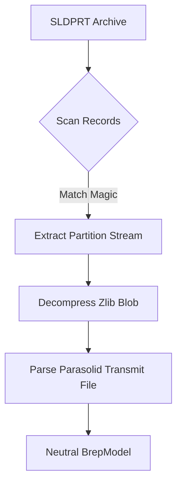
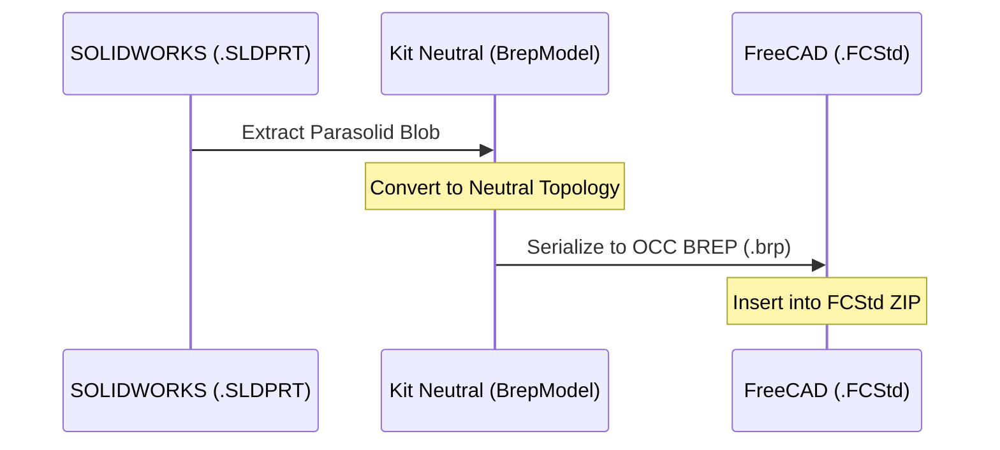

<!--
SPDX-License-Identifier: MIT
SPDX-FileCopyrightText: Copyright (c) 2026 Parashell, Odin Glynn-Martin, Stephen Harcourt
-->

---
title: "Geometry Translation (Parasolid & OpenCASCADE)"
wiki_page_id: "page-geom-trans"
---

<details>
<summary>Relevant source files</summary>

The following files were used as context for generating this wiki page:

- [src/convert/adapters/solidworks/container/Parasolid.py](src/convert/adapters/solidworks/container/Parasolid.py)
- [src/convert/adapters/freecad/Archive.py](src/convert/adapters/freecad/Archive.py)
- [src/convert/adapters/solidworks/core/Adapter.py](src/convert/adapters/solidworks/core/Adapter.py)
- [re/solidworks/README.md](re/solidworks/README.md)
- [re/solidworks/archive/Grammar.md](re/solidworks/archive/Grammar.md)
- [re/solidworks/features/Revolve.md](re/solidworks/features/Revolve.md)
</details>

# Geometry Translation (Parasolid & OpenCASCADE)

Kit provides bidirectional translation between CAD-neutral B-rep models and vendor-specific geometry formats, primarily focusing on Parasolid (used by SOLIDWORKS) and OpenCASCADE (used by FreeCAD). The system handles the extraction, transformation, and re-injection of B-rep data into proprietary containers.

Sources: [README.md](README.md), [src/convert/adapters/solidworks/core/Adapter.py:317-340](src/convert/adapters/solidworks/core/Adapter.py#L317-L340)

## Parasolid Translation

Parasolid translation manages the extraction and encoding of `.x_t` (text) and `.x_b` (binary) geometry data within SOLIDWORKS `.SLDPRT` and `.SLDASM` files.

### Geometry Extraction
Kit identifies Parasolid payloads by scanning compound stream records for specific magic numbers or headers. It identifies native Parasolid content within raw-deflate streams. The decoder extracts compressed Parasolid transmit blobs and converts them into neutral `BrepModel` structures.

Sources: [src/convert/adapters/solidworks/core/Adapter.py:1697-1725](src/convert/adapters/solidworks/core/Adapter.py#L1697-L1725), [src/convert/adapters/solidworks/container/Parasolid.py](src/convert/adapters/solidworks/container/Parasolid.py), [re/solidworks/README.md](re/solidworks/README.md)

### Payload Management
The following diagram illustrates the flow of Parasolid data during a SOLIDWORKS part read:



The system identifies `Contents/Config-0-Partition` as the primary Parasolid body cache in SOLIDWORKS files.

Sources: [src/convert/adapters/solidworks/core/Adapter.py:1718-1725](src/convert/adapters/solidworks/core/Adapter.py#L1718-L1725), [re/solidworks/archive/Grammar.md:52-58](re/solidworks/archive/Grammar.md#L52-L58)

### Feature-Based Rebuilds
Kit can drop the Parasolid geometry cache entirely in SOLIDWORKS files. If the cache is absent, SOLIDWORKS rebuilds the identical solid geometry from the feature history records (`Contents/Config-0-ResolvedFeatures`) and XML metadata.

Sources: [re/solidworks/archive/Grammar.md:52-58](re/solidworks/archive/Grammar.md#L52-L58), [re/solidworks/README.md](re/solidworks/README.md)

## OpenCASCADE Translation

OpenCASCADE translation facilitates B-rep interchange for FreeCAD `.FCStd` files, typically using the BREP format.

### BREP Serialization
The system converts neutral B-rep models into OpenCASCADE-compatible ASCII BREP strings. These strings start with the standard header: `CASCADE Topology V1, (c) Matra-Datavision`.

Sources: [src/convert/adapters/freecad/Archive.py:1174-1188](src/convert/adapters/freecad/Archive.py#L1174-L1188), [tests/convert/freecad/FreecadTests.py:465-470](tests/convert/freecad/FreecadTests.py#L465-L470)

### FreeCAD Geometry Logic
FreeCAD adapters handle geometry through `Part::PropertyPartShape` properties. Kit manages primary `.brp` (BREP) files and associated sidecar files like `.Map.txt` (Element Maps) to preserve topological naming and entity mappings.

Sources: [src/convert/adapters/freecad/Archive.py:1463-1490](src/convert/adapters/freecad/Archive.py#L1463-L1490), [tests/convert/freecad/FreecadTests.py:1463-1490](tests/convert/freecad/FreecadTests.py#L1463-L1490)

## Comparison of Geometry Formats

| Format | Native CAD | Storage Method | Neutral Representation |
| :--- | :--- | :--- | :--- |
| **Parasolid** | SOLIDWORKS | Compressed blobs in streams | `BrepModel` / `ParasolidPayload` |
| **OpenCASCADE** | FreeCAD | ASCII `.brp` files in ZIP | `BrepModel` / `ProvenAsciiBrep` |

Sources: [src/convert/adapters/solidworks/container/Parasolid.py](src/convert/adapters/solidworks/container/Parasolid.py), [src/convert/adapters/freecad/Archive.py:75-80](src/convert/adapters/freecad/Archive.py#L75-L80)

## Cross-Format Data Flow

Conversion between formats utilizes a central neutral model.



Sources: [README.md](README.md), [src/convert/adapters/solidworks/core/Adapter.py:1550-1570](src/convert/adapters/solidworks/core/Adapter.py#L1550-L1570)

### Geometry Consistency Rules
*  **Stale Caches**: Stale derived caches (like bounding boxes or Parasolid face blobs) are generally safe to leave in the document; the vendor application recomputes them on load.
*  **Incorrect Caches**: Writing plausible but mathematically incorrect geometry caches often leads to application crashes or zero-volume bodies.
*  **Feature Identity**: SOLIDWORKS identifies bodies via a `final_feature_id` which must correlate with the B-rep bodies stored in the Parasolid partition.

Sources: [re/solidworks/archive/Grammar.md:183-195](re/solidworks/archive/Grammar.md#L183-L195), [re/solidworks/README.md](re/solidworks/README.md), [src/convert/adapters/solidworks/core/Adapter.py:325-345](src/convert/adapters/solidworks/core/Adapter.py#L325-L345)

## Implementation Details

### Parasolid Payload Schema
The `BrepPayload` object for Parasolid data includes specific attributes used for reconstruction:

| Attribute | Type | Description |
| :--- | :--- | :--- |
| `format_id` | string | Set to `"parasolid"` |
| `kind` | string | e.g., `"partition"` or `"shape"` |
| `wrapper_offset` | integer | Byte offset of the vendor wrapper |
| `compressed_size` | integer | Size of the zlib-compressed payload |

Sources: [src/convert/adapters/solidworks/core/Adapter.py:1735-1755](src/convert/adapters/solidworks/core/Adapter.py#L1735-L1755)

### Code Snippet: OpenCASCADE BREP Header Validation
Kit validates OpenCASCADE ASCII BREP strings by checking for the structural header.

```python
# src/convert/adapters/freecad/Brep.py (referenced in Archive.py)
def proven_ascii_brep(DataValue: bytes) -> bytes:
    # Validates if bytes contain "CASCADE Topology V1"
    if b"CASCADE Topology V" in DataValue[:512]:
        return DataValue
    # ... transformation logic ...
```

Sources: [src/convert/adapters/freecad/Archive.py:1174-1188](src/convert/adapters/freecad/Archive.py#L1174-L1188), [tests/convert/freecad/FreecadTests.py:345-355](tests/convert/freecad/FreecadTests.py#L345-L355)

## Conclusion
Kit handles geometry translation by abstracting vendor formats into a neutral B-rep model. It manages complex binary structures in Parasolid for SOLIDWORKS and ASCII-based OpenCASCADE data for FreeCAD, ensuring topological consistency through careful management of derived caches and feature-to-body mappings.
