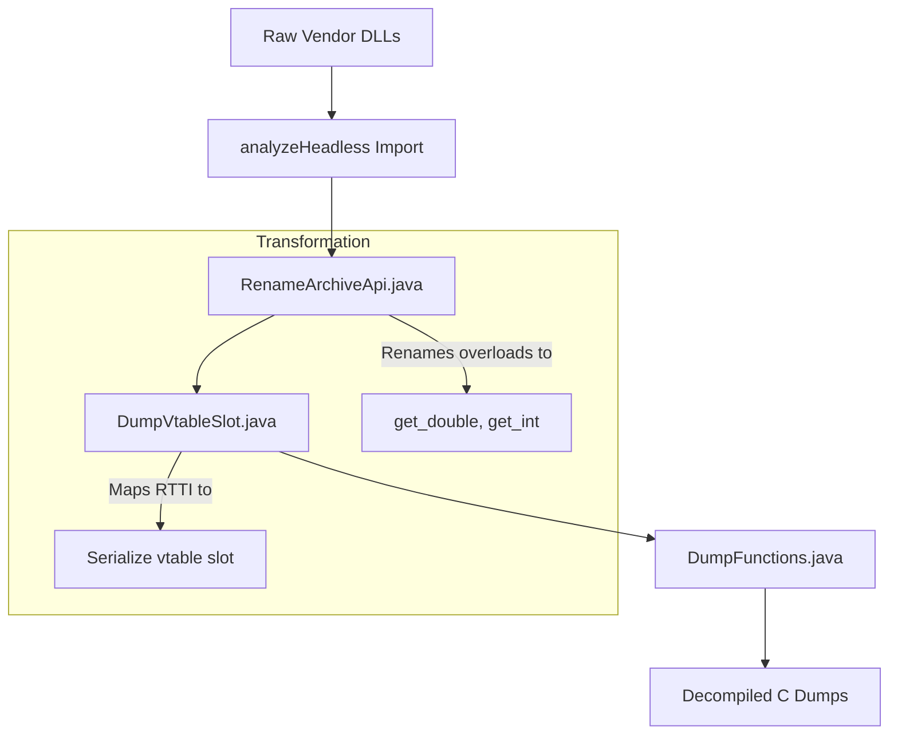
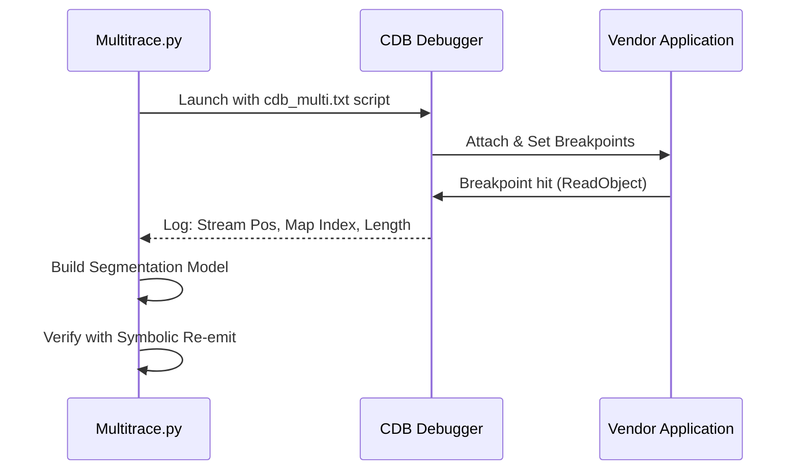

Relevant source files

The following files were used as context for generating this wiki page:

- [re/Methodology.md](re/Methodology.md)
- [re/README.md](re/README.md)
- [re/tooling/ghidra/Setup.md](re/tooling/ghidra/Setup.md)
- [re/tooling/windbg/Multitrace.py](re/tooling/windbg/Multitrace.py)
- [re/tooling/harness/Serialize.py](re/tooling/harness/Serialize.py)
- [re/tooling/ProgramDecomposition/GeneratePrograms.py](re/tooling/ProgramDecomposition/GeneratePrograms.py)

# Reverse Engineering Tooling

The reverse engineering tooling provides a structured framework for analyzing proprietary CAD formats, specifically targeting the SOLIDWORKS part format. This system enables developers to read, patch, and re-emit binary streams by combining static decompilation, runtime tracing, and differential analysis of authored corpora. The tooling is designed to be format-agnostic, allowing the same methodology to be applied to other CAD systems like AutoCAD, CATIA, NX, or Creo.

The primary goal of these tools is to build a **measurement oracle** and perform automated segmentation of binary records. By automating the extraction of serialization logic and object boundaries, the tooling minimizes manual byte-level inference and ensures that all findings are numerically verified against the vendor application.

Sources: [re/Methodology.md:14-25](re/Methodology.md#L14-L25), [re/README.md:12-25](re/README.md#L12-L25)

## Core Methodology and Phase Order

Reverse engineering proceeds through six distinct phases. Each phase provides the ground truth required for subsequent steps.

| # | Phase | Primary Tooling | Objective |
| :--- | :--- | :--- | :--- |
| 1 | **Container Framing** | Custom Python scripts | Enumerate streams and identify the file envelope. |
| 2 | **Measurement Oracle** | `re/tooling/harness/` | Obtain quantitative correctness verdicts (e.g., mass properties). |
| 3 | **Differential Corpus** | Vendor API (COM/.NET) | Locate fields by diffing files with single-property variations. |
| 4 | **Runtime Trace** | `re/tooling/windbg/` | Recover object boundaries and index arithmetic. |
| 5 | **Static Decompilation** | `re/tooling/ghidra/` | Identify field types, version gates, and enum branches. |
| 6 | **Write Path** | `src/convert/adapters/` | Implement the final converter logic. |

Sources: [re/Methodology.md:34-45](re/Methodology.md#L34-L45)

## Static Analysis with Ghidra

Static analysis utilizes Ghidra 12.x to decompile vendor DLLs (e.g., `sldmodu.dll`, `swccu.dll`). The process is entirely headless, driven by PowerShell wrappers and Java scripts to ensure reproducibility and handle large binaries that exceed the GUI's practical limits.

### Decompilation Pipeline
The pipeline automates the transformation of raw binaries into readable C code with context-aware naming.

The diagram shows the automated flow from raw DLLs to structured decompiled output.

### Key Ghidra Components
*  **RenameArchiveApi.java**: Renames `operator>>` overloads based on parameter types (e.g., `double`, `char`) to make field widths unambiguous in decompiled code.
*  **DumpVtableSlot.java**: Identifies the specific virtual table slots used for serialization (e.g., slot 5 for SOLIDWORKS `Serialize`).
*  **SerializeMap.py**: Generates a mapping of RTTI-named classes to their corresponding `Serialize` function addresses.

Sources: [re/tooling/ghidra/Setup.md:65-85](re/tooling/ghidra/Setup.md#L65-L85), [re/Methodology.md:138-160](re/Methodology.md#L138-L160)

## Runtime Tracing with WinDbg/CDB

Runtime tracing captures the behavior of the vendor's reader at the binary level. This phase is critical for identifying object boundaries and renumbering map indices, which static diffing cannot resolve.

### Multitrace Architecture
The `Multitrace.py` script automates the attachment of the `cdb` debugger to a vendor process. It sets breakpoints on serialization routines like `ReadObject` and `ReadClass` to log stream positions and map counters.

The sequence shows how the tracing tool interacts with the debugger to extract stream metadata.

### Verification Discipline
Tracing results are verified by reparsing the stream into a symbolic model. If the tool can re-emit a byte-identical stream while recomputing all indices from scratch, the segmentation is considered **confirmed**.

Sources: [re/tooling/windbg/Multitrace.py:80-120](re/tooling/windbg/Multitrace.py#L80-L120), [re/Methodology.md:103-115](re/Methodology.md#L103-L115)

## Measurement Harness and Oracle

The measurement harness (found in `re/tooling/harness/`) provides the "Measurement Oracle." It uses the vendor's COM API to verify that generated or patched files are numerically correct.

### Oracle Requirements
1.  **Quantitative Validation**: Uses solid volume (m³) and center of mass to verify geometry to a relative precision of ≤6e-16.
2.  **Process Hygiene**: Launches a fresh application process for every candidate to prevent crash-poisoning.
3.  **Control Batches**: Measures a known-good file at the start and end of every batch to detect silent installation degradation.
4.  **Dialog Suppression**: Uses a watchdog thread (`re/tooling/harness/Dismiss.py`) to automatically dismiss blocking UI modals.

Sources: [re/Methodology.md:52-78](re/Methodology.md#L52-L78), [re/tooling/harness/Serialize.py:530-550](re/tooling/harness/Serialize.py#L530-L550)

## Program Decomposition and Generation

The `re/tooling/ProgramDecomposition/` toolset handles the high-level organization of recovered serialization logic. It converts extracted data into Python "programs" that can be used by the converter's write path.

*  **GeneratePrograms.py**: Coordinates the build process, rendering owners, methods, and registries into the source tree.
*  **ProgramBuilder.py**: Catalogs identified serialization sites and groups them by variant path.
*  **ProgramRenderer.py**: Generates the final Python source files, including a manifest for tracking global stats such as total operations and stream counts.

Sources: [re/tooling/ProgramDecomposition/GeneratePrograms.py:55-80](re/tooling/ProgramDecomposition/GeneratePrograms.py#L55-L80)

## Summary

Reverse Engineering Tooling provides the automated infrastructure needed to crack proprietary CAD formats with high confidence. By enforcing a strict phase order and prioritizing a numerically-backed measurement oracle over manual byte-guessing, the project maintains "scope honesty"—clearly distinguishing between confirmed facts and unverified hypotheses. The reusable assets in `re/tooling/` enable rapid analysis of new formats by automating the heavy lifting of decompilation renaming, vtable mapping, and runtime segmentation.

Sources: [re/Methodology.md:210-225](re/Methodology.md#L210-L225), [re/README.md:105-115](re/README.md#L105-L115)
