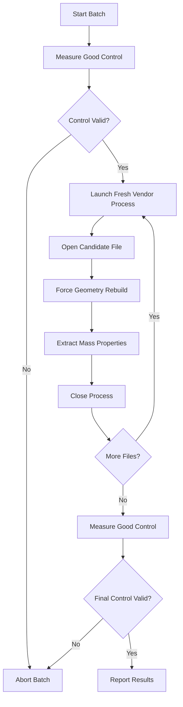
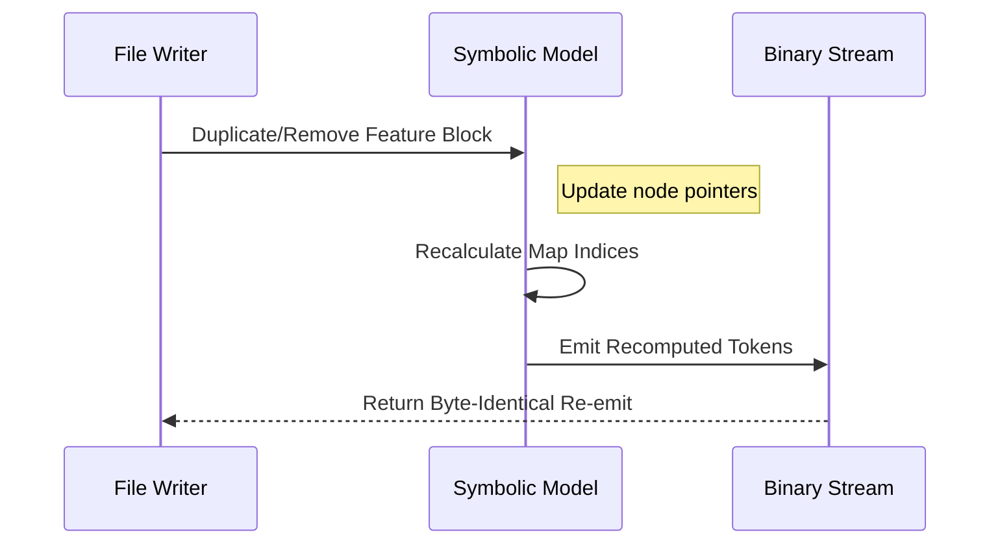

<!--
SPDX-License-Identifier: MIT
SPDX-FileCopyrightText: Copyright (c) 2026 Parashell, Odin Glynn-Martin, Stephen Harcourt
-->

---
title: "Oracle Validation & Donor Fixtures"
wiki_page_id: "page-oracle-donor"
---

<details>
<summary>Relevant source files</summary>

The following files were used as context for generating this wiki page:

- [re/Methodology.md](re/Methodology.md)
- [re/solidworks/archive/Grammar.md](re/solidworks/archive/Grammar.md)
- [re/solidworks/features/RevolveDonorSpec.md](re/solidworks/features/RevolveDonorSpec.md)
- [re/solidworks/archive/Segmentation.md](re/solidworks/archive/Segmentation.md)
- [tests/convert/solidworks/core/SolidworksOracleTests.py](tests/convert/solidworks/core/SolidworksOracleTests.py)
</details>

# Oracle Validation & Donor Fixtures

The Oracle Validation system provides an unattended, quantitative mechanism to verify the correctness of CAD file translations by querying the original vendor application. It measures physical properties like solid volume and center of mass to provide numerical verdicts instead of simple boolean "opens" checks. This system ensures that reverse-engineered file structures maintain geometric integrity when rebuilt by the vendor software.

Donor Fixtures are known-good CAD documents used as skeletons or templates for generating new files. They provide the necessary feature topology and class definitions that are not yet fully serializable from first principles. By patching specific parameters within these donor structures, the system can author valid CAD files while ensuring they remain loadable and rebuildable by the vendor application.

## Measurement Oracle

The measurement oracle acts as the ultimate ground truth for verification. It uses the vendor's own API (such as SOLIDWORKS COM) to open files and extract quantitative physical data.

### Oracle Requirements
To ensure reliable results, the oracle follows these constraints:
- **Quantitative Metrics**: You must use numerical values like solid volume (m³) and center of mass. Volume alone is insufficient as it cannot distinguish between plane swaps or direction flips.
- **Process Isolation**: You must launch one fresh application process per candidate file. Malformed files can crash the application or poison the session, leading to phantom failures in subsequent batches.
- **Control Batches**: You must run a known-good control file at the start and end of every batch. If the control fails, you must discard the entire batch.
- **Process Hygiene**: You must sweep orphaned helper and crash-reporter processes between batches to prevent installation degradation.

Sources: [re/Methodology.md:65-98](re/Methodology.md#L65-L98), [re/solidworks/archive/Segmentation.md:109-114](re/solidworks/archive/Segmentation.md#L109-L114)

### Logic Flow of Oracle Verification
The following diagram illustrates the verification cycle:



Sources: [re/Methodology.md:73-86](re/Methodology.md#L73-L86), [re/solidworks/archive/Segmentation.md:109-114](re/solidworks/archive/Segmentation.md#L109-L114)

## Donor Fixture System

Donor fixtures are used when a format is not yet fully inverted. They provide a "skeleton" containing base classes and feature topologies that the system can grow, shrink, or patch.

### Patching and Topology
A donor is essentially a one-parameter or multi-parameter template. For example, a revolve donor allows patching the revolve angle while inheriting complex properties like the centerline selection or thin-feature settings that remain opaque to the writer.

| Parameter | Status | Requirement |
| :--- | :--- | :--- |
| **Geometry** | Patchable | Coordinate pairs can be written into coordinate records. |
| **Dimensions** | Patchable | Scalars like depth or angle are patchable in dimension-scalar records. |
| **Topology** | Inherit Only | Boss-versus-cut operations and class sets must be inherited from a donor. |
| **Caches** | Stale Safe | Derived caches (e.g., bounding boxes) can be left stale; the application recomputes them. |

Sources: [re/solidworks/features/RevolveDonorSpec.md:12-28](re/solidworks/features/RevolveDonorSpec.md#L12-L28), [re/solidworks/archive/Grammar.md:155-165](re/solidworks/archive/Grammar.md#L155-L165)

### Donor Selection and Upgrade Path
Donors are categorized by a topology key consisting of `(operation, profile, support, end_condition)`. When a donor from an older version is used (e.g., SOLIDWORKS version 13000 used in a version 18000 environment), the vendor application typically performs an upgrade on open, which rewrites the stream.

Sources: [re/solidworks/features/RevolveDonorSpec.md:46-75](re/solidworks/features/RevolveDonorSpec.md#L46-L75)

## Object Segmentation and Renumbering

Authoring structural changes in donor-based files requires understanding object boundaries within the binary stream. Many proprietary formats use MFC-style `CArchive` serialization, where class definitions and object instances are indexed.

### Map Counter Rules
The reader maintains a map counter that increments based on the type of record encountered.
- **Class Definition**: Increments counter by **+2** (one for the class, one for the object).
- **Class Reference**: Increments counter by **+1**.
- **Object Reference**: Increments counter by **0**.
- **Null Tag**: Increments counter by **0**.

Inserting or deleting objects shifts the index of every subsequent definition. You must renumber every class-reference token to match the new map.

Sources: [re/solidworks/archive/Segmentation.md:77-100](re/solidworks/archive/Segmentation.md#L77-L100), [re/solidworks/archive/Grammar.md:65-75](re/solidworks/archive/Grammar.md#L65-L75)

### Structural Modification Flow



Sources: [re/solidworks/archive/Segmentation.md:102-125](re/solidworks/archive/Segmentation.md#L102-L125)

## Integration with Testing

The project uses automated tests to verify that generated files are "Application Usable" and "Vendor Loadable."

```python
@KPytestmark
def TestFRPOISWEV(TmpPath: FilePath) -> None:
    Document = FreecadRPD()
    TargetDoc = TmpPath / "FreeCADRectanglePad.SLDPRT"
    ResultInfo = WriteDocument(Document, TargetDoc, allow_carrier=False)
    
    assert ResultInfo.IsAppUsable is True
    assert ResultInfo.IsVendorLoadable is True
    
    with OracleSession() as Session:
        Report = Session.InspectPart(TargetDoc)
        
    assert Report.Opened is True
    assert Report.Rebuilt is True
    assert Report.Solid.VolumeMmThree == PytestLib.approx(ExpectedVolume, rel=1e-09)
```

Sources: [tests/convert/solidworks/core/SolidworksOracleTests.py:28-48](tests/convert/solidworks/core/SolidworksOracleTests.py#L28-L48)

## Summary

The Oracle Validation and Donor Fixture systems form the engineering core of the reverse-engineering strategy. The Oracle provides automated, quantitative proof of correctness, while Donor Fixtures allow the system to generate valid files for formats where serializing from first principles is not yet possible. This combination allows for structural edits like reordering the feature tree or changing dimensions while ensuring the resulting files are exact matches to vendor-authored documents.
