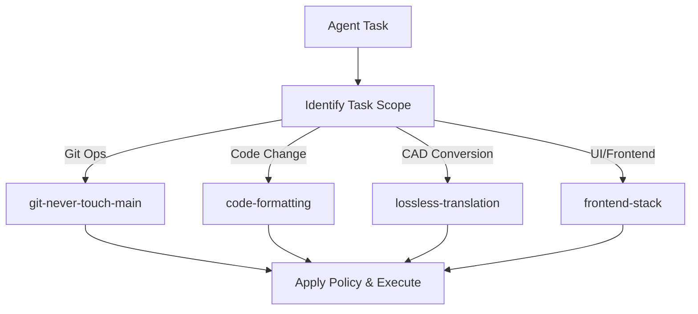
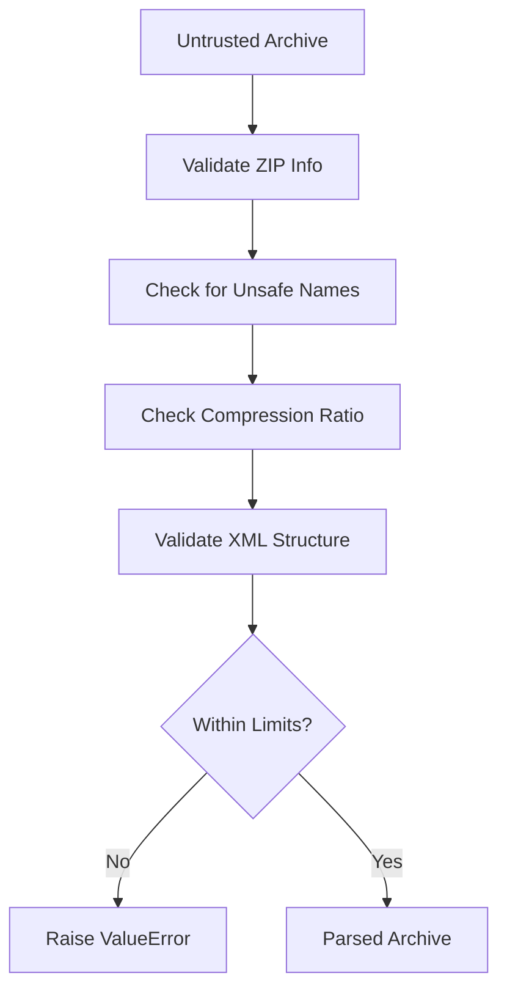
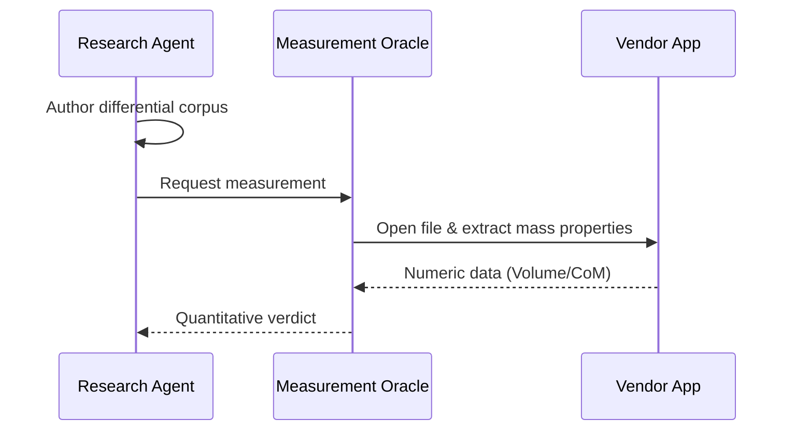

<!--
SPDX-License-Identifier: MIT
SPDX-FileCopyrightText: Copyright (c) 2026 Parashell, Odin Glynn-Martin, Stephen Harcourt
-->

---
title: "Policy & Governance Tools"
wiki_page_id: "page-policy"
---

Relevant source files

The following files were used as context for generating this wiki page:

- [tools/skills/Descriptions.py](tools/skills/Descriptions.py)
- [AGENTS.md](AGENTS.md)
- [re/Methodology.md](re/Methodology.md)
- [SECURITY.md](SECURITY.md)
- [src/convert/adapters/freecad/Archive.py](src/convert/adapters/freecad/Archive.py)
- [tools/steering/SteeringBaseline.txt](tools/steering/SteeringBaseline.txt)

# Policy & Governance Tools

Policy & Governance Tools define the operational constraints, security requirements, and automated verification rules for the Kit repository. These tools regulate how human contributors and delegated agents interact with the codebase to maintain high-integrity CAD format conversion.

The governance framework ensures that every code change adheres to structural policies, naming conventions, and security audits. It explicitly prohibits isolated unit testing in favor of end-to-end policy checks at real component boundaries.

Sources: [AGENTS.md](AGENTS.md) , [SECURITY.md](SECURITY.md)

## Agent Guidance and Skill Steering

Agent guidance centralizes task triggers and steering behaviors for AI-driven contributions. Portable steering lives in `.agents/skills/` and maps to source files in `.kiro/steering/`. Agents must follow specific skills based on the nature of their work, such as `git-never-touch-main` or `lossless-translation`.

### Skill Routing Logic

The system routes agents to specific skills depending on the files they modify or the operations they perform.

This diagram shows how task identification triggers the activation of mandatory policy skills.

Sources: [AGENTS.md:7-15](AGENTS.md#L7-L15), [tools/skills/Descriptions.py:8-40](tools/skills/Descriptions.py#L8-L40)

### Skill Descriptions

| Skill Name | Policy Description |
| :--- | :--- |
| `git-never-touch-main` | Protects the main branch from direct commits or push operations. |
| `lossless-translation` | Enforces verified parametric output in target CAD applications. |
| `no-cad-runtime` | Prevents vendor automation from entering production paths. |
| `no-stubs` | Prohibits the delivery of placeholders or incomplete code implementations. |
| `no-donor-blocks` | Prohibits shipping vendor bytes; requires first-principles emission. |

Sources: [tools/skills/Descriptions.py:18-28](tools/skills/Descriptions.py#L18-L28)

## Repository Constraints and Governance

Always-on project constraints govern dependency management, branch protection, and testing architectures.

1.  **Branch Protection**: You must never write to `main`. Work only on non-protected working branches.
2.  **Dependency Management**: Use `uv` for Python dependency management. Pixi lockfiles must be synchronized after manifest edits.
3.  **Test Policy**: Unit tests are strictly prohibited. You must validate behavior through integration, smoke, and repository-wide policy checks in CI.
4.  **Licensing**: Every project file must start with required SPDX headers.

Sources: [AGENTS.md:20-43](AGENTS.md#L20-L43)

### Structural Policy Baseline

Structural policies enforce PascalCase identifier casing, length ranges, and semantic folder density. The system monitors these via a steering baseline that identifies violations like excessive line counts in single declarations.

Sources: [tools/steering/SteeringBaseline.txt:1-15](tools/steering/SteeringBaseline.txt#L1-L15)

## Security Policy and Archive Validation

Security governance combines automated monitoring with strict runtime validation of untrusted data inputs.

### Automated Monitoring
The project runs continuous integration for the following security audits:
*  Secret auditing (Gitleaks, TruffleHog).
*  Dependency scanning (pip-audit, OSV-Scanner, Safety).
*  Static Analysis (Bandit, Semgrep, CodeQL).
*  Infrastructure-as-code checks (Checkov).

Sources: [SECURITY.md:22-30](SECURITY.md#L22-L30)

### Archive Security Limits
The FreeCAD adapter implements hard security gates to prevent archive-based attacks. These gates enforce limits on entry counts, file sizes, and XML nesting depth.

This diagram represents the security gate sequence applied to incoming FCStd archives.

| Constraint | Limit Value | Description |
| :--- | :--- | :--- |
| `KMaxEntries` | 16,384 | Maximum entries in a single FCStd archive. |
| `KMaxTotalSize` | 1 GB | Maximum aggregate size of archive members. |
| `KMaxCompressionRatio` | 500 | Maximum allowed ratio between uncompressed and compressed size. |
| `KMaxXmlDepth` | 256 | Maximum nesting depth allowed in Document.xml. |
| `KMaxXmlNodes` | 2,000,000 | Maximum total nodes allowed in the XML object graph. |

Sources: [src/convert/adapters/freecad/Archive.py:140-155](src/convert/adapters/freecad/Archive.py#L140-L155), [src/convert/adapters/freecad/Archive.py:188-210](src/convert/adapters/freecad/Archive.py#L188-L210)

## Reverse Engineering Discipline

The reverse engineering (`re/`) workspace operates under a specialized exemption. Standard repository rules for formatting, naming, and SPDX headers do not apply to research code in this tree.

### Methodology Phases

Governance of the reverse engineering process follows a six-phase playbook to ensure accuracy.

1.  **Container Framing**: Enumerate streams and crack the file envelope.
2.  **Measurement Oracle**: Build unattended quantitative correctness checks.
3.  **Authored Corpus**: Create single-variable families of documents for differential analysis.
4.  **Runtime Trace**: Watch the vendor reader under a debugger to find object boundaries.
5.  **Static Decompilation**: Determine authoritative field order and types.
6.  **Write Path**: Implement first-principles emission of the format.

This diagram illustrates the role of the measurement oracle in confirming byte-level inferences.

Sources: [re/Methodology.md:27-45](re/Methodology.md#L27-L45), [AGENTS.md:46-55](AGENTS.md#L46-L55)

## Summary

Policy & Governance Tools maintain repo integrity by combining strict AI agent steering with automated structural enforcement. These tools ensure that all CAD translations are lossless, vendor-loadable, and free from proprietary vendor bytes. Safety limits and CI-based auditing protect the system from malicious inputs and supply-chain vulnerabilities.

Sources: [AGENTS.md](AGENTS.md), [SECURITY.md](SECURITY.md)
