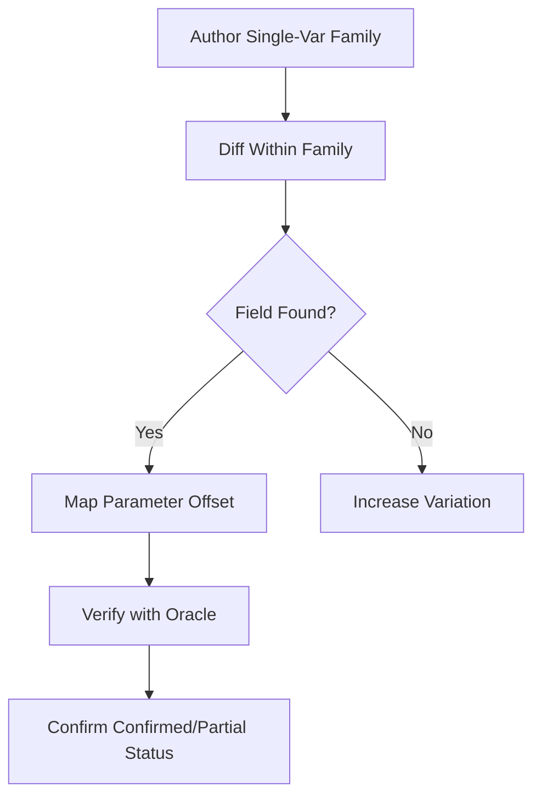
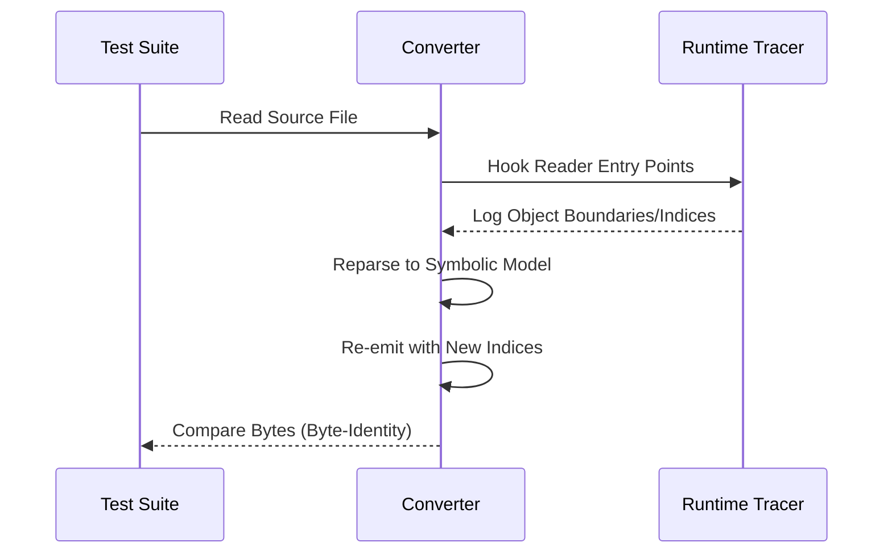

Relevant source files

The following files were used as context for generating this wiki page:

- [re/Methodology.md](re/Methodology.md)
- [tests/convert/formats/SwapsTests.py](tests/convert/formats/SwapsTests.py)
- [tests/convert/catia/CatiaTests.py](tests/convert/catia/CatiaTests.py)
- [tests/convert/freecad/FreecadTests.py](tests/convert/freecad/FreecadTests.py)
- [tests/convert/solidworks/core/SolidworksWriterTests.py](tests/convert/solidworks/core/SolidworksWriterTests.py)
- [AGENTS.md](AGENTS.md)
- [re/solidworks/archive/Grammar.md](re/solidworks/archive/Grammar.md)

# Translation Testing Strategies

Translation testing strategies ensure the quantitative correctness and interoperability of CAD format conversions. The project prioritizes lossless, vendor-loadable, and parametric output verified through measurement oracles and extensive cross-format swap matrices.

Testing behavior focuses on integration, end-to-end, and smoke tests at real component boundaries rather than isolated unit tests. Verification procedures utilize vendor APIs only for validation, ensuring that the core converter maintains independence from proprietary runtime dependencies.

Sources: [re/Methodology.md:20-25](re/Methodology.md#L20-L25), [tools/skills/Descriptions.py:21](tools/skills/Descriptions.py#L21), [AGENTS.md:38-44](AGENTS.md#L38-L44)

## The Measurement Oracle

A measurement oracle provides a quantitative verdict on file correctness by querying a vendor application for geometric scalars. Qualitative verdicts like "file opens" are insufficient for proving translation accuracy.

### Oracle Requirements
*  **Quantitative Data**: You must use numbers determined by geometry, such as solid volume in m³ or center of mass.
*  **Precision**: Match values to a relative tolerance, typically ≤6e-16 or ≤1e-6 depending on the target.
*  **Process Isolation**: Run one fresh vendor process per candidate file to prevent crash poisoning or silent install degradation.
*  **Control Batches**: Measure a known-good vendor file at the start and end of every batch. Discard the entire batch if the control fails.

Sources: [re/Methodology.md:55-80](re/Methodology.md#L55-L80)

### Automation Surface
Testing automation interfaces with vendor software in a specific preference order to obtain oracle data:
1.  Vendor COM / .NET / Scripting API (e.g., SOLIDWORKS COM, NXOpen, CATIA CAA).
2.  Headless CLI.
3.  UI Automation.

Sources: [re/Methodology.md:82-87](re/Methodology.md#L82-L87)

## Differential Corpus Analysis

Differential analysis locates binary fields by comparing families of documents that vary in exactly one property. This method identifies where specific parameters, such as depth or feature count, are stored within a proprietary format.

### Corpus Design
*  **Control Pairs**: You author the same document twice to identify "noise" like timestamps and session IDs.
*  **Family Ladders**: You create files with incremental changes (e.g., 1, 2, 3... n features) to identify repeating blocks.
*  **Boolean Coverage**: You exercise both "on" and "off" states for every boolean flag.
*  **Production Corpus**: You collect real-world user data to test localization and handle values not produced by authored files.

Sources: [re/Methodology.md:92-115](re/Methodology.md#L92-L115)

The diagram shows the iterative process of identifying data fields using a differential corpus and confirming them via geometric measurement.
Sources: [re/Methodology.md:98-103](re/Methodology.md#L98-L103), [re/README.md:55-63](re/README.md#L55-L63)

## Cross-Format Swap Matrix

The swap matrix verifies that a document can transition through multiple formats and return to its original state without data loss. You test these transitions using a representative set of parts and assemblies from each supported format.

### Supported Testing Formats
| Extension | Format Identifier |
| :--- | :--- |
| .SLDPRT | solidworks.sldprt |
| .SLDASM | solidworks.sldasm |
| .FCStd | freecad.fcstd |
| .CATPart | catia.v5 |
| .CATProduct | catia.v5 |

Sources: [tests/convert/formats/SwapsTests.py:91-97](tests/convert/formats/SwapsTests.py#L91-L97)

### Verification Tiers
A successful translation must pass multiple verification checks during a swap:
*  **Application Usability**: The file can be modified or extended in the target CAD package.
*  **Vendor Loadable**: The vendor application opens the file without errors or rebuild crashes.
*  **Semantic Equality**: The restored document signature (configurations, parameters, planes, etc.) matches the original source signature.
*  **Near-Lossless Proof**: You confirm that no data was dropped unless the target format explicitly lacks support for that capability.

Sources: [tests/convert/formats/SwapsTests.py:186-215](tests/convert/formats/SwapsTests.py#L186-L215), [tools/skills/Descriptions.py:21](tools/skills/Descriptions.py#L21)

## Native Replay and Byte Identity

Native replay strategies verify that the converter can handle proprietary binary streams without corruption. You use byte-identity checks to confirm that re-emitted files match their sources exactly when no neutral edits are performed.

### Segmentation and Renumbering
To insert, delete, or reorder objects in proprietary streams (like MFC-style `CArchive`), you must trace object boundaries and recompute map indices.

The diagram represents the verification flow for confirming object segmentation and index renumbering accuracy through byte-identity testing.
Sources: [re/Methodology.md:126-140](re/Methodology.md#L126-L140), [re/solidworks/archive/Grammar.md:54-68](re/solidworks/archive/Grammar.md#L54-L68)

### Replay Compatibility Modes
| Mode | Description |
| :--- | :--- |
| **native-exact** | The file is byte-identical to the source or an exact native roundtrip. |
| **native-base-neutral-overlay** | Native streams are preserved exactly, while neutral edits are carried in a sidecar (e.g., `KitInterchange` stream). |
| **kit-neutral-only** | No native streams are preserved; the file depends entirely on the neutral manifest. |

Sources: [src/convert/adapters/catia/Adapter.py:465-475](src/convert/adapters/catia/Adapter.py#L465-L475), [tests/convert/solidworks/core/SolidworksWriterTests.py:291-300](tests/convert/solidworks/core/SolidworksWriterTests.py#L291-L300)

## Verification Discipline

The project enforces a strict three-tier confidence system for all discovered fields to prevent silent corruption:
1.  **Confirmed**: The field is decompiled and reproduces a real measured number or traced span.
2.  **Partial**: The field is decompiled but no available corpus file exercises it. You must copy these from a donor rather than synthesizing them.
3.  **Not Found**: The field is unresolved.

Sources: [re/Methodology.md:195-202](re/Methodology.md#L195-L202), [re/README.md:58-65](re/README.md#L58-L65)

### Rule of Stale Caches
Formats often contain derived caches (e.g., bounding boxes, Parasolid geometry caches). You must identify which fields are authored parameters and which are derived. A stale derived cache is safe because the CAD application recomputes it; a wrong cache results in crashes or incorrect geometry.

Sources: [re/Methodology.md:204-208](re/Methodology.md#L204-L208), [re/solidworks/archive/Grammar.md:155-165](re/solidworks/archive/Grammar.md#L155-L165)

## Conclusion

Translation testing strategies ensure CAD data integrity by combining quantitative geometric measurement with rigorous binary analysis. By prioritizing measurement oracles, differential corpus creation, and cross-format swap matrices, the project maintains high standards for application usability and vendor loadability. The use of native replay and byte-identity checks further guarantees that proprietary formats are handled without structural corruption.
