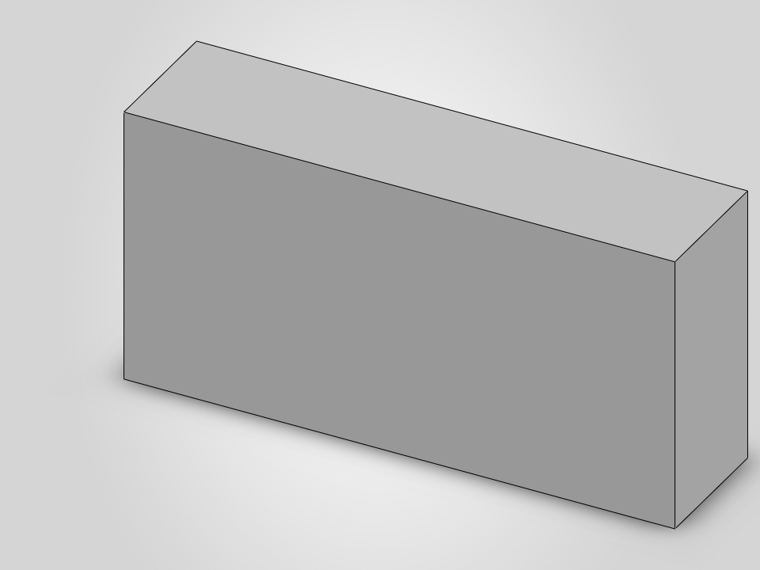
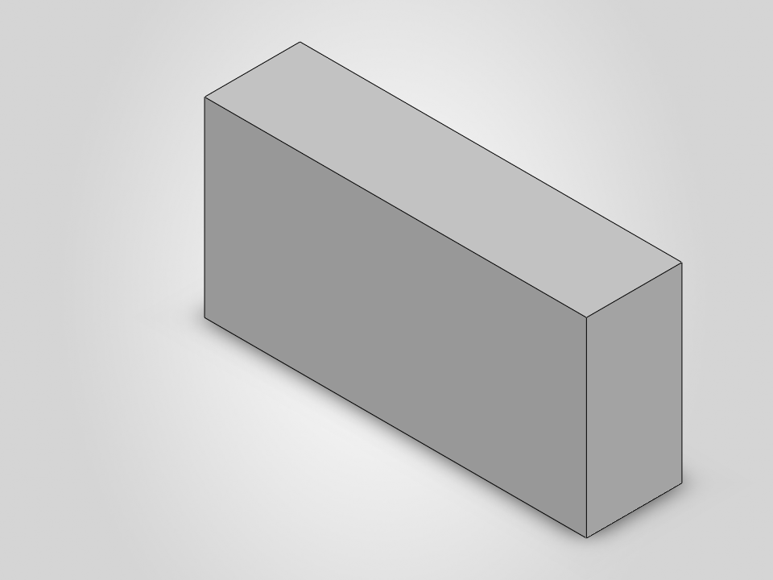
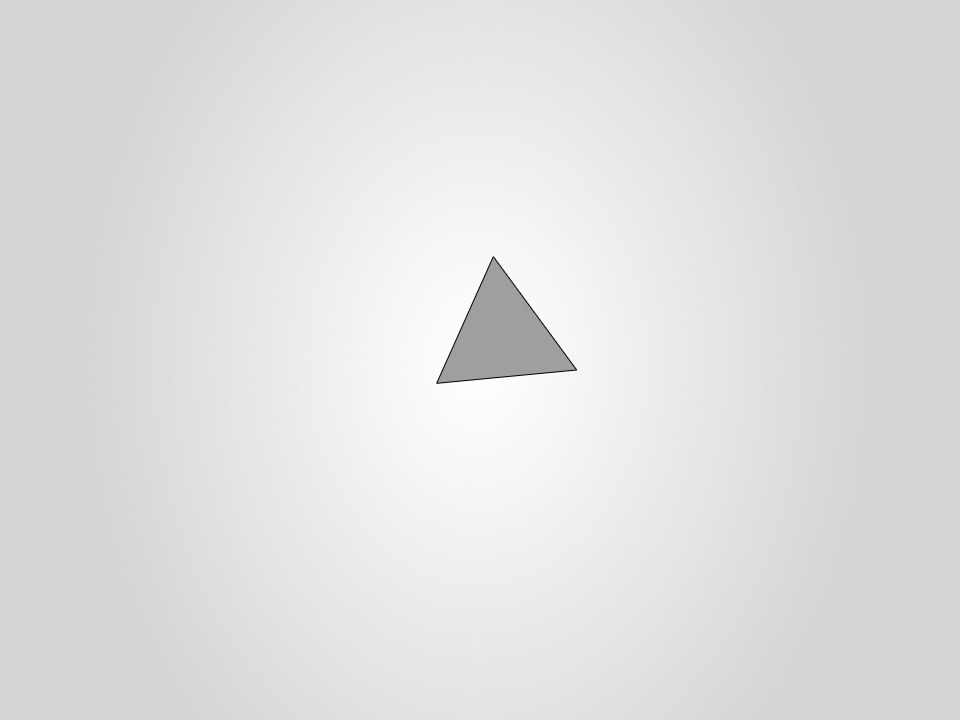
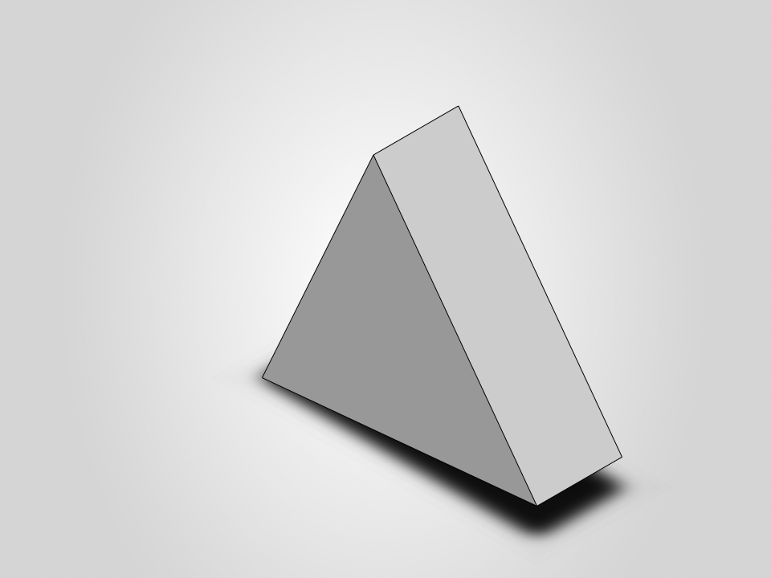
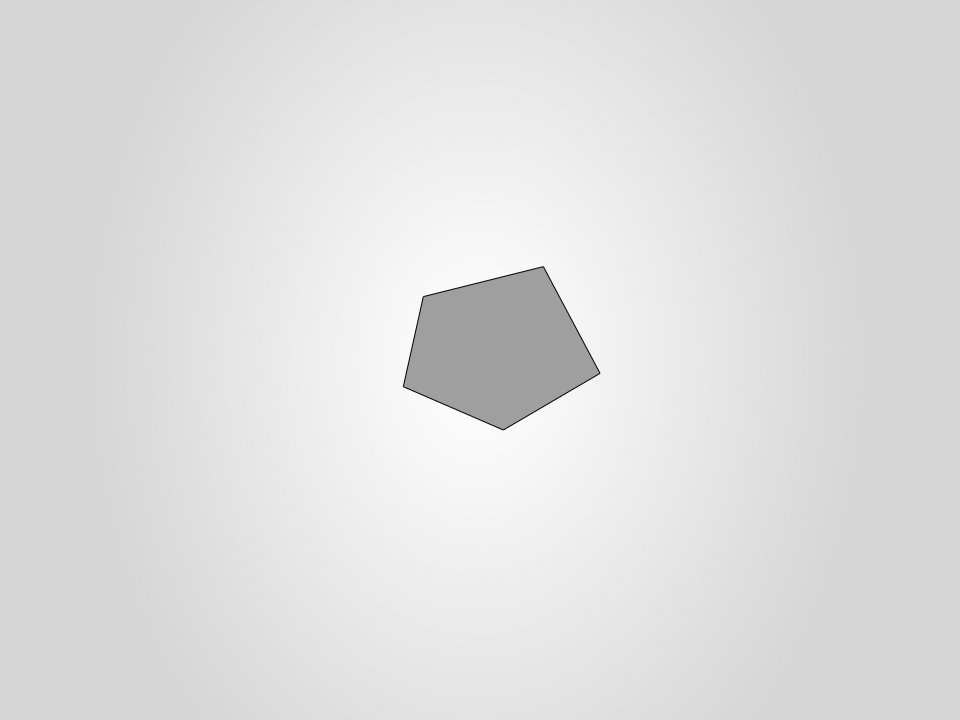
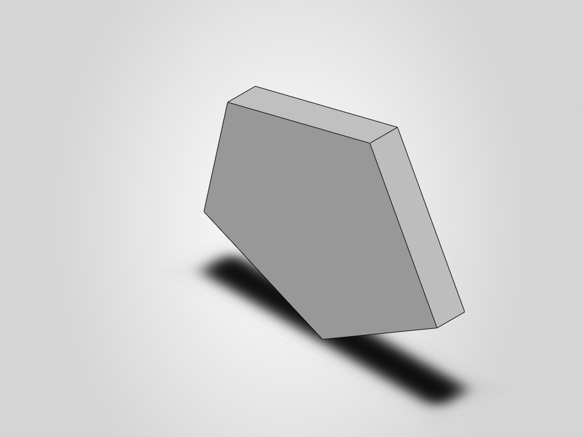
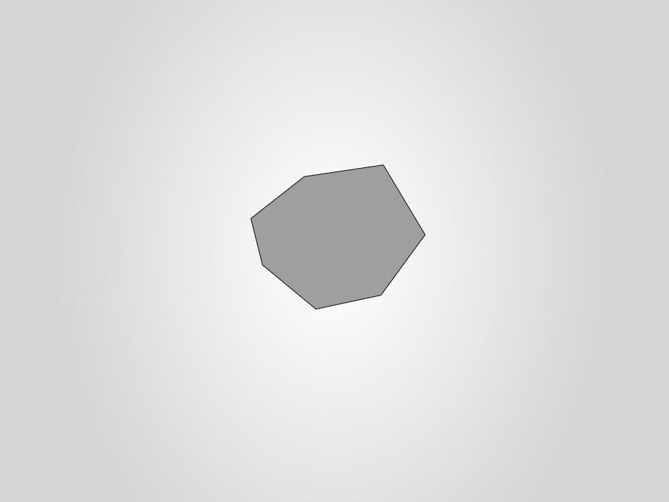
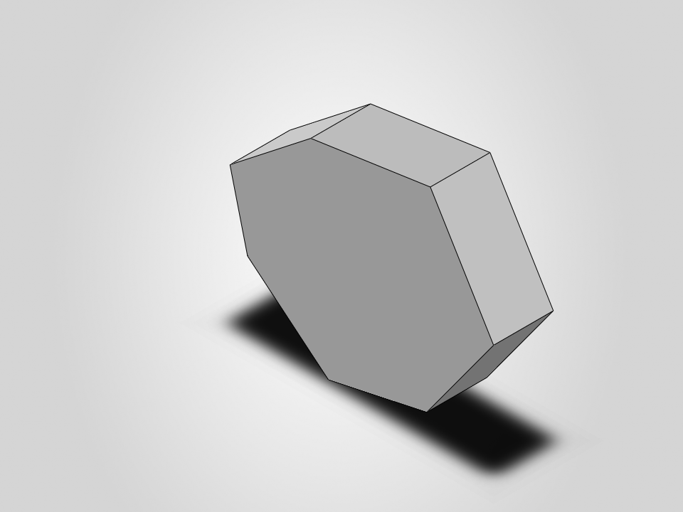

# SOLIDWORKS 2026 canonical-view measurements

Status: **bounded named-view parity measured for three generated polygon parts; the full CAD goal remains unfinished**

This batch measures source revision `b9a599fdc95f8f8aa6534343568ba6c9ca11bb49`.
It does not establish geometry, dimension-edit or reopen acceptance for later revisions.
The production SOLIDWORKS adapter remains read-only.
No curve or assembly writer acceptance is established.

## Evidence and provenance

The completed owner-controlled batch is `ViewsNegativeHalf03`.
Its native authority is `native-visible-document-viewport`.
The measurement window is 2026-11-15 19:48:26–19:50:42 UTC.
The publication agent did not launch, attach to or automate the CAD application.

| Artifact                                       | Content and authority                                                                                               |
| ---------------------------------------------- | ------------------------------------------------------------------------------------------------------------------- |
| [NativeViewReport.json](NativeViewReport.json) | Native results, with only 15 source/BMP path replacements and JSON reserialization                                  |
| [Analysis.json](Analysis.json)                 | Derived numeric comparisons, array validation, image identities and scope limits                                    |
| [Provenance.json](Provenance.json)             | Original source hashes, generator/inspector identities, staging-snapshot distinction and owner inspection statement |
| [BaselineInputs.json](BaselineInputs.json)     | Independent prior baseline metrics and neutral polygon models from `Edits0af/EditJob.json`                          |
| [ImageManifest.json](ImageManifest.json)       | Original BMP and published PNG hashes, byte counts, dimensions and conversion provenance                            |
| [Analyze.py](Analyze.py)                       | Standalone, standard-library-only measurement analysis; no CAD calls or repository imports                          |

The external original native report has SHA-256
`7b690c431d7997827058763239945d2c3135f1273cefcc883b9fd0cb150f044b`.
The published JSON has a separate digest in `Analysis.json` because home-share paths were removed.
The logical `external-inputs/` and `external-originals/` paths do not denote files shipped in this directory.
No held-out native source document or stream was inspected for this publication.
Only measurements, neutral inputs, existing metadata and images were read.

The generator and inspector source revision is `b9a599fdc95f8f8aa6534343568ba6c9ca11bb49`.
The [remote job](https://github.com/TryUniCAD/Kit/actions/runs/43731969072/job/132866188827)
produced [artifact 14168208508](https://github.com/TryUniCAD/Kit/actions/runs/43731969072/artifacts/14168208508).
Its synthetic revision is `438e6982d3edd771689abce500d639ce4ab8dfba`, with parents
`f324fe6fe07bc2515147fcd7c6b213a31c8c1f8f` and the generator source revision.
The artifact digest is GitHub metadata; its archive bytes were not independently rehashed here.
All three staged inspector-tool hashes and lengths matched the original manifest.

`Provenance.json` retains selected original staging fields as a **pre-run snapshot**.
Its `oracle_measurements_started=false` and staging-only limitation describe that earlier snapshot.
They do not describe the subsequently completed native batch.
The report's completed rows and timestamps supply the measurement evidence.

## Native outcomes

All five rows opened with zero errors and zero warnings, rebuilt successfully and returned one solid body.
Every recorded feature had zero error, no warning and no suppression.
The two controls had 19 features each; the three candidates had 20 each.
All five source hashes were unchanged after inspection.
The report records no exceptions, cleanup errors, controller diagnostics, dialogs or progress windows.

| Case          | Process ID | Features | Volume (m³)             | Area (m²)              | Center of mass (m), rounded for display                               |
| ------------- | ---------- | -------- | ----------------------- | ---------------------- | --------------------------------------------------------------------- |
| ControlBefore | 9264       | 19       | `8.000000000000001e-6`  | `0.0028`               | `(0, 0, 0.005)`                                                       |
| H3_scalene    | 8636       | 20       | `9.932000000000002e-6`  | `0.003166276360558158` | `(0.006666666666666669, 0.007000000000000002, 0.0065)`                |
| H5_irregular  | 4492       | 20       | `1.31635e-5`            | `0.004932190747600379` | `(0.005411149516972432, 0.0033525658069662317, 0.0035)`               |
| H7_irregular  | 3980       | 20       | `5.3796500000000006e-5` | `0.009896349327158964` | `(0.0014406699320587766, 0.006562595460051614, 0.008499999999999999)` |
| ControlAfter  | 11204      | 19       | `8.000000000000001e-6`  | `0.0028`               | `(0, 0, 0.005)`                                                       |

Each row records a different process ID and creation identity.
Every executable identity matches `34.5.2.0604`, x64 PE machine `0x8664`, and SHA-256
`3f6844591c7456a476bdc141817a21c3c10f770e12347a698eef5ea8ad60d1fe`.
The controls' complete mass-property records are identical.

Each candidate's volume, area and center of mass match the independent prior baseline within declared tolerances.
They also match a separate polygon-area, perimeter and centroid calculation from the neutral model.
The recorded extrusion depths are `0.013`, `0.007` and `0.017` metres for H3, H5 and H7 respectively.
This batch reads those dimensions; it does not edit them.

## Named-view parity

All nine returned standard-view rotations, IDs 1 through 9, are finite numeric arrays of length nine.
Both capture phases supply them for every row: 90 arrays in total.
The ten active-transform arrays are finite numeric arrays of length sixteen.
Unavailable-query records and nonnumeric values would fail the analysis instead of becoming parity evidence.

Every candidate view was compared with the corresponding view from both controls, before and after selection.
The largest absolute coefficient discrepancy is `7.888609052210118e-31`.
The two controls differ by exactly zero.
The declared absolute rotation tolerance is `1e-12`.
All standard-view arrays are unchanged between the initial and selected-view phases.

The staged inspector called `ShowNamedView2("", 7)`, zoom-to-fit and graphics redraw before the second capture.
Every resulting active rotation's first nine coefficients equal its own isometric target exactly.
These measurements confirm the negative-half-angle canonical targets for this bounded generated batch.
They do not supply coefficients for the writer or prove matrix-byte identity.
View ID zero was not queried.

The initial active camera is different.
Candidates initially returned identity rotation while the controls returned their existing non-front orientation.
The initial candidate/control maximum coefficient difference is `0.5150380749100181`.
Initial active-camera parity is therefore **not claimed**.

## Images and visual inspection

The oracle owner manually inspected all ten original staged PNGs.
Both controls show a visible cuboid initially and an isometric cuboid after selection.
All three candidates initially show a small, nonempty front-facing polygon.
After isometric selection and zoom, all three show visible extrusion depth and side faces.
The publisher records that owner inspection and did not repeat it independently.

The original BMPs remain external.
Their hashes and sizes were rechecked against the native report.
The owner converted them to lossless PNG with macOS `sips` for display.
All ten PNGs were copied unchanged, and the analysis rechecks their digests and dimensions.
Independent decoded-pixel equality between BMP and PNG was not measured here.
No image generation or image editing was used.

| Case          | Initial capture                                                              | After isometric selection and zoom                                 |
| ------------- | ---------------------------------------------------------------------------- | ------------------------------------------------------------------ |
| ControlBefore |           |       |
| H3_scalene    |    |    |
| H5_irregular  |  |  |
| H7_irregular  |  |  |
| ControlAfter  |             |         |

## Reproduce the analysis

From the checkout root, run:

```sh
python3 re/solidworks/measurements/2026/CanonicalViews/Analyze.py
pnpm dlx prettier@3.6.2 --write re/solidworks/measurements/2026/CanonicalViews/Analysis.json
```

The command reads only the published JSON, PNGs and its own source.
It rewrites `Analysis.json` and does not open CAD files or contact the oracle.
It computes baseline metrics from neutral polygon inputs rather than opening held-out native documents.
Invalid lengths, nonnumeric rotations, ambiguous dimension readback or missing inputs raise an error.
The native measurements are not rerun by this command.

Rotation and depth comparisons use absolute tolerances of `1e-12`.
Geometry comparisons use `max(absolute tolerance, 1e-9 * abs(expected))`.
The absolute geometry tolerances are `1e-15 m³`, `1e-12 m²`, `1e-12 m` and `1e-15 kg`.
`Analysis.json` keeps every expected value, measured value, difference and effective tolerance.
These comparisons are derived analysis of an existing batch, not local execution of product tests.

## Acceptance boundary

The [CAD success criteria](../../../../../Documentation/Reference/Operations/CadSuccessCriteria.md)
state the stopping conditions exactly:

> There are two acceptable stopping conditions.
> The first is success under every criterion on this page.
> The second is the end of the available context.

Named-target parity and visible selected-view geometry are **confirmed** for the stated source revision and three polygon cases.
The evidence does not establish the complete goal, later-source geometry/edit/reopen behavior, initial-camera parity or production writer support.
The refuted positive-half-angle history remains in the
[construction record](../../../records/StandardViewsConstruction2026.md).
The [change entry](../../../../../Documentation/Changes/Solidworks/Inspection/SolidworksCanonicalViewMeasurements.md)
describes the published evidence and its use.
