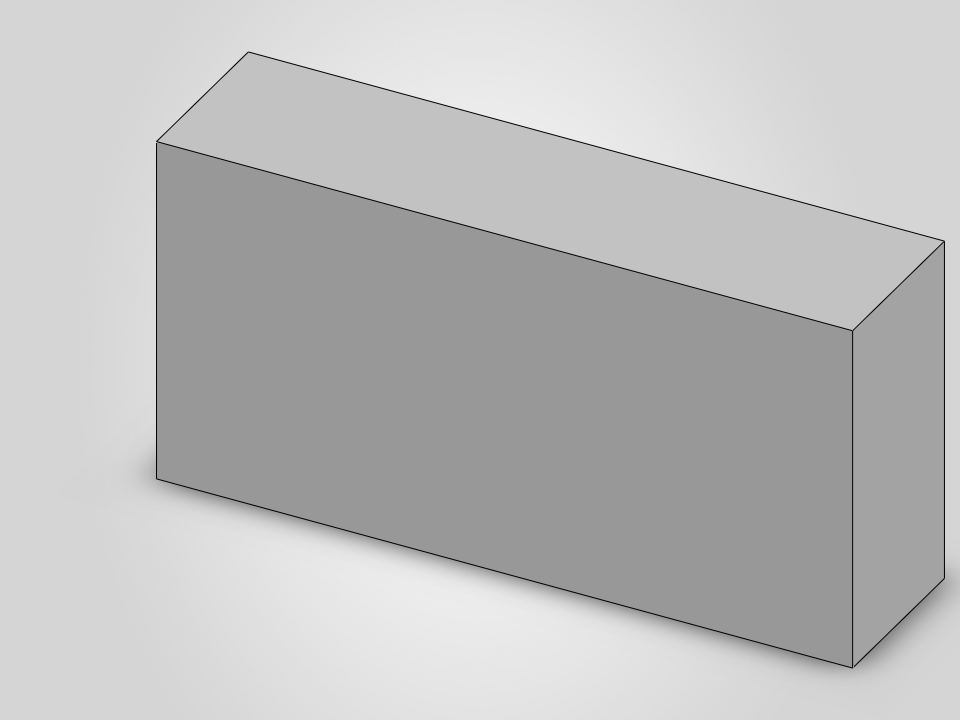
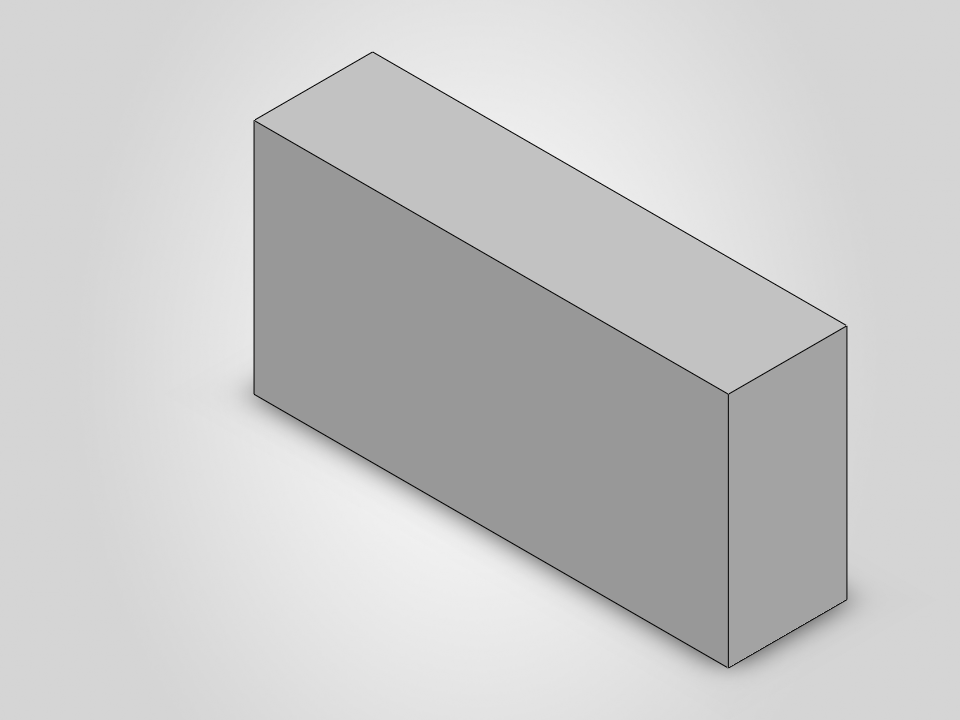
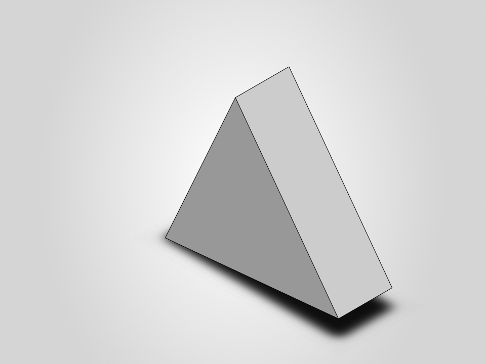
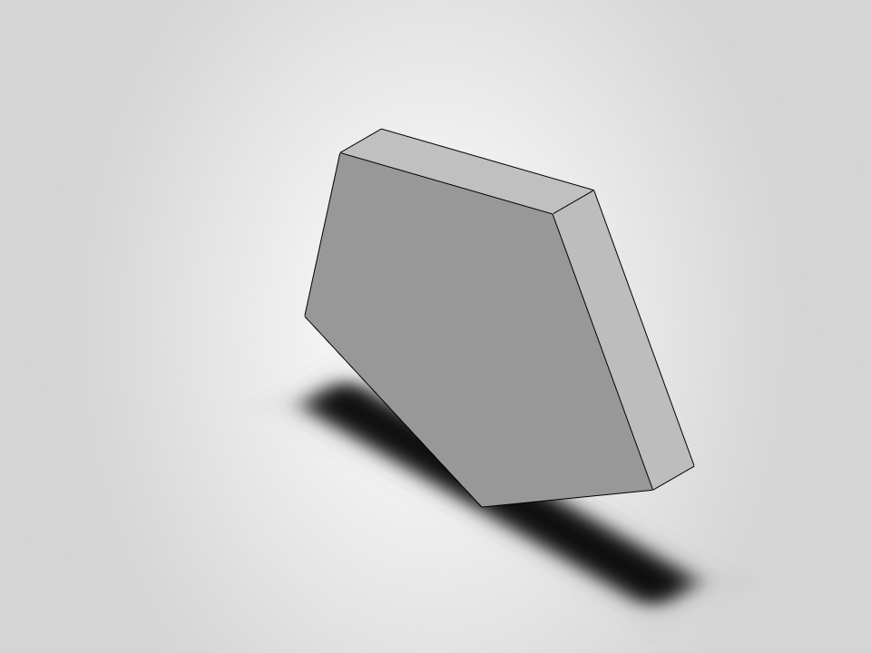
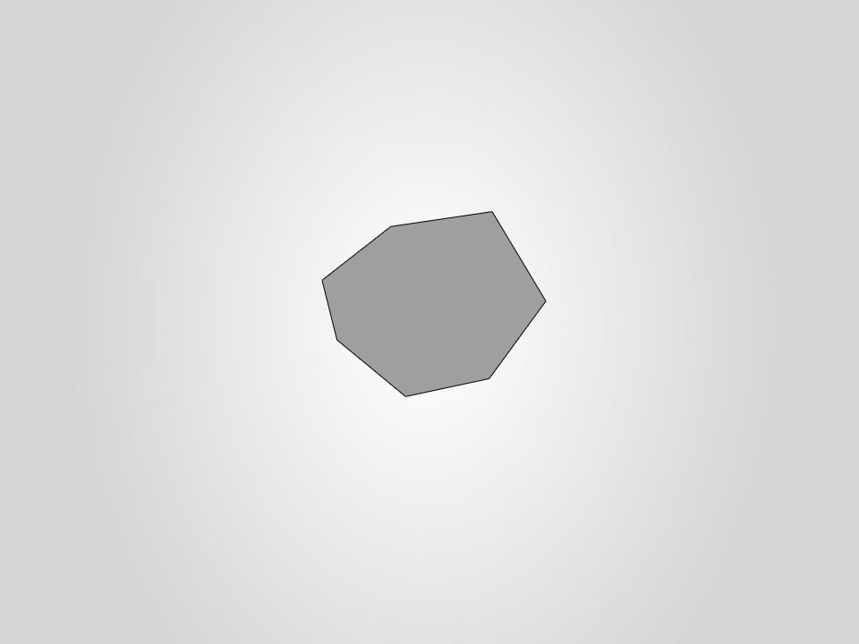
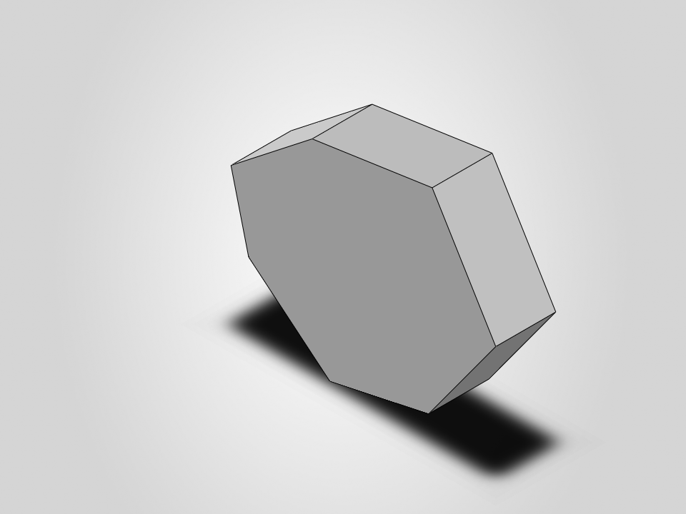

# Current polygon geometry, views and depth edits

Full CAD acceptance remains unfinished. Three generated polygon parts pass the bounded geometry, canonical-view and depth-edit/save/reopen measurements below; their material-folder labels change after native save, and the production SOLIDWORKS adapter remains read-only.

## Source and artifact identity

The measured generator and inspector source is `b23e72c609caca0d0ca4acf871e9680a325f0548`.
Its artifact `14177624347` belongs to [run 43756383239](https://github.com/TryUniCAD/Kit/actions/runs/43756383239), synthetic merge `2179cb75a8501f83d78eacbdeb67f533a94246cc`.
The oracle owner independently verified that the three candidate files in artifact `14180956560` from head `033b97679263fe31d7c4fb46899470be6c2923c5` are byte-identical to these measured inputs.
That artifact belongs to [run 43761751165](https://github.com/TryUniCAD/Kit/actions/runs/43761751165) and synthetic merge `00d1f12ca6b516ee3b0559e90f46a2b67848d0d6`.
This equivalence covers only the three named files, not every artifact or later revision.

| Candidate    | Bytes | SHA-256                                                            |
| ------------ | ----: | ------------------------------------------------------------------ |
| H3_scalene   | 7,618 | `0605bd78a63b6d7e25e05d5000d948e555a8c7f1157d41154436a437920e7c73` |
| H5_irregular | 7,687 | `0957e8ba435cd9dbbbe10b13a3742a26d8dc0c0d95689e38e4b93353c2120f6d` |
| H7_irregular | 7,782 | `e9f9f23bae737109f03425040de1066ab267f212183ca55d7ec713f6f99ff000` |

[ArtifactIdentity.json](ArtifactIdentity.json) records the verified parents, tree, artifact metadata and full-file byte comparison.
Archive digests are GitHub metadata; the downloaded archive ZIP was not independently rehashed.
The original independent native control is pinned by SHA-256 `c0472f9f42bf473a9073adb997180040b7767dfae93310610f77cff9509bec57`.

Every measured process reports SOLIDWORKS 2026 SP05.2, executable build `34.5.2.0604`, x64 machine `0x8664` and executable SHA-256 `3f6844591c7456a476bdc141817a21c3c10f770e12347a698eef5ea8ad60d1fe`.
The oracle owner drove the Windows 11 VM from macOS through current-user Parallels execution and COM.
This publication agent did not access the oracle or native source streams.

## Native batches

| Batch                                |              Recorded rows | Controls                 | Result                                                                                                          |
| ------------------------------------ | -------------------------: | ------------------------ | --------------------------------------------------------------------------------------------------------------- |
| Fresh heptagon geometry repeat       |                          3 | Healthy before and after | All rows opened and rebuilt with one body, zero load or feature errors/warnings and zero `GetWhatsWrongCount`   |
| Visible canonical views              |                          5 | Healthy before and after | Three candidates and two controls opened and rebuilt cleanly, each with one body and unchanged input hash       |
| Depth edits and saved-copy reopening | 11 fresh process lifetimes | Healthy before and after | All three baselines, depth edits and reopened saved copies match geometry predictions; sources remain unchanged |

No batch records a dialog, progress window or cleanup diagnostic.
Candidate trees contain 20 reported entries; controls contain 19.
These counts include native system folders and do not mean 20 authored modeling features.
The raw reports retain every reported node, error, warning, dimension and process creation identity.

The earlier [interrupted batch](../PolygonCurrentInterruption.json) remains historical evidence.
Its missing trailing control prevented crash attribution.
The fresh heptagon geometry repeat and subsequent view/edit batches do not reproduce that disconnect.
They do not identify its cause.

## Geometry and edit measurements

Independent neutral polygon inputs are retained in [BaselineInputs.json](BaselineInputs.json).
The analyses recompute signed polygon area, perimeter and centroid, then prism volume, surface area and center of mass from those inputs.
No native source streams are read or used as writer templates.

The edit is `D1@Boss-Extrude1` multiplied by `1.25`: H3 `0.013 → 0.01625 m`, H5 `0.007 → 0.00875 m` and H7 `0.017 → 0.02125 m`.
Each edited copy is saved cleanly and reopened in a fresh process.
Every snapshot has one body.
Reopened mass properties equal the corresponding edited values shown here.

| Case and stage     |             Volume (m³) |              Area (m²) | Center of mass (m)                                                    |
| ------------------ | ----------------------: | ---------------------: | --------------------------------------------------------------------- |
| H3 baseline        |  `9.932000000000002e-6` | `0.003166276360558158` | `(0.006666666666666669, 0.007000000000000002, 0.0065)`                |
| H3 edited/reopened |             `1.2415e-5` | `0.003575845450697697` | `(0.006666666666666669, 0.006999999999999999, 0.008125000000000002)`  |
| H5 baseline        |            `1.31635e-5` | `0.004932190747600379` | `(0.005411149516972432, 0.0033525658069662317, 0.0035)`               |
| H5 edited/reopened |          `1.6454375e-5` | `0.005224988434500474` | `(0.005411149516972433, 0.00335256580696623, 0.004375)`               |
| H7 baseline        | `5.3796500000000006e-5` | `0.009896349327158964` | `(0.0014406699320587766, 0.006562595460051614, 0.008499999999999999)` |
| H7 edited/reopened |  `6.724562500000002e-5` | `0.010788186658948706` | `(0.001440669932058777, 0.0065625954600516114, 0.010624999999999999)` |

The control volume is `8.000000000000001e-6 m³`, area `0.0028 m²` and center `(0, 0, 0.005) m` before and after each batch.
Geometry comparisons use relative tolerance `1e-9`, with absolute floors `1e-15 m³`, `1e-12 m²` and `1e-12 m`.
Depth readback uses absolute tolerance `1e-12 m`.
The full recorded numbers and tolerances are in [Analysis.json](Analysis.json), [GeometryAnalysis.json](GeometryAnalysis.json) and [EditAnalysis.json](EditAnalysis.json).

Feature type order and the count of 20 entries survive editing and saved-copy reopening in all three cases.
The edited live tree retains its initial names.
On reopening, index 12 changes from `authored material` to `Material <not specified>` for type `MaterialFolder`.
All other reported names are unchanged.
Full feature-name preservation is therefore not claimed.
The [material-folder gotcha](../../../../../Documentation/Gotchas/Conversion/Solidworks/Model/MaterialFolderNameChangesOnSave.md) records this measured normalization without inferring its implementation cause.

## Canonical views and visual inspection

All 90 standard-view arrays are finite numeric arrays of length nine.
All ten active transforms are finite arrays of length 16.
Every candidate matches both controls across all nine standard views, before and after view selection, within absolute coefficient tolerance `1e-12`.
The largest coefficient discrepancy is `7.888609052210118e-31`.
Each selected active rotation matches its own standard isometric rotation.

The oracle owner visually inspected all ten PNGs.
Controls show nonempty cuboids with depth.
Candidates initially show small nonempty front-facing polygons; selecting standard view 7 and zooming shows extrusion depth and side faces for all three.
Initial active-camera parity with the controls is not established.

| Case           | Initial viewport                                            | Selected isometric viewport                           |
| -------------- | ----------------------------------------------------------- | ----------------------------------------------------- |
| Control before |  |  |
| H3             |           |           |
| H5             |         |         |
| H7             |         |         |
| Control after  |    |    |

The PNGs are unchanged copies of the oracle owner's `sips` format conversions from native BMPs.
The original BMPs remain external.
[ImageManifest.json](ImageManifest.json) binds the original and published hashes, sizes and PNG dimensions.
Decoded-pixel equality between formats was not independently measured.

## Evidence and reproduction

| Native evidence           | Original SHA-256                                                   | Published report                                     |
| ------------------------- | ------------------------------------------------------------------ | ---------------------------------------------------- |
| Visible views             | `33e2af2cfed4f5cea5b66e543e72e7888449e16a2a0a6ba1cef8682f3c61ef2e` | [NativeViewReport.json](NativeViewReport.json)       |
| Fresh heptagon geometry   | `998fd0b3b18a240938d198b9c31bd6255efd261ab7e545061dcc6da8e1f5941e` | [FreshGeometryReport.json](FreshGeometryReport.json) |
| Depth edits and reopening | `136484f02e546679352db915731e99e0947f7b1801034ee982e639f756586f82` | [EditReport.json](EditReport.json)                   |

[Provenance.json](Provenance.json) distinguishes original hashes from published bytes and lists every private-path replacement.
All remaining original report values are retained.
The original source manifest's false `native_measurements_started` flag is explicitly a pre-run staging snapshot.
It is not the completed measurement state.

The standalone analysis scripts read only this published bundle and neutral inputs.
They do not import product modules, drive CAD or run tests.
From this directory, regenerate their derived JSON with:

```sh
python3 Analyze.py
python3 AnalyzeGeometry.py
python3 AnalyzeEdits.py
pnpm dlx prettier@3.6.2 --write Analysis.json GeometryAnalysis.json EditAnalysis.json
```

These commands reanalyze measurements; they do not repeat the native experiments.
Publication verification checks JSON values, hashes, numeric comparisons, image bindings, syntax, formatting and local documentation links.
No local product or unit tests ran.

## Limits

This is bounded research evidence for three generated polygon blind extrusions and one depth edit per case.
It does not establish lossless conversion, complete feature-name preservation, sketch dimension edits, all feature families, assemblies, configurations, materials, appearances, equations or the requested repository-wide conversion corpus.
It does not promote the SOLIDWORKS adapter to a writer.
The full CAD goal, curve source lock and Kit-written curved-sketch acceptance remain separate work.

The [CAD success criteria](../../../../../Documentation/Reference/Operations/CadSuccessCriteria.md) still require every criterion at once.
Their stopping conditions remain “success under every criterion on this page” or “the end of the available context”.
