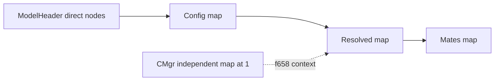

# Ordinary version-19000 CMgr body grammar in the SDK

The SDK reads and serializes the complete exercised configuration-manager graph
without saved field programs. Full linked model and writer qualification remain
unfinished. This tranche records structure and metadata, not a new native
application result.

## Ownership and stopping conditions

Task: `B04-SW2026-CMGR`, owner `/root/flag_ownership`, delivery PR #121.
The takeover root owns publication, the Windows oracle and shared registers.
Dependencies are the current 2026 owner rules, the shared archive object/map
model, the header handoff, shared scalars and the ordinary context/map closure.
The child exit condition is exact typed manager parity, alias preservation,
real process verification and honest profile diagnostics. The parent CAD goal
remains open.

The complete CAD criteria and RE playbook govern this work. The stopping
conditions remain: “The first is success under every criterion on this page.”
and “The second is the end of the available context.” Missing grammar remains
work. This phase used repository source and disclosed archives only. It did not
open native executables, use the VM, call CAD/COM, inspect held-out payloads or
change licensing state. No Hopper target was opened or owned.

## Provenance and native scope

The bound release is SOLIDWORKS 2026 SP05.2, file version `34.5.2.0604`, ordinary
archive version `19000`. This port uses existing native evidence and independently
authored field rules. It does not infer fields from a saved row or use 2025
findings without the current-version binding.

| Module            | SHA-256                                                            |
| ----------------- | ------------------------------------------------------------------ |
| `sldmodu.dll`     | `569a081928ad24afac5408cc15a1034d18e89b2c5001428a64115a3cc497067e` |
| `sldarchiveu.dll` | `5f743916826fd26a25c8d4792ada785d414d1c718c32495e481b1c5dc512ac48` |
| `sldmfcu.dll`     | `af2148c7f429e017e75de45b27acf4105b80457fa510dffaa25db88c387a9735` |
| `swccu.dll`       | `d5a8a3f3c9e4f108650242dab99ae8f9c9b8edb0e3fd2e04c185964f79d1ba7c` |

The current [class map](../../data/Serialization/SerializeMap2026.json) binds
manager serialization to `sldmodu!0x4c21ef40`, base configuration to
`0x4c217e30`, part configuration to `0x4c228a30`, assembly configuration to
`0x4c221a20`, configuration object to `0x4c21dfc0`, feature serialization to
`0x4bb11aa0`, and configuration options to `sldmfcu!0x3c7c6310`.
These are existing pinned dispatch identities; this source port did not repeat
their native inspection.

The [scalar census](LinkedGraphScalarConstruction2026.md) identifies 299 reached
schemas in 32 research modules across twelve disclosed/generated files.
CMgr accounts for 46 of those schemas. The owner layouts come from the current
`SmallCMgr`, `ResolvedCore`, `ConfigAssembly`, `ExtObject`, `VisualRefs`,
`CommonPartOwners2026`, `Geometry`, `MaterialDisplay`, `MfcMaps` and shared
container definitions. Their independently documented native evidence includes:

- [Model and configuration construction](ModelConstruction2026.md)
- [Ordinary occurrences and separate CMgr wrappers](OrdinaryOccurrenceConstruction2026.md)
- [Planar reference-chain field order](PlanarMateReferenceChains2026.md)
- [Current context-chain and framework map rules](ContextAndStringMapArchive2026.md)
- [Common component owner](CommonPartOwners2026.md)
- [Material/PBR and visual fields](MaterialDisplayArchive2026.md)
- [Framework counts](MfcCountArchive2026.md)
- [Configuration name, comment and description owners](ConfigurationManagerHeader2026.md)

The accompanying receipt binds the actual ported sources and the exercised
schemas. Structural reproduction is confirmed for those disclosed paths.
Unexercised branches, full field meanings, synthesis domains and C10/native
acceptance retain their prior partial or unqualified status.

## Graph and framing rules

The root is one concrete `RuntimeClass("moConfigurationMgr_c", 1)`.
Its object archive starts at map base 1 and must consume the entire stream.
`ArchiveNode`, `RuntimeClass`, shared count/scalar/string/tag codecs and
`ArchiveMaps` own all nodes, primitive representation and map allocations.
Registration precedes body traversal, preserving aliases and cycles.
Serialization starts a fresh map and computes all indexes from the actual graph.
No saved operation list, offset patch or raw tail is available.

The 16 admitted concrete descriptor classes all use schema 1. The other
exercised names are base or embedded method grammars; they are not additional
object headers. `ExternalClass` placeholders never acquire admission by name.
The generic reader's optional node factory permits research `Obj` subclasses
while retaining the same nodes and map entries. It does not copy payloads or
materialize `MutableMapping` providers.

The registry contains current native field order, scalar kinds, field names,
embedded owners, repetition rules and explicit context/virtual conditions.
Per-document field values always come from the typed node. The external-file
and configuration-pair fields reuse the SDK header vocabulary. The concrete
manager/configuration virtual table determines the inherited lightweight/XML
helper, rather than an RTTI-parent guess.

Vendor counts keep the 16/32-bit grammar. `su_CMapStringToInt` uses the separate
framework 16/32/64-bit count. Counts derive from row lengths on store; equivalent
negative signed count words retain their original raw representation where the
native reader uses a positive iteration bound. The existing ten-million-row
safety limit remains. Split high/low counts keep their native order.

The three normalized Boolean fields retain their original `#wire` word.
Unchanged normalized values re-emit that word. A modeled edit emits the edited
value. This does not apply runtime fixups to the generic archive or declare a
constructor default. Context-chain `f48`, stamps and other wire fields remain
raw; native owner restoration and normalization remain separate.

## Conditional closure and metadata

The public codec requires explicit version 19000. Ordinary non-DB archive mode
is the entry contract. The current profile exposes no drawing/helper mode
selector. Reached context masks, flag-controlled optional records and concrete
virtual calls remain in the grammar. Unknown paths fail before a graph or byte
result is returned.

The current conditional dependency boundary names are `mConfigCosmeticThread`,
`mConfigScaleFactor`, `mgPlane_c.restore`, `mgXform_c.restore`,
`mo3DPrintSettings_c.load`, `moBaseConfiguration_c.f610`, `moBodyChooser_c`,
`moConfigLimitMate`, `moCustomProperty`, `moNodeList_c.Serialize` and
`uoMaterialTextureProperties.restore`. Their absent/empty branches are fully
represented. Reaching a missing grammar rejects this SDK profile; no empty
replacement or captured bytes are emitted.

`moExtFeature_c` retains the previously proven ordinary CMgr profile. It must
belong to a `moConfiguration_c` feature list under the active manager context,
use the containing-file representation and real CString handle, and have its
CMgr-specific null `f50`. The guard is a limit on accepted source graphs, not a
set of output defaults. Other external-feature contexts remain unqualified here.

Metadata follows `root.f370.items[].o`, the actual configuration node name
`f18.f08`, native ID `f08`, comment `f4a8`, alternate name `f498` and stored
feature description `f1f8`. `f4a8` is a comment even though an older builder
parameter calls its supplied string `description`; the native manager-header
proof distinguishes those owners. Pointer-selection booleans compare actual
node identities with `root.f360` and `root.f368`. The manager's raw `f658` is
reported as the resolved-body mapping context.

Normal part and assembly SDK reads expose this result before source-retention
fingerprints are computed. Existing semantic projections remain unchanged.
An unsupported manager adds an explicit informational diagnostic and a failed
typed dependency status. It does not make the compatibility projection a
fully admitted graph. Drawings and embedded carrier paths keep their earlier
dispatch. The production adapter remains read-only.

## Research bridge and usage

`CmgrBridge` supplies the actual SDK graph to the research CMgr plan and the
resolved-stream prerequisite read. The inherited Config map is never replaced
with the manager map. Current `Obj` compatibility properties and object spans
remain available without copying nodes.

Only a `BodyUnsupported` profile exception selects the previous independent
typed research grammar. Malformed admitted data still raises an archive error.
The compatibility result records `admitted: false` plus the SDK diagnostic.
This is a research grammar path, not an opaque or donor fallback in production.
Its ordinary byte/schema proof does not establish SDK profile admission.

Each research usage snapshot has `shared_schema_usage` records. Successful SDK
schema names join the actually used name set. Native SDK schema totals and
field-operation totals remain in their own report, instead of invented research
operation paths. Traditional research provisional/profile checks still apply
to every traditional execution. Failed SDK attempts remain explicitly separate.
Fresh load/store contexts prevent borrowed coverage. No source inspection or
file reads occur inside the body codec.

## Verification and remaining work

Twelve custody-checked A17–A19 and generated parent/child managers reproduce
identical bytes, with all 46 schemas reached in both directions and no missing
or provisional SDK schema. The surrounding 36 Config/CMgr/Resolved comparisons
and six populated mate-list comparisons pass. A strict linked field inventory
binds 163 implementation sources. The authored four-document repeated nested
process passes 36 comparisons with zero runtime input reads and byte-identical
stdout before and after the bridge.

The permanent process regression generates a new Unicode-named distance pair,
checks typed manager bytes and aliases through the actual CLI, opens its child
through the normal SDK, and opens an independently generated unmated assembly
through the normal SDK. Truncated and unknown-class full containers fail the
typed check, publish no successful receipt and retain explicit compatibility
diagnostics. A distance-mate normal-read assertion initially exposed the older
`mate ... has no entities` boundary; it was not relaxed. The documented case
separates that unfinished mate projection from CMgr metadata.

A separately authored extra-root syntax case is rejected by the SDK's one-root
profile. The existing typed research path reads and re-emits both roots exactly,
while both shared-codec usage records remain explicitly unadmitted and
incomplete. This exercises the compatibility boundary, not native acceptance
of that discovery file. The first bridge integration also exposed a missing
custom-plan `archive` keyword; the bridge signature now accepts the existing
caller contract. The assertions were retained.

See [SdkCmgrGraph01.json](../measurements/2026/SdkCmgrGraph01.json) for exact
source and artifact hashes, checks and limitations. No new native application
or held-out writer acceptance is transferred. The next dependency is promotion
of the remaining Config/Resolved/Mates body grammars, followed by actual normal
SDK typed semantic admission. Parent C3–C10, full field classification, drawing
acceptance and generated conversion totals remain unfinished.
